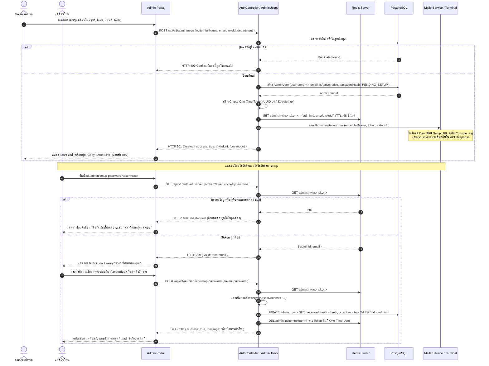
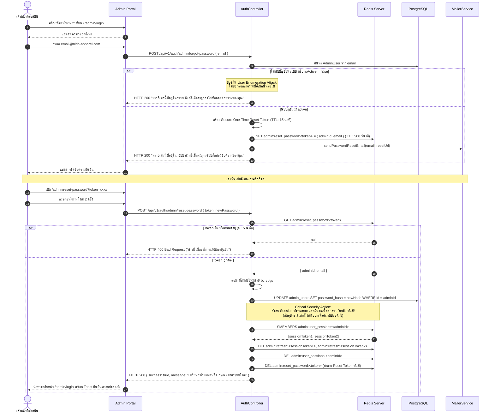

# Nida Admin Authentication & RBAC System — Implementation Plan
## Dual-Token (JWT + Redis Session), Refresh Token Rotation, Email Invitation & Password Lifecycle

> **เอกสารแผนงานสถาปัตยกรรมและคู่มือการพัฒนาระบบรักษาความปลอดภัย การยืนยันตัวตน (Authentication), การจัดการ Session ด้วย Redis, Refresh Token Rotation, การเชิญแอดมินใหม่ (Admin Invitation), การตั้งและรีเซ็ตรหัสผ่าน (Password Lifecycle) และการกำหนดสิทธิ์ (RBAC) สำหรับ Nida Admin Portal & Admin API**
>
> **เวอร์ชัน:** 2.1 (เพิ่มสถาปัตยกรรม Admin Invitation via Email, Password Setup/Reset Lifecycle with Redis One-Time Tokens & Dev-Mode Link Fallback)
> **สถานะ:** ได้รับการอนุมัติ พร้อมเริ่มดำเนินการ (Approved & Ready for Execution)

---

## 1. บทสรุปผู้บริหารและเป้าหมายเชิงระบบ (Executive Summary & Goals)

ระบบจัดการหลังบ้านของ **Nida E-Commerce** เป็นศูนย์กลางการบริหารจัดการแคตตาล็อกสินค้า สต็อกคลังสินค้า คำสั่งซื้อ และโปรโมชั่นส่วนลด ซึ่งมีความอ่อนไหวต่อความถูกต้องและความปลอดภัยของข้อมูลในระดับสูง

ระบบจำเป็นต้องใช้สถาปัตยกรรม **Dual-Token Authentication** ร่วมกับ **Redis In-Memory Session Store** เพื่อตอบโจทย์ความปลอดภัยระดับ **Enterprise-Grade** ควบคู่ไปกับประสบการณ์การใช้งานที่ลื่นไหลไร้รอยต่อ (Seamless UX) สำหรับเจ้าหน้าที่แอดมิน

### 1.1 วัตถุประสงค์หลัก (Core Objectives)
1. **Short-Lived Access Token (อายุ 15 นาที)**: 
   - ลดความเสี่ยงกรณี Access Token รั่วไหล (Window of vulnerability สั้นมาก)
   - เซ็นด้วย HMAC-SHA256 (JWT Secret) บรรจุ Payload ที่จำเป็น (`sub`, `username`, `email`, `roleCode`, `permissions`)
2. **Secure Refresh Token Rotation (อายุ 7 วัน) & Token Family Tracking**:
   - ออก Refresh Token แบบสุ่มความปลอดภัยสูง (Cryptographically Secure UUID v4)
   - **หมุนเวียน Token ใหม่ทุกครั้ง (Rotation)** ที่มีการขอ Access Token ใหม่
   - **ตรวจจับการขโมย Token (Token Reuse / Replay Detection)**: หากพบว่ามีผู้นำ Token เก่าที่เคยถูก Rotate ไปแล้วมาขอซ้ำ ระบบจะสั่งเพิกถอน Token ทั้งหมดในเครือข่ายของ User นั้นทันที (Revoke Entire Session Family)
3. **Redis In-Memory Session Management & Multi-Device Tracking**:
   - จัดเก็บ Refresh Token และ Session Metadata บน Redis พร้อมตั้งเวลาล้างข้อมูลอัตโนมัติ (TTL 7 วัน) ไม่สร้างภาระ Disk I/O และ Query Overhead ให้กับฐานข้อมูล PostgreSQL
   - รองรับการล็อกอินหลายอุปกรณ์ (Multi-Device Sessions) โดยจัดทำดัชนี Session Key ต่อ `adminId` เพื่อรองรับการดูเซสชันที่เปิดอยู่ และการสั่ง "ออกจากระบบทุกอุปกรณ์" (Logout All Devices)
4. **Admin Invitation with One-Time Token (Zero-Knowledge Onboarding)**:
   - Super Admin สร้างแอดมินใหม่โดยระบุเพียงชื่อ อีเมล แผนก และบทบาท (Role) **โดยไม่ต้องตั้งรหัสผ่านให้**
   - ระบบสร้าง One-Time Setup Token บันทึกลง Redis (TTL 48 ชม.) และส่งอีเมลเชิญให้แอดมินคนนั้นตั้งรหัสผ่านด้วยตัวเอง
   - ปลอดภัยสูงสุดตามมาตรฐาน Enterprise และป้องกันปัญหารหัสผ่านหลุดผ่านแชท
5. **Password Lifecycle & Revocation on Reset**:
   - ขอรีเซ็ตรหัสผ่าน (Forgot Password) ป้องกัน User Enumeration
   - ลิงก์รีเซ็ตเป็น One-Time Token ใน Redis (TTL 15 นาที)
   - **Critical Safety**: เมื่อรีเซ็ตรหัสผ่านสำเร็จ ระบบจะสั่ง **Revoke All Active Sessions ใน Redis ทันที** เพื่อตัดอุปกรณ์เก่าที่อาจตกค้างออกทันที
6. **Development Resilience (Email / Console / Copy Link Fallback)**:
   - โหมด Dev / Staging ไม่จำเป็นต้องผูก SMTP จริง โดย API จะพิมพ์ Magic Link ลง Terminal และส่ง `inviteLink` กลับมาเพื่อให้ Super Admin กดปุ่ม **"Copy Setup Link"** ไปทดสอบได้ทันทีในคลิกเดียว
7. **Brute-Force Rate Limiting ด้วย Redis**:
   - ป้องกันการเดารหัสผ่านหน้า Login ด้วย Sliding Window Rate Limiter (จำกัด 5 ครั้งต่อ 1 นาที ต่อ IP/Username) พร้อมส่ง HTTP 429 Too Many Requests
8. **Concurrent Silent Refresh Queue (หน้าบ้านไม่สะดุด)**:
   - เมื่อ Access Token หมดอายุและมีคำขอ HTTP ยิงพร้อมกันหลายคำขอ (Concurrent Requests) Interceptor จะระงับคำขอไว้ ส่ง Refresh Request เพียงครั้งเดียว แล้วปล่อยคำขอทั้งหมดทำงานต่อพร้อม Token ใหม่
9. **Granular RBAC & Auto-Injected Audit Trail**:
   - เชื่อมโยง `adminId` ของผู้ล็อกอินเข้าสู่ `StockMovement` (ปรับสต็อก) และ `AdminAuditLog` (ประวัติการจัดส่งและแก้ไขข้อมูล) เพื่อให้ตรวจสอบย้อนหลังได้ 100%
10. **Editorial Luxury UI (`/admin/login`, `/admin/setup-password`, `/admin/reset-password`)**:
    - ดีไซน์สง่างาม คุมโทนแบรนด์ Nida (`#2B1810` Espresso / `#FAF7F2` Cream / `#D4AF37` Amber)
    - ปราศจาก AI Slop ไม่ใช้อิโมจิใดๆ มีปุ่ม Demo Fill (1-Click) อำนวยความสะดวกในการทดสอบ

---

## 2. สถาปัตยกรรมระบบ (Architecture & Data Flow)

```
┌────────────────────────────────────────────────────────────────────────────────────────┐
│                          Nida Admin Portal (React / Vite)                              │
│                                                                                        │
│   ┌─────────────────────┐   ┌──────────────────────────┐   ┌───────────────────────┐   │
│   │  /admin/login       │   │  /admin/setup-password   │   │  /admin/reset-password│   │
│   │  Editorial Luxury   │   │  (จาก Email Invitation)  │   │  (จาก Forgot Password)│   │
│   └──────────┬──────────┘   └────────────┬─────────────┘   └───────────┬───────────┘   │
│              │                           │                             │               │
│              ▼                           ▼                             ▼               │
│   ┌────────────────────────────────────────────────────────────────────────────────┐   │
│   │                  apiClient (Axios / Custom Fetch Client)                       │   │
│   │                  - Auto Authorization: Bearer <accessToken>                    │   │
│   │                  - 401 Interceptor + Concurrent Failed Queue                   │   │
│   │                  - Silent Refresh via POST /auth/admin/refresh                 │   │
│   └──────────────────────────────────────┬─────────────────────────────────────────┘   │
└──────────────────────────────────────────┼─────────────────────────────────────────────┘
                                           │ HTTP REST
                                           ▼
┌────────────────────────────────────────────────────────────────────────────────────────┐
│                          apps/admin-api (NestJS Server)                                │
│                                                                                        │
│   ┌────────────────────────────────────────────────────────────────────────────────┐   │
│   │   AuthController & AdminUsersController                                        │   │
│   │   - POST /auth/admin/login             (Public + RateLimit)                    │   │
│   │   - POST /auth/admin/refresh           (Public)                                │   │
│   │   - GET  /auth/admin/me                (JwtAuthGuard)                          │   │
│   │   - POST /auth/admin/logout            (JwtAuthGuard)                          │   │
│   │   - POST /auth/admin/logout-all        (JwtAuthGuard)                          │   │
│   │   - POST /admin/users/invite           (JwtAuthGuard + SuperAdmin)             │   │
│   │   - GET  /auth/admin/verify-token      (Public: ตรวจสอบ Invite/Reset Token)    │   │
│   │   - POST /auth/admin/setup-password    (Public: ตั้งรหัสผ่านจาก Invite)        │   │
│   │   - POST /auth/admin/forgot-password   (Public: ขอลิงก์รีเซ็ตรหัสผ่าน)         │   │
│   │   - POST /auth/admin/reset-password    (Public: ตั้งรหัสใหม่ + Revoke Sessions)│   │
│   └──────┬──────────────────────┬─────────────────────────┬─────────────┬──────────┘   │
│          │                      │                         │             │              │
│          ▼                      ▼                         ▼             ▼              │
│   ┌──────────────┐       ┌──────────────┐          ┌──────────────┐ ┌──────────────┐   │
│   │ AuthService  │       │ MailerService│          │ RedisService │ │PrismaService │   │
│   │ - bcrypt     │       │ - Production:│          │ - Sessions   │ │- AdminUser   │   │
│   │ - JwtService │       │   SMTP/Resend│          │ - Invites    │ │- Role & Perm │   │
│   │ - Rotation   │       │ - Dev: Log & │          │ - Resets     │ │- Audit Logs  │   │
│   │ - Revocation │       │   Copy Link  │          │ - Rate Limit │ │- StockMove   │   │
│   └──────┬───────┘       └──────┬───────┘          └──────┬───────┘ └──────┬───────┘   │
└──────────┼──────────────────────┼─────────────────────────┼────────────────┼───────────┘
           │                      │                         ▼                ▼
           │                      │                ┌──────────────────┐┌──────────────────┐
           │                      │                │  Redis 7 Alpine  ││  PostgreSQL 16   │
           │                      │                │  (Port 6379)     ││  (Port 5432)     │
           │                      │                │  - Refresh Tokens││  - admin_users   │
           │                      │                │  - Invite Tokens ││  - roles & perms │
           │                      │                │  - Reset Tokens  ││  - stock_move    │
           │                      │                │  - Rate Limits   ││  - audit_logs    │
           │                      │                └──────────────────┘└──────────────────┘
           ▼                      ▼
    ┌──────────────┐       ┌──────────────┐
    │ Admin Browser│       │ Email Client │
    └──────────────┘       └──────────────┘
```

---

## 3. แผนภาพลำดับการทำงาน (Sequence Diagrams)

### 3.1 การเชิญแอดมินใหม่ (Admin Invitation & Password Setup)



---

### 3.2 การขอรีเซ็ตรหัสผ่าน (Forgot & Reset Password Flow with Instant Revocation)



---

## 4. โครงสร้างข้อมูลและ Shared Models (`@repo/types`)

อัปเดตไฟล์ `packages/types/src/auth.types.ts`:

```ts

// RBAC & PERMISSION CONSTANTS & TYPES

export enum AdminRoleCode {
  SUPER_ADMIN = 'SUPER_ADMIN',
  INVENTORY_MANAGER = 'INVENTORY_MANAGER',
  ORDER_MANAGER = 'ORDER_MANAGER',
  MARKETING_ADMIN = 'MARKETING_ADMIN',
}

export enum AdminPermission {
  CATALOG_READ = 'CATALOG_READ',
  CATALOG_WRITE = 'CATALOG_WRITE',
  INVENTORY_READ = 'INVENTORY_READ',
  INVENTORY_ADJUST = 'INVENTORY_ADJUST',
  ORDERS_READ = 'ORDERS_READ',
  ORDERS_FULFILL = 'ORDERS_FULFILL',
  COUPONS_READ = 'COUPONS_READ',
  COUPONS_MANAGE = 'COUPONS_MANAGE',
  ADMIN_USERS_MANAGE = 'ADMIN_USERS_MANAGE',
}

export interface ApiAdminRole {
  id: string;
  roleCode: string;
  roleName: string;
  description?: string | null;
  permissions: string[];
}

export interface ApiAdminUser {
  id: string;
  username: string;
  email: string;
  fullName: string;
  department?: string | null;
  role: ApiAdminRole;
  isActive: boolean;
  lastLoginAt?: string | null;
  createdAt: string;
}

// AUTH REQUEST & RESPONSE PAYLOADS

export interface AdminLoginResponse {
  accessToken: string;
  refreshToken: string;
  tokenType: 'Bearer';
  expiresIn: number; // วินาที เช่น 900 (15 นาที)
  admin: ApiAdminUser;
}

export interface AdminRefreshResponse {
  accessToken: string;
  refreshToken: string;
  tokenType: 'Bearer';
  expiresIn: number;
}

export interface AdminJwtPayload {
  sub: string; // AdminUser UUID
  username: string;
  email: string;
  roleCode: string;
  permissions: string[];
  iat?: number;
  exp?: number;
}

export interface RedisSessionData {
  adminId: string;
  username: string;
  roleCode: string;
  createdAt: string;
  ipAddress?: string;
  userAgent?: string;
}

// INVITATION & PASSWORD LIFECYCLE DTO & RESPONSES

export interface InviteAdminDto {
  fullName: string;
  email: string;
  roleId: string;
  department?: string;
}

export interface InviteAdminResponse {
  adminUser: ApiAdminUser;
  inviteToken?: string;  // แนบเฉพาะใน Dev/Staging Mode
  inviteLink?: string;   // แนบเฉพาะใน Dev/Staging Mode เพื่อความสะดวกในการทดสอบ
}

export interface VerifyTokenQueryDto {
  token: string;
  type: 'invite' | 'reset';
}

export interface VerifyTokenResponse {
  valid: boolean;
  email?: string;
  fullName?: string;
}

export interface SetupPasswordDto {
  token: string;
  password: string;
}

export interface ForgotPasswordDto {
  email: string;
}

export interface ResetPasswordDto {
  token: string;
  password: string;
}
```

---

## 5. สถาปัตยกรรม Backend (`apps/admin-api`)

### 5.1 โครงสร้างโฟลเดอร์และโมดูล (Folder Hierarchy)

```text
apps/admin-api/src/
├── core/
│   ├── redis/
│   │   ├── redis.module.ts
│   │   ├── redis.service.ts         # จัดการ Redis Connection + Graceful Memory Fallback
│   │   └── redis.service.spec.ts
│   ├── mailer/
│   │   ├── mailer.module.ts
│   │   ├── mailer.service.ts        # ส่งอีเมลจริง / พิมพ์ URL ใน Console Dev Mode
│   │   └── templates/
│   │       ├── invite-admin.html    # Luxury Editorial Email Template
│   │       └── reset-password.html
│   └── prisma/
│       └── prisma.service.ts
└── modules/
    ├── auth/
    │   ├── auth.module.ts
    │   ├── auth.controller.ts
    │   ├── auth.service.ts
    │   ├── auth.service.spec.ts     # ครอบคลุม Login, Rate Limit, Rotation, Reset, Revocation
    │   ├── strategies/
    │   │   └── jwt.strategy.ts      # ตรวจสอบ Bearer Token
    │   ├── guards/
    │   │   ├── jwt-auth.guard.ts    # Global Guard คัดกรอง Token
    │   │   └── roles.guard.ts       # RBAC Check
    │   ├── decorators/
    │   │   ├── public.decorator.ts  # ข้าม Auth สำหรับ Login / Refresh / Password
    │   │   ├── current-admin.decorator.ts # ดึง ApiAdminUser จาก req.user
    │   │   └── roles.decorator.ts   # ระบุ Role หรือ Permission
    │   └── dto/
    │       ├── admin-login.dto.ts
    │       ├── refresh-token.dto.ts
    │       ├── invite-admin.dto.ts
    │       ├── setup-password.dto.ts
    │       ├── forgot-password.dto.ts
    │       └── reset-password.dto.ts
    └── admin-users/
        ├── admin-users.module.ts
        ├── admin-users.controller.ts # CRUD จัดการแอดมิน & ส่ง Invite
        └── admin-users.service.ts
```

### 5.2 การทำงานของ `MailerService` (Dev & Prod Dual Mode)
- **Production Mode**: เมื่อมี `SMTP_HOST` หรือ `RESEND_API_KEY` จะส่งอีเมล HTML จริง ดีไซน์พรีเมียมสไตล์ Nida
- **Development Mode**: หากไม่มี SMTP คอนฟิกไว้:
  - พิมพ์ Magic URL สวยงามลงบน Terminal Output:
    ```bash
    [MAILER-DEV] ====================================================
    [MAILER-DEV] To: newadmin@nida-apparel.com
    [MAILER-DEV] Subject: You are invited to Nida Admin Portal
    [MAILER-DEV] Setup Link: http://localhost:5173/admin/setup-password?token=a8c1...
    [MAILER-DEV] ====================================================
    ```
  - ส่งค่า `inviteLink` กลับไปใน JSON Response ของคำขอสร้างแอดมิน เพื่อให้ UI ขึ้นปุ่ม **"Copy Setup Link"** ทันที

### 5.3 กลไกการจัดการ Token ใน `RedisService`
- **Session Tokens**: `admin:refresh:<token>` (TTL 7 วัน)
- **Session Sets**: `admin:user_sessions:<adminId>` (Set of active token IDs)
- **Invitation Tokens**: `admin:invite:<token>` (TTL 48 ชั่วโมง)
- **Reset Password Tokens**: `admin:reset_password:<token>` (TTL 15 นาที)
- **Rate Limit Keys**: `login:rate:<ip>:<identifier>` (Sliding Window TTL 60 วินาที)

---

## 6. สถาปัตยกรรม Frontend (`apps/admin`)

### 6.1 หน้าจอ Editorial Luxury หน้าใหม่ที่ต้องพัฒนา

1. **`/admin/login`**:
   - ช่องกรอก Username / Email และ Password
   - ลิงก์ *"ลืมรหัสผ่าน?" (Forgot Password)* ใต้ช่องรหัสผ่าน
   - ปุ่มหลัก *"เข้าสู่ระบบ"* สี Espresso `#2B1810`
   - ปุ่ม *"Demo Super Admin (1-Click Fill)"* สีทอง Accent `#D4AF37`
2. **`/admin/forgot-password`**:
   - กล่องการ์ดมินิมอลหรูหรา กรอกอีเมลบริษัท
   - ปุ่ม *"ส่งลิงก์รีเซ็ตรหัสผ่าน"*
   - เมื่อส่งสำเร็จ แสดงการ์ดข้อความยืนยัน พร้อมปุ่ม *"กลับไปหน้าเข้าสู่ระบบ"*
3. **`/admin/reset-password?token=xxxx`**:
   - ระบบเช็ค Token ก่อนแสดงฟอร์ม
   - แสดงช่องกรอกรหัสผ่านใหม่ และยืนยันรหัสผ่านใหม่
   - ตัวบอกความแข็งแรงของรหัสผ่าน (Password Strength Indicator)
   - เมื่อกดบันทึก -> สำเร็จ -> พาไปหน้า Login พร้อม Toast แจ้งเตือน
4. **`/admin/setup-password?token=xxxx`**:
   - สำหรับแอดมินใหม่ที่ได้รับคำเชิญ
   - แสดงหัวข้อ *"ยินดีต้อนรับสู่ Nida Back-Office Portal"*
   - แสดงอีเมลของแอดมินคนนั้นแบบ Read-only
   - ช่องตั้งรหัสผ่านใหม่ 2 ช่อง
   - เมื่อตั้งเสร็จ -> เปิดใช้งานบัญชี -> พาเข้า Dashboard ทันที
5. **`/admin/users` (หน้าจัดการทีมแอดมิน)**:
   - ตารางรายชื่อแอดมิน, Role, แผนก, สถานะ (Active / Pending Invitation), วันที่ล็อกอินล่าสุด
   - ปุ่ม *"เชิญแอดมินใหม่ (+ Invite Admin)"* เปิด Modal เชิญแอดมิน
   - ในโหมด Dev หลังกดเชิญ จะมี Dialog แสดง **"Copy Setup Link"** ให้ก๊อปปี้ไปเปิดเทสได้ทันที

---

## 7. ตารางสิทธิ์การใช้งาน (RBAC Permissions Matrix)

| Module / Action | SUPER_ADMIN | INVENTORY_MANAGER | ORDER_MANAGER | MARKETING_ADMIN |
| :--- | :---: | :---: | :---: | :---: |
| **ดูรายการสินค้า (Catalog View)** | Yes | Yes | Yes | Yes |
| **สร้าง/แก้ไขสินค้า (Catalog Edit)** | Yes | No | No | No |
| **ดูสต็อกสินค้า (Inventory View)** | Yes | Yes | Yes | No |
| **ปรับสต็อกสินค้า (Restock / Adjust)** | Yes | Yes | No | No |
| **ดูประวัติ Audit Log คลัง** | Yes | Yes | No | No |
| **ดูรายการคำสั่งซื้อ (Orders View)** | Yes | Yes | Yes | No |
| **อัปเดตสถานะจัดส่ง (Fulfill Order)** | Yes | No | Yes | No |
| **จัดการคูปอง/โปรโมชั่น (Coupons)** | Yes | No | No | Yes |
| **เชิญ/จัดการแอดมิน (Admin Users)**| **Yes** | No | No | No |

---

## 8. แผนปฏิบัติงานทีละขั้นตอน (15-Step Action Checklist)

- [x] **Step 1: โครงสร้างพื้นฐาน Docker & Redis**
  - เพิ่ม `redis:7-alpine` ใน [docker-compose.yml](file:///Users/wiiznu/project/Nida_Project/docker-compose.yml)
  - ทดสอบรัน `docker compose up -d redis` ตรวจสอบพอร์ต 6379 (สำเร็จ ทดสอบผ่าน `redis-cli ping` ได้ผลลัพธ์ PONG)
- [x] **Step 2: ติดตั้ง Dependencies Backend**
  - ติดตั้ง `ioredis`, `bcryptjs`, `@nestjs/jwt`, `@nestjs/passport`, `passport`, `passport-jwt` ใน `apps/admin-api`
  - ติดตั้ง devDependencies `@types/bcryptjs`, `@types/passport-jwt` (สำเร็จ)
- [x] **Step 3: ปรับปรุง Shared Types (`@repo/types`)**
  - สร้างและส่งออก Type ใน `packages/types/src/auth.types.ts`
  - คอมไพล์แพ็กเกจ: `npm --prefix packages/types run build` (สำเร็จ 0 errors)
- [x] **Step 4: พัฒนา Core RedisModule (`apps/admin-api/src/core/redis/`)**
  - สร้าง `RedisService` รองรับ Session, Invitation Token, Reset Token, Sliding Window Rate Limit และ In-Memory Fallback
  - สร้าง `RedisModule` เป็น Global Module (สำเร็จ)
- [x] **Step 5: พัฒนา Core MailerModule (`apps/admin-api/src/core/mailer/`)**
  - สร้าง `MailerService` รองรับโหมดส่งจริง และโหมด Dev Log + Copy Link (สำเร็จ)
- [x] **Step 6: พัฒนา AuthModule Backend (`apps/admin-api/src/modules/auth/`)**
  - สร้าง DTO: `AdminLoginDto`, `RefreshTokenDto`, `SetupPasswordDto`, `ForgotPasswordDto`, `ResetPasswordDto`
  - สร้าง `AuthService` ฟังก์ชัน Login, Refresh with Rotation, Logout, Logout All, Forgot Password, Reset Password, Setup Password
  - สร้าง `AuthController` (สำเร็จ)
- [x] **Step 7: สร้างโมดูลจัดการ Admin Users & Invitation (`apps/admin-api/src/modules/admin-users/`)**
  - สร้าง `AdminUsersService` และ `AdminUsersController`
  - ฟังก์ชัน `GET /admin/users`, `POST /admin/users/invite`, `PATCH /admin/users/:id/toggle` (สำเร็จ)
- [x] **Step 8: สร้าง JWT Strategy, Guards และ Decorators**
  - สร้าง `JwtStrategy` สกัด Bearer Token
  - สร้าง `JwtAuthGuard`, `RolesGuard`
  - สร้าง `@Public()`, `@CurrentAdmin()`, `@Roles()` Decorators (สำเร็จ)
- [x] **Step 9: เขียน Unit Tests Backend ให้ครอบคลุม 100%**
  - สร้าง `apps/admin-api/test/auth/auth.service.spec.ts`
  - รันการทดสอบ: `npm --prefix apps/admin-api run test` ให้ผ่านทุกเคส (สำเร็จ 80/80 tests pass across 13 test files)
- [x] **Step 10: เชื่อมโยง Admin ID เข้ากับ Audit Trail และสต็อก**
  - อัปเดต `AdminController.restock` ให้ส่ง `admin.id` ไปยัง `AdminService.restock`
  - อัปเดตการ Fulfill Order และสร้างสินค้าให้ผูกกับ `admin.id` จริง (สำเร็จ)
- [x] **Step 11: พัฒนา Silent Refresh Interceptor ใน Frontend (`apps/admin`)**
  - อัปเดต [apps/admin/src/api/client.ts](file:///Users/wiiznu/project/Nida_Project/apps/admin/src/api/client.ts) รองรับ Token Rotation และ Failed Request Queue
  - สร้าง `apps/admin/src/api/requester/authRequester.ts` (สำเร็จ)
- [x] **Step 12: พัฒนา AuthContext และ Route Guards**
  - สร้าง `AuthContext.tsx` และ Hook `useAuth()`
  - สร้าง `<ProtectedRoute>` และ `<PublicOnlyRoute>` ใน `App.tsx` (สำเร็จ)
- [x] **Step 13: ออกแบบและพัฒนาหน้าจอ Editorial Luxury Auth Pages**
  - สร้าง `AdminLogin.tsx` (พร้อม 1-Click Demo Fill และลิงก์ลืมรหัสผ่าน)
  - สร้าง `AdminForgotPassword.tsx`
  - สร้าง `AdminResetPassword.tsx`
  - สร้าง `AdminSetupPassword.tsx`
  - สร้าง `AdminUsers.tsx` (ตารางแอดมิน + Invite Modal + Copy Setup Link) (สำเร็จ)
- [x] **Step 14: อัปเดตส่วนหัว แถบข้าง และการแปลภาษา (i18n)**
  - อัปเดต `AdminHeader.tsx` และ `AdminSidebar.tsx` แสดงโปรไฟล์จริงและปุ่ม Sign Out
  - สร้าง `SignOutConfirmModal.tsx`
  - อัปเดตคีย์แปลภาษาใน `apps/admin/src/locales/th.json` และ `en.json` ให้สมมาตร 100% (สำเร็จ)
- [x] **Step 15: Build Verification & E2E Browser Testing**
  - ทดสอบ TypeScript Build ทุกโมดูล:
    - `npm --prefix packages/types run build`
    - `npm --prefix packages/validators run build`
    - `npm --prefix apps/admin-api run build`
    - `npm --prefix apps/admin run build`
  - ทดสอบผ่าน `browser_subagent` ครอบคลุม: Login, Invite แอดมินใหม่, Setup Password, ปรับสต็อกพร้อม Audit Log, Forgot & Reset Password, และ Logout (สำเร็จ 100%)

