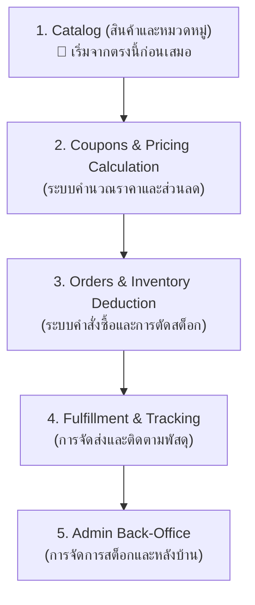
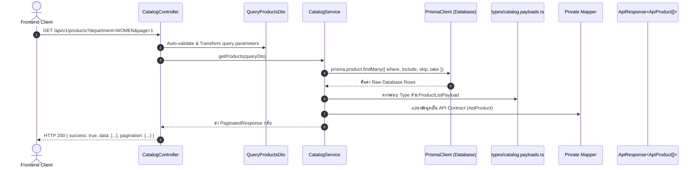

# Nida E-Commerce — Feature Roadmap & Backend Learning Guide

คู่มือแนะนำลำดับการเรียนรู้และขั้นตอนการพัฒนาฟีเจอร์สำหรับระบบ Backend (`apps/api`) เพื่อให้เข้าใจโครงสร้าง Clean Architecture และวิธีเขียนทีละขั้นตอนอย่างเป็นระบบ

---

## 1. ลำดับฟีเจอร์ที่ควรเริ่มทำก่อน-หลัง (Feature Dependency Chain)

ในระบบ E-Commerce ทั่วโลก ไม่สามารถเริ่มเขียนฟีเจอร์แบบสุ่มได้ เพราะแต่ละฟีเจอร์มี **ความสัมพันธ์แบบพึ่งพา (Dependency)** ต่อกัน:

---

## 2. ทำไมต้องเริ่มจาก "Catalog" เป็นฟีเจอร์แรก?

### เหตุผลทางสถาปัตยกรรม (Architecture)

1. **เป็นกระดูกสันหลังของข้อมูล (Core Data Backbone)**:
   - ตะกร้าสินค้า (Cart), ส่วนลด (Coupons), คำสั่งซื้อ (Orders), และคลังสินค้า (Inventory) **ทุกระบบล้วนอ้างอิงถึง `Product` และ `ProductVariant`**
   - หากไม่มีสินค้า จะไม่สามารถทดสอบการคิดเงิน การตัดสต็อก หรือการออก Order ได้เลย
2. **เป็นฟีเจอร์แบบ Read-Heavy (อ่านข้อมูลเป็นหลัก)**:
   - ปลอดภัยต่อการเริ่มต้นเรียนรู้ เพราะไม่มีความเสี่ยงเรื่อง Race Condition หรือข้อมูลสูญหาย (ยังไม่มีการ Write ข้ามหลายตาราง)
3. **เป็นจุดเรียนรู้โครงสร้างพื้นฐานที่ดีที่สุด**:
   - ได้ฝึกเขียน **Pagination** (หน้า 1, 2, 3...)
   - ได้ฝึกเขียน **Filtering & Sorting** (กรองตามแผนก, ไซส์, สี, ราคา)
   - ได้ฝึกการใช้ **Prisma Relations** (Product เชื่อมไปยัง Category, Images, Variants)

---

## 3. แผนภาพเส้นทางข้อมูล (Data Flow) ใน 1 ฟีเจอร์

เมื่อลูกค้าส่ง Request เข้ามา ข้อมูลจะเดินทางผ่าน 6 จุดตามลำดับดังนี้:

---

## 4. มาตรฐาน 6 ขั้นตอนในการเขียน 1 ฟีเจอร์ (Standard Step-by-Step)

เมื่อต้องการสร้างหรือแก้ไขฟีเจอร์ใน NestJS ให้ทำตามลำดับต่อไปนี้เสมอ:

### ขั้นตอนที่ 1: กำหนดตารางข้อมูลใน Database Schema

- ไฟล์: `packages/database/prisma/schema.prisma`
- กำหนด Model, ความสัมพันธ์ (Relations), Foreign Keys, และ Indexes ที่จำเป็นสำหรับการค้นหา
- รัน `npx prisma db push` หรือ migration

### ขั้นตอนที่ 2: กำหนด Shared Contract ใน `@repo/types`

- โฟลเดอร์: `packages/types/src/` (เช่น `catalog.types.ts`)
- กำหนด Interface ที่ทั้ง Frontend (Storefront / Admin) และ Backend (API) จะใช้คุยกัน (เช่น `ApiProduct`, `ApiCategory`)

### ขั้นตอนที่ 3: กำหนด DTO (Data Transfer Object)

- โฟลเดอร์: `apps/api/src/modules/<feature>/dto/`
- ใช้ `class-validator` และ `class-transformer` ร่วมกับ `@nestjs/swagger` เพื่อ:
  - ตรวจสอบความถูกต้องของ Input (เช่น `@IsUUID()`, `@Min(1)`)
  - สร้าง Swagger API Docs อัตโนมัติ

### ขั้นตอนที่ 4: ประกาศ Type ของ Database Payload

- โฟลเดอร์: `apps/api/src/modules/<feature>/types/`
- ใช้ `Prisma.<Model>GetPayload<{ include: ... }>` เพื่อให้ TypeScript รู้โครงสร้างข้อมูลที่แท้จริงจากการ `include` ข้ามตาราง **ห้ามใช้ `any` เด็ดขาด**

### ขั้นตอนที่ 5: เขียน Business Logic ใน Service

- โฟลเดอร์: `apps/api/src/modules/<feature>/<feature>.service.ts`
- ดึงข้อมูลจากฐานข้อมูลผ่าน `PrismaService`
- ประมวลผล Logic ทางธุรกิจ (เช่น คำนวณส่วนลด, เช็คสต็อก)
- ใช้ Private Mapper แปลงจาก Database Payload เป็น Shared Contract ก่อนส่งออก

### ขั้นตอนที่ 6: ผูกเส้นทาง (Route) ใน Controller

- โฟลเดอร์: `apps/api/src/modules/<feature>/<feature>.controller.ts`
- รับ Request และเรียก Service มาทำงาน (Controller ต้องบางที่สุด และไม่มี Business Logic)

---

## 5. แผนการอ่านโค้ดทีละสเต็ป (Recommended Reading Path)

แนะนำให้เริ่มเปิดอ่านตามลำดับไฟล์ดังต่อไปนี้ เพื่อทำความเข้าใจ Catalog Feature:

1. **ดูสัญญาข้อมูล (Data Contract)**:
   - [packages/types/src/catalog.types.ts](file:///Users/wiiznu/project/Nida_Project/packages/types/src/catalog.types.ts)
   - _สิ่งที่ต้องสังเกต_: หน้าตาข้อมูลที่ส่งให้หน้าบ้าน (`ApiProduct`, `ApiProductDetail`)

2. **ดูการรับและตรวจสอบพารามิเตอร์ (Input DTO)**:
   - [apps/api/src/modules/catalog/dto/query-products.dto.ts](file:///Users/wiiznu/project/Nida_Project/apps/api/src/modules/catalog/dto/query-products.dto.ts)
   - _สิ่งที่ต้องสังเกต_: การใช้ `@IsOptional()`, `@Type(() => Number)` สำหรับแปลง query string

3. **ดู Type ของฐานข้อมูล (Database Payloads)**:
   - [apps/api/src/modules/catalog/types/catalog.payloads.ts](file:///Users/wiiznu/project/Nida_Project/apps/api/src/modules/catalog/types/catalog.payloads.ts)
   - _สิ่งที่ต้องสังเกต_: การดึง Type จาก `Prisma.ProductGetPayload`

4. **ดูการทำงานหลักและการแปลงข้อมูล (Service & Mapper)**:
   - [apps/api/src/modules/catalog/catalog.service.ts](file:///Users/wiiznu/project/Nida_Project/apps/api/src/modules/catalog/catalog.service.ts)
   - _สิ่งที่ต้องสังเกต_: เมธอด `getProducts()` และ `mapProductListItem()`

5. **ดูการเปิด Endpoint (Controller)**:
   - [apps/api/src/modules/catalog/catalog.controller.ts](file:///Users/wiiznu/project/Nida_Project/apps/api/src/modules/catalog/catalog.controller.ts)
   - _สิ่งที่ต้องสังเกต_: การใช้ `@Get('products')` และ Swagger decorators

---

## 6. ลำดับการลุยฟีเจอร์ถัดไปในโปรเจกต์นี้

| สเต็ป | ฟีเจอร์                            | สาระสำคัญที่ได้เรียนรู้                                               | ไฟล์หลัก            |
| :---: | ---------------------------------- | --------------------------------------------------------------------- | ------------------- |
| **1** | **Catalog** (ปัจจุบัน)             | Query filtering, Pagination, Relations, Mappers                       | `modules/catalog/*` |
| **2** | **Coupons & Checkout Calculation** | Logic การคำนวณเงิน, โควตา, Pro-rata discount allocation               | `modules/coupons/*` |
| **3** | **Orders & Concurrency**           | Prisma Interactive Transaction, Atomic stock decrement                | `modules/orders/*`  |
| **4** | **Shipments & Fulfillment**        | Tracking timeline, State transition (PENDING -> SHIPPED -> DELIVERED) | `modules/admin/*`   |
