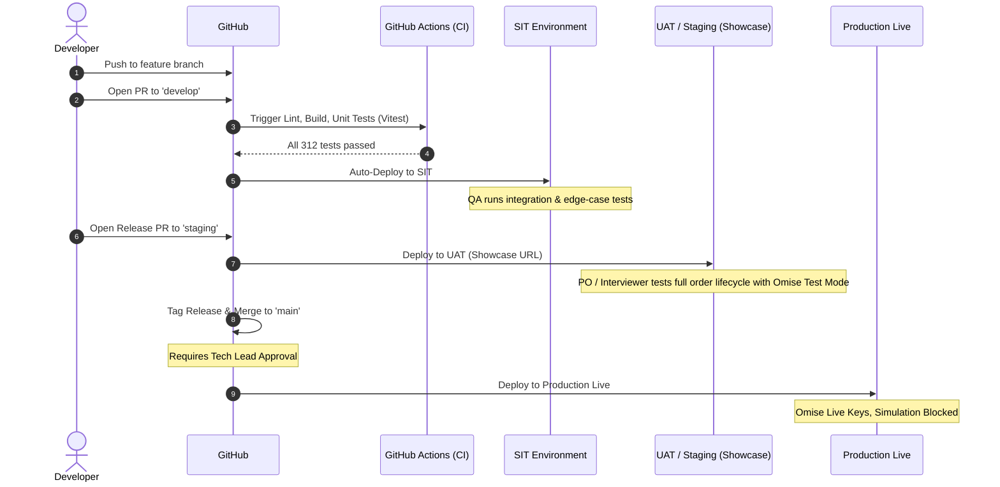

# NIDA E-Commerce — Multi-Environment Deployment Guide
## คู่มือการจัดการและ Deploy ระบบแยกตามระดับสภาพแวดล้อม (DEV, SIT, UAT, PROD)

เอกสารฉบับนี้กำหนดมาตรฐานสถาปัตยกรรมและการ Deploy ของระบบ **NIDA E-Commerce (Turborepo Monorepo)** ครอบคลุมทั้งฝั่ง Frontend (`apps/store`, `apps/admin`), Backend APIs (`apps/api`, `apps/admin-api`), ฐานข้อมูล และบริการเสริมต่างๆ ตามหลักวิศวกรรมซอฟต์แวร์ระดับสากล เพื่อให้การส่งมอบระบบมีเสถียรภาพ ปลอดภัย และตรวจสอบได้ในทุกขั้นตอน

---

## 1. ภาพรวมระดับสภาพแวดล้อมทั้ง 4 ระดับ (Environment Overview)

```
[ DEV ] ───────────> [ SIT ] ───────────> [ UAT / Staging ] ───────────> [ PROD ]
(นักพัฒนา)          (QA / Dev)            (PO / กรรมการสัมภาษณ์)         (ลูกค้าจริง)
Local Sandbox        Integration Test       Acceptance / Demo              Commercial Live
```

| ระดับ | วัตถุประสงค์หลัก | กลุ่มผู้ใช้งาน | ฐานข้อมูล | สถานะ Payment (Omise) |
|---|---|---|---|---|
| **DEV** (Development) | พัฒนาฟีเจอร์, แก้บั๊ก, ทดสอบโค้ดบนเครื่องส่วนตัว | Developers | Local Docker (Postgres) | Sandbox / Test Keys |
| **SIT** (System Integration Testing) | ทดสอบการเชื่อมต่อข้ามระบบ (APIs, Queues, Webhooks, Third-party) | QA Engineers, Developers | Cloud DB (SIT Isolated) | Sandbox / Test Keys |
| **UAT / Staging** (User Acceptance Testing) | ตรวจรับ Requirement, ทดสอบ Business Flow, ใช้เป็น **Showcase สัมภาษณ์งาน** | Product Owner, Clients, Interviewers | Cloud DB (UAT Realistic Seed) | Sandbox / Test Keys (เปิด Simulation ได้) |
| **PROD** (Production) | ให้บริการเชิงพาณิชย์จริง พร้อมรองรับธุรกรรมการเงินและคำสั่งซื้อจริง | Real Customers, Operation Staff | Cloud DB (High Availability + Backup) | Live Mode (ตัดเงินจริง, ปิด Simulation ถาวร) |

---

## 2. ตารางเปรียบเทียบสถาปัตยกรรมและการตั้งค่าในแต่ละระดับ

| มิติ (Dimension) | DEV | SIT | UAT / Staging | PROD |
|---|---|---|---|---|
| **Git Branch** | `feat/*`, `fix/*` | `develop` | `staging` หรือ `release/*` | `main` (Tag Release) |
| **CI/CD Trigger** | Local Commit | Auto Deploy เมื่อ merge เข้า `develop` | Auto Deploy เมื่อเปิด Release PR | Manual Approval Gate |
| **Frontend Host** | `localhost:3000`, `:5173` | Vercel / Cloudflare (SIT Subdomain) | Vercel (Staging / Showcase URL) | Vercel (Custom Domain) |
| **Backend Host** | `localhost:4001`, `:4000` | Render / Railway (SIT Instance) | Render / Railway (UAT Instance) | Render / Railway / AWS ECS |
| **Database Instance** | Docker Compose Postgres | Supabase / Neon (SIT DB) | Supabase / Neon (UAT DB) | Supabase / AWS RDS (HA + Pooling) |
| **Database Migration** | `prisma migrate dev` | `prisma migrate deploy` (Auto) | `prisma migrate deploy` (Manual/CI) | `prisma migrate deploy` (Gated) |
| **Data Seed** | `seed-dev.ts` (Mocked data) | SIT Test Scenarios | `seed-prod.ts` (Realistic luxury catalog) | `seed-prod.ts` (System initial only) |
| **Redis & Queue** | Docker Redis (No TLS) | Upstash Redis (`rediss://`) | Upstash Redis (`rediss://`) | Upstash / Redis Cloud (HA + TLS) |
| **Omise Key** | Test (`skey_test_...`) | Test (`skey_test_...`) | Test (`skey_test_...`) | Live (`skey_live_...`) |
| **Payment Simulation** | เปิด (`true`) | เปิด (`true`) | เปิด (`true` สำหรับ Demo) | **ปิดถาวร (`false`)** |
| **Swagger API Docs** | เปิด (`/docs`) | เปิด (`/docs` สำหรับ QA) | ปิด (เพื่อความสะอาด/ปลอดภัย) | **ปิดถาวร (`false`)** |
| **Security Headers (Helmet)**| ปิด (เพื่อความสะดวก) | เปิดเต็มรูปแบบ | เปิดเต็มรูปแบบ | เปิดเต็มรูปแบบ |
| **CORS Policy** | เปิดกว้าง / Localhost | Strict SIT URLs | Strict UAT URLs | Strict Production Domains |
| **Mailer Transport** | Stream (Terminal Log) | Sandbox SMTP (Mailtrap) | Real SMTP (Resend/SendGrid) | Real SMTP (Dedicated IP + Domain) |
| **Media CDN** | Local / Cloudinary Test | Cloudinary SIT Folder | Cloudinary UAT Folder | Cloudinary Production Master |

---

## 3. รายละเอียดและแนวทางการ Deploy แต่ละระดับ

### ระดับที่ 1: DEV (Development Environment)

- **เป้าหมาย**: ให้นักพัฒนาแก้ไขและทดสอบโค้ดได้อย่างรวดเร็ว (Fast Feedback Loop) โดยไม่กระทบผู้อื่น
- **โครงสร้างการทำงาน**:
  - รัน Service พื้นฐานผ่าน Docker Compose:
    ```bash
    docker compose -f docker-compose.dev.yml up -d
    ```
  - รัน Full-Stack Development Server:
    ```bash
    # สำหรับ Storefront (Next.js 16) + Customer API (Port 4001)
    npm run dev:store-full

    # สำหรับ Admin Portal (Vite React) + Admin API (Port 4000)
    npm run dev:admin-full
    ```
- **การจัดการฐานข้อมูล**:
  - สร้าง Schema Migration: `npm --prefix packages/database run db:migrate:dev`
  - เติมข้อมูลทดสอบ: `npm --prefix packages/database run db:seed:dev`

---

### ระดับที่ 2: SIT (System Integration Testing)

- **เป้าหมาย**: ตรวจสอบความถูกต้องของการเชื่อมต่อระหว่าง Services (Storefront <-> Customer API <-> Admin API <-> Database <-> Redis BullMQ <-> Omise Sandbox) และรัน Automated Integration Tests
- **ขั้นตอนการ Deploy**:
  1. นักพัฒนาสร้าง Pull Request จาก Feature Branch เข้าสู่ `develop`
  2. GitHub Actions (CI) ทำการตรวจสอบ:
     - Linting & Type Check (`tsc --noEmit`)
     - Unit Tests ทั้งหมดใน `apps/api` (117 tests) และ `apps/admin-api` (195 tests)
     - Build Validation ของทุก Packages และ Apps
  3. เมื่อ Merge สำเร็จ CD Pipeline จะสั่ง Trigger Deployment ไปยัง SIT Server (เช่น Render SIT Web Service)
  4. ทำการรัน `prisma migrate deploy` ไปยัง SIT Database
- **จุดที่ต้องตรวจสอบใน SIT**:
  - Webhook ของ Omise (`/api/v1/orders/omise-webhook`) สามารถรับ Charge Complete Event จาก Sandbox ได้ถูกต้อง
  - BullMQ Delayed Workers (Order Timeout, Delivery Auto-Complete, Return Deadline) ทำงานและประมวลผลสถานะตามเวลาที่กำหนด
  - Token Revocation และ Refresh Token Rotation ทำงานบน Redis ข้าม Client ได้อย่างสมบูรณ์

---

### ระดับที่ 3: UAT / Staging (User Acceptance Testing & Portfolio Showcase)

> **หมายเหตุสำคัญ**: ระดับ UAT คือสถานะที่เหมาะสมที่สุดสำหรับการนำโปรเจกต์ขึ้น Cloud เพื่อ **เปิดแสดงในห้องสัมภาษณ์งาน (Technical Showcase)** เนื่องจากทำงานบน Cloud Infrastructure จริงทุกประการ แต่ยังคงใช้ Omise Test Mode เพื่อให้ผู้สัมภาษณ์สามารถทดสอบสั่งซื้อสินค้าจริงได้โดยไม่ต้องใช้เงินจริง

- **เป้าหมาย**: ให้ Product Owner, Stakeholders หรือผู้สัมภาษณ์งาน ทดสอบ Business Workflow ตั้งแต่ต้นจนจบ
- **โครงสร้างการ Deploy**:
  - **Frontend**: Deploy ผ่าน **Vercel**
    - Storefront: `https://nida-store-staging.vercel.app`
    - Admin Portal: `https://nida-admin-staging.vercel.app`
  - **Backend APIs**: Deploy ผ่าน **Render** หรือ **Railway**
    - Customer API: `https://nida-api-staging.onrender.com`
    - Admin API: `https://nida-admin-api-staging.onrender.com`
  - **Database**: **Supabase** (PostgreSQL พร้อม PgBouncer Connection Pooling บน Port 6543)
  - **Redis**: **Upstash** (Serverless Redis ผ่าน TLS `rediss://`)
  - **Media**: **Cloudinary** (Direct Uploads ผ่าน Secure REST API)
- **ขั้นตอนการเตรียม UAT**:
  1. สั่งรัน Database Migration:
     ```bash
     DATABASE_URL="postgres://...@...pooler.supabase.com:6543/postgres?pgbouncer=true" \
     DIRECT_URL="postgres://...@...supabase.com:5432/postgres" \
     npm --prefix packages/database run db:migrate:deploy
     ```
  2. สั่งรัน Production Seed เพื่อสร้าง Catalog สินค้าที่สมบูรณ์และสวยงาม:
     ```bash
     DATABASE_URL="postgres://...@...pooler.supabase.com:6543/postgres?pgbouncer=true" \
     npm --prefix packages/database run db:seed:prod
     ```
- **การทดสอบ Payment ใน UAT (Omise Test Mode)**:
  - ใช้ `OMISE_SECRET_KEY=skey_test_...` และ `ALLOW_PAYMENT_SIMULATION=true`
  - สำหรับ **PromptPay**: ระบบจะดึง QR Code จริงจาก Omise Sandbox มาแสดง ผู้ทดสอบสามารถกดปุ่ม **"จำลองการชำระเงินสำเร็จ (Simulate Instant Payment)"** เพื่อให้ Omise Sandbox Mark As Paid และสั่งให้ระบบตัดสต็อก เปลี่ยนสถานะเป็น `PAID` ทันที
  - สำหรับ **Credit Card**: ผู้ทดสอบสามารถใส่เลขบัตรทดสอบมาตรฐานของ Omise (เช่น `4242 4242 4242 4242`, วันหมดอายุในอนาคต, CVV `123`) เพื่อทดสอบ 3D-Secure และ Tokenization ได้จริง

---

### ระดับที่ 4: PROD (Commercial Production)

- **เป้าหมาย**: ให้บริการจริงแก่ลูกค้าเชิงพาณิชย์ มุ่งเน้น High Availability, Zero Downtime, Data Security และความถูกต้องของข้อมูลทางการเงิน 100%
- **มาตรการความปลอดภัยและข้อกำหนดเข้มงวด**:
  1. **ห้ามใช้ Test Keys**: ต้องใช้ `skey_live_...` และ `pkey_live_...` เท่านั้น
  2. **บล็อก Payment Simulation 100%**: ระบบมี Code Guard ใน `orders.service.ts` ที่จะปฏิเสธ (`ForbiddenException`) คำขอจำลองการจ่ายเงินทันทีหากอยู่ใน Production ที่มี Live Key
  3. **ปิด Swagger API Documentation**: ซ่อนหน้า `/docs` เพื่อไม่ให้บุคคลภายนอกแกะโครงสร้าง Internal Endpoints ได้
  4. **Strict CORS Whitelist**: รับเฉพาะ Domain ทางการของระบบ เช่น `https://www.nidafashion.com` และ `https://admin.nidafashion.com`
  5. **Database Safety**: ห้ามรันคำสั่ง `prisma migrate reset` หรือ `db:push` เด็ดขาด อนุญาตเฉพาะ `prisma migrate deploy` เท่านั้น มีการเปิด Point-in-Time Recovery (PITR) และ Daily Automated Snapshots
  6. **Zero Fakes / Mocks**: ห้ามมีโค้ด Fallback จำลองสถานะออเดอร์ ทุกคำสั่งซื้อต้องผ่านการยืนยันสถานะจาก Omise Webhook / Gateway อย่างแท้จริง

---

## 4. ตาราง Environment Variables เปรียบเทียบทั้ง 4 ระดับ

### Customer API (`apps/api`)

| Key | DEV | SIT | UAT (Showcase) | PROD |
|---|---|---|---|---|
| `NODE_ENV` | `development` | `production` | `production` | `production` |
| `PORT` | `4001` | `4001` | `4001` | `4001` |
| `DATABASE_URL` | `postgresql://...@localhost:5432/nida_db` | Supabase SIT Pooler | Supabase UAT Pooler | AWS RDS / Supabase Prod Pooler |
| `DIRECT_URL` | `postgresql://...@localhost:5432/nida_db` | Supabase SIT Direct | Supabase UAT Direct | AWS RDS / Supabase Prod Direct |
| `REDIS_URL` | `redis://localhost:6379` | `rediss://...upstash.io:6379` | `rediss://...upstash.io:6379` | High Availability Cluster |
| `JWT_SECRET` | `dev-secret-key-32-chars...` | SIT Secret | UAT Secret | Cryptographically Random 64-char |
| `OMISE_PUBLIC_KEY` | `pkey_test_...` | `pkey_test_...` | `pkey_test_...` | `pkey_live_...` |
| `OMISE_SECRET_KEY` | `skey_test_...` | `skey_test_...` | `skey_test_...` | `skey_live_...` |
| `ALLOW_PAYMENT_SIMULATION` | `true` | `true` | `true` | `false` |
| `SWAGGER_ENABLED` | `true` | `true` | `false` | `false` |
| `CORS_ORIGIN` | `http://localhost:3000` | `https://store-sit.domain.com` | `https://nida-store-staging.vercel.app` | `https://www.nidafashion.com` |

### Admin API (`apps/admin-api`)

| Key | DEV | SIT | UAT (Showcase) | PROD |
|---|---|---|---|---|
| `NODE_ENV` | `development` | `production` | `production` | `production` |
| `PORT` | `4000` | `4000` | `4000` | `4000` |
| `DATABASE_URL` | Same as API | SIT Pooler | UAT Pooler | Prod Pooler |
| `DIRECT_URL` | Same as API | SIT Direct | UAT Direct | Prod Direct |
| `REDIS_URL` | Same as API | SIT Redis | UAT Redis | Prod Redis |
| `CLOUDINARY_CLOUD_NAME` | Development Cloud | SIT Cloud | Shared/Showcase Cloud | Dedicated Master Cloud |
| `SWAGGER_ENABLED` | `true` | `true` | `false` | `false` |
| `CORS_ORIGIN` | `http://localhost:5173` | `https://admin-sit.domain.com` | `https://nida-admin-staging.vercel.app` | `https://admin.nidafashion.com` |

### Storefront (`apps/store`)

| Key | DEV | SIT | UAT (Showcase) | PROD |
|---|---|---|---|---|
| `NEXT_PUBLIC_API_URL` | `http://localhost:4001/api/v1` | `https://api-sit.domain.com/api/v1` | `https://nida-api-staging.onrender.com/api/v1` | `https://api.nidafashion.com/api/v1` |
| `NEXT_PUBLIC_OMISE_PUBLIC_KEY`| `pkey_test_...` | `pkey_test_...` | `pkey_test_...` | `pkey_live_...` |

### Admin Portal (`apps/admin`)

| Key | DEV | SIT | UAT (Showcase) | PROD |
|---|---|---|---|---|
| `VITE_API_URL` | `http://localhost:4000/api/v1` | `https://admin-api-sit.domain.com/api/v1` | `https://nida-admin-api-staging.onrender.com/api/v1` | `https://admin-api.nidafashion.com/api/v1` |

---

## 5. กระบวนการ Promotion และ Rollback (Deployment Lifecycles)



### แนวปฏิบัติเมื่อเกิดปัญหาและต้อง Rollback

1. **Frontend Rollback (Instant)**:
   - สามารถ Instant Rollback บน Vercel Dashboard ไปยัง Deployment Hash ก่อนหน้าได้ทันที (ใช้เวลาไม่เกิน 5 วินาที)
2. **Backend Rollback**:
   - Re-deploy Container Image Tag ก่อนหน้าบน Render / Railway
3. **Database Migration Rollback (Expand-Contract Pattern)**:
   - ยึดหลัก **Backward-Compatible Migration**: เมื่อเพิ่มคอลัมน์ใหม่ใน Database ห้ามลบคอลัมน์เก่าออกทันที เพื่อให้ Backend เวอร์ชั่นก่อนหน้ายังคงทำงานต่อได้โดยไม่พัง (Non-breaking deployment)
   - หากต้อง Rollback Schema ให้สร้าง Migration Script ใหม่เพื่อย้อนสภาพแทนการแก้ไขไฟล์ Migration ในอดีต

---

## 6. สรุป Checklist ความพร้อมก่อนส่งมอบงานในแต่ละระดับ

- [ ] **SIT Checklist**:
  - [ ] Unit Test ทุกชุดผ่าน 100% (`npm run test` ในทั้งสอง APIs)
  - [ ] TypeScript Compilation ผ่าน 100% ปราศจาก `any` และ Type Errors
  - [ ] Webhook Endpoints ตรวจสอบ Signature ถูกต้อง
- [ ] **UAT / Showcase Checklist**:
  - [ ] ฐานข้อมูล Cloud มีการรัน `db:seed:prod` เรียบร้อย (มีสินค้า, รูปภาพ, หมวดหมู่)
  - [ ] Omise ทำงานใน Test Mode และปุ่ม Simulate Payment ใช้งานได้
  - [ ] Redis เชื่อมต่อผ่าน TLS (`rediss://`) ปราศจาก Connection Errors
  - [ ] หน้าเว็บโหลดรวดเร็ว ไม่มี Error ใน Console
- [ ] **Production Checklist**:
  - [ ] สลับใช้ `skey_live_...` และ `pkey_live_...`
  - [ ] `ALLOW_PAYMENT_SIMULATION` ตั้งค่าเป็น `false`
  - [ ] ปิด Swagger Documentation
  - [ ] ตั้งค่า CORS เฉพาะโดเมนจริงของระบบ
  - [ ] ตั้งค่า Database Backup และ Alert Monitoring ครบถ้วน
