# NIDA E-Commerce — Order Lifecycle & Fulfillment Flow Guide

คู่มืออธิบายขั้นตอนการทำงานของระบบคำสั่งซื้อ (Order Flow), การคำนวณค่าจัดส่ง, การตัดสต็อก, การออกหมายเลขพัสดุ (Fulfillment) และการพิมพ์เอกสารสำหรับคลังสินค้าของระบบ **NIDA Luxury Apparel**

---

## 1. ภาพรวมสถาปัตยกรรมคำสั่งซื้อ (Architectural Overview)

ระบบคำสั่งซื้อของ NIDA ถูกออกแบบตามมาตรฐาน Enterprise E-Commerce โดยใช้หลักการ **Transactional Integrity** และ **Event Snapshot** เพื่อป้องกันข้อผิดพลาดในการตัดสต็อกและบันทึกประวัติย้อนหลัง:

```mermaid
graph LR
    subgraph Storefront["Storefront (Client)"]
        Cart["ตะกร้าสินค้า (Cart)"] --> Checkout["ชำระเงิน (Checkout)"]
    end

    subgraph BackendAPI["Backend Core Engine"]
        Val["ตรวจสอบสต็อก & คูปอง"]
        Calc["คำนวณราคาสุทธิ & ค่าจัดส่ง"]
        OrderRecord["บันทึก Order & Address Snapshot"]
        PayRecord["บันทึก Payment Record"]
    end

    subgraph WarehouseAdmin["Admin Back-Office"]
        PickPack["คลังสินค้าหยิบและแพ็คสินค้า"]
        Fulfill["ออกเลขพัสดุ (Shipment Fulfill)"]
        Track["บันทึกไทม์ไลน์ (Shipment Log)"]
    end

    Checkout --> Val --> Calc --> OrderRecord --> PayRecord
    PayRecord --> PickPack --> Fulfill --> Track
```

---

## 2. แผนผังสถานะระบบและวงจรการทำงาน (Lifecycle State Machines)

> [!IMPORTANT]
> ### สถาปัตยกรรมการแยกขอบเขตหน้าที่ (Architectural Separation of Concerns)
> - **Order Aggregate (`OrderStatus`)**: ดูแลข้อผูกพันทางธุรกิจระหว่างลูกค้ากับร้านค้าในระดับภาพรวม (Macro-Level Contract) ได้แก่ `PENDING`, `PAID`, `PREORDER_AWAITING_STOCK`, `PROCESSING`, `SHIPPED`, `DELIVERED`, `CANCELLED`, `REFUNDED`
> - **Shipment Domain (`ShipmentStatus` และ `ShipmentLog`)**: ดูแลการเดินทางทางกายภาพของพัสดุในระดับละเอียด (Micro-Level Courier Events) เช่น `LABEL_CREATED`, `PICKED_UP`, `IN_TRANSIT`, `OUT_FOR_DELIVERY`, `DELIVERED`, `FAILED`
> - **กฎข้อบังคับสำคัญ**: เหตุการณ์การขนส่ง เช่น "พนักงานกำลังนำจ่าย (Out for Delivery)" หรือ "พัสดุถึงศูนย์กระจายสินค้า (Sorting Hub)" จะถูกบันทึกลงใน **`ShipmentLog`** และปรับสถานะของ **`ShipmentStatus`** เท่านั้น โดย **ไม่นำไปปะปนกับ `OrderStatus`** ซึ่งจะยังคงเป็น `SHIPPED` จนกระทั่งขนส่งส่งมอบสำเร็จ (`DELIVERED`) จึงจะปรับ `OrderStatus` เป็น `DELIVERED` ตาม

ระบบจัดการคำสั่งซื้อของ NIDA เชื่อมโยงสถานะของ 4 มิติหลักเข้าด้วยกันแบบบูรณาการ:
1. **`OrderStatus`**: สถานะหลักของคำสั่งซื้อ (Core Domain Aggregate)
2. **`PaymentStatus`**: สถานะธุรกรรมการชำระเงิน (Financial Gateway Transactions)
3. **`ShipmentStatus`**: สถานะการจัดส่งพัสดุและการเดินทางของสินค้า (Logistics & Fulfillment)
4. **`ReturnStatus` & `RefundStatus`**: สถานะกระบวนการหลังการขาย การขอคืนสินค้า และการคืนเงิน (After-Sales Operations)

---

### 2.1 แผนภาพการซิงโครไนซ์สถานะข้ามระบบ (Cross-Entity Lifecycle Synchronization)

แผนผังแสดงความสัมพันธ์และการส่งต่อสถานะ (State Dependency & Event Propagation) ระหว่างแต่ละโมดูล:

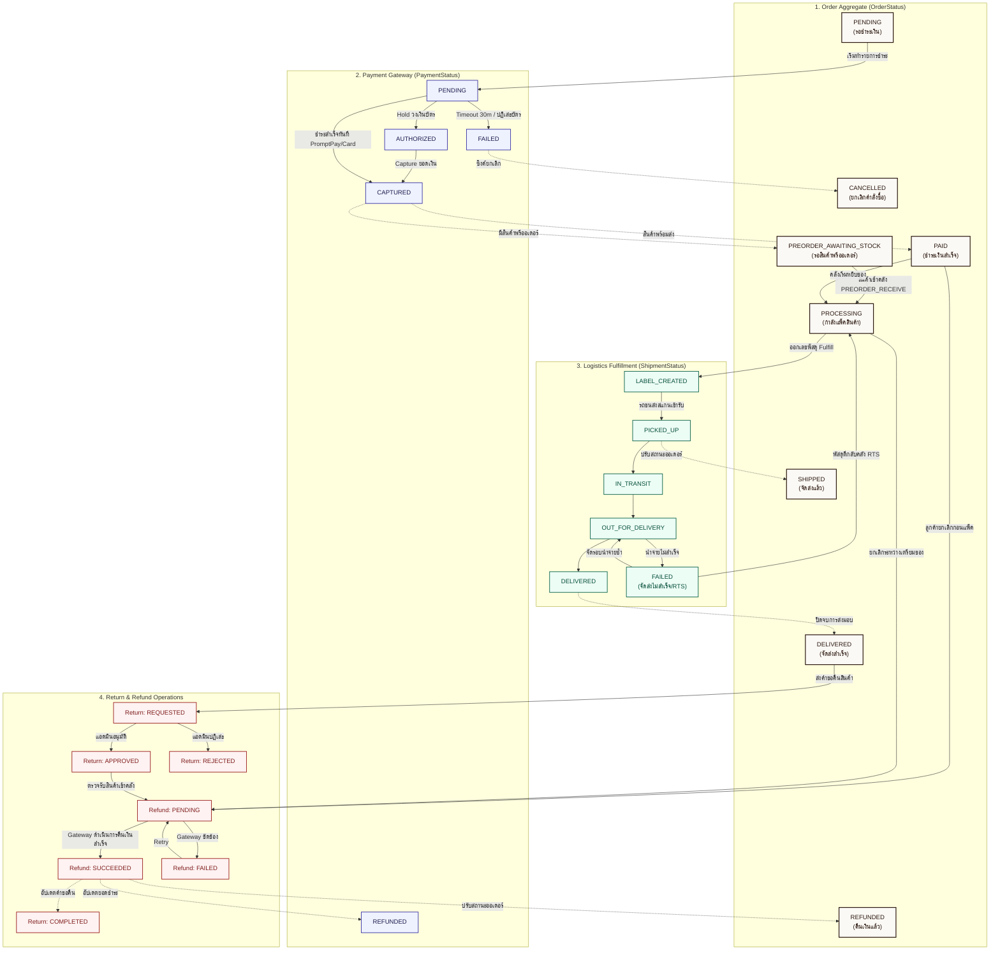

---

### 2.2 วงจรสถานะคำสั่งซื้อ (Order Lifecycle State Machine — `OrderStatus`)

คำสั่งซื้อจะมีการเปลี่ยนสถานะตามขั้นตอนการดำเนินงานจริง ตั้งแต่การสั่งซื้อจนถึงการส่งมอบสินค้า:

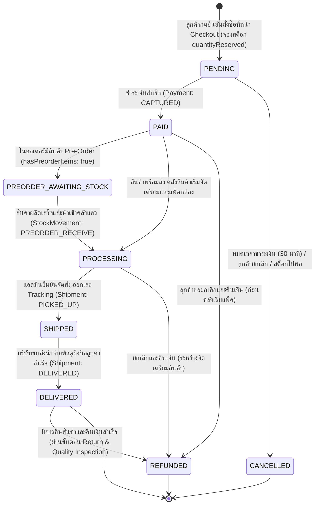

#### คำอธิบายสถานะคำสั่งซื้อ (`OrderStatus`)

| สถานะ | ความหมาย | สต็อก (Inventory) | ผู้มีอำนาจเปลี่ยนสถานะ |
| :--- | :--- | :--- | :--- |
| `PENDING` | สั่งซื้อแล้ว รอชำระเงิน | จองสต็อกชั่วคราว (`quantityReserved`) | System (Timeout) / Customer |
| `PAID` | ชำระเงินสำเร็จแล้ว | ตัดสต็อกจริง (`quantityAvailable` ลดลง) | Payment Gateway Webhook / Admin |
| `PREORDER_AWAITING_STOCK` | ชำระเงินแล้ว อยู่ระหว่างรอสินค้า Pre-Order | บันทึกยอดจองพรีออเดอร์ (`preorderBooked`) | System (ตรวจพบสินค้า `isPreorder: true`) |
| `PROCESSING` | คลังสินค้ากำลังหยิบของ ตรวจสอบ และแพ็คใส่กล่อง | สต็อกถูกตัดไปแล้ว | Staff / Inventory Manager |
| `SHIPPED` | บรรจุกล่องและมอบให้บริษัทขนส่งแล้ว (มี Tracking Number) | พัสดุอยู่ระหว่างการขนส่ง | Order Manager / Fulfill Staff |
| `DELIVERED` | พัสดุนำส่งถึงปลายทางเรียบร้อย | จบกระบวนการจัดส่ง | Courier Webhook / Admin Manual Update |
| `CANCELLED` | ยกเลิกคำสั่งซื้อ | คืนยอดจองสต็อกกลับสู่ระบบ | Customer / System Auto-Expire / Admin |
| `REFUNDED` | ดำเนินการคืนเงิน (เต็มจำนวนหรือตามสัดส่วนสินค้า) | ปรับยอดสต็อกตามการรับของคืนเข้าคลัง | Super Admin / Order Manager |

---

### 2.3 วงจรสถานะการจัดส่งพัสดุ (Shipment Lifecycle State Machine — `ShipmentStatus`)

วงจรสถานะพัสดุบันทึกประวัติการขนส่งแบบละเอียด และสร้างเหตุการณ์ใน `ShipmentLog` ในทุกการเปลี่ยนแปลง:

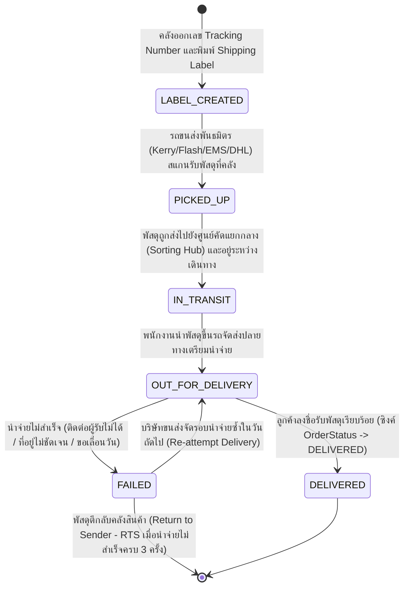

#### คำอธิบายสถานะการจัดส่ง (`ShipmentStatus`)

| สถานะ | ความหมายเชิงลอจิสติกส์ | การบันทึก `ShipmentLog` | ผลกระทบต่อ `OrderStatus` |
| :--- | :--- | :--- | :--- |
| `LABEL_CREATED` | พิมพ์ใบปะหน้ากล่องและออกเลขพัสดุเรียบร้อย รอนัดรถเข้ารับ | บันทึก "กำลังเตรียมพัสดุ ณ ศูนย์กระจายสินค้า NIDA" | คงสถานะ `PROCESSING` |
| `PICKED_UP` | บริษัทขนส่งสแกนรับพัสดุขึ้นรถขนส่ง | บันทึก "บริษัทขนส่งเข้ารับพัสดุเรียบร้อยแล้ว" | เปลี่ยนเป็น `SHIPPED` |
| `IN_TRANSIT` | พัสดุกำลังเดินทางข้ามศูนย์คัดแยกสาขา | บันทึกรหัสสาขาและตำแหน่งปัจจุบันของศูนย์กระจายสินค้า | คงสถานะ `SHIPPED` |
| `OUT_FOR_DELIVERY` | พนักงานส่งพัสดุกำลังเดินทางไปส่งที่อยู่ปลายทาง | บันทึก "พนักงานกำลังนำจ่ายพัสดุให้แก่ท่าน" | คงสถานะ `SHIPPED` |
| `DELIVERED` | พัสดุนำจ่ายถึงมือผู้รับสำเร็จ | บันทึก "จัดส่งสำเร็จ ลงชื่อรับโดย [ชื่อผู้รับ]" | เปลี่ยนเป็น `DELIVERED` |
| `FAILED` | การนำจ่ายมีข้อผิดพลาด หรือพัสดุตีกลับคลัง | บันทึกสาเหตุ (เช่น ติดต่อไม่ได้/ที่อยู่ผิด) | คง `SHIPPED` (ถ้าจัดส่งซ้ำ) หรือแจ้งเตือนแอดมิน |

---

### 2.4 วงจรสถานะการชำระเงิน (Payment Lifecycle State Machine — `PaymentStatus`)

ระบบชำระเงินรองรับทั้งการชำระเงินทันที (PromptPay QR, Direct Debit) และการกันวงเงิน (Credit Card Authorization):

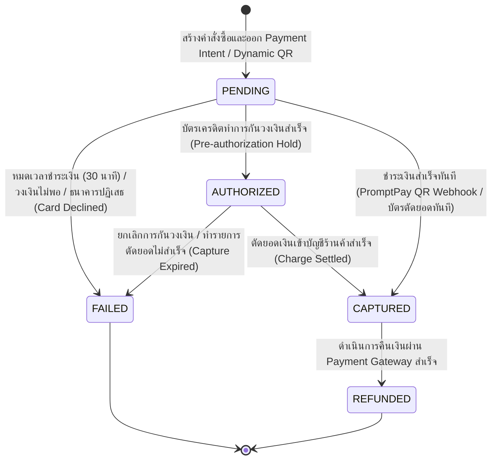

#### คำอธิบายสถานะการชำระเงิน (`PaymentStatus`)

| สถานะ | ความหมาย | ความปลอดภัย & ข้อมูลเชื่อมโยง | ผลกระทบต่อ `OrderStatus` |
| :--- | :--- | :--- | :--- |
| `PENDING` | สร้างรายการชำระแล้ว รอผลจากเกตเวย์ | มี `idempotencyKey` ป้องกันการส่งคำขอซ้ำ | `OrderStatus: PENDING` |
| `AUTHORIZED` | บัตรเครดิตกันวงเงินสำเร็จ (Hold) | บันทึก `cardLast4`, `cardBrand`, `transactionReference` | เตรียมเปลี่ยนเป็น `PAID` เมื่อ Capture |
| `CAPTURED` | หักเงินสำเร็จ ยอดเงินเข้าบัญชีแล้ว | บันทึก `paidAt` และ `gatewayEventId` สำหรับ Audit | `OrderStatus: PAID` (หรือ `PREORDER`) |
| `FAILED` | ลูกค้ายกเลิก หรือธุรกรรมล้มเหลว | บันทึก `rawWebhookPayload` เพื่อตรวจสอบสาเหตุ | `OrderStatus: CANCELLED` |
| `REFUNDED` | ทำรายการคืนเงินสำเร็จผ่าน Payment Gateway | มีรายการบันทึกในตาราง `Refund` เชื่อมโยง | `OrderStatus: REFUNDED` |

---

### 2.5 วงจรการคืนสินค้าและการคืนเงิน (Return & Refund Lifecycle State Machine)

การคืนสินค้า (Return) และการคืนเงิน (Refund) เป็นระบบคู่ขนานที่ทำงานร่วมกันอย่างปลอดภัย:

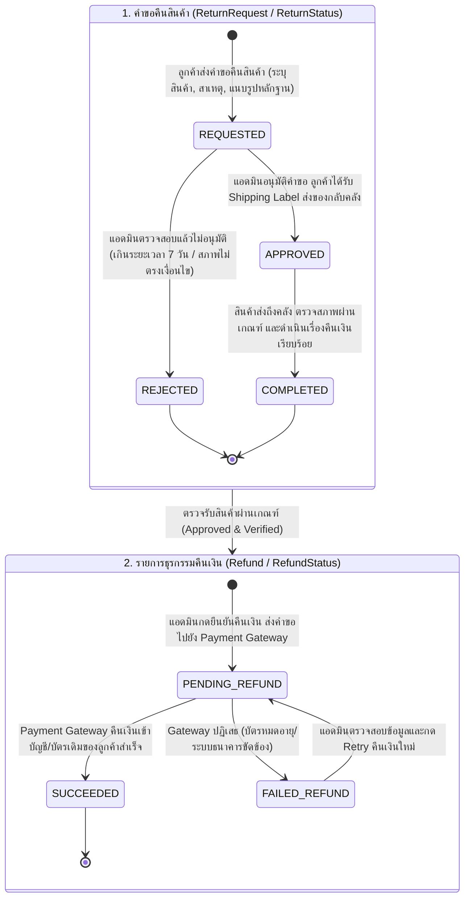

#### การประมวลผลสต็อกและแต้มสะสมเมื่อคืนเงิน/คืนสินค้า:
1. **สต็อกสินค้า (Inventory)**: เมื่อคลังตรวจรับสินค้าคืนเรียบร้อย ระบบจะบันทึก `StockMovement` ชนิด `RETURNED` และเพิ่มสต็อก `quantityAvailable` กลับเข้าระบบโดยอัตโนมัติ
2. **แต้มสมาชิก (Loyalty Points)**:
   - หักแต้มสะสมที่เคยได้รับจากออเดอร์นี้ออกผ่าน `PointTransaction` ชนิด `REFUND_CANCEL`
   - หากลูกค้าเคยใช้แต้มแลกส่วนลดในออเดอร์นี้ ระบบจะคืนแต้มส่วนลดกลับเข้ากระเป๋าของลูกค้า
3. **การคำนวณเงินคืนแบบ Pro-rated**: คำนวณยอดเงินคืนสุทธิจากคอลัมน์ `netPrice` ใน `order_items` ซึ่งหักส่วนลดเฉลี่ยตามสัดส่วนคูปองจริง ป้องกันการคืนเงินเกินมูลค่าที่ชำระ

---

### 2.6 ตารางเมทริกซ์ความสัมพันธ์สถานะข้ามระบบ (Cross-Entity Status Matrix)

ตารางสรุปสถานะของทุกระบบในแต่ละขั้นตอนสำคัญของการดำเนินงาน:

| ขั้นตอนทางธุรกิจ (Business Milestone) | `OrderStatus` | `PaymentStatus` | `ShipmentStatus` | `ReturnStatus` | `RefundStatus` | ผลกระทบต่อสต็อกสินค้า | ผู้กระทำ (Actor) |
| :--- | :--- | :--- | :--- | :--- | :--- | :--- | :--- |
| **ลูกค้ากดยืนยันคำสั่งซื้อ** | `PENDING` | `PENDING` | *-* | *-* | *-* | จองชั่วคราว (`quantityReserved` +) | ลูกค้า (Storefront) |
| **ชำระเงินสำเร็จ (สินค้าพร้อมส่ง)** | `PAID` | `CAPTURED` | *-* | *-* | *-* | ตัดสต็อกจริง (`quantityAvailable` -) | Payment Gateway |
| **ชำระเงินสำเร็จ (มีสินค้า Pre-Order)** | `PREORDER_AWAITING_STOCK` | `CAPTURED` | *-* | *-* | *-* | บันทึกยอดจอง (`preorderBooked` +) | System Auto-Detect |
| **สินค้า Pre-Order ผลิตเสร็จเข้าคลัง** | `PROCESSING` | `CAPTURED` | *-* | *-* | *-* | นำเข้าคลัง (`PREORDER_RECEIVE`) | คลังสินค้า |
| **คลังสินค้าเริ่มหยิบและแพ็คสินค้า** | `PROCESSING` | `CAPTURED` | *-* | *-* | *-* | สต็อกตัดแล้วในขั้นตอนชำระเงิน | เจ้าหน้าที่คลัง |
| **ออกเลขพัสดุและพิมพ์ใบปะหน้า** | `PROCESSING` | `CAPTURED` | `LABEL_CREATED` | *-* | *-* | เตรียมของพร้อมส่ง | เจ้าหน้าที่คลัง |
| **รถขนส่งสแกนรับพัสดุที่คลัง** | `SHIPPED` | `CAPTURED` | `PICKED_UP` | *-* | *-* | สินค้าอยู่ระหว่างการขนส่ง | บริษัทขนส่งพันธมิตร |
| **พัสดุเดินทางข้ามศูนย์กระจายสินค้า** | `SHIPPED` | `CAPTURED` | `IN_TRANSIT` | *-* | *-* | บันทึกตำแหน่งใน `ShipmentLog` | ระบบขนส่ง |
| **พนักงานนำจ่ายพัสดุปลายทาง** | `SHIPPED` | `CAPTURED` | `OUT_FOR_DELIVERY` | *-* | *-* | กำลังเดินทางส่งผู้รับ | พนักงานนำจ่าย |
| **ลูกค้าเซ็นรับพัสดุสำเร็จ** | `DELIVERED` | `CAPTURED` | `DELIVERED` | *-* | *-* | ปิดรอบจัดส่งสมบูรณ์ | ลูกค้า / บริษัทขนส่ง |
| **การนำจ่ายพัสดุล้มเหลวชั่วคราว** | `SHIPPED` | `CAPTURED` | `FAILED` | *-* | *-* | รอนำจ่ายซ้ำวันถัดไป | พนักงานนำจ่าย |
| **พัสดุตีกลับคลัง (RTS)** | `PROCESSING` | `CAPTURED` | `FAILED` | *-* | *-* | ตรวจสอบสินค้าและประสานงานลูกค้า | เจ้าหน้าที่คลัง |
| **ยกเลิกก่อนชำระเงิน / หมดเวลา** | `CANCELLED` | `FAILED` | *-* | *-* | *-* | คืนยอดจอง (`quantityReserved` -) | ลูกค้า / System Expire |
| **ยกเลิกหลังชำระเงิน (ก่อนจัดส่ง)** | `REFUNDED` | `REFUNDED` | *-* | *-* | `SUCCEEDED` | คืนสต็อก (`quantityAvailable` +) | แอดมิน / Gateway |
| **ลูกค้าส่งคำขอคืนสินค้า (หลังรับของ)**| `DELIVERED` | `CAPTURED` | `DELIVERED` | `REQUESTED` | *-* | สินค้ายังอยู่กับลูกค้า | ลูกค้า (Storefront) |
| **แอดมินอนุมัติคำขอคืนสินค้า** | `DELIVERED` | `CAPTURED` | `DELIVERED` | `APPROVED` | *-* | ลูกค้าเตรียมส่งของคืนคลัง | แอดมิน Back-Office |
| **ตรวจรับของคืนและคืนเงินสำเร็จ** | `REFUNDED` | `REFUNDED` | `DELIVERED` | `COMPLETED` | `SUCCEEDED` | รับของคืน (`StockMovement: RETURNED`) | แอดมิน & Gateway |

---

## 3. ลำดับขั้นตอนการทำงาน (End-to-End Sequence Diagrams)

### 3.1 ขั้นตอนการสั่งซื้อและชำระเงิน (Customer Checkout & Order Placement)

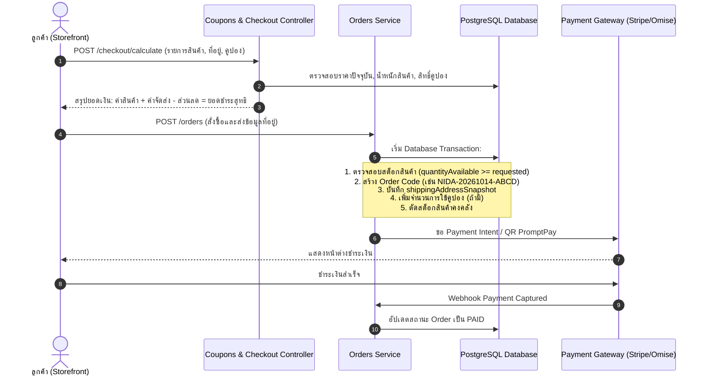

---

### 3.2 ขั้นตอนการจัดส่งและออกเลขพัสดุ (Warehouse Fulfillment)

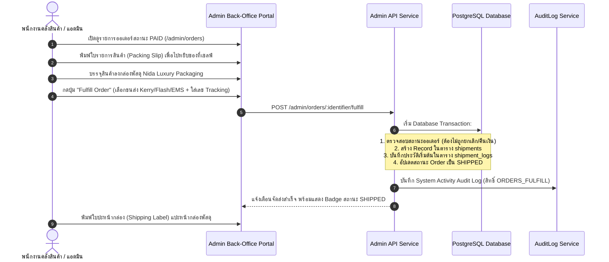

---

### 3.3 ขั้นตอนการอัปเดตสถานะพัสดุและการติดตาม (Shipment Tracking & Timeline)

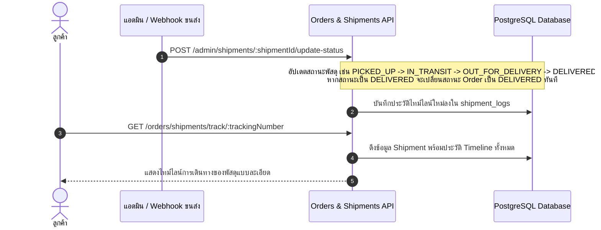

---

### 3.4 ขั้นตอนการขอคืนสินค้าและการคืนเงิน (Customer Return Request & Refund Processing Flow)

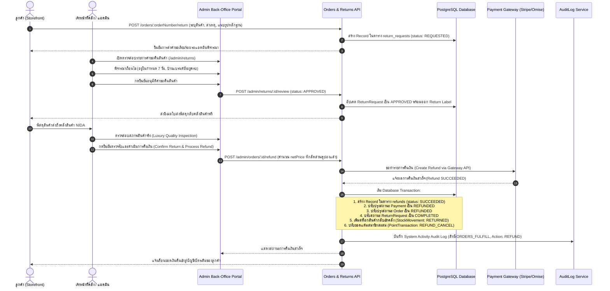

---

## 4. โครงสร้างการจัดส่งและคำนวณค่าส่ง (Shipping Architecture)

### 4.1 ตรรกะการคิดค่าจัดส่ง (Shipping Calculation Rules)

ระบบคำนวณค่าจัดส่งใน [coupons.service.ts](file:///apps/admin-api/src/modules/coupons/coupons.service.ts) มีหลักการดังนี้:

1. **Free Shipping Threshold**:
   - หากยอดสั่งซื้อรวม (Subtotal) ถึงเกณฑ์ที่กำหนด (เช่น $\ge 1,500$ บาท) $\rightarrow$ **ฟรีค่าจัดส่ง ($0$ บาท)**
   - หากยอดสั่งซื้อรวมไม่ถึงเกณฑ์ $\rightarrow$ คิดค่าจัดส่งตามอัตรามาตรฐาน (Standard Shipping Fee เช่น $50$ บาท)
2. **คูปองส่งฟรี (Free Shipping Coupon)**:
   - หากลูกค้ากรอกโค้ดส่วนลดประเภท `FREE_SHIPPING` $\rightarrow$ ระบบจะลดค่าจัดส่งให้เหลือ $0$ บาท ทันที แม้ยอดสั่งซื้อจะไม่ถึงเกณฑ์ขั้นต่ำ

### 4.2 การเก็บข้อมูลที่อยู่จัดส่งแบบ Snapshot (Shipping Address Snapshot)

เพื่อป้องกันปัญหาเมื่อลูกค้าแก้ไขที่อยู่ในโปรไฟล์ส่วนตัวหลังจากสั่งซื้อไปแล้ว ระบบจะบันทึกที่อยู่จัดส่ง ณ เสี้ยววินาทีที่ชำระเงินลงในคอลัมน์ `shipping_address_snapshot` ของตาราง `orders` ในรูปแบบ JSON:

```json
{
  "recipientName": "คุณ นิดา เลิศรัตนวิจิตร",
  "phone": "081-234-5678",
  "addressLine1": "99/1 ซอยทองหล่อ 13 ถนนสุขุมวิท 55",
  "addressLine2": "อาคารเพนท์เฮาส์ ชั้น 14",
  "subdistrict": "คลองตันเหนือ",
  "district": "วัฒนา",
  "province": "กรุงเทพมหานคร",
  "postalCode": "10110",
  "country": "TH"
}
```

### 4.3 โมเดลข้อมูลการจัดส่ง (`Shipment` และ `ShipmentLog`)

> [!NOTE]
> **Database Readiness Guarantee**: โครงสร้างตารางใน [packages/database/prisma/schema.prisma](file:///packages/database/prisma/schema.prisma) มีโมเดล `Shipment` และ `ShipmentLog` ครบถ้วนตามมาตรฐานสากลแล้ว **ไม่จำเป็นต้องแก้ไข Schema หรือทำการ Database Migration ใดๆ เพิ่มเติม**

ตาราง `shipments` เชื่อมโยงกับ `orders` แบบ $1 : N$ (รองรับกรณีแยกจัดส่งหลายกล่อง):
- **`id`**: รหัส UUID ประจำ Shipment
- **`orderId`**: รหัส UUID เชื่อมโยงกับคำสั่งซื้อในตาราง `orders`
- **`courierName`**: ชื่อบริษัทขนส่งพันธมิตร (เช่น `Kerry Express`, `Flash Express`, `Thailand Post EMS`, `DHL Express`)
- **`trackingNumber`**: หมายเลขติดตามพัสดุของขนส่งจริง (เช่น `EA823739216TH`, `KEX12345678`, `TH0123456789A`)
- **`carrierCode`**: Enum รหัสบริษัทขนส่ง (`KERRY_EXPRESS`, `FLASH_EXPRESS`, `THAILAND_POST_EMS`, `DHL_EXPRESS`)
- **`status`**: สถานะพัสดุ (`LABEL_CREATED` $\rightarrow$ `PICKED_UP` $\rightarrow$ `IN_TRANSIT` $\rightarrow$ `OUT_FOR_DELIVERY` $\rightarrow$ `DELIVERED` หรือ `FAILED`)
- **`shippedAt`**: วันเวลาที่รถขนส่งสแกนรับพัสดุเข้าระบบ
- **`estimatedDelivery`**: วันเวลาคาดการณ์ที่จะนำจ่ายถึงปลายทาง
- **`deliveredAt`**: วันเวลาที่ลูกค้าเซ็นรับพัสดุเสร็จสมบูรณ์

ตาราง `shipment_logs` บันทึกประวัติไทม์ไลน์และเหตุการณ์ทุกจุดของการขนส่ง ($1 : N$ กับ `shipments`):
- **`id`**: รหัส UUID ประจำ Log Entry
- **`shipmentId`**: รหัส UUID ของ `shipments`
- **`statusTitle`**: หัวข้อสถานะภาษาไทยระดับ Luxury เช่น "สร้างหมายเลขพัสดุเรียบร้อย", "พัสดุถึงศูนย์กระจายสินค้า", "พนักงานกำลังนำจ่ายพัสดุ", "จัดส่งสำเร็จ"
- **`statusDescription`**: รายละเอียดเพิ่มเติมจากขนส่ง ข้อมูลผู้เซ็นรับ (`signerTypeText`) และลิงก์รูปถ่ายหลักฐานการส่งมอบ (`info.pod`) โดยไม่ต้องสร้างคอลัมน์ใหม่
- **`location`**: ตำแหน่งศูนย์คัดแยกหรือสถานีปลายทางที่ทำการสแกน (เช่น "Kerry Hub บางนา", "ศูนย์คัดแยกหลักสี่")
- **`logTimestamp`**: วันเวลาตามบันทึกจริงของเครื่องสแกนขนส่ง (Courier Event Timestamp) เพื่อป้องกันปัญหาเวลาคลาดเคลื่อนจากความล่าช้าของเครือข่าย

---

## 5. มาตรฐานการจัดเก็บ Log สำหรับ Timeline & Status (ตามข้อกำหนด SHIPPOP Integration)

จากการศึกษา API Document ของ **SHIPPOP Shipping Gateway** อย่างละเอียด ระบบของ NIDA ถูกออกแบบให้รองรับ Data Contract และ Event Flow ของ SHIPPOP แบบ 100%:

### 5.1 การแมปโครงสร้างข้อมูลสถานะ (Status Code & Event Mapping)

SHIPPOP มีการส่งสถานะผ่าน 2 ระดับ: **`order_status`** (สถานะหลักของบิล) และ **`state.status`** (รหัสเหตุการณ์ย่อยของขนส่ง):

| ขั้นตอนลอจิสติกส์ | SHIPPOP `order_status` | SHIPPOP `state.status` (Courier Event) | NIDA `ShipmentStatus` | NIDA `OrderStatus` | คำอธิบายและข้อความที่บันทึกลง `ShipmentLog` |
| :--- | :--- | :--- | :--- | :--- | :--- |
| **จองพัสดุสำเร็จ** | `booking` | `000` / `wait_pickup` | `LABEL_CREATED` | `PROCESSING` | "สร้างหมายเลขพัสดุและใบปะหน้ากล่องเรียบร้อย รอนัดรถเข้ารับ" |
| **ขนส่งเข้ารับพัสดุ** | `shipping` | `010` (Picked Up) | `PICKED_UP` | `SHIPPED` | "บริษัทขนส่งเข้ารับพัสดุจากศูนย์กระจายสินค้า NIDA แล้ว" |
| **ถึงศูนย์คัดแยก** | `shipping` | `102` (Hub / Transit) | `IN_TRANSIT` | `SHIPPED` | "พัสดุถึงศูนย์คัดแยก [Location] และอยู่ระหว่างส่งต่อ" |
| **ถึงศูนย์ปลายทาง** | `shipping` | `103` (Destination Station) | `IN_TRANSIT` | `SHIPPED` | "พัสดุถึงศูนย์กระจายสินค้าปลายทาง [Location]" |
| **กำลังนำจ่าย** | `shipping` | `045` (Out for Delivery) | `OUT_FOR_DELIVERY` | `SHIPPED` | "พนักงานจัดส่งกำลังนำจ่ายพัสดุไปยังที่อยู่ปลายทาง" |
| **นำจ่ายสำเร็จ** | `complete` | `POD` (Proof of Delivery) | `DELIVERED` | `DELIVERED` | "จัดส่งพัสดุสำเร็จ ลงชื่อรับโดย: [signerTypeText] พร้อมหลักฐานภาพถ่าย" |
| **มีปัญหาการนำจ่าย** | `problem` | `050` / `contact_fail` / `postpone` | `FAILED` | `SHIPPED` (รอนำจ่ายซ้ำ) | บันทึกสาเหตุจริง (เช่น ติดต่อผู้รับไม่ได้, ลูกค้าขอเลื่อนวัน, ที่อยู่ไม่ชัดเจน) |
| **พัสดุตีกลับคลัง** | `return` / `return_shipping` | `RTS` (Return to Sender) | `FAILED` | `PROCESSING` | "พัสดุอยู่ระหว่างการส่งตีกลับมายังศูนย์กระจายสินค้า NIDA" |
| **ยกเลิกพัสดุ** | `cancel` | `999` (Cancelled) | `FAILED` | `PROCESSING` / `REFUNDED` | บันทึก "ยกเลิกหมายเลขพัสดุตามคำขอ" |

---

### 5.2 แผนภาพลำดับการรับ Webhook และบันทึก Log (Webhook Real-time Log Ingestion)

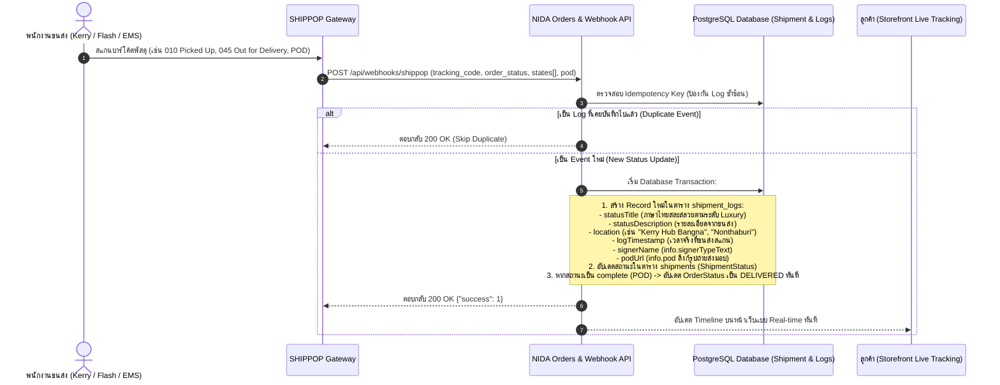

---

### 5.3 หลักการและข้อกำหนดเข้มงวดในการเก็บ Log และทำ Timeline

เพื่อให้ระบบ Timeline มีความน่าเชื่อถือระดับ Enterprise และสอดรับกับ SHIPPOP 100%:

1. **การป้องกัน Log ซ้ำซ้อน (Deduplication & Idempotency)**:
   - ปัญหาพบบ่อย: ขนส่งอาจยิง Webhook สถานะเดิมซ้ำหลายครั้งในเสี้ยววินาที หรือส่ง Retry เมื่อเครือข่ายกระตุก
   - วิธีแก้: ในขั้นตอนบันทึก `ShipmentLog` ระบบจะใช้ Deduplication Key ประกอบด้วย `shipmentId + statusCode + logTimestamp` หากพบว่ามี Log ชุดนี้อยู่แล้ว จะไม่ Insert ซ้ำเด็ดขาด
2. **การยึดถือเวลาจริงของเหตุการณ์ (`logTimestamp` vs Server Time)**:
   - เวลาที่แสดงใน Timeline จะต้องดึงมาจากฟิลด์ `datetime` ของเหตุการณ์ที่ขนส่งสแกนจริงจากเครื่อง Handheld ไม่ใช่เวลาที่ Server รับ Webhook เพื่อป้องกันปัญหาความคลาดเคลื่อนหาก Webhook มีการดีเลย์
3. **การป้องกันสถานะถอยหลัง (Monotonic State Progression Guard)**:
   - หากพัสดุมีสถานะเป็น `DELIVERED` เรียบร้อยแล้ว ระบบจะไม่อนุญาตให้ Webhook ล่าช้าที่ส่งสถานะ `IN_TRANSIT` หรือ `OUT_FOR_DELIVERY` มาปรับลดทอนสถานะของพัสดุถอยหลังเด็ดขาด
4. **การแสดงผลแบบ Hybrid Timeline (Virtual Milestone + Actual Carrier Events)**:
   - **ระยะแรก (ก่อนขนส่งสแกนรับ)**: ระบบจะสร้าง Milestone จำลองจากคำสั่งซื้อ (เช่น `ชำระเงินสำเร็จ` $\rightarrow$ `กำลังจัดเตรียมสินค้าที่คลัง` $\rightarrow$ `ออกเลขพัสดุเรียบร้อย`)
   - **ระยะขนส่งจริง (เมื่อมีข้อมูลจาก SHIPPOP)**: แสดง Event Stream ครบทุกสถานี จุดคัดแยก เวลาที่สแกน และแสดงรูปภาพหลักฐานการเซ็นรับ (`pod`) เมื่อส่งมอบสำเร็จ

---

## 6. มาตรฐานระบบชำระเงิน OMISE Integration (PromptPay QR, 3-D Secure Card & Refunds)

ระบบการชำระเงินของ NIDA ออกแบบตามมาตรฐานความปลอดภัย **PCI-DSS Level 1** โดยเชื่อมต่อกับ **Omise (Opn Payments)** ซึ่งเป็น Payment Gateway ชั้นนำของประเทศไทย:

### 6.1 รูปแบบการชำระเงินที่รองรับ

1. **PromptPay Dynamic QR Code**:
   - ระบบสร้าง Source ประเภท `promptpay` ผ่าน Omise API โดยระบุจำนวนเงินสุทธิ (แปลงเป็นหน่วยสตางค์ เช่น $1,500$ บาท = $150,000$ สตางค์)
   - Omise ส่งกลับภาพ QR Code แบบ Dynamic พร้อม `charge_id` (เช่น `chrg_test_...`)
   - หน้าร้านแสดง QR Code พร้อมระบบนับเวลาถอยหลัง (TTL 15 นาที) ป้องกันการสแกนจ่ายช้าเกินกำหนด
2. **บัตรเครดิต / เดบิต (Credit/Debit Card with 3-D Secure)**:
   - **Client-Side Tokenization**: ข้อมูลบัตรเครดิตของผู้ใช้ถูกเข้ารหัสโดยตรงผ่าน `Omise.js` ที่ฝั่งเบราว์เซอร์ และส่งกลับมาเป็น Token (`tokn_test_...`) โดยไม่มีข้อมูลเลขบัตร 16 หลักหรือ CVV ผ่านเข้ามายังเซิร์ฟเวอร์ของ NIDA
   - **3-D Secure (3DS)**: ฝั่งเซิร์ฟเวอร์สร้างรายการ Charge พร้อมส่ง URL `return_uri` เมื่อได้รับผลจาก Omise จะนำลูกค้าไปยังหน้ายืนยันรหัส OTP ทาง SMS ของธนาคารผู้ออกบัตร
3. **การคืนเงินอัตโนมัติ (Automated Gateway Refund)**:
   - เมื่อแอดมินอนุมัติและตรวจรับสินค้าคืน ระบบจะเรียก Omise Refund API (`POST /charges/:charge_id/refunds`) เพื่อโอนเงินคืนเข้าบัตรหรือบัญชีพร้อมเพย์เดิมของลูกค้าโดยตรง ไม่ต้องขอเลขที่บัญชีใหม่

---

### 6.2 ลำดับขั้นตอนการชำระเงินผ่าน OMISE (Payment Sequence Diagram)

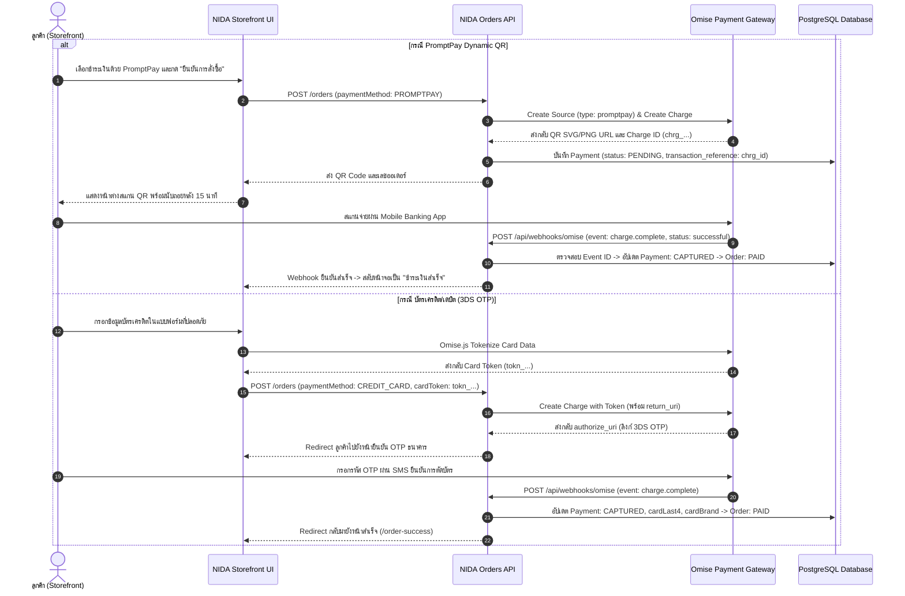

---

### 6.3 ความปลอดภัยและการจัดการ Webhook Idempotency ของ Omise
- **Webhook Signature Verification**: ตรวจสอบ Header ลายเซ็นดิจิทัลจาก Omise ก่อนอนุญาตให้ Payload เข้าสู่ระบบ
- **Event Deduplication**: ใช้ฟิลด์ `gateway_event_id` ในตาราง `payments` บันทึกรหัสเหตุการณ์ของ Omise (`evnt_test_...`) เพื่อป้องกันไม่ให้การส่ง Webhook ซ้ำมีผลกระทบต่อยอดเงินหรือสถานะออเดอร์
- **Graceful Polling Fallback**: หาก Webhook มีการดีเลย์ หน้าร้านสามารถส่งคำขอ `GET /orders/:orderNumber/payment-status` เพื่อให้ระบบไปดึงสถานะล่าสุดจาก Omise API โดยตรงได้

---

## 7. สถาปัตยกรรม Adapter และการสลับ Provider ด้วย Environment Variables (`.env`)

ระบบคำสั่งซื้อของ NIDA ถูกออกแบบตามหลัก **Adapter Pattern** ทั้งในมิติของ **การจัดส่ง (Logistics)** และ **การชำระเงิน (Payment)**:

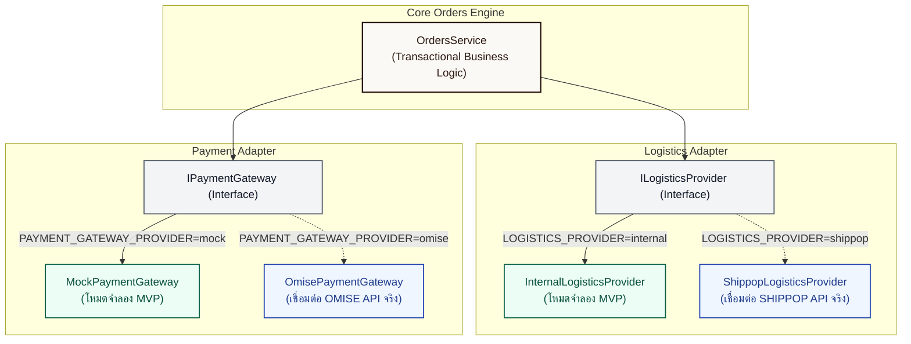

### 7.1 ตารางสรุปการตั้งค่า Environment Variables (`.env`)

| Variable | ค่าที่รองรับ | ค่าเริ่มต้น (Default MVP) | คำอธิบาย |
| :--- | :--- | :--- | :--- |
| **`LOGISTICS_PROVIDER`** | `internal` / `shippop` | `internal` | สลับระหว่างระบบจำลองภายใน กับการยิงจองรถจริงผ่าน SHIPPOP |
| `SHIPPOP_API_KEY` | String | - | API Key สำหรับเรียกใช้งาน SHIPPOP Marketplace API |
| `SHIPPOP_ENDPOINT_URL` | URL | `https://mkpservice.shippop.com` | Base URL ของ SHIPPOP Production หรือ Sandbox |
| `SHIPPOP_WEBHOOK_SECRET`| String | - | Secret Key สำหรับตรวจสอบความถูกต้องของ Webhook พัสดุ |
| **`PAYMENT_GATEWAY_PROVIDER`** | `mock` / `omise` | `mock` | สลับระหว่างระบบจำลองชำระเงิน กับการตัดเงินจริงผ่าน Omise |
| `OMISE_PUBLIC_KEY` | String (`pkey_...`) | - | Omise Public Key สำหรับ Frontend Tokenization |
| `OMISE_SECRET_KEY` | String (`skey_...`) | - | Omise Secret Key สำหรับ Backend Charge & Refund API |
| `OMISE_WEBHOOK_SECRET` | String | - | Secret สำหรับตรวจสอบลายเซ็น Webhook ของ Omise |

---

### 7.2 โครงสร้าง Interface และสัญญาของ Logistics Adapter (`ILogisticsProvider`)

เพื่อให้คำสั่งซื้อและคลังสินค้าทำงานได้เป็นอิสระจาก Gateway ภายนอก ทุก Provider ต้องปฏิบัติตามสัญญาต่อไปนี้:

```typescript
export interface CreateShipmentInput {
  orderId: string;
  orderNumber: string;
  recipientName: string;
  recipientPhone: string;
  shippingAddress: {
    addressLine1: string;
    addressLine2?: string;
    subdistrict: string;
    district: string;
    province: string;
    postalCode: string;
    country: string;
  };
  carrierCode?: CarrierCode;
  weightGrams?: number;
}

export interface CreateShipmentResult {
  trackingNumber: string;
  courierName: string;
  carrierCode: CarrierCode;
  labelUrl?: string;
  estimatedDelivery?: Date;
  initialLog: {
    statusTitle: string;
    statusDescription?: string;
    location?: string;
    logTimestamp: Date;
  };
}

export interface TrackingTimelineResult {
  trackingNumber: string;
  courierName: string;
  status: ShipmentStatus;
  events: Array<{
    statusTitle: string;
    statusDescription?: string;
    location?: string;
    timestamp: Date;
  }>;
}

export interface ParsedLogisticsWebhook {
  trackingNumber: string;
  shipmentStatus: ShipmentStatus;
  statusTitle: string;
  statusDescription?: string;
  location?: string;
  eventTimestamp: Date;
  isDelivered: boolean;
}

export interface ILogisticsProvider {
  createShipment(input: CreateShipmentInput): Promise<CreateShipmentResult>;
  getTrackingTimeline(trackingNumber: string): Promise<TrackingTimelineResult>;
  getShippingLabelUrl(trackingNumber: string): Promise<string>;
  parseWebhook(
    payload: unknown,
    headers: Record<string, string | string[] | undefined>
  ): Promise<ParsedLogisticsWebhook | null>;
}
```

---

### 7.3 โครงสร้าง Interface และสัญญาของ Payment Gateway Adapter (`IPaymentGatewayProvider`)

```typescript
export interface CreatePaymentIntentInput {
  orderId: string;
  orderNumber: string;
  amount: number; // หน่วยบาท
  currency: string; // เช่น "THB"
  paymentMethod: PaymentMethod; // PROMPTPAY, CREDIT_CARD
  cardToken?: string; // Omise tokn_... (กรณีบัตรเครดิต)
  customerEmail?: string;
  returnUri?: string; // URL สำหรับ 3DS OTP Redirect กลับมา
}

export interface CreatePaymentIntentResult {
  transactionReference: string;
  status: PaymentStatus; // PENDING, AUTHORIZED, CAPTURED
  qrCodeUrl?: string; // URL ภาพ QR Code สำหรับ PromptPay
  authorizeUri?: string; // ลิงก์ยืนยัน OTP ธนาคาร 3DS
  expiresAt?: Date;
}

export interface CreateRefundInput {
  transactionReference: string;
  amount: number;
  reason?: string;
}

export interface CreateRefundResult {
  gatewayRefundId: string;
  status: RefundStatus; // SUCCEEDED, FAILED
}

export interface ParsedPaymentWebhook {
  transactionReference: string;
  gatewayEventId: string;
  paymentStatus: PaymentStatus;
  isSuccessful: boolean;
  paidAt?: Date;
  cardLast4?: string;
  cardBrand?: string;
}

export interface IPaymentGatewayProvider {
  createPaymentIntent(input: CreatePaymentIntentInput): Promise<CreatePaymentIntentResult>;
  checkPaymentStatus(transactionReference: string): Promise<PaymentStatus>;
  createRefund(input: CreateRefundInput): Promise<CreateRefundResult>;
  parseWebhook(
    payload: unknown,
    headers: Record<string, string | string[] | undefined>
  ): Promise<ParsedPaymentWebhook | null>;
}
```

---

### 7.4 กลไกการคัดเลือก Provider ขณะรันไทม์ (Dependency Injection & Runtime Switch)

ระบบใช้ Factory Pattern ภายใน NestJS Module เพื่อเลือกสร้าง Provider Instance ตามค่าใน Environment Variables:

1. **เมื่อ `LOGISTICS_PROVIDER=internal` (โหมดค่าเริ่มต้นสำหรับ Development & MVP)**:
   - ระบบจะสร้าง `InternalLogisticsProvider` (สร้างเลข Tracking จำลอง เช่น `NIDA-KEX-...`, `NIDA-FLS-...` พร้อมสร้าง Milestone จำลองและ Timeline ที่สมจริง)
   - รองรับการทดสอบ Fulfill และดู Timeline ในระบบได้ 100% โดยไม่ต้องเชื่อมต่อเครือข่ายภายนอก
2. **เมื่อ `LOGISTICS_PROVIDER=shippop` (โหมด Production Integration)**:
   - ระบบจะสร้าง `ShippopLogisticsProvider` ยิงคำสั่งจองพัสดุผ่าน SHIPPOP Booking API (`https://mkpservice.shippop.com/booking/`)
   - นำเข้า Tracking Code จริง และรับ Webhook สแกนพัสดุจากรถขนส่งจริง
3. **เมื่อ `PAYMENT_GATEWAY_PROVIDER=mock` (โหมดค่าเริ่มต้นสำหรับ Development & MVP)**:
   - สร้าง QR PromptPay จำลอง หรือตัดบัตรทดสอบทันที
4. **เมื่อ `PAYMENT_GATEWAY_PROVIDER=omise` (โหมด Production Integration)**:
   - เรียกใช้ Omise API (`POST /charges`) สำหรับ PromptPay Source และตัดบัตร 3DS OTP จริง

## 8. ความจำเป็นของระบบ Fulfillment & Printing ในคลังสินค้า

| เอกสาร / ฟังก์ชัน | วัตถุประสงค์ในการทำงานจริง | ขนาดมาตรฐาน | ผลกระทบหากไม่มีระบบนี้ |
| :--- | :--- | :--- | :--- |
| **ใบปะหน้ากล่อง (Shipping Label)** | แปะหน้ากล่องพัสดุสำหรับเจ้าหน้าที่ขนส่งสแกนรับสินค้า (มีบาร์โค้ด Tracking, ชื่อ-ที่อยู่ผู้ส่ง และผู้รับชัดเจน) | สติกเกอร์ความร้อน $100 \times 150$ มม. (A6) | แอดมินต้องก๊อปปี้ที่อยู่ทีละรายการไปแปะ Word/Excel หรือคีย์มือเข้าเว็บขนส่ง ซึ่งเสียเวลาและเสี่ยงที่อยู่ผิดพลาดสูง |
| **ใบแจ้งรายการสินค้า (Packing Slip)** | พนักงานคลังใช้หยิบของจากเชลฟ์ (Pick List) และใส่ในกล่องให้ลูกค้าตรวจสอบสินค้าที่ได้รับ | กระดาษ A4 หรือ A5 | พนักงานอาจหยิบสินค้าผิดไซส์/ผิดสี หรือลืมใส่สินค้าให้ครบตามรายการ |
| **การจัดส่งแบบกลุ่ม (Bulk Fulfill)** | เลือกออเดอร์สถานะ PAID หลายรายการพร้อมกัน แล้วพิมพ์เอกสารและออกเลขอัตโนมัติ | - | หากมี 30-100 ออเดอร์ต่อวัน แอดมินต้องกดเปิดทีละหน้าจอเพื่อใส่เลข Tracking ซึ่งไม่รองรับการเติบโตของธุรกิจ |

---

## 9. ความปลอดภัยและการควบคุมสิทธิ์ (RBAC & Audit Trail)

ตามมาตรฐานความปลอดภัยระดับ Enterprise ของ Nida:
- **สิทธิ์การเข้าถึง**:
  - `ORDERS_READ`: ดูรายการคำสั่งซื้อ รายละเอียด และพิมพ์เอกสาร
  - `ORDERS_FULFILL`: ออกเลขพัสดุ เปลี่ยนสถานะการจัดส่ง และจัดการพัสดุ
- **Audit Trail**: ทุกครั้งที่มีการกด Fulfill หรือแก้ไขสถานะพัสดุ ระบบจะบันทึกประวัติลงใน `AdminAuditLog` โดยอัตโนมัติ:
  - ระบุ ID แอดมินผู้ดำเนินการ, IP Address, ข้อมูลก่อน-หลังแก้ไข, และสิทธิ์ที่ใช้ (`ORDERS_FULFILL`) เพื่อความโปร่งใสและตรวจสอบได้ 100%

---

## 10. สรุป Endpoint สำคัญที่เกี่ยวข้องทั้งหมด

| Method | Endpoint | สิทธิ์ที่ต้องใช้ | หน้าที่การทำงาน |
| :--- | :--- | :--- | :--- |
| `POST` | `/checkout/calculate` | Public / Customer | คำนวณยอดเงิน ค่าจัดส่ง และส่วนลด |
| `POST` | `/orders` | Public / Customer | สร้างคำสั่งซื้อใหม่และตัดสต็อก (พร้อมรองรับ Omise Source/Token) |
| `GET` | `/store/orders/my-orders` | Customer (JWT) | ดึงประวัติคำสั่งซื้อทั้งหมดของลูกค้าที่ล็อกอินอยู่ |
| `POST` | `/orders/track` | Public | ค้นหาข้อมูลพัสดุและไทม์ไลน์ด้วย Order Number + เบอร์โทรศัพท์ |
| `GET` | `/orders/shipments/track/:trackingNumber` | Public | ลูกค้าตรวจสอบสถานะพัสดุและไทม์ไลน์ด้วยเลข Tracking |
| `GET` | `/admin/orders` | `ORDERS_READ` | ดึงรายการคำสั่งซื้อทั้งหมดสำหรับแอดมิน |
| `GET` | `/admin/orders/:orderNumber` | `ORDERS_READ` | ดูรายละเอียดคำสั่งซื้อเดี่ยว พร้อมรายการสินค้าและที่อยู่ |
| `POST` | `/admin/orders/:id/fulfill` | `ORDERS_FULFILL` | ยืนยันจัดส่ง สร้าง Shipment และเปลี่ยนสถานะเป็น `SHIPPED` |
| `POST` | `/admin/shipments/:id/update-status` | `ORDERS_FULFILL` | อัปเดตสถานะพัสดุและไทม์ไลน์การเดินทางแบบแมนนวล |
| `POST` | `/api/webhooks/shippop` | Public (Token) | รับสถานะ Real-time จากขนส่งผ่าน SHIPPOP และบันทึก Log ไทม์ไลน์ |
| `POST` | `/api/webhooks/omise` | Public (Signature) | รับแจ้งผลการชำระเงิน (`charge.complete`) จาก Omise Gateway |
| `POST` | `/orders/:orderNumber/return` | Customer | ลูกค้าส่งคำขอคืนสินค้า (Return Request) พร้อมรูปหลักฐาน |
| `GET` | `/admin/returns` | `ORDERS_READ` | ดึงรายการคำขอคืนสินค้าทั้งหมดสำหรับแอดมิน |
| `POST` | `/admin/returns/:id/review` | `ORDERS_FULFILL` | แอดมินอนุมัติหรือปฏิเสธคำขอคืนสินค้า |
| `POST` | `/admin/orders/:id/refund` | `ORDERS_FULFILL` | ดำเนินการคืนเงินผ่าน Omise Gateway API พร้อมปรับยอดสต็อกและแต้ม |

---

### 10.1 ความเชื่อมโยงโดยตรงกับ Phase 6 ของ `docs/TODO_store.md`

โครงสร้าง Endpoint ด้านบนถูกจัดเตรียมเพื่อรองรับหน้าร้านในเฟส 6 ได้อย่างสมบูรณ์แบบ:

1. **หน้าติดตามพัสดุ (`/track-order`)**:
   - ใช้ `POST /orders/track` (Payload: `{ orderNumber, phone }`) เพื่อค้นหาคำสั่งซื้อโดยไม่ต้องล็อกอิน (Guest Checkout)
   - ดึงข้อมูล `Shipment` และ `ShipmentLog` ทั้งหมดมาแสดง Timeline การเดินทางจริง
2. **ประวัติการสั่งซื้อในหน้าโปรไฟล์ (`/profile/orders`)**:
   - ใช้ `GET /store/orders/my-orders` (Bearer Token JWT) เพื่อดึงประวัติคำสั่งซื้อทั้งหมดของผู้ใช้
   - แสดงสถานะแบบเรียลไทม์ พร้อมรายการสินค้าแต่ละชิ้น และปุ่มกดเปิดดู Tracking ได้ทันที
3. **การทำงานร่วมกับ SHIPPOP และ Omise โดยไม่ต้องรอการเชื่อมต่อภายนอก**:
   - หน้าร้านทั้ง 2 หน้ารวมถึงหน้า Checkout สามารถทดสอบการทำงานได้อย่างสมบูรณ์แบบทันทีผ่าน `internal` / `mock` provider และพร้อมสลับไปใช้ Production Gateway ทันทีเพียงเปลี่ยนตัวแปรใน `.env`


