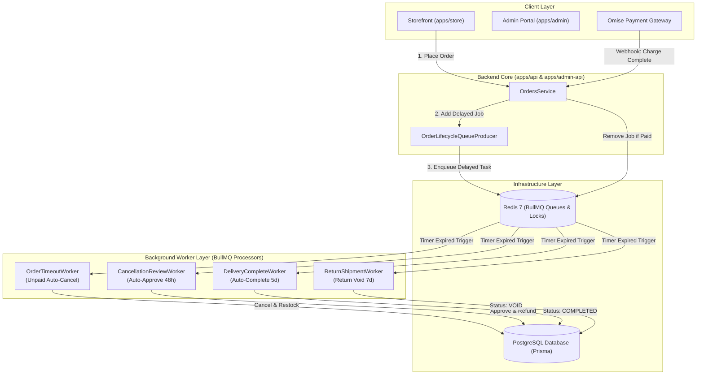
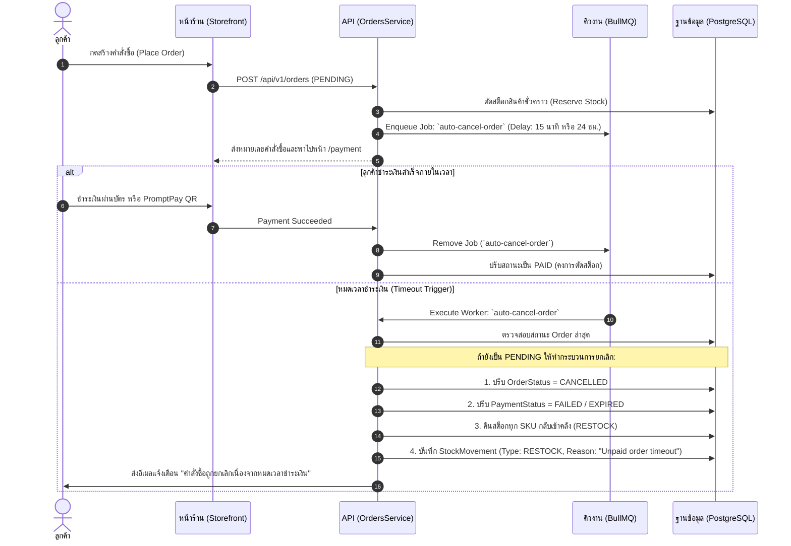

# NIDA E-Commerce — Order Lifecycle, Cooldowns & Background Jobs Business Logic Specification

> **เอกสารข้อกำหนดทางธุรกิจ (Business Logic Specification)** สำหรับสถาปัตยกรรมวงจรชีวิตคำสั่งซื้อ ระบบคูลดาวน์ (Cooldowns) ระบบจำกัดเวลา (Timeouts) และคิวงานประมวลผลเบื้องหลัง (Background Worker & Queues) ของระบบ **NIDA Luxury E-Commerce Platform** ครอบคลุมทั้งฝั่งหน้าร้าน (`apps/store`), API ลูกค้า (`apps/api`), API แอดมิน (`apps/admin-api`), และแผงควบคุมหลังบ้าน (`apps/admin`)

---

## 1. บทนำและปรัชญาการออกแบบ (Executive Summary & Philosophy)

ในการดำเนินธุรกิจพาณิชย์อิเล็กทรอนิกส์ระดับพรีเมียม (Luxury E-Commerce) การจัดการวงจรชีวิตคำสั่งซื้อ (Order Lifecycle) มีผลโดยตรงต่อ **ความพึงพอใจของลูกค้า (Customer Experience)**, **ความแม่นยำของสต็อกสินค้า (Inventory Integrity)**, และ **กระแสเงินสดของกิจการ (Cash Flow & Financial Security)**

### ปัญหาที่ต้องแก้ไข:

1. **การกั๊กสต็อกสินค้า (Stock Hoarding & Unpaid Orders)**: ลูกค้ากดสั่งซื้อสินค้า (โดยเฉพาะสินค้ายอดนิยมหรือมีจำนวนจำกัด) แต่ไม่ยอมชำระเงิน หากระบบไม่ตัดคำสั่งซื้อออก สต็อกสินค้าจะค้างอยู่ในสถานะตัดจำหน่าย ทำให้ลูกค้าคนอื่นเสียโอกาสในการซื้อ และร้านค้าสูญเสียยอดขาย
2. **คำขอยกเลิกค้างเติ่ง (Unprocessed Cancellation Requests)**: ลูกค้ากดยกเลิกสินค้าก่อนการจัดส่ง หากแอดมินหรือคลังสินค้าไม่กดตรวจสอบภายในระยะเวลาที่เหมาะสม ลูกค้าจะเกิดความกังวลและร้องเรียน
3. **การขอคืนสินค้าย้อนหลังเกินสมควร (Return Abuse)**: ลูกค้ารับสินค้าไปแล้วหลายสัปดาห์หรือนำไปสวมใส่ใช้งานแล้ว ส่งคำร้องขอคืนสินค้าย้อนหลัง ทำให้สินค้าเสื่อมสภาพและเกิดข้อพิพาท
4. **การยิงสแปมช่องทางชำระเงิน (Payment Switch Flooding)**: การกดสลับวิธีชำระเงินรัวๆ ก่อให้เกิดขยะ Transaction และ Rate Limit Error บน Payment Gateway (เช่น Omise)

### ปรัชญาสถาปัตยกรรม (Architectural Principles):

- **Deterministic & Automated**: อาศัยระบบ Automation และ Job Queue ในการตัดสินใจตามเงื่อนไขเวลา ไม่พึ่งพากำลังคนในการไล่กวาดงานรูทีน
- **Decoupled from HTTP Cycle**: งานที่ต้องหน่วงเวลา (Delayed Jobs) ต้องทำงานแบบ Asynchronous ผ่านระบบคิว ไม่บล็อกการตอบสนองของ API
- **Crash-Resilient & Persistent**: งานทุกชิ้นต้องถูกบันทึกลง Persistent Storage (Redis) หากเซิร์ฟเวอร์เกิดการรีสตาร์ทหรือดับกลางคัน คิวงานต้องกลับมาทำงานต่อได้ถูกต้อง 100%
- **Audit-Logged**: ทุกการขยับสถานะโดยระบบอัตโนมัติ (System Automated Trigger) ต้องถูกบันทึกประวัติลง `AuditLog` และ `StockMovement` อย่างโปร่งใส

---

## 2. แผนภาพสถาปัตยกรรมระบบคิว (System Architecture Diagram)

ระบบใช้ **`@nestjs/bullmq`** ทำงานร่วมกับ **Redis 7** โดยแบ่ง Worker และ Queue ออกเป็นโมดูลชัดเจน:



---

## 3. รายละเอียดกฎทางธุรกิจทั้ง 6 ประการ (Detailed Business Rules)

### กฎข้อที่ 1: การยกเลิกออเดอร์ค้างชำระอัตโนมัติ (Unpaid Order Auto-Cancel & Restock)

> **เป้าหมาย**: ป้องกันการกั๊กสต็อกสินค้า คืนสินค้ากลับสู่หน้าร้านให้ลูกค้าท่านอื่นอย่างรวดเร็ว



#### กำหนดระยะเวลา Timeout:

- **PromptPay QR Code**: หมดอายุภายใน **15 นาที** (900 วินาที) นับจากเวลาที่สร้างคำสั่งซื้อ (ตรงกับอายุ QR Code ของระบบธนาคาร)
- **Credit / Debit Card**: หมดอายุภายใน **30 นาที** นับจากเวลาที่สร้างคำสั่งซื้อ
- **กรณีแอดมินสร้างคำสั่งซื้อแบบกำหนดเอง (Admin Manual Draft)**: ให้เวลาสูงสุด **24 ชั่วโมง**

#### เงื่อนไขด้านความปลอดภัย (Concurrency & Race Condition Guard):

- ก่อน Worker จะปรับสถานะเป็น `CANCELLED` **ต้องครอบ Transaction และตรวจสอบสถานะล่าสุดใน Database อีกครั้งเสมอ**:
  ```ts
  if (order.status !== OrderStatus.PENDING) {
    // ออเดอร์ถูกชำระเงินหรือยกเลิกไปก่อนหน้าแล้ว ให้ข้ามงานนี้ (Skip idempotent)
    return;
  }
  ```
- หากลูกค้าชำระเงินสำเร็จในวินาทีที่ 14:59 แต่ Worker รันในวินาทีที่ 15:00 ให้ยึด **ผลการอนุมัติเงินจาก Payment Gateway เป็นที่สิ้นสุด (Payment Success Wins)** ห้ามยกเลิกออเดอร์ที่ถูกหักเงินสำเร็จแล้วเด็ดขาด

---

### กฎข้อที่ 2: การอนุมัติคำขอยกเลิกสินค้าอัตโนมัติ (Pre-Fulfillment Cancel Auto-Approve)

> **เป้าหมาย**: ปกป้องสิทธิผู้บริโภค หากลูกค้าเปลี่ยนใจขอยกเลิกก่อนพัสดุถูกแพ็ค และแอดมินไม่ตอบรับภายในระยะเวลาที่กำหนด ระบบจะคืนเงินและยกเลิกให้อัตโนมัติ

- **ขอบเขตการใช้งาน**: ใช้ได้เฉพาะคำสั่งซื้อที่อยู่ในสถานะ `PAID` (จ่ายเงินแล้ว) แต่ยังไม่ถูกจัดส่ง (ยังไม่เป็น `SHIPPED`)
- **ระยะเวลารอแอดมิน (Review Timeout)**: **48 ชั่วโมง** นับจากเวลาที่ลูกค้ากดส่งคำร้อง (`cancellationRequests.createdAt`)
- **การทำงานเมื่อครบกำหนด 48 ชม. โดยแอดมินไม่กด Approve/Reject**:
  1. ระบบปรับสถานะคำร้อง `OrderCancellationRequest` จาก `PENDING` เป็น `APPROVED` (บันทึกหมายเหตุ `reviewedBy: "SYSTEM_AUTO_TIMEOUT"`)
  2. ปรับสถานะคำสั่งซื้อ `OrderStatus = CANCELLED`
  3. สั่งงานระบบคืนเงิน **Omise Refund API** คืนเงินเต็มจำนวนสู่บัตรของลูกค้า หรือส่งต่อให้ฝ่ายการเงินโอนคืนกรณี PromptPay
  4. คืนสต็อกสินค้ากลับเข้า Inventory (`StockMovementType: RESTOCK`)
  5. ดึงคะแนนสะสม (Loyalty Points) คืนหากมีการให้แต้มไปล่วงหน้า
  6. บันทึกลง `AuditLog` (Module: `orders`, Action: `REFUND`, Context: `SYSTEM_AUTO`)

---

### กฎข้อที่ 3: การยอมรับสินค้าและปิดออเดอร์สมบูรณ์ (Delivery Acceptance & COMPLETED Transition)

> **เป้าหมาย**: ปิดวงจรคำสั่งซื้ออย่างสมบูรณ์ตามมาตรฐานสากล E-commerce เพื่อบันทึกรายได้ทางบัญชี (Realized Revenue), มอบคะแนนสะสม (Loyalty Points), และปลดล็อกสิทธิ์การรีวิวสินค้า
>
> ⚠️ **การปรับโครงสร้างฐานข้อมูล (Database Schema Upgrade)**:
> ในเฟส 8 ระบบจะเพิ่มสถานะ `COMPLETED` ลงใน `enum OrderStatus` ใน [schema.prisma](file:///packages/database/prisma/schema.prisma) และ `@repo/types`:
>
> ```prisma
> enum OrderStatus {
>   PENDING
>   PAID
>   PREORDER_AWAITING_STOCK
>   PROCESSING
>   SHIPPED
>   DELIVERED    // พัสดุส่งถึงบ้านลูกค้าแล้ว (อยู่ระหว่างตรวจรับ)
>   COMPLETED    // ปิดวงจรการซื้อขายสมบูรณ์ 100% (ยอมรับสินค้าแล้ว)
>   CANCELLED
>   REFUNDED
> }
> ```
>
> **ลำดับการเลื่อนสถานะ (State Machine)**: `PENDING ➔ PAID ➔ PROCESSING ➔ SHIPPED ➔ DELIVERED ➔ COMPLETED`

- **จุดเริ่มต้น (Trigger Point)**: เมื่อสถานะพัสดุอัปเดตเป็น `DELIVERED` (ส่งมอบสำเร็จ)
- **ระยะเวลาการยอมรับ (Acceptance Window)**: **5 วัน** (120 ชั่วโมง)
- **พฤติกรรมของระบบ**:
  - บนหน้าร้าน [CustomerOrderDetailPage](file:///apps/store/src/app/profile/orders/[orderNumber]/page.tsx) จะมีปุ่ม **"ฉันได้ตรวจสอบและยอมรับสินค้าแล้ว (Accept Delivery)"**
  - **กรณีลูกค้าคลิกยอมรับเอง**:
    - ยิง API `POST /api/v1/orders/:orderNumber/accept`
    - ออเดอร์จะเปลี่ยนสถานะจาก `DELIVERED` เป็น `COMPLETED` ทันที
    - ระบบจะโอนแต้มสะสม (Loyalty Points) เข้าบัญชีลูกค้า และปลดล็อกสิทธิ์การเขียนรีวิวสินค้า
    - ถอน Delayed Job ออกจากคิว `delivery-completion-queue`
  - **กรณีลูกค้าไม่กดปุ่มใดๆ ภายใน 5 วัน (Auto-Acceptance)**:
    - เมื่อครบ 120 ชั่วโมง Worker ใน BullMQ จะทำงานอัตโนมัติ: ปรับสถานะออเดอร์เป็น `COMPLETED`
    - บันทึกประวัติ `completedAt = now()` โอน Loyalty Points ให้ลูกค้า และบันทึก `AuditLog` ในระบบหลังบ้าน

---

### กฎข้อที่ 4: การปิดหน้าต่างสิทธิ์ขอคืนสินค้า (Return Window Strict Expiration)

> **เป้าหมาย**: ป้องกันการทุจริตและการนำเสื้อผ้า/สินค้าไปใช้งานแล้วส่งคืนย้อนหลัง

- **กรอบเวลาที่อนุญาต (Return Window)**: **7 วัน** (168 ชั่วโมง) นับจากเวลาที่สินค้าขึ้นสถานะ `DELIVERED`
- **การควบคุมบนหน้าจอ (UI Safeguard)**:
  - หาก `currentTime <= deliveredAt + 7 days`: ปุ่ม **"ยื่นคำร้องขอคืนสินค้า (Request Return)"** จะแสดงและกดได้ตามปกติ
  - หาก `currentTime > deliveredAt + 7 days`:
    - ปุ่มขอคืนสินค้าจะ **ถูกซ่อนหรือปิดการใช้งาน (Disabled)** อย่างถาวร
    - แสดงข้อความกำกับ: _"ระยะเวลาการขอคืนสินค้าสิ้นสุดลงแล้ว (รับประกันภายใน 7 วันหลังได้รับพัสดุ)"_
- **การควบคุมที่ระดับ Backend API (Backend Guard)**:
  - ในฟังก์ชัน `createReturnRequest` ที่ `CustomerOrdersService`:
    ```ts
    const RETURN_WINDOW_DAYS = 7;
    const deliveryDate = order.shipments.find(
      (s) => s.status === ShipmentStatus.DELIVERED,
    )?.updatedAt;

    if (
      !deliveryDate ||
      Date.now() - deliveryDate.getTime() > RETURN_WINDOW_DAYS * 86400 * 1000
    ) {
      throw new BadRequestException(
        'คำสั่งซื้อนี้หมดระยะเวลาการยื่นคำร้องขอคืนสินค้าแล้ว (เกิน 7 วันหลังส่งมอบ)',
      );
    }
    ```

---

### กฎข้อที่ 5: กำหนดเวลาส่งพัสดุคืนหลังคำร้องได้รับอนุมัติ (Return Shipment Deadline)

> **เป้าหมาย**: ป้องกันคำร้องขอคืนสินค้าค้างสถานะตลอดกาลโดยที่ลูกค้าไม่เคยส่งของกลับมาจริง

- **จุดเริ่มต้น (Trigger Point)**: เมื่อแอดมินตรวจสอบเหตุผลและกด **Approve** คำร้องขอคืนสินค้า (สถานะเปลี่ยนเป็น `APPROVED`)
- **ระยะเวลาที่ให้ลูกค้าส่งของคืน**: **7 วัน** (168 ชั่วโมง)
- **พฤติกรรมของระบบ**:
  - ลูกค้าต้องนำพัสดุไปส่งที่ขนส่ง และเข้ามากรอกเลข Tracking พัสดุขากลับในระบบภายใน 7 วัน
  - หากพ้นกำหนด 7 วันแล้วยังไม่มีข้อมูลการส่งพัสดุคืน:
    - Worker จะปรับสถานะคำร้องขอคืนสินค้าเป็น `EXPIRED` หรือ `VOIDED`
    - คืนสิทธิ์การปิดออเดอร์เป็น `COMPLETED`
    - ส่งอีเมลแจ้งเตือนลูกค้าว่าคำร้องถูกยกเลิกเนื่องจากไม่ได้รับพัสดุตามกำหนดเวลา

---

### กฎข้อที่ 6: การป้องกันการกดสลับช่องทางชำระเงินรัว (Payment Switch Rate Limit)

> **เป้าหมาย**: ป้องกันบอทและผู้ใช้กดย้ำปุ่มสลับช่องทางถี่ๆ ซึ่งจะยิงไปสร้าง QR Code ซ้ำซ้อนบน Omise Gateway

- **ระยะเวลาคูลดาวน์ (Cooldown Duration)**: **2 วินาที** (Sliding Window per Order)
- **กลไกการทำงาน**:
  - ใช้ **Redis Distributed Rate Limit** ด้วยคีย์ `ratelimit:switch-payment:{orderNumber}`
  - ไม่บันทึกค่าจำกัดลงฐานข้อมูล PostgreSQL เพื่อรักษาความสะอาดของตาราง Payment
  - **ไม่จำกัดโควต้าจำนวนครั้งตลอดชีพ (No Lifetime Cap)**: ลูกค้าสามารถสลับไปมาระหว่างบัตรเครดิตและ PromptPay ได้ตามต้องการ ตราบใดที่ไม่กดรัวในเสี้ยววินาทีเดียวกัน

---

## 4. สรุปตารางสถานะและเงื่อนไขเวลา (Order Timeout Matrix)

| กฎ / ฟีเจอร์                 | สภาพแวดล้อมที่ตรวจสอบ | ระยะเวลา (Timeout) | การกระทำเมื่อหมดเวลา (Automated Action)            | ผลกระทบต่อสต็อกสินค้า  |
| :--------------------------- | :-------------------: | :----------------: | :------------------------------------------------- | :--------------------: |
| **Unpaid PromptPay**         |    Order `PENDING`    |    **15 นาที**     | ปรับ Order เป็น `CANCELLED`, ปิด QR                | **คืนสต็อก (Restock)** |
| **Unpaid Credit Card**       |    Order `PENDING`    |    **30 นาที**     | ปรับ Order เป็น `CANCELLED`                        | **คืนสต็อก (Restock)** |
| **Cancel Request Review**    |  CancelReq `PENDING`  |   **48 ชั่วโมง**   | Auto-Approve, ปรับเป็น `CANCELLED`, คืนเงิน        | **คืนสต็อก (Restock)** |
| **Delivery Acceptance**      |   Order `DELIVERED`   |     **5 วัน**      | ปรับ Order เป็น `COMPLETED`, ให้คะแนนสะสม          |        ไม่กระทบ        |
| **Return Request Window**    |   Order `DELIVERED`   |     **7 วัน**      | ปิดสิทธิ์ยื่นคำร้องขอคืนสินค้า (Disabled UI & API) |        ไม่กระทบ        |
| **Return Shipment Return**   | ReturnReq `APPROVED`  |     **7 วัน**      | คำร้องหมดอายุ (`VOID`), ปิดเคส                     |     ไม่รับคืนสต็อก     |
| **Payment Switch Anti-Spam** |   หน้าจอ `/payment`   |    **2 วินาที**    | ปฏิเสธ Request ที่ยิงซ้ำเร็วเกินกำหนด              |        ไม่กระทบ        |

---

## 5. การติดตั้งและการใช้งานเชิงเทคนิค (Technical Implementation Plan)

### 5.1 แพ็กเกจที่ต้องติดตั้ง (`apps/api` และ `apps/admin-api`)

```bash
npm --prefix apps/api install @nestjs/bullmq bullmq
npm --prefix apps/admin-api install @nestjs/bullmq bullmq
```

### 5.2 การลงทะเบียนโมดูล (`order-lifecycle.module.ts`)

```ts
import { Module } from '@nestjs/common';
import { BullModule } from '@nestjs/bullmq';
import { OrderLifecycleProducer } from './order-lifecycle.producer';
import { OrderTimeoutProcessor } from './processors/order-timeout.processor';
import { CancellationTimeoutProcessor } from './processors/cancellation-timeout.processor';

@Module({
  imports: [
    BullModule.registerQueue(
      { name: 'order-lifecycle-queue' },
      { name: 'cancellation-review-queue' },
      { name: 'return-deadline-queue' },
    ),
  ],
  providers: [
    OrderLifecycleProducer,
    OrderTimeoutProcessor,
    CancellationTimeoutProcessor,
  ],
  exports: [OrderLifecycleProducer],
})
export class OrderLifecycleModule {}
```

### 5.3 ตัวอย่าง Producer หน่วงเวลา 15 นาที

```ts
@Injectable()
export class OrderLifecycleProducer {
  constructor(
    @InjectQueue('order-lifecycle-queue') private readonly orderQueue: Queue,
  ) {}

  async scheduleUnpaidOrderTimeout(
    orderNumber: string,
    delayMs: number = 15 * 60 * 1000,
  ) {
    await this.orderQueue.add(
      'unpaid-timeout',
      { orderNumber },
      {
        jobId: `unpaid:${orderNumber}`, // ใช้ JobId เดียวกันเพื่อป้องกันการใส่คิวซ้ำ
        delay: delayMs,
        removeOnComplete: true,
        removeOnFail: false,
      },
    );
  }

  async cancelUnpaidOrderTimeout(orderNumber: string) {
    const job = await this.orderQueue.getJob(`unpaid:${orderNumber}`);
    if (job) {
      await job.remove();
    }
  }
}
```

### 5.4 ตัวอย่าง Processor ปลดล็อกและคืนสต็อก

```ts
@Processor('order-lifecycle-queue')
export class OrderTimeoutProcessor extends WorkerHost {
  private readonly logger = new Logger(OrderTimeoutProcessor.name);

  constructor(private readonly prisma: PrismaService) {
    super();
  }

  async process(job: Job<{ orderNumber: string }>): Promise<void> {
    const { orderNumber } = job.data;
    this.logger.log(
      `Processing unpaid timeout check for order #${orderNumber}`,
    );

    await this.prisma.$transaction(async (tx) => {
      const order = await tx.order.findUnique({
        where: { orderNumber },
        include: { items: true, payment: true },
      });

      if (!order || order.status !== OrderStatus.PENDING) {
        return; // Idempotent check
      }

      // 1. Update Order status
      await tx.order.update({
        where: { id: order.id },
        data: { status: OrderStatus.CANCELLED },
      });

      // 2. Update Payment status
      if (order.payment) {
        await tx.payment.update({
          where: { id: order.payment.id },
          data: { status: PaymentStatus.FAILED },
        });
      }

      // 3. Restock inventory items atomically
      for (const item of order.items) {
        if (!item.variantId) continue;
        await tx.inventoryItem.updateMany({
          where: { variantId: item.variantId },
          data: { quantity: { increment: item.quantity } },
        });
        await tx.stockMovement.create({
          data: {
            variantId: item.variantId,
            changeType: StockChangeType.RESTOCK,
            quantity: item.quantity,
            reason: `Auto-cancelled unpaid order timeout #${orderNumber}`,
          },
        });
      }
    });
  }
}
```

---

## 6. แผนการตรวจสอบและทดสอบระบบ (Testing & Verification Strategy)

เพื่อให้มั่นใจว่าระบบไม่มีข้อผิดพลาดตามแนวทาง `AGENTS.md` ต้องจัดทำ Unit Tests และ Integration Tests ครอบคลุม:

1. **Happy Path Tests**:
   - Order หมดเวลา 15 นาที $\rightarrow$ สถานะเปลี่ยนเป็น `CANCELLED`, สต็อกถูกคืนเข้าคลังถูกต้อง
   - ลูกค้าชำระเงินก่อนครบ 15 นาที $\rightarrow$ Job ถูกดึงออกจาก Queue ออเดอร์ไม่ถูกยกเลิก
2. **Negative & Edge Case Tests**:
   - จำลองสถานการณ์จ่ายเงินสำเร็จในเสี้ยววินาทีเดียวกับที่ Worker ทำงาน (Race Condition Test)
   - จำลองเซิร์ฟเวอร์ตัดการเชื่อมต่อระหว่างที่ Job กำลังรัน (Retry & Persistence Test)
3. **Boundary Value Tests**:
   - ทดสอบการกดขอคืนสินค้าในวันที่ 7 พอดี (Allowed) และวันที่ 8 (Rejected)
