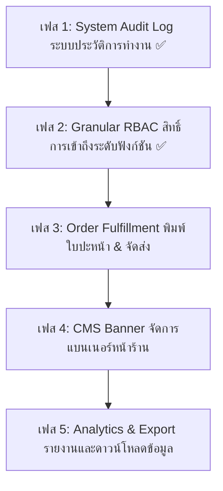

# NIDA Admin Portal — Development Roadmap & TODO

เอกสารรวบรวมสถานะของระบบ แผนงานการพัฒนา และสิ่งที่ควรทำต่อไปสำหรับระบบ **NIDA Admin Back-Office Portal & API** ทั้งหมด

---

## 📊 สถานะปัจจุบันของระบบ (Current System Status)

| โมดูล / ระบบ | Backend (API) | Frontend (Admin UI) | สถานะภาพรวม |
| :--- | :---: | :---: | :--- |
| **Authentication & Sessions** | ✅ Dual-Token (JWT+Redis) | ✅ Split-Screen Clean UI | **พร้อมใช้งาน 100%** |
| **Multi-Device & Security** | ✅ Redis Session List/Revoke | ✅ Session Control | **พร้อมใช้งาน 100%** |
| **Staff & Team Management** | ✅ Invite Link / Status | ✅ Staff Table & Invite Modal | **พร้อมใช้งาน 100%** |
| **Product & Catalog** | ✅ CRUD / Categories / Variant | ✅ Matrix Form / Image Crop | **พร้อมใช้งาน 100%** |
| **Inventory Control** | ✅ Stock Balance / Adjustments | ✅ Inventory Table / Restock | **พร้อมใช้งาน 100%** |
| **Inventory Movements Log** | ✅ Stock Movement Log API | ✅ Movement Audit Table | **พร้อมใช้งาน 100%** |
| **Orders & Fulfillment** | ✅ Status Flow / Courier / Tracking | ✅ Order List & Detail Page | **พร้อมใช้งานพื้นฐาน** |
| **Promotions & Coupons** | ✅ Coupon CRUD & Validations | ✅ Promotion Manager Modal | **พร้อมใช้งาน 100%** |
| **System Activity Audit Log** | ✅ AuditLog API & Interceptors | ✅ Audit Table & Diff Viewer | **พร้อมใช้งาน 100%** |
| **Granular RBAC Permissions** | ✅ PermissionsGuard & Seed | ✅ Route Guards & PermissionGates | **พร้อมใช้งาน 100%** |
| **CMS Banner Management** | ⏳ มี Prisma Model | ⏳ ยังไม่ได้ทำ | **รอดำเนินการ** |
| **Order Packing & Invoicing** | ⏳ ยังไม่ได้ทำ | ⏳ ยังไม่ได้ทำ | **รอดำเนินการ (แนะนำลำดับถัดไป)** |

---

## 🎯 แผนงานสิ่งที่ควรทำต่อไป (Prioritized Roadmap)

---

### 🔥 ลำดับที่ 1: ระบบประวัติการทำงานและความปลอดภัยของแอดมิน (System Activity Audit Log)
> **เป้าหมาย**: บันทึกทุกความเคลื่อนไหวสำคัญของแอดมิน (ใคร ทำอะไร ที่ไหน เมื่อไหร่ ก่อน-หลังแก้ไขเป็นอย่างไร) เพื่อความโปร่งใสและตรวจสอบได้ในระดับ Enterprise

- [x] **Backend (`apps/admin-api`)**:
  - [x] สร้าง `AuditLogModule`, `AuditLogService`, `AuditLogController`
  - [x] บันทึก Event สำคัญและบริบทความปลอดภัย (Permission, Performed Role, IP, User Agent):
    - การสร้าง / ปรับปรุงเจ้าหน้าที่ (Invite Staff, Deactivate/Toggle Admin Account)
    - การปรับสต็อกสินค้า (Manual Inventory Adjustment / Restock)
    - การเปลี่ยนสถานะออเดอร์และการจัดส่ง (Order Fulfill, Tracking Number, Shipment Status Update)
  - [x] Endpoint `GET /admin/audit-logs` พร้อม Filter:
    - ตาม Module / Table (`products`, `orders`, `inventory_items`, `coupons`, `admin_users`, `shipments`)
    - ตาม Action (`CREATE`, `UPDATE`, `DELETE`, `STATUS_CHANGE`, `REFUND`)
    - ตาม Permission, Admin ผู้กระทำ, Search term, และช่วงเวลา (Date Range)
  - [x] Endpoint `GET /admin/audit-logs/stats` สรุปเมตริกกิจกรรม
  - [x] Endpoint `GET /admin/audit-logs/:id` ตรวจสอบข้อมูลประวัติเดี่ยว
  - [x] Unit Tests สำหรับ `AuditLogService` (100% coverage, 14 test suites, 87 tests passing)

- [x] **Frontend (`apps/admin`)**:
  - [x] สร้างหน้า `AdminAuditLogs.tsx` (`/admin/audit-logs`, `/audit-logs`)
  - [x] เพิ่มเมนู **"ประวัติการทำงานระบบ (Audit Log)"** ใน [AdminSidebar.tsx](file:///apps/admin/src/components/layout/AdminSidebar.tsx)
  - [x] ตารางแสดงประวัติแบบ Clean Editorial Luxury (`AuditTable.tsx`):
    - Avatar แอดมิน, Action Badge (Lucide SVG, No Emojis), Target Entity, Security Context / Permission, เวลาที่ทำ, IP Address
  - [x] Modal แสดงรายละเอียด Diff View (`AuditDiffModal.tsx`):
    - เปรียบเทียบข้อมูลก่อนแก้ไข (`oldValuesJson`) และหลังแก้ไข (`newValuesJson`) แบบ Side-by-Side และสรุป Field Breakdown
  - [x] ระบบแปลภาษา i18n (`th.json` และ `en.json`) กุญแจสมมาตร 100% ปราศจาก Emoji

---

### 🛡️ ลำดับที่ 2: ระบบจัดการสิทธิ์การเข้าถึงอย่างละเอียด (Granular RBAC & Permissions)
> **เป้าหมาย**: ควบคุมสิทธิ์ของแต่ละตำแหน่ง (Super Admin, Inventory Manager, Order Manager, Marketing Admin) ไม่ให้เข้าถึงหรือแก้ไขข้อมูลข้ามสายงาน

- [x] **Shared Types & Constants (`@repo/types`)**:
  - [x] กำหนด `AdminPermission` 10 รายการ และ `AdminRoleCode` 4 บทบาทหลัก
  - [x] กำหนด `ROLE_DEFAULT_PERMISSIONS` และ `PERMISSION_DEFINITIONS` กลาง
- [x] **Database & Seeding (`packages/database`)**:
  - [x] สคริปต์ `seed-rbac.ts` และเชื่อมโยงใน `seed.ts` ซิงค์ Permissions 10 รายการ และ Roles 4 รายการสู่ PostgreSQL
  - [x] ผูก default permissions เข้ากับทุก Role ในตาราง `role_permissions`
  - [x] สร้างบัญชี Demo สำหรับทดสอบแต่ละ Role (`inventory_mgr`, `order_officer`, `marketing_mgr`)
- [x] **Backend Security (`apps/admin-api`)**:
  - [x] สร้าง `@RequirePermissions(...)` Decorator และลงทะเบียน `PermissionsGuard` เป็น Global APP_GUARD ใน `AppModule`
  - [x] ป้องกัน Endpoints ใน `AdminUsersController`, `AuditLogController`, `AdminController`, `CouponsController`, `CatalogController`, `OrdersController`
  - [x] อัปเดต `JwtStrategy` ดึง `rolePermissions` เชื่อมสู่ `user.role.permissions`
  - [x] Unit Tests สำหรับ `PermissionsGuard` (100% pass, 15 test suites, 93 tests passing)
- [x] **Frontend Security & UI/UX (`apps/admin`)**:
  - [x] สร้าง `<PermissionGate>` Component สำหรับจำกัดการมองเห็น/การใช้งานปุ่ม Action ต่างๆ
  - [x] สร้างหน้า `AdminAccessDenied.tsx` สำหรับแจ้งเตือนเมื่อไม่มีสิทธิ์เข้าถึง (Editorial Luxury, Zero Emojis)
  - [x] อัปเดต `ProtectedRoute.tsx` รองรับ `requiredPermissions` และ Fallback สู่ Access Denied อัตโนมัติ
  - [x] อัปเดต `App.tsx` กำหนดสิทธิ์ของแต่ละ Route กลุ่มงานอย่างรัดกุม
  - [x] กรองเมนู [AdminSidebar.tsx](file:///apps/admin/src/components/layout/AdminSidebar.tsx) แบบไดนามิกตาม Permissions ของผู้ใช้งานที่ล็อกอิน
  - [x] ครอบปุ่มปรับสต็อก, เพิ่มสินค้า, จัดส่งพัสดุ, และสร้างคูปองด้วย `<PermissionGate>`
  - [x] ระบบแปลภาษา i18n (`th.json` และ `en.json`) กุญแจสมมาตร 100% ปราศจาก Emoji

---

### 📦 ลำดับที่ 3: ระบบจัดการคำสั่งซื้อและจัดส่งสินค้า (Order Fulfillment & Printing)
> **เป้าหมาย**: เพิ่มประสิทธิภาพให้ทีมจัดส่งพัสดุทำงานได้รวดเร็ว ลดข้อผิดพลาด (ดูคู่มือและไดอะแกรมแบบละเอียดได้ที่ [ORDER_FLOW_AND_FULFILLMENT.md](file:///docs/ORDER_FLOW_AND_FULFILLMENT.md))

- [x] **ใบปะหน้าพัสดุและใบเสร็จ (Shipping Label & Packing Slip)**:
  - [x] ออกแบบหน้า Print View สำหรับพิมพ์ใบปะหน้ากล่องพัสดุ (ชื่อ ที่อยู่ เบอร์โทร บาร์โค้ด Code 128 SVG ไร้ไลบรารีภายนอก) ขนาด 100x150 mm Thermal Label
  - [x] ออกแบบใบ Packing Slip สำหรับพนักงานคลังสินค้าหยิบของ (SKU, รายการ, ไซส์, สี, จำนวน, สรุปยอด, นโยบายรับประกัน)
  - [x] สร้าง Reusable Components: `OrderBarcode.tsx`, `OrderShippingLabel.tsx`, `OrderPackingSlip.tsx`, `OrderPrintModal.tsx` พร้อมระบบ `@media print`
- [x] **การจัดส่งและพิมพ์เอกสารแบบกลุ่ม (Bulk Order Printing & Actions)**:
  - [x] ระบบ Checkbox เลือกหลายออเดอร์ในหน้า [AdminOrders.tsx](file:///apps/admin/src/pages/AdminOrders.tsx) พร้อม Floating Bottom Action Bar
  - [x] พิมพ์ใบปะหน้าพัสดุและ Packing Slip แบบชุด (Bulk Batch Printing with auto page-break)
  - [x] ปุ่มพิมพ์เอกสารแยกรายออเดอร์ใน [AdminOrders.tsx](file:///apps/admin/src/pages/AdminOrders.tsx) และ [AdminOrderDetail.tsx](file:///apps/admin/src/pages/AdminOrderDetail.tsx)
- [x] **ประวัติสถานะพัสดุและสถาปัตยกรรม (Order Flow & Architecture)**:
  - [x] ระบบเชื่อมต่อขนส่งจำลอง (Carrier Mock Integration Service) รองรับ Kerry, Flash, EMS, DHL ออกเลขพัสดุอัตโนมัติในคลิกเดียว (`POST /orders/:id/carrier-booking`)
  - [x] บันทึกไทม์ไลน์สถานะพัสดุในหน้า [AdminOrderDetail.tsx](file:///apps/admin/src/pages/AdminOrderDetail.tsx)
  - [x] จัดทำคู่มือและ Mermaid Diagrams 3 ชุดใน [ORDER_FLOW_AND_FULFILLMENT.md](file:///docs/ORDER_FLOW_AND_FULFILLMENT.md)
  - [x] ระบบแปลภาษา i18n (`th.json` และ `en.json`) กุญแจสมมาตร 100% ปราศจาก Emoji

---

### 🖼️ ลำดับที่ 4: ระบบจัดการแบนเนอร์หน้าร้าน (CMS Banner Management)
> **เป้าหมาย**: ให้ฝ่ายการตลาดจัดการรูปภาพแบนเนอร์และโปรโมชันหน้าร้านได้เองโดยไม่ต้องแก้โค้ด

- [ ] **Backend (`apps/admin-api`)**:
  - [ ] สร้าง `BannerModule` รองรับตาราง `CmsBanner` ที่มีอยู่ใน Prisma:
    - `placement`: `HERO_HOME`, `COLLECTION_TOP`, `PROMO_BAR`
    - `imageDesktopUrl`, `imageMobileUrl`, `targetUrl`, `startDate`, `endDate`, `sortOrder`, `isActive`
  - [ ] API CRUD แบนเนอร์ พร้อมระบบจัดลำดับ (Drag & Drop Reordering API)

- [ ] **Frontend (`apps/admin`)**:
  - [ ] สร้างหน้า `AdminBanners.tsx` (`/admin/banners`)
  - [ ] ฟอร์มอัปโหลดรูปภาพ Desktop และ Mobile พร้อมพรีวิวสด
  - [ ] ตัวตั้งเวลาเริ่ม/สิ้นสุดแคมเปญแบนเนอร์อัตโนมัติ

---

### 📈 ลำดับที่ 5: แดชบอร์ดวิเคราะห์และส่งออกข้อมูล (Analytics & Data Export)
> **เป้าหมาย**: ช่วยให้ผู้บริหารดูรายงานเชิงลึกและส่งออกข้อมูลบัญชีได้ทันที

- [ ] **การส่งออกข้อมูล (Data Export)**:
  - [ ] ส่งออกรายการสินค้าเป็น CSV / Excel
  - [ ] ส่งออกคำสั่งซื้อและยอดขายรายเดือน/รายไตรมาสเพื่อใช้ทำบัญชี
  - [ ] ส่งออกรายการสต็อกสินค้าและ Audit Log
- [ ] **กราฟและรายงานวิเคราะห์ (Analytics Dashboard)**:
  - [ ] กราฟยอดขายแยกตามแผนกสินค้า (Women, Men, Bags, Shoes)
  - [ ] สรุปสินค้าขายดี Top 10 และสินค้าสต็อกจม (Slow-Moving Items)
  - [ ] อัตราการใช้คูปองส่วนลดและผลตอบแทนจากแคมเปญ

---

## 🛠️ รายการปรับปรุงเชิงเทคนิคและ Clean Code (Maintenance & DX)

- [ ] อัปเดตและรัน Unit Tests ให้ครอบคลุมทุกโมดูลใหม่เสมอ (`npm --prefix apps/admin-api run test`)
- [ ] ตรวจสอบความถูกต้องของ TypeScript Compilation ทั้งโมโนรีโป (`npm run build`)
- [ ] ยึดหลัก **Zero Emojis in UI** และใช้ Lucide Icons อย่างเป็นระเบียบ
- [ ] ดูแลระบบแปลภาษา i18n ([th.json](file:///apps/admin/src/locales/th.json) และ [en.json](file:///apps/admin/src/locales/en.json)) ให้กุญแจสมมาตร 100% เสมอ
