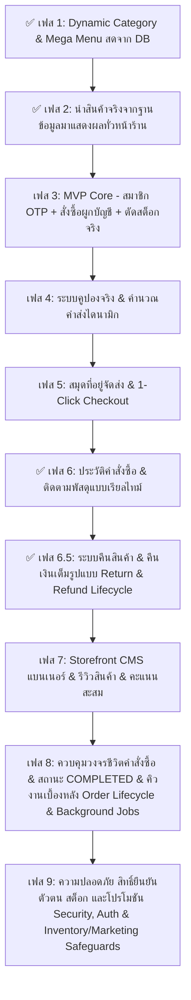
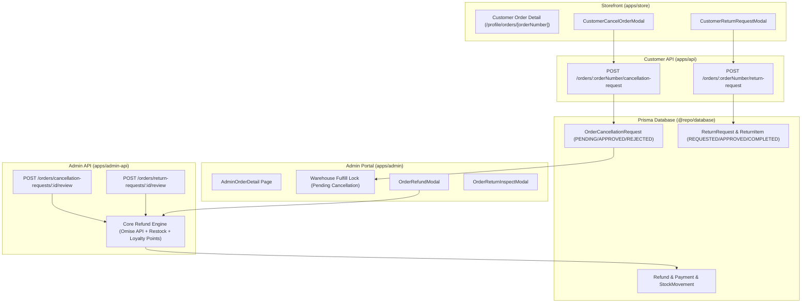

# NIDA Storefront — Development Roadmap & TODO (MVP First)

เอกสารรวบรวมสถานะ แผนงานการพัฒนา และสิ่งที่ต้องทำสำหรับระบบหน้าร้านออนไลน์ **NIDA Luxury E-Commerce Storefront (`apps/store`)** โดยจัดลำดับความสำคัญตาม **MVP (Minimum Viable Product)** เพื่อให้ร้านค้าสามารถเชื่อมโยงข้อมูลกับระบบหลังบ้าน (Admin) ได้แบบเรียลไทม์ เปิดรับออเดอร์ รับชำระเงิน และตัดสต็อกได้จริงอย่างสมบูรณ์

---

## 📊 สถานะปัจจุบันของหน้าร้าน (Current Storefront Status)

| ระบบ / ฟังก์ชันหน้าร้าน | สถานะหน้า UI (`apps/store`) | การเชื่อมต่อ Backend Database | สถานะภาพรวม |
| :--- | :---: | :---: | :--- |
| **หมวดหมู่สินค้า & เมนู (Category Navigation)** | ✅ Mega Menu สวยงาม / ตัวกรอง 2 ภาษา | ✅ เชื่อมต่อ API หมวดหมู่สดจาก DB (`GET /api/v1/catalog/categories`) | **เสร็จสมบูรณ์ (Production Ready)** |
| **แคตตาล็อกสินค้า (Product Browsing)** | ✅ หน้ารวม & แยกตามแผนก | ✅ เชื่อมต่อ API สินค้าจริง (`GET /api/v1/catalog/products`) | **เสร็จสมบูรณ์ (Production Ready)** |
| **หน้ารายละเอียดสินค้า (PDP)** | ✅ เลือกสี / ไซส์ / แกลเลอรีรูปภาพ | ✅ เชื่อมต่อ SKU Matrix & รูปภาพจริง (`GET /api/v1/catalog/products/:slugOrId`) | **เสร็จสมบูรณ์ (Production Ready)** |
| **ตะกร้าสินค้า (Cart Drawer)** | ✅ ป๊อปอัปตะกร้า / เพิ่ม-ลดจำนวน | ❌ เก็บเฉพาะ React State ในแรม | **เป้าหมายเฟส 3 (Persistent & Stock Check)** |
| **ระบบสมาชิก & ยืนยัน OTP (Customer Auth)** | ✅ หน้า Login / Register / OTP | ⚠️ มี Mock Auth / รอเชื่อม API สมบูรณ์ | **เป้าหมายเฟส 3 (OTP & JWT Cookie)** |
| **ระบบสั่งซื้อ & เช็คเอาต์ (Checkout)** | ✅ กรอกที่อยู่ / เลือกวิธีชำระเงิน | ❌ ยังไม่ได้ยิง API สร้าง Order จริง | **เป้าหมายเฟส 3 (Real Order & ตัดสต็อก)** |
| **ติดตามพัสดุ (Track Order)** | ✅ หน้าค้นหาเลขพัสดุ & Timeline | ✅ เชื่อมต่อ API พัสดุจริง (`GET /api/v1/orders/:number/tracking`) | **เสร็จสมบูรณ์ (Production Ready)** |
| **รายละเอียดออเดอร์ & ยกเลิกเอง (Order Detail & Self-Cancel)** | ✅ หน้าจอ Editorial Luxury Grid (`/profile/orders/[orderNumber]`) | ✅ เชื่อมต่อ API ยกเลิกออเดอร์และ Audit Trail | **เสร็จสมบูรณ์ (Production Ready)** |
| **การคืนสินค้าและคืนเงิน (Return & Refund)** | ✅ รองรับครบ 3 เคสทางธุรกิจ พร้อมโมดอลขอคืนสินค้า | ✅ เชื่อม Omise Refund API, คืนสต็อก และระบบพิจารณา | **เสร็จสมบูรณ์ (Production Ready)** |
| **วงจรชีวิตคำสั่งซื้อและคิวงาน (Order Lifecycle & Jobs)** | ⏳ หน้ารองรับสถานะ CANCELLED / EXPIRED | ⏳ มี Redis พร้อมรองรับ / รอติดตั้ง BullMQ | **เป้าหมายเฟส 8 (ดูคู่มือ [ORDER_LIFECYCLE_BUSINESS_LOGIC.md](file:///docs/ORDER_LIFECYCLE_BUSINESS_LOGIC.md))** |
| **ความปลอดภัย, สต็อก และโปรโมชัน (Security, Auth & Marketing)** | ⏳ มี Mock Rate Limit บางส่วน | ⏳ วางสถาปัตยกรรม Redis Token Bucket & Quota | **เป้าหมายเฟส 9 (Security & Marketing Safeguards)** |

---

## 🎯 แผนภาพการพัฒนาตามลำดับความสำคัญ (Roadmap)



---

## 📂 เฟส 1: เชื่อมโยงหมวดหมู่สินค้าแบบไดนามิกจากฐานข้อมูล (Dynamic Categories & Mega Menu)
> **เป้าหมาย**: หน้าร้านค้าสะท้อนหมวดหมู่ที่แอดมินจัดการในระบบหลังบ้าน (Admin Categories) ได้ทันที เมื่อแอดมินเพิ่ม, แก้ไขชื่อ, หรือปิดใช้งาน (`isActive: false`) หน้าร้านจะอัปเดตแบบเรียลไทม์

### 1.1 เชื่อมต่อ API หมวดหมู่หน้าร้าน (Storefront Category API)
- [x] **Backend Integration (`apps/api` หรือ Public Catalog Endpoint)**:
  - [x] ตรวจสอบว่า Endpoint `GET /api/v1/catalog/categories` ส่งคืนเฉพาะหมวดหมู่ที่ `isActive: true` (ซ่อนหมวดหมู่ที่ปิดใช้งาน)
  - [x] ส่งข้อมูลโครงสร้างแบบ Tree (Parent Category + Children Sub-categories) พร้อมจำนวนสินค้า `productCount`
- [x] **Frontend Category State (`apps/store`)**:
  - [x] สร้าง Category Requester หรือขยาย [CatalogContext.tsx](file:///apps/store/src/context/CatalogContext.tsx) ให้ดึงหมวดหมู่สดจากฐานข้อมูล
  - [x] มีระบบ Cache / ISR หรือ Revalidate เพื่อให้การโหลดหน้าเว็บรวดเร็วระดับพรีเมียม

### 1.2 ปรับปรุงเมนูหลักและตัวกรอง (Dynamic Mega Menu & Collection Filters)
- [x] **Mega Menu ใน [Layout.tsx](file:///apps/store/src/components/Layout.tsx)**:
  - [x] แทนที่ข้อมูล Hardcoded ในฟังก์ชัน `getMegaMenuData()` ด้วยหมวดหมู่สดจากฐานข้อมูล
  - [x] แยกหมวดหมู่ตามแผนก (`WOMEN`, `MEN`, `KIDS`, `BAGS`, `SHOES`, `HOME`) ตามฟิลด์ `department` ใน DB
  - [x] รองรับการแสดงผล 2 ภาษา (TH / EN) สลับได้ราบรื่นทันที
- [x] **หน้าแคตตาล็อก [collections/[[...category]]/page.tsx](file:///apps/store/src/app/collections/%5B%5B...category%5D%5D/page.tsx)**:
  - [x] ตัวกรองหมวดหมู่ย่อย (Sub-category Filter Pills) อ่านจาก Sub-categories ในฐานข้อมูลแทน hardcode
  - [x] แบนเนอร์และคำอธิบายแผนก (Header Info) ดึงจาก `bannerTag`, `bannerImage`, `description` ของ Category ที่ตั้งค่าในหลังบ้าน

---

## 🛍️ เฟส 2: นำสินค้าจริงจากฐานข้อมูลมาแสดงผล (Real Products & Live Catalog)
> **เป้าหมายหลัก**: ดึงข้อมูลสินค้าจริงจากฐานข้อมูลผ่าน Customer API มาแสดงผลทั่วทั้งหน้าร้านค้า ทั้งหน้าแคตตาล็อก (Collection), หน้ารายละเอียดสินค้า (PDP), สินค้าแนะนำบนหน้าแรก (Homepage), และระบบค้นหา (Header Search) โดยรองรับสินค้าหลายสี หลายไซส์ (Variant Matrix) สต็อกคงเหลือจริง และการแสดงผล 2 ภาษา

### 2.1 เชื่อมต่อ API แคตตาล็อกสินค้าสด (Storefront Products API Integration)
- [x] **Backend Public Catalog Endpoints (`apps/api`)**:
  - [x] ตรวจสอบว่า `GET /api/v1/catalog/products` กรองเฉพาะสินค้าที่สถานะ `status: 'PUBLISHED'` และ `isActive: true`
  - [x] รองรับ Filter Parameters ครบถ้วน:
    - `department` (เช่น `MEN`, `WOMEN`, `KIDS`, `BAGS`, `SHOES`, `HOME`)
    - `category` (Category Slug หรือ ID)
    - `subCategory` (Sub-category Slug หรือ ID)
    - `search` (ค้นหาชื่อสินค้า/คำอธิบายทั้ง TH และ EN)
    - `sort` (`newest`, `price_asc`, `price_desc`, `featured`)
    - `page` และ `limit` สำหรับการแบ่งหน้า
  - [x] ตรวจสอบ Endpoint `GET /api/v1/catalog/products/:slugOrId` ส่งคืนข้อมูลเชิงลึก:
    - ข้อมูลสินค้า 2 ภาษา (`titleTh`, `titleEn`, `descriptionTh`, `descriptionEn`)
    - รายการรูปภาพทั้งหมด (Cover Image + Gallery Images)
    - ตาราง SKU Variants (สี, ไซส์, รหัส SKU, ราคา, Compare-at Price, สต็อกคงเหลือ)
- [x] **Frontend Product State & Service (`apps/store`)**:
  - [x] ขยาย [catalogApi.ts](file:///apps/store/src/lib/catalogApi.ts) และ [CatalogContext.tsx](file:///apps/store/src/context/CatalogContext.tsx) ให้ดึงสินค้าจริงจาก API โดยตรงอย่างราบรื่น
  - [x] ลบ Mock Data [products.ts] ทิ้งอย่างสมบูรณ์ และใช้ [StorefrontProduct](file:///packages/types/src/customer/catalog.types.ts) จาก `@repo/types` เป็น Single Source of Truth
  - [x] จัดการสถานะการโหลด (`loading`, `error`, `emptyState`) อย่างสวยงามระดับ Editorial Luxury

### 2.2 หน้าแคตตาล็อกและคอลเลกชันสินค้า (`/collections/[[...category]]`)
- [x] **Dynamic Department & Category Routing**:
  - [x] รองรับ URL Path ตามโครงสร้างแผนกและหมวดหมู่ เช่น `/collections/men`, `/collections/women`
- [x] **Interactive Filters & Sorting**:
  - [x] กรองสินค้าตามหมวดหมู่ย่อย (Sub-category Pills) ได้แบบไดนามิกจากฐานข้อมูล
  - [x] กรองตามช่วงราคา (Price Range) และสี
  - [x] จัดเรียงสินค้าตาม: สินค้ามาใหม่, ราคาต่ำ-สูง, ราคาสูง-ต่ำ
  - [x] แสดงจำนวนสินค้าที่พบ พร้อม Empty State เมื่อไม่พบสินค้า

### 2.3 หน้ารายละเอียดสินค้าจริง (Real Product Detail Page — PDP `/product/[id]`)
- [x] **แกลเลอรีรูปภาพสินค้าจริง (Luxury Product Gallery)**:
  - [x] แสดงรูปภาพจริงจาก Cloud Storage / CDN
  - [x] สลับภาพหลักผ่าน Thumbnails ด้านข้าง
- [x] **Matrix ตัวเลือกสีและไซส์ (Live Variant Selector)**:
  - [x] ดึงรายชื่อสีและโค้ดสี (`hexColor`) จากสินค้าและ SKU ในฐานข้อมูล
  - [x] แสดงไซส์ที่มีอยู่จริงที่ดึงจาก Variants ของสินค้า
- [x] **ข้อมูลรายละเอียดและวัสดุ (Product Story & Materials)**:
  - [x] แสดงรายละเอียดส่วนประกอบเนื้อผ้า, คำแนะนำในการดูแลรักษา, และ Accordion 2 ภาษา

### 2.4 การแสดงสินค้าสดบนหน้าแรก (Homepage Live Showcase)
- [x] **ส่วนสินค้ามาใหม่และ Trending (Trending Showcase)**:
  - [x] ดึงสินค้าจริงจาก API ผ่าน [CatalogContext.tsx](file:///apps/store/src/context/CatalogContext.tsx) มาแสดงผลแทน Mock Data
- [x] **Quick View / Quick Add to Cart**:
  - [x] ผู้ใช้สามารถกดเพิ่มสินค้าลงตะกร้าได้ทันทีจากหน้าแรก

### 2.5 ระบบค้นหาสินค้าแบบ Live Search บน Header
- [x] **Instant Search Dropdown**:
  - [x] ค้นหาสินค้าแบบเรียลไทม์รองรับทั้งภาษาไทยและอังกฤษ
  - [x] แสดงผลลัพธ์เป็นรูปภาพขนาดย่อ, ชื่อสินค้า 2 ภาษา, แผนก/หมวดหมู่ และราคา

---

## 🚀 เฟส 3: MVP Core — ระบบสมาชิก OTP, สั่งซื้อผูกบัญชี และตัดสต็อกจริง
> **เป้าหมายหลัก**: ลูกค้าเลือกสินค้าลงตะกร้า ➔ ยืนยันตัวตนด้วยอีเมล OTP (สร้างบัญชีให้อัตโนมัติหากเป็นผู้ใช้ใหม่) ➔ สั่งซื้อโดยออเดอร์ผูกกับ `userId` ในฐานข้อมูล พร้อมตัดสต็อกจริงทันที

### 3.1 ระบบตะกร้าสินค้าที่ปลอดภัย (Cart Integrity & Storage)
- [x] **Frontend (`apps/store`)**:
  - [x] อัปเดต [CartContext.tsx](file:///apps/store/src/context/CartContext.tsx) ให้บันทึกข้อมูลลง `localStorage` (เพื่อไม่ให้สินค้าในตะกร้าหายเมื่อ Refresh หรือปิดแท็บ)
  - [x] เก็บ `variantId` / `sku` ควบคู่กับ `productId` เพื่อส่งเข้า API สร้างคำสั่งซื้อได้แม่นยำ
  - [x] ตรวจสอบสต็อกคงเหลือล่าสุดก่อนอนุญาตให้เพิ่มจำนวนในตะกร้า

### 3.2 ระบบสมาชิกลูกค้าและการยืนยันตัวตน (Customer Auth & OTP Auto-Register)
- [x] **Backend Customer Auth API (`apps/api`)**:
  - [x] Endpoint `POST /api/v1/auth/request-otp`:
    - รับอีเมลลูกค้า ➔ สุ่ม OTP 6 หลัก บันทึกลงตาราง `OtpVerification` (หรือ Redis) อายุ 5 นาที
    - ส่งรหัส OTP ไปยังอีเมลลูกค้าผ่าน `MailerService`
  - [x] Endpoint `POST /api/v1/auth/verify-otp`:
    - ตรวจสอบ OTP ถ้าถูกต้อง:
      - หากยังไม่มีในระบบ ➔ สร้างบัญชีลูกค้าใหม่ลงตาราง `User` (Role `CUSTOMER`) ให้อัตโนมัติทันที
      - ออก Customer JWT Access Token
      - ส่งข้อมูล Profile ลูกค้ากลับไป
- [x] **Frontend Store Auth & Checkout Guard**:
  - [x] ในหน้าตะกร้า (Cart Drawer) เมื่อกดปุ่ม **"ดำเนินการสั่งซื้อ (Checkout)"**:
    - หากลูกค้ายังไม่ได้ล็อกอิน ➔ นำไปยังหน้าเข้าสู่ระบบ `/login?redirect=/checkout`
    - เมื่อยืนยัน OTP สำเร็จ ➔ เข้าสู่หน้า Checkout ทันทีแบบไร้รอยต่อ
  - [x] ปรับปรุง [AuthContext.tsx](file:///apps/store/src/context/AuthContext.tsx) ให้เก็บ Token จริง และอ่านข้อมูล Profile จาก JWT/API (เลิกใช้ Mock)

### 3.3 ระบบสร้างคำสั่งซื้อจริงผูกบัญชี (Real Order Creation Flow)
- [x] **Backend Public Order API**:
  - [x] สร้าง Endpoint `POST /api/v1/orders`:
    - รับข้อมูล: ข้อมูลผู้ซื้อ, ที่อยู่จัดส่ง (`shippingAddress`), รายการสินค้า (`items: { variantId, quantity, price }[]`), วิธีชำระเงิน (`paymentMethod`), โค้ดส่วนลด (`couponCode`)
    - ผูกออเดอร์กับ `userId` ของลูกค้าที่ล็อกอิน
    - รัน Database Transaction:
      1. ตรวจสอบสต็อกล่าสุดว่ามีของพอหรือไม่ (Lock / Concurrency Check)
      2. สร้าง `Order` และ `OrderItem` (บันทึก Snapshot ชื่อและราคา ณ วันสั่งซื้อ)
      3. บันทึกการตัดสต็อกลงตาราง `StockMovement` (ประเภท `ORDER_DEDUCT`)
      4. ส่งคืน `orderNumber` (เช่น `ORD-20261014-XXXX`) และยอดเงินสุทธิ
- [x] **Frontend (`apps/store`)**:
  - [x] ในหน้า [apps/store/src/app/checkout/page.tsx](file:///apps/store/src/app/checkout/page.tsx):
    - Autofill ข้อมูลชื่อและอีเมลของลูกค้าจาก Profile โดยอัตโนมัติ
    - ยิง `POST /api/v1/orders` พร้อมแนบ Token
    - ล้างตะกร้าสินค้า (`clearCart()`) เมื่อสร้างออเดอร์สำเร็จ
    - ส่งลูกค้าไปยัง `/order-success?orderNumber=ORD-XXXX` พร้อมแสดงเลขออเดอร์จริง

### 3.4 การชำระเงินเบื้องต้น (Payment Methods MVP)
- [x] **PromptPay QR Code**:
  - [x] แสดง QR Code มาตรฐานพร้อมยอดเงินจริงในหน้าเช็คเอาต์
- [x] **โอนเงินผ่านธนาคาร (Bank Transfer)**:
  - [x] แสดงเลขบัญชีของร้าน Nida พร้อมฟอร์มอัปโหลดสลิปโอนเงิน (แนบรูปสลิปไปกับออเดอร์)
- [x] **บัตรเครดิต (Credit / Debit Card Sandbox)**:
  - [x] รองรับการจำลองสำเร็จสำหรับทดสอบ หรือเชื่อมต่อ Payment Gateway ในอนาคต

---

## 🏷️ เฟส 4: ระบบคูปองส่วนลดและคำนวณค่าจัดส่งอัตโนมัติ (Coupons & Shipping Engine)
> **เป้าหมาย**: ใช้งานโค้ดส่วนลดที่แอดมินสร้างจากระบบหลังบ้านได้จริง และคำนวณค่าส่งตามเงื่อนไข

- [x] **เชื่อมโยงโค้ดโปรโมชันจริง (Dynamic Coupons)**:
  - [x] เชื่อม API `POST /api/v1/coupons/validate` ในหน้าตะกร้าและหน้า Checkout
  - [x] คำนวณส่วนลดตามประเภทจริง:
    - ส่วนลดเป็นเปอร์เซ็นต์ (Percentage Discount พร้อม Max Cap)
    - ส่วนลดจำนวนเงินคงที่ (Fixed Amount)
    - สิทธิ์จัดส่งฟรี (Free Shipping)
  - [x] แสดงข้อผิดพลาดที่ชัดเจน (เช่น "โค้ดยังไม่เปิดใช้งาน", "โค้ดหมดอายุ", "ยอดซื้อขั้นต่ำไม่ถึง")
- [x] **การคำนวณค่าส่ง (Shipping Policy)**:
  - [x] จัดส่งฟรีเมื่อยอดซื้อครบกำหนด (ครบ 1,000 บาท หรือ $100) พร้อมแถบแสดง Progress Bar
  - [x] คำนวณค่าจัดส่งมาตรฐานสำหรับยอดที่ไม่ถึงเกณฑ์ (50 บาท หรือ $9.99)

---

## 🏡 เฟส 5: สมุดที่อยู่จัดส่งและสั่งซื้อสะดวกรวดเร็ว (Address Book & 1-Click Checkout)
> **เป้าหมาย**: ลูกค้าที่มีบัญชีแล้วสามารถบันทึกที่อยู่จัดส่งได้หลายที่ และไม่ต้องกรอกที่อยู่ซ้ำในครั้งต่อไป

- [x] **สมุดที่อยู่จัดส่ง (Saved Addresses)**:
  - [x] API จัดการที่อยู่ลูกค้า `GET / POST / PUT / DELETE /api/v1/store/users/addresses`
  - [x] ในหน้า Checkout มีตัวเลือกว่า "ใช้ที่อยู่จัดส่งเดิม" หรือ "เพิ่มที่อยู่ใหม่"
  - [x] ให้ลูกค้าสามารถตั้งค่าที่อยู่เริ่มต้น (Default Address) ได้
- [x] **หน้าจัดการที่อยู่ในโปรไฟล์ (`/profile/addresses`)**:
  - [x] ลูกค้าสามารถเข้ามาแก้ไขหรือลบที่อยู่ของตนเองได้ตลอดเวลา


---

## 📦 เฟส 6: ประวัติคำสั่งซื้อ หน้ารายละเอียด และการติดตามพัสดุ (Order History, Customer Order Detail & Live Tracking)
> **เป้าหมาย**: ลูกค้าสามารถดูประวัติคำสั่งซื้อ เข้าดูรายละเอียดคำสั่งซื้อแบบเต็มรูปแบบ (`/profile/orders/[orderNumber]`) ติดตามสถานะสินค้าได้ตลอด 24 ชั่วโมง และสามารถกดยกเลิกคำสั่งซื้อด้วยตนเองได้ตามเงื่อนไขที่ปลอดภัย

### 6.1 ประวัติการสั่งซื้อในหน้าโปรไฟล์ (`/profile/orders`)
- [x] **ภาพรวมรายการคำสั่งซื้อ**:
  - [x] สรุปรายการออเดอร์ทั้งหมดของลูกค้า พร้อมตัวกรองสถานะ, ค้นหา, และแบ่งหน้า
  - [x] ปุ่ม "ชำระเงินทันที", "ติดตามพัสดุ", และ "สั่งซื้อซ้ำ"

### 6.2 หน้ารายละเอียดคำสั่งซื้อสำหรับลูกค้า (Customer Order Detail Page — `/profile/orders/[orderNumber]`)
- [x] **Frontend Page (`apps/store/src/app/profile/orders/[orderNumber]/page.tsx`)**:
  - [x] ออกแบบหน้าจอแบบ Responsive 12-Column Grid ตามมาตรฐาน Editorial Luxury
  - [x] **หัวข้อคำสั่งซื้อ (Order Header)**: หมายเลขคำสั่งซื้อ, วันที่สั่งซื้อ, Status Badge และ Payment Badge
  - [x] **รายการสินค้าในคำสั่งซื้อ (Order Items)**:
    - รูปภาพสินค้า, ชื่อภาษาไทยและอังกฤษ, สี, ไซส์ (Variant Details Snapshot)
    - ราคาต่อหน่วย, จำนวนที่ซื้อ, และราคารวมต่อรายการ
    - ลิงก์กลับไปยังหน้ารายละเอียดสินค้า (PDP)
  - [x] **ข้อมูลการจัดส่งและที่อยู่ (Fulfillment & Shipping Info)**:
    - ข้อมูลผู้รับ: ชื่อ-นามสกุล, เบอร์โทรศัพท์, ที่อยู่จัดส่ง (`shippingAddressSnapshot`)
    - ข้อมูลพัสดุ: บริษัทขนส่ง, หมายเลขพัสดุ (Tracking Number) พร้อมปุ่ม Copy และลิงก์ไปยังหน้า `/track-order/[orderNumber]`
  - [x] **ข้อมูลการเงินและใบเสร็จ (Financial Breakdown)**:
    - ยอดรวมค่าสินค้า (Subtotal)
    - ส่วนลดคูปองโปรโมชัน (Coupon Discount พร้อมชื่อโค้ด)
    - ค่าจัดส่ง (Shipping Fee หรือสิทธิ์ส่งฟรี)
    - ยอดชำระสุทธิ (Total Amount Paid)
    - วิธีการชำระเงิน (Credit Card / PromptPay), วันที่และเวลาชำระเงิน
  - [x] **แถบดำเนินการของลูกค้า (Customer Action Bar)**:
    - ปุ่ม **"ยกเลิกคำสั่งซื้อ (Cancel Order)"**: แสดงเมื่อสถานะยังอนุญาตให้ยกเลิกได้ (ดูเงื่อนไขข้อ 6.3)
    - ปุ่ม **"ชำระเงินทันที (Pay Now)"**: หากเป็นออเดอร์ `PENDING` ผ่าน PromptPay
    - ปุ่ม **"ติดตามพัสดุ (Track Shipment)"**: ลิงก์ไปยังหน้าติดตามพัสดุ
    - ปุ่ม **"ขอคืนสินค้า (Request Return)"**: แสดงเมื่อสถานะเป็น `DELIVERED` ภายในระยะเวลากำหนด (เชื่อมต่อเฟส 6.5)

### 6.3 ระบบคำขอยกเลิกคำสั่งซื้อสำหรับลูกค้า (Customer Order Cancellation Request & Admin Approval)
> ออกแบบโดยใช้ตารางคำขอแยก `OrderCancellationRequest` (สไตล์เดียวกับ `ReturnRequest`) เพื่อเก็บบันทึกประวัติ (Audit Trail) ป้องกันปัญหา Race Condition กับคลังสินค้า และป้องกันความเสียหายจากค่าธรรมเนียม Gateway

- [x] **การออกแบบโครงสร้างฐานข้อมูล (Database Schema — `@repo/database`)**:
  - [x] เพิ่ม `enum CancellationRequestStatus`:
    - `PENDING`: ลูกค้ายื่นคำขอ อยู่ระหว่างรอแอดมินและคลังตรวจสอบ
    - `APPROVED`: แอดมินอนุมัติคำขอ พร้อมดำเนินการคืนเงินและยกเลิกออเดอร์
    - `REJECTED`: แอดมินปฏิเสธคำขอ (ระบุเหตุผล เช่น สินค้าเริ่มผลิตแล้ว หรือส่งออกแล้ว)
  - [x] เพิ่ม `model OrderCancellationRequest`:
    - `id`: UUID (Primary Key)
    - `requestNumber`: รหัสคำขอ เช่น `CAN-20261017-XXXX`
    - `orderId`: FK ชี้ไปยัง `Order`
    - `userId`: FK ชี้ไปยัง `User` (เจ้าของคำสั่งซื้อ)
    - `reason`: เหตุผลที่เลือก (เช่น สั่งผิดไซส์/สี, เปลี่ยนใจ, เปลี่ยนที่อยู่จัดส่ง, สั่งซ้ำ)
    - `customerNote`: ข้อความเพิ่มเติมจากลูกค้า (Text)
    - `adminNote`: หมายเหตุจากแอดมินกรณีปฏิเสธหรืออนุมัติ (Text)
    - `status`: `CancellationRequestStatus` (ค่าเริ่มต้น `PENDING`)
    - `reviewedAt`: วันที่แอดมินพิจารณา
    - `reviewedBy`: Admin ID ผู้พิจารณา
    - `createdAt`, `updatedAt`
  - [x] เพิ่มความสัมพันธ์ `cancellationRequests OrderCancellationRequest[]` ใน `Order`, `User`, `AdminUser`

- [x] **กฎและเงื่อนไขการยกเลิก (Cancellation Eligibility Policy)**:
  - [x] **กรณีที่ 1: สถานะ `PENDING` (ยังไม่ชำระเงิน)**:
    - ลูกค้ากดยกเลิกได้ทันที 100% อัตโนมัติ (ไม่ต้องรออนุมัติ เพราะยังไม่มีธุรกรรมทางการเงิน)
    - ระบบเปลี่ยนสถานะ `Order.status = CANCELLED` และคืนยอดจองสต็อก (`quantityReserved`) ทันที
  - [x] **กรณีที่ 2: สถานะ `PAID` หรือ `PREORDER_AWAITING_STOCK` (ชำระเงินแล้ว แต่คลังยังไม่เริ่มแพ็ค `PROCESSING`)**:
    - ลูกค้าสามารถกด **"ขอยกเลิกคำสั่งซื้อ (Request Cancellation)"**
    - มี Modal ยืนยันการขอยกเลิก (`CustomerCancelOrderModal.tsx`) ให้เลือกเหตุผลและระบุหมายเหตุ
    - **ระบบบันทึกคำขอลงตาราง `OrderCancellationRequest` (สถานะ `PENDING`)**:
      - `Order.status` ยังคงเป็นสถานะเดิม (`PAID` หรือ `PREORDER_AWAITING_STOCK`)
      - แต่หน้าจอแสดงป้ายสถานะเตือน **"Cancellation Requested"**
      - **Warehouse Safeguard (ล็อคคลังสินค้า)**: ระบบล็อคไม่ให้เจ้าหน้าที่คลังกดเริ่มแพ็คของหรือออกเลขพัสดุ (Shipment Fulfill) ตราบใดที่มีคำขอยกเลิกค้างอยู่
  - [x] **กรณีที่ 3: สถานะ `PROCESSING`, `SHIPPED`, `DELIVERED` (คลังแพ็คของแล้ว หรือส่งออกแล้ว)**:
    - ล็อคปุ่มยกเลิกอัตโนมัติ (ป้องกันสินค้าสูญหายระหว่างขนส่ง)
    - แสดงคำแนะนำอย่างสุภาพ: "พัสดุของท่านอยู่ระหว่างเตรียมจัดส่งหรือจัดส่งแล้ว หากต้องการยกเลิกกรุณาปฏิเสธการรับพัสดุเพื่อให้ตีกลับ (RTS) หรือรอรับสินค้าแล้วยื่นคำขอคืนสินค้า (Request Return)"

- [x] **กระบวนการพิจารณาของแอดมินและการคืนเงิน (Admin Review & Refund Engine)**:
  - [x] แสดงการ์ดแจ้งเตือนคำขอยกเลิกในหน้า [AdminOrderDetail.tsx](file:///apps/admin/src/pages/AdminOrderDetail.tsx)
  - [x] **กรณีอนุมัติ (Approve)**:
    - แอดมินกดปุ่ม **"Approve Cancellation & Process Refund"**
    - อัปเดต `OrderCancellationRequest.status = APPROVED`
    - ปรับ `Order.status = CANCELLED` (หรือ `REFUNDED`)
    - ดึงสต็อกสินค้าคงคลังกลับ (`StockMovement: RESTOCK_CANCEL`)
    - เรียก `paymentGatewayService.createRefund()` เพื่อยิง Omise API คืนเงินจริงเข้าบัตรเครดิตหรือพร้อมเพย์เดิมของลูกค้า
    - บันทึกเรคคอร์ดลงตาราง `Refund` และปรับ `PaymentStatus.REFUNDED`
    - คืนแต้มสะสมและสิทธิ์คูปองส่วนลดที่เคยใช้งาน
  - [x] **กรณีปฏิเสธ (Reject)**:
    - แอดมินกดปุ่ม **"Reject Request"** พร้อมระบุ `adminNote` ชี้แจงเหตุผล
    - อัปเดต `OrderCancellationRequest.status = REJECTED`
    - ปลดล็อคคลังสินค้าให้ออเดอร์สามารถหยิบแพ็คและจัดส่งได้ตามปกติ โดยที่ `OrderStatus` เดิมไม่ผิดเพี้ยน

- [x] **API Endpoints (`apps/api` และ `apps/admin-api`)**:
  - [x] Customer: `POST /api/v1/orders/:orderNumber/cancellation-request` (ลูกค้ายื่นคำขอยกเลิก)
  - [x] Admin: `GET /api/v1/orders/cancellation-requests` (รายการคำขอยกเลิกทั้งหมด พร้อม Filter)
  - [x] Admin: `POST /api/v1/orders/cancellation-requests/:id/review` (อนุมัติยกเลิก + ยิง Omise คืนเงิน หรือปฏิเสธพร้อมระบุเหตุผล)

### 6.4 หน้าติดตามพัสดุแบบเรียลไทม์ (`/track-order`)
- [x] **หน้าติดตามพัสดุ (`/track-order`)**:
  - [x] ค้นหาด้วยเลขออเดอร์ + อีเมล/เบอร์โทรศัพท์ (สำหรับลูกค้าที่ไม่ได้ล็อกอิน / Guest Checkout)
  - [x] แสดง Timeline สถานะ: `ชำระเงินแล้ว` ➔ `กำลังจัดเตรียมสินค้า` ➔ `กำลังจัดส่ง (พร้อม Tracking Number & ลิงก์เช็คพัสดุ)` ➔ `จัดส่งสำเร็จ`

---

## 🔄 เฟส 6.5: ระบบการคืนสินค้าและการคืนเงินเต็มรูปแบบ (Full Return & Refund Lifecycle)
> **เป้าหมายหลัก**: รองรับกระบวนการคืนเงิน (Refund) และการขอคืนสินค้า (Return Request) ครอบคลุมทั้ง 3 กรณีทางธุรกิจจริง: ยกเลิกหลังจ่ายเงินก่อนจัดส่ง, ขอคืนสินค้าหลังจัดส่งสำเร็จ, และพัสดุตีกลับ (RTS) โดยเชื่อมต่อกับ Omise Payment Gateway (`POST /charges/{id}/refunds`), จัดการสต็อกสินค้าคงคลัง และบันทึกบัญชีอย่างถูกต้อง

### 6.5.1 จำแนก 3 เคสทางธุรกิจ (Refund & Return Business Scenarios)

| เคส | สถานการณ์ทางธุรกิจ | สถานะออเดอร์ | ตำแหน่งสินค้า | ต้องมี Return Request? | การดำเนินการหลัก |
| :--- | :--- | :--- | :--- | :---: | :--- |
| **เคส 1** | **ยกเลิกหลังจ่ายเงิน (ก่อนส่งของ)** | `PAID` / `PROCESSING` | อยู่ที่คลัง | ❌ ไม่ต้อง | แอดมินกด Cancel & Refund → คืนเงินผ่าน Omise + ดึงสต็อกกลับ (`RESTOCK_CANCEL`) |
| **เคส 2** | **ขอคืนสินค้าหลังจัดส่งแล้ว** | `DELIVERED` | อยู่ที่ลูกค้า | ✅ **ต้องมี** | ลูกค้ายื่น Return Request ผ่านหน้าร้าน → แอดมิน Approve → ลูกค้าส่งของคืน → คลังตรวจสภาพ → กด Refund คืนเงิน |
| **เคส 3** | **พัสดุตีกลับคลัง (RTS)** | `Shipment: FAILED` | ตีกลับมาที่คลัง | ❌ ไม่ต้อง | ขนส่งส่งไม่สำเร็จ ของเด้งกลับมาคลัง → คลังตรวจพัสดุ → แอดมินกด Refund + คืนสต็อก |

---

### 6.5.2 โมดูลที่ 1: Core Refund Engine (เครื่องมือคืนเงินกลาง)
> ใช้งานร่วมกันสำหรับ เคส 1 (ยกเลิกก่อนส่ง), เคส 3 (พัสดุตีกลับ), และสเต็ปสุดท้ายของ เคส 2 (ตรวจรับของคืนแล้ว)

- [x] **Backend API & Payment Gateway (`apps/admin-api`)**:
  - [x] Endpoint `POST /api/v1/orders/:id/refund`:
    - รับ Parameter: `amount?: number` (คืนเต็มจำนวนหรือบางส่วน), `reason: string`, `restockInventory: boolean`
    - ตรวจสอบความถูกต้องของคำสั่งซื้อ (`PAID`, `PROCESSING`, `DELIVERED`, หรือพัสดุ `FAILED`)
    - ดึงหมายเลขธุรกรรม `transactionReference` (Omise Charge ID) จากตาราง `Payment`
    - เรียก `paymentGatewayService.createRefund()` เพื่อยิง API คืนเงินไปยัง Omise จริง
    - บันทึกเรคคอร์ดลงตาราง `Refund` (`refundNumber`, `amount`, `gatewayRefundId`, `status: SUCCEEDED`, `createdAdminId`)
    - อัปเดต `Payment.status = REFUNDED`
    - ปรับ `Order.status = REFUNDED` (หรือ `CANCELLED`)
    - หาก `restockInventory: true`: บันทึก `StockMovement` ชนิด `RETURNED` หรือ `RESTOCK_CANCEL` และเพิ่มสต็อก `quantityAvailable` กลับ
    - ปรับปรุงคะแนนสะสมและคูปองตามเงื่อนไข (ดึงแต้มคืนผ่าน `PointTransaction: REFUND_CANCEL`)
- [x] **Admin Portal UI (`apps/admin`)**:
  - [x] เพิ่มปุ่ม **"Process Refund"** ในหน้า [AdminOrderDetail.tsx](file:///apps/admin/src/pages/AdminOrderDetail.tsx)
  - [x] สร้างคอมโพเนนต์ `OrderRefundModal.tsx` ตามมาตรฐาน Editorial Luxury:
    - สรุปยอดเงินที่จะคืน (ค่าสินค้าสุทธิ + ค่าส่ง)
    - ตัวเลือก Preset เหตุผล (ลูกค้าขอยกเลิก, สินค้าหมด, ชำรุดระหว่างขนส่ง, คืนสินค้าตามนโยบาย)
    - สวิตช์เลือกว่าต้องการนำสินค้ากลับเข้าสต็อกหรือไม่ (`Restock Inventory`)
    - ยืนยันการทำรายการแบบ Transactional Safeguard

---

### 6.5.3 โมดูลที่ 2: Return Request Engine (ระบบคำขอคืนสินค้าฝั่งลูกค้าร่วมกับหลังบ้าน)
> สำหรับ เคส 2 (ลูกค้าได้รับของแล้ว แต่ต้องการคืนสินค้า เช่น ผิดไซส์, เปลี่ยนใจ หรือมีตำหนิ)

- [x] **Storefront Customer Self-Service (`apps/store`)**:
  - [x] ในหน้าประวัติการสั่งซื้อ [profile/orders/page.tsx](file:///apps/store/src/app/profile/orders/page.tsx) และหน้า [profile/orders/[orderNumber]/page.tsx](file:///apps/store/src/app/profile/orders/%5BorderNumber%5D/page.tsx):
    - แสดงปุ่ม **"ขอคืนสินค้า (Request Return)"** เฉพาะออเดอร์สถานะ `DELIVERED` ที่จัดส่งสำเร็จ
  - [x] สร้างโมดอล `CustomerReturnRequestModal.tsx`:
    - แสดงรายการสินค้าในออเดอร์ ให้ลูกค้าเลือกติ๊กชิ้นที่จะคืน และระบุจำนวน
    - Dropdown เหตุผล (สินค้ามีตำหนิ, ผิดไซส์/สี, ไม่ตรงปก, อื่นๆ)
    - ช่องกรอกหมายเหตุของลูกค้า (`customerNote`)
  - [x] ยิง API `POST /api/v1/orders/:orderNumber/return-request`
- [x] **Backend Return Request API (`apps/api` & `apps/admin-api`)**:
  - [x] สร้าง `ReturnRequest` และ `ReturnItem` ในฐานข้อมูล สถานะเริ่มต้นเป็น `REQUESTED`
  - [x] ออกรหัสคำขอ `requestNumber` (เช่น `RET-20261017-XXXX`)
  - [x] Endpoint จัดการคำขอฝั่ง Admin:
    - `GET /api/v1/orders/return-requests` (รายการคำขอคืนสินค้าทั้งหมด พร้อม Filter ตามสถานะ)
    - `POST /api/v1/orders/return-requests/:id/review` (อนุมัติคำขอ ลูกค้าเตรียมส่งของกลับ หรือปฏิเสธคำขอ พร้อมระบุ `adminNote`)
    - Action `COMPLETE` (คลังได้รับของแล้ว ตรวจสภาพผ่านเกณฑ์ ➔ เรียก Core Refund Engine เพื่อคืนเงินจริงและปิดเคสเป็น `COMPLETED`)
- [x] **Admin Portal Review Dashboard (`apps/admin`)**:
  - [x] เพิ่มการ์ด **Return Requests** ในหน้า [AdminOrderDetail.tsx](file:///apps/admin/src/pages/AdminOrderDetail.tsx)
  - [x] แสดงสถานะของคำขอ (`REQUESTED` ➔ `APPROVED` ➔ `COMPLETED` หรือ `REJECTED`)
  - [x] ปุ่ม Action ควบคุมคำขอ (อนุมัติ, ปฏิเสธ, หรือยืนยันรับของพร้อมคืนเงิน)


---

## 💎 เฟส 7: ระบบจัดการเนื้อหาหน้าร้านและการตลาด (Storefront CMS, Home Customization & Loyalty)
> **เป้าหมายหลัก**: ปลดล็อคให้แอดมินสามารถปรับแต่งรูปภาพ แคมเปญ และข้อความบนหน้าแรก (Homepage) ได้เองแบบ 100% Dynamic โดยไม่ต้องแก้โค้ดหรือ Build เว็บใหม่ พร้อมระบบคำนวณสินค้า Trending ตามยอดขายจริง

### 7.1 ระบบจัดการเนื้อหาหน้าแรกแบบไดนามิก (Home Page CMS & Banner Management)

#### ① มาตรฐานข้อมูลและข้อกำหนดรูปภาพ/ข้อความ (Strict Data & Copy Specifications)
- [x] **Hero Billboard / Carousel Banners**:
  - สัดส่วนภาพ (Aspect Ratio): Desktop `21:9` หรือ `16:9` (2560×1080px หรือ 1920×820px), Mobile `4:5` (1080×1350px)
  - ขนาดไฟล์สูงสุด: 3 MB ต่อภาพ (แนะนำ WebP / JPG 85%+)
  - Campaign Tag / Eyebrow: สูงสุด 30 ตัวอักษร (TH / EN)
  - Main Headline (Line 1 + Line 2): บรรทัดละไม่เกิน 35 ตัวอักษร (รวมไม่เกิน 70 ตัวอักษร)
  - Subtitle / Description: ไม่เกิน 160 ตัวอักษร
  - Primary & Secondary CTA: Label ไม่เกิน 18 ตัวอักษร พร้อม Relative URL Path
- [x] **Top Announcement Bar**:
  - ข้อความประกาศ: สูงสุด 80 ตัวอักษร (TH / EN)
  - ป้ายไฮไลต์ (Badge Text): สูงสุด 15 ตัวอักษร
  - สวิตช์เปิด/ปิด (`isActive: boolean`)
- [x] **Promo Ribbon Strip**:
  - ผูกกับ `couponId` (ดึงจากคูปองจริงในระบบ) หรือ Custom Code (สูงสุด 15 ตัวอักษร)
  - Promo Title: สูงสุด 45 ตัวอักษร, Description: สูงสุด 100 ตัวอักษร
- [x] **Value Props Strip**:
  - กำหนดยอดส่งฟรีขั้นต่ำ (`freeShippingThreshold` เช่น ฿1,000 หรือ ฿1,500)
  - กำหนดกรอบวันคืนสินค้า (`returnWindowDays` เช่น 7 วัน หรือ 14 วัน)

#### ② นโยบายการตรวจสอบความถูกต้องด้วย Zod ข้ามระบบ (Mandatory Centralized Zod Validation)
- [x] สร้าง Zod Schema กลางใน `packages/validators/src/admin/content.ts`:
  - `saveCmsBannerSchema`: ตรวจสอบความยาวตัวอักษร, URL format, placement, วันที่แคมเปญ
  - `updateStoreSettingsSchema`: ตรวจสอบ Announcement Bar และเกณฑ์ตัวเลขนโยบายร้านค้า
  - ส่งออกผ่าน `packages/validators/src/index.ts` และรัน build
- [x] **Backend Integration**: Controllers ใน `apps/admin-api` และ `apps/api` ต้องรับ Payload ผ่าน `@Body(new ZodValidationPipe(schema))` 100%
- [x] **Frontend Integration**: ฟอร์มใน `apps/admin` ต้องใช้ Zod Schema เดียวกันนี้ตรวจความถูกต้องก่อนส่ง Request

#### ③ ระบบ Live Interactive Preview Mode ฝั่ง Admin Portal
- [x] สร้าง Mirror Preview Components ใน `apps/admin/src/components/cms/preview/`:
  - `HeroBillboardPreview.tsx`, `TopAnnouncementPreview.tsx`, `PromoRibbonPreview.tsx`, `ValuePropsPreview.tsx`
  - เรนเดอร์ด้วย CSS และ Typography เดียวกับหน้าร้าน Storefront แบบ 1:1 Editorial Luxury
- [x] **ฟังก์ชันควบคุมบน Preview Canvas**:
  - Device Viewport Switcher: สลับดูมุมมอง **Desktop (1440px wide)** หรือ **Mobile Frame (375px)**
  - Language Switcher: สลับดูผลลัพธ์ภาษาไทย (TH) และอังกฤษ (EN) ได้ทันที
  - Carousel Slider Simulator: เลื่อนดูแบนเนอร์แต่ละสไลด์ได้แบบสดๆ

#### ④ สถาปัตยกรรมฐานข้อมูลและ API (CMS Architecture)
- [x] เพิ่มโมเดล `CmsBanner` และ `StoreSettings` ใน `packages/database/prisma/schema.prisma`
- [x] สร้างโมดูล Content ใน `apps/admin-api`: `GET /api/v1/content/home`, `POST /api/v1/content/banners`, `PUT /api/v1/content/banners/:id`, `DELETE /api/v1/content/banners/:id`, `PATCH /api/v1/content/banners/reorder`, `PUT /api/v1/content/settings`
- [x] สร้างโมดูล Content ใน `apps/api`: `GET /api/v1/content/home` (แคชความเร็วสูง)
- [x] ปรับปรุงหน้าจอ Storefront (`HeroBillboard.tsx`, `TopPromoBanner.tsx`, `PromoRibbon.tsx`, `ValuePropsStrip.tsx`, `SplitEditorialBento.tsx`) ให้อ่านข้อมูลจริงจาก API พร้อม Graceful Fallback
- [x] เขียน Unit Tests 100% ครอบคลุมการบันทึก, การเรียงลำดับ, การ validate ด้วย Zod และการปฏิเสธค่าผิดพลาด

---

### 7.2 ระบบสินค้ากำลังนิยม (WHAT'S TRENDING NOW Engine)

- [ ] **ระยะยาว (Future Plan — Real Sales Velocity & Order Volume)**:
  - [ ] คำนวณอันดับสินค้า Trending โดยอัตโนมัติตาม **ยอดการสั่งซื้อจริง (Sales Volume / Order Velocity)** จากตาราง `OrderItem` และ `Order` ในช่วงเวลาที่กำหนด (เช่น 7 วัน หรือ 30 วันย้อนหลัง)
  - [ ] สินค้าที่มียอดสั่งซื้อสูงสุดหรือมีอัตราการเติบโตของยอดขายเร็วที่สุดจะขึ้นมาติดอันดับ Trending โดยอัตโนมัติ
- [x] **ระยะสั้น (Current Interim — Filter by Product Marketing Tags)**:
  - [x] แทนที่แท็บแผนกเดิม (Women, Men, Bags) ด้วยแท็บ **Marketing Tags** ของสินค้า (`NEW_ARRIVAL`, `BESTSELLER`, `TRENDING`, `LIMITED_EDITION`, `PRE_ORDER` ฯลฯ) ที่มีอยู่ในระบบอยู่แล้ว
  - [x] ผู้ใช้สามารถคลิกแท็บเพื่อดูสินค้าตามป้ายการตลาดได้อย่างแม่นยำ ไม่ซ้ำซ้อนกับส่วน "SHOP BY DEPARTMENT" ด้านล่าง

---

### 7.3 ระบบสมาชิกและความภักดีต่อแบรนด์ (Loyalty, Wishlist & Reviews)

- [ ] **รายการสินค้าที่อยากได้ (Wishlist Persistence)**:
  - [ ] บันทึกรายการโปรดลงตาราง `Wishlist` ในฐานข้อมูลสำหรับสมาชิก
- [ ] **ระบบสะสมคะแนนและระดับสมาชิก (Loyalty Points & VIP Tiers)**:
  - [ ] สะสมแต้มอัตโนมัติเมื่อออเดอร์จัดส่งสำเร็จ (เช่น ทุก 100 บาท ได้ 1 แต้ม)
  - [ ] อัปเกรดระดับสมาชิก (`REGULAR`, `VIP_SILVER`, `VIP_GOLD`) พร้อมส่วนลดพิเศษ
- [ ] **รีวิวและการให้คะแนนสินค้า (Customer Reviews)**:
  - [ ] ลูกค้าที่สั่งซื้อสินค้าจริงสามารถเขียนรีวิวและให้คะแนน 1-5 ดาวได้

---

## ⏱️ เฟส 8: ระบบควบคุมวงจรชีวิตคำสั่งซื้อ สถานะ COMPLETED และคิวงานเบื้องหลัง (Order Lifecycle, COMPLETED Status & Background Jobs)
> **เป้าหมาย**: ป้องกันการกั๊กสต็อกสินค้า คืนสต็อกเข้าคลังอัตโนมัติเมื่อไม่ชำระเงิน ยกระดับวงจรสถานะออเดอร์ให้สมบูรณ์ด้วยสถานะ `COMPLETED` จัดการคำร้องขอยกเลิกและคืนสินค้าตามกรอบเวลา (SLA) และป้องกันการสแปมระบบด้วยสถาปัตยกรรมคิวงานระดับ Enterprise (`@nestjs/bullmq` + Redis 7)
> 
> 📖 **อ่านข้อกำหนดทางธุรกิจและสถาปัตยกรรมแบบละเอียดฉบับเต็มได้ที่**: [docs/ORDER_LIFECYCLE_BUSINESS_LOGIC.md](file:///docs/ORDER_LIFECYCLE_BUSINESS_LOGIC.md)

### 8.1 การขยายโครงสร้างสถานะคำสั่งซื้อ (Approach 1: Add COMPLETED to OrderStatus)
- [x] **Database Schema & Types Migration**:
  - [x] เพิ่มค่า `COMPLETED` ลงใน `enum OrderStatus` ใน [schema.prisma](file:///packages/database/prisma/schema.prisma):
    ```prisma
    enum OrderStatus {
      PENDING
      PAID
      PREORDER_AWAITING_STOCK
      PROCESSING
      SHIPPED
      DELIVERED
      COMPLETED    // สิ้นสุดวงจรการสั่งซื้ออย่างสมบูรณ์ (ลูกค้ายอมรับสินค้า / Auto-Accept 5 วัน)
      CANCELLED
      REFUNDED
    }
    ```
  - [x] เพิ่มฟิลด์ `completedAt DateTime? @map("completed_at")` ใน Model Order ใน [schema.prisma](file:///packages/database/prisma/schema.prisma)
  - [x] อัปเดต `OrderStatus` ใน [enums.ts](file:///packages/types/src/common/enums.ts) และรัน build `@repo/types`
  - [x] รัน Prisma Migration & `db push` สำเร็จ ข้อมูลเดิมคงอยู่ 100%
- [x] **State Machine & Logic Flow**:
  - [x] วงจรสถานะใหม่: `PENDING ➔ PAID ➔ PROCESSING ➔ SHIPPED ➔ DELIVERED ➔ COMPLETED`
  - [x] อัปเดต Customer Backend API (`apps/api`):
    - เพิ่ม Endpoint `POST /api/v1/orders/:orderNumber/accept` รองรับทั้งลูกค้าล็อกอินและ Guest OTP token
    - อนุญาตการเปลี่ยนสถานะจาก `DELIVERED` ไปเป็น `COMPLETED` พร้อมบันทึก `completedAt`
    - เมื่อออเดอร์เปลี่ยนเป็น `COMPLETED` ➔ คำนวณและบันทึก Loyalty Points (1 คะแนนต่อ 100 บาท) แบบ Idempotent ลง `PointTransaction`
    - มีระบบ Safeguard กรอบเวลา 7 วันสำหรับการขอคืนสินค้า (`requestReturn`) จากเวลาจัดส่ง/สำเร็จ
  - [x] อัปเดต Admin Backend API (`apps/admin-api`):
    - อนุญาตให้แอดมินเปลี่ยนสถานะออเดอร์จาก `DELIVERED` ไปเป็น `COMPLETED` ได้ พร้อมคำนวณคะแนนสะสมและอัปเดต `completedAt`
    - มี Guardrail ห้ามข้ามขั้นไปสถานะ `COMPLETED` โดยตรงหากยังไม่ได้ส่งมอบ (`DELIVERED`)
  - [x] อัปเดต Storefront UI (`apps/store`):
    - แสดงป้าย `StatusBadge` สีเขียวมรกตพรีเมียม (Emerald Pill) สไตล์ Editorial Luxury
    - หน้า [CustomerOrderHeaderCard.tsx](file:///apps/store/src/components/profile/orders/CustomerOrderHeaderCard.tsx) มีปุ่ม "ฉันได้ตรวจสอบและยอมรับสินค้าแล้ว" พร้อม [CustomerAcceptDeliveryModal.tsx](file:///apps/store/src/components/profile/orders/CustomerAcceptDeliveryModal.tsx)
    - รองรับแท็บตัวกรองและเคาน์เตอร์สถานะ `COMPLETED` ในหน้ารายการออเดอร์ของลูกค้า
  - [x] อัปเดต Admin Portal UI (`apps/admin`):
    - แสดงแถบขั้นตอน Milestone ขั้นที่ 5 `COMPLETED` ใน [OrderDetailStatusCard.tsx](file:///apps/admin/src/components/order/OrderDetailStatusCard.tsx)
    - รองรับแท็บตัวกรองและเคาน์เตอร์สถานะ `COMPLETED` ในหน้ารายการออเดอร์ของแอดมิน
  - [x] Unit Test & Build Verification ครบ 100%:
    - Unit tests ใน `apps/api` (51/51 passing)
    - Unit tests ใน `apps/admin-api` (156/156 passing)
    - Build ผ่านฉลุย 0 errors ทุก Workspace (`@repo/types`, `@repo/validators`, `apps/api`, `apps/admin-api`, `apps/admin`, `apps/store`)

### 8.2 การติดตั้งและสถาปัตยกรรมระบบคิว (BullMQ Infrastructure & Modules)
- [x] ติดตั้งแพ็กเกจ `@nestjs/bullmq` และ `bullmq` ใน `apps/api` และ `apps/admin-api`
- [x] สร้างโมดูล `OrderLifecycleModule` เชื่อมต่อ Redis Instance เดิม (`ecommerce_redis`)
- [x] จัดโครงสร้าง Queue แยกตามหน้าที่:
  - `order-timeout-queue`: จัดการออเดอร์ค้างชำระ (Unpaid Orders)
  - `cancellation-review-queue`: จัดการคำร้องขอยกเลิกที่แอดมินยังไม่ได้รีวิว
  - `delivery-completion-queue`: จัดการการยอมรับสินค้าอัตโนมัติหลังจัดส่งสำเร็จ (Auto-Complete 5 วัน)
  - `return-deadline-queue`: จัดการการส่งพัสดุคืนภายในกำหนด
- [x] พัฒนา `OrderLifecycleProducerService` กลางสำหรับควบคุม Enqueue/Cancel Delayed Jobs ด้วย Deterministic Job IDs
- [x] สร้าง Unit Tests ครอบคลุม Producer Service ทั้งฝั่ง `apps/api` (65/65 passing) และ `apps/admin-api` (177/177 passing)

### 8.3 กฎและเงื่อนไขการทำงานอัตโนมัติ (Automated Business Logic Workers)
- [x] **1. ตัดออเดอร์ค้างชำระอัตโนมัติ (Unpaid Order Auto-Cancel & Restock)**:
  - [x] หน่วงเวลา (Delay) 15 นาทีสำหรับ PromptPay และ 30 นาทีสำหรับบัตรเครดิต
  - [x] เมื่อหมดเวลา: ปรับสถานะเป็น `CANCELLED`, คืนสต็อกสินค้ากลับเข้า Inventory อัตโนมัติ (`StockMovementType: RESTOCK`)
  - [x] ป้องกัน Race Condition: หากลูกค้าชำระเงินสำเร็จก่อนหมดเวลา ให้ถอน Job ออกจากคิวทันที (Payment Success Wins)
- [x] **2. อนุมัติคำขอยกเลิกอัตโนมัติ (Pre-Fulfillment Cancel Auto-Approve)**:
  - [x] หน่วงเวลา 48 ชั่วโมงหากแอดมินไม่กด Approve/Reject คำร้องขอยกเลิก
  - [x] เมื่อครบกำหนด: ปรับสถานะคำร้องเป็น `APPROVED`, สั่งคืนเงินผ่าน Omise Refund API, คืนสต็อกสินค้า, และบันทึก `AuditLog`
- [x] **3. ยอมรับสินค้าและปิดออเดอร์เป็น COMPLETED (Delivery Acceptance & Auto-Complete)**:
  - [x] เมื่อพัสดุขึ้นสถานะ `DELIVERED` มีปุ่ม Luxury Button **"ฉันได้ตรวจสอบและยอมรับสินค้าแล้ว (Accept Delivery)"** ในหน้า [CustomerOrderDetailPage](file:///apps/store/src/app/profile/orders/[orderNumber]/page.tsx)
  - [x] ลูกค้าคลิก ➔ ยิง API `POST /api/v1/orders/:orderNumber/accept` ปรับสถานะเป็น `COMPLETED` และโอนแต้มสะสมทันที
  - [x] หากลูกค้าไม่กดปุ่มภายใน 5 วัน (120 ชั่วโมง): Worker ใน `delivery-completion-queue` ปรับสถานะเป็น `COMPLETED` ให้อัตโนมัติ
- [x] **4. ปิดหน้าต่างสิทธิ์ขอคืนสินค้าอย่างเข้มงวด (Return Window Strict Expiration)**:
  - [x] จำกัดระยะเวลายื่นคำร้องขอคืนสินค้าภายใน 7 วันหลังสถานะ `DELIVERED`
  - [x] หากเกิน 7 วัน: ปิดการใช้งานปุ่ม "ขอคืนสินค้า" บนหน้า UI และเขียน Guard ปฏิเสธ Request ที่ระดับ API
- [x] **5. กำหนดเวลาส่งพัสดุคืนหลังคำร้องได้รับอนุมัติ (Return Shipment Deadline)**:
  - [x] ให้เวลาลูกค้าส่งของและแจ้งเลขพัสดุคืนภายใน 7 วันหลังแอดมินกด Approve
  - [x] หากพ้นกำหนด: ปรับสถานะคำร้องเป็น `EXPIRED/VOID` ปิดสิทธิ์การขอคืนเงิน
- [x] **6. ป้องกันการกดสลับช่องทางชำระเงินถี่ (Payment Switch Rate Limit)**:
  - [x] ใช้ Redis Sliding Window จำกัด Cooldown 2 วินาที ป้องกันการกดย้ำปุ่มสร้าง QR ซ้ำซ้อน

### 8.4 การทดสอบและการตรวจสอบความถูกต้อง (Testing & Verification)
- [x] Unit Tests จำลองการนับเวลาถอยหลัง (Timer Simulation) และการคืนสต็อกเมื่อออเดอร์หมดอายุ
- [x] Test ป้องกัน Race Condition เมื่อเกิดการชำระเงินในเสี้ยววินาทีเดียวกับที่ Worker ทำงาน (Payment Success Wins)
- [x] Test ตรวจสอบสิทธิ์ขอคืนสินค้าในวันที่ 7 (ผ่าน) และวันที่ 8 (ถูกปฏิเสธ)
- [x] Test วงจรเปลี่ยนสถานะสู่ `COMPLETED` ทั้งแบบลูกค้ายืนยันเองและแบบ Auto-Complete ครบ 5 วัน
- [x] ตรวจสอบว่าไม่มีการทิ้ง Fake Mock หรือ Silent Fallback ในระบบจริงตามมาตรฐาน `AGENTS.md`

---

## 🛡️ เฟส 9: ความปลอดภัย สิทธิ์การยืนยันตัวตน สต็อก และโปรโมชัน (Security, Auth & Inventory/Marketing Safeguards)
> **เป้าหมาย**: ป้องกันการทุจริต การสแปมระบบ บอทกวาดซื้อ การแย่งชิงสต็อก (Flash Sale Race Conditions) และการใช้คูปองซ้ำซ้อน ด้วยสถาปัตยกรรมความปลอดภัยระดับสูง (High Concurrency & Fraud Prevention)

### 9.1 หมวดความปลอดภัยและการยืนยันตัวตน (Security & Authentication Safeguards)
- [x] **1. ควบคุมอัตราการขอ OTP และล็อกอิน (OTP Request & Login Rate Limiting)**:
  - [x] ใช้ Redis Sliding Window / Token Bucket จำกัดการขอ OTP สูงสุด 3 ครั้งต่อ 5 นาทีต่ออีเมล และ 10 ครั้งต่อ 15 นาทีต่อ IP Address
  - [x] บังคับ Cooldown 60 วินาที ทั้งระดับ Backend Redis Key (`otp:cooldown:${email}`) และ Frontend Timer ป้องกันการกดยิง API ซ้ำซ้อน
  - [x] หน่วงเวลาและล็อกบัญชีชั่วคราว (Account Lockout) 15 นาที (`otp:lockout:${email}`) หากกรอกรหัส OTP ผิดติดต่อกันเกิน 5 ครั้ง พร้อมเคลียร์เมื่อยืนยันสำเร็จ
- [x] **2. การบริหารจัดการวงจรอายุ Token และการเพิกถอนสิทธิ์ (Token Lifecycle & Session Revocation)**:
  - [x] กำหนดอายุ JWT Access Token สั้น (15 นาที) ควบคู่กับ Refresh Token (UUID 7 วัน) ใน Redis
  - [x] ใช้เทคนิค Refresh Token Rotation ป้องกัน Token Reuse Attack พร้อม Silent Refresh อัตโนมัติเมื่อ HTTP 401
  - [x] พัฒนาฟังก์ชัน "ออกจากระบบทุกอุปกรณ์ (Sign Out All Devices)" โดยการจัดเก็บและเพิกถอน Token Sessions ใน Redis
- [x] **3. การยืนยันตัวตนซ้ำสำหรับการดำเนินการที่มีความอ่อนไหว (Sensitive Action Re-Authentication)**:
  - [x] บันทึกการแก้ไขข้อมูลส่วนตัว (ชื่อ-นามสกุล, เบอร์โทรศัพท์) ลงฐานข้อมูล PostgreSQL จริงผ่าน Zod Schema Validation
  - [x] เมื่อลูกค้าต้องการเปลี่ยนอีเมลหลัก ต้องผ่านการยืนยันรหัส OTP ส่งไปยังอีเมลใหม่ พร้อมเพิกถอนเซสชันเดิมทุกเครื่องอัตโนมัติเพื่อความปลอดภัย
- [x] **4. ป้องกันบอทและการโจมตีแบบอัตโนมัติ (Anti-Bot & Brute-force Shield)**:
  - [x] ติดตั้ง Invisible Bot Protection (Cloudflare Turnstile Guard) พร้อม API Endpoint Verification และ Development Bypass Mode

### 9.2 หมวดสต็อกสินค้าและโปรโมชั่น (Inventory & Marketing Safeguards)
- [x] **1. การจัดการสต็อกออเดอร์และการคืนสต็อกอัตโนมัติ (Order Stock Deduction & Auto-Restock Timeout)**:
  - [x] ตัดสต็อกจริงเมื่อสร้างออเดอร์ (`createOrder`) พร้อม Atomic Conditional Update ป้องกัน Overselling 100%
  - [x] ระบบจับเวลาชำระเงิน 15 นาทีผ่าน BullMQ Worker (`order-timeout.worker.ts`): หากไม่ชำระเงินตามเวลา ระบบจะยกเลิกออเดอร์และคืนสต็อก (`RESTOCK`) สู่คลังอัตโนมัติ (ปลอดภัยจากการเปิดหน้าเว็บกั๊กของ / Cart Hoarding)

- [x] **2. ป้องกันการใช้โค้ดส่วนลดและคูปองซ้ำซ้อน (Voucher Quota & Concurrency Guard)**:
  - [x] จำกัดสิทธิ์การใช้งานคูปอง: 1 สิทธิ์ / 1 บัญชีผู้ใช้ ตรวจสอบภายใน Prisma Transaction
  - [x] ป้องกัน Race Condition กรณีลูกค้าเปิดหลายแท็บกดใช้พร้อมกัน ด้วย Atomic Conditional Update (`currentUsageCount: { lt: totalUsageLimit }`)
  - [x] ระบบคืนสิทธิ์คูปอง (Coupon Re-instatement): รองรับทั้ง Unpaid Timeout Auto-Cancel, Auto-approved Cancellation, และ Admin Manual Refund/Cancel
- [x] **3. ตรวจจับและแจ้งเตือนสินค้าใกล้หมดแบบเรียลไทม์ (Real-time Low-Stock Alert & Overselling Shield)**:
  - [x] บังคับใช้ Atomic Conditional Update ภายใน Prisma Transaction (`quantityAvailable: { gte: quantity }`) รับประกัน 100% ว่าไม่มีการขายเกินสต็อกจริง (Zero Overselling) พร้อม Atomic Guard สำหรับเพดานสินค้า Pre-order (`preorderLimit`)
  - [ ] ส่งการแจ้งเตือนแบบเรียลไทม์ (Webhooks / WebSockets) ไปยัง Admin Dashboard เมื่อสต็อก SKU ลดลงต่ำกว่าค่าความปลอดภัย (Safety Stock Threshold <= 5 ชิ้น)
- [ ] **4. ป้องกันการทุจริตแต้มสะสมและการกำหนดอายุคะแนน (Loyalty Points Anti-Fraud & Expiry)**:
  - [ ] กำหนดอายุคะแนนสะสม (เช่น หมดอายุทุกสิ้นปี หรือ 365 วันหลังได้รับ)
  - [ ] ระงับการใช้แต้มสะสมทันทีหากพบความผิดปกติของบัญชีผู้ใช้ หรือมีอัตราการขอคืนสินค้าเกินเกณฑ์ที่กำหนด

---

## ⚡ มาตรฐานทางเทคนิคและ UX (Technical & Quality Standards)

1. **Next.js App Router & Server Components**:
   - ใช้ SSR / ISR ในหน้าแคตตาล็อกเพื่อความเร็วในการโหลดและการทำ SEO (LCP < 2.0s)
2. **Type Safety ข้ามระบบ (`@repo/types`)**:
   - ใช้งาน DTO และ Interface ร่วมกันระหว่าง Backend และ Frontend ปราศจากการเขียน `any`
3. **i18n Localization**:
   - รองรับ 2 ภาษา (ภาษาไทย และ English) สลับได้อย่างราบรื่น
4. **ความปลอดภัย**:
   - มีระบบ Rate Limit ป้องกันการสแปมยิง OTP และสแปมยิง Checkout

