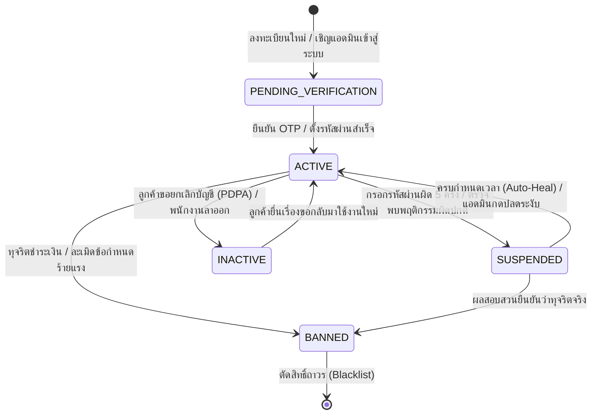
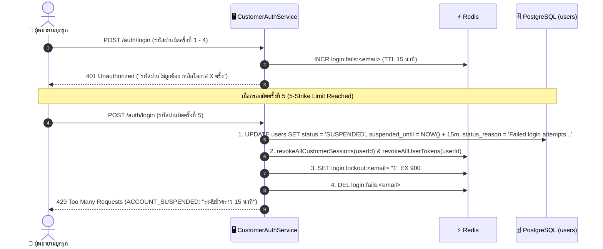
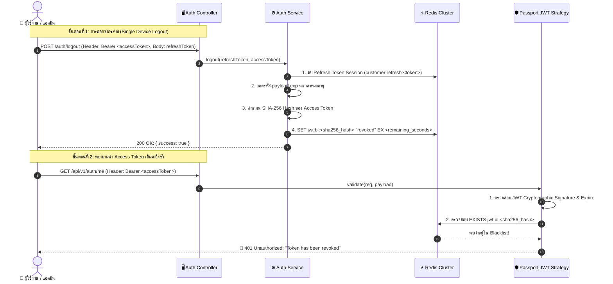
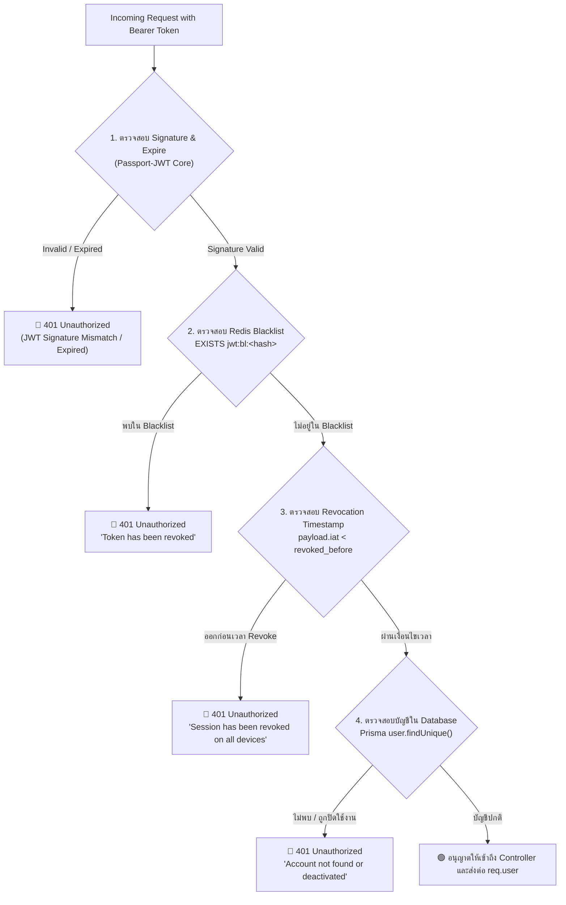
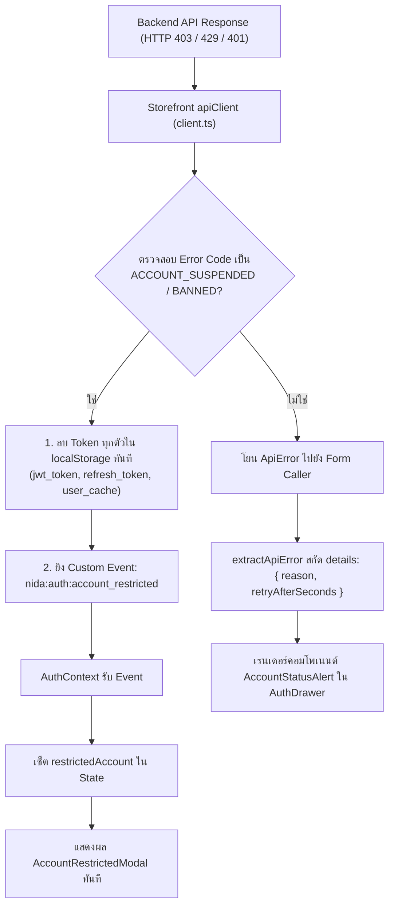

# Account & Authentication Specification (`account.md`)

เอกสารข้อกำหนดเชิงเทคนิคสำหรับวงจรชีวิตบัญชีผู้ใช้งาน (`AccountStatus`), การควบคุมสิทธิ์ผ่าน Guards, การล็อคบัญชีอัตโนมัติ (Auto-Lockout), และการเพิกถอนเซสชัน (Token Revocation) ของ Nida Platform

---

## 1. แผนภาพสถานะบัญชี (Account Lifecycle State Machine)



---

## 2. นิยามสถานะและสิทธิ์การเข้าถึง (`AccountStatus`)

| สถานะ (Enum)               |  สี Badge  | สิทธิ์การเรียก API                        | ผลกระทบต่อระบบเมื่อติดสถานะนี้                                           |
| :------------------------- | :--------: | :---------------------------------------- | :----------------------------------------------------------------------- |
| **`PENDING_VERIFICATION`** |  🔵 สีฟ้า  | เฉพาะ Endpoint ยืนยัน OTP / ตั้งรหัสผ่าน  | บล็อกการสั่งซื้อ, ตะกร้าสินค้า และการเข้าถึงระบบหลังบ้าน                 |
| **`ACTIVE`**               | 🟢 สีเขียว | ใช้งานได้เต็มสิทธิ์ตามบทบาท (Full Access) | อนุญาตให้ผ่านทุก Endpoint ตามสิทธิ์ปกติ                                  |
| **`SUSPENDED`**            |  🟡 สีส้ม  | ถูกตัดสิทธิ์ชั่วคราว                      | สกัดกั้นที่ `AccountStatusGuard` (HTTP 403 `ACCOUNT_SUSPENDED`)          |
| **`BANNED`**               |  🔴 สีแดง  | ถูกตัดสิทธิ์ถาวร                          | บล็อกทุกคำขอ (HTTP 403 `ACCOUNT_BANNED`) และขึ้นบัญชีดำ Token บน Redis   |
| **`INACTIVE`**             |  ⚪ สีเทา  | ปิดการใช้งานถาวร                          | ตัดสิทธิ์ล็อกอิน (HTTP 401 `ACCOUNT_DEACTIVATED`) คงประวัติคำสั่งซื้อไว้ |

### 2.1 โครงสร้างฐานข้อมูลและการขจัดสถานะคลุมเครือ (Database Schema & Split-Brain Elimination)

ระบบ Nida ได้ทำการ **ถอดถอนและลบคอลัมน์ Boolean เดิม (`users.is_verified` และ `admin_users.is_active`) ออกจากฐานข้อมูล 100%** ผ่าน Migration [`20261103205000_remove_is_verified_and_is_active`](file:///Users/wiiznu/project/Nida_Project/packages/database/prisma/migrations/20261103205000_remove_is_verified_and_is_active/migration.sql) เพื่อป้องกันปัญหา Split-Brain State (สภาวะที่แฟล็ก Boolean ขัดแย้งกับค่า Enum):

```prisma
// โมเดล User (ลูกค้าหน้าร้าน)
model User {
  id             String        @id @default(uuid(7)) @db.Uuid
  email          String        @unique @db.VarChar(255)
  // ...
  status         AccountStatus @default(PENDING_VERIFICATION)
  statusReason   String?       @map("status_reason") @db.VarChar(255)
  suspendedAt    DateTime?     @map("suspended_at")
  suspendedUntil DateTime?     @map("suspended_until")

  @@index([status])
  @@map("users")
}

// โมเดล AdminUser (เจ้าหน้าที่ระบบ)
model AdminUser {
  id             String        @id @default(uuid(7)) @db.Uuid
  email          String        @unique @db.VarChar(255)
  // ...
  status         AccountStatus @default(ACTIVE)
  statusReason   String?       @map("status_reason") @db.VarChar(255)
  suspendedAt    DateTime?     @map("suspended_at")
  suspendedUntil DateTime?     @map("suspended_until")

  @@index([status])
  @@map("admin_users")
}
```

---

## 3. สถาปัตยกรรมและการทำงานของ `AccountStatusGuard`

```mermaid
flowchart TD
    A["Request + Bearer JWT Token"] --> B["Passport Strategy (ตรวจสอบ Signature)"]
    B --> C{"AccountStatusGuard"}

    C -->|status == ACTIVE| D["🟢 ผ่านเข้าสู่ Controller"]

    C -->|status == SUSPENDED| E{"ตรวจเวลา suspendedUntil"}
    E -->|ยังไม่ถึงเวลา| F["🔴 403 Forbidden: ACCOUNT_SUSPENDED"]
    E -->|เลยเวลาแล้ว| G["✨ Auto-Heal: อัปเดต DB เป็น ACTIVE และอนุญาตให้ผ่าน"]

    C -->|status == BANNED| H["🔴 403 Forbidden: ACCOUNT_BANNED"]

    C -->|status == PENDING_VERIFICATION| I{"มี Decorator @AllowPendingVerification()?"}
    I -->|มี (เช่น ยืนยัน OTP)| D
    I -->|ไม่มี| J["🔴 403 Forbidden: ACCOUNT_UNVERIFIED"]

    C -->|status == INACTIVE| K["🔴 401 Unauthorized: ACCOUNT_DEACTIVATED"]
```

### 3.1 สัญญาข้อความแจ้งเตือนข้อผิดพลาดตามมาตรฐาน RFC 7807 (`AccountStatusErrorResponse`)

เมื่อคำขอถูกสกัดกั้นโดย `AccountStatusGuard` หรือเซอร์วิสตรวจสอบสิทธิ์ ระบบจะส่ง Response ในรูปแบบ JSON มาตรฐาน RFC 7807 โดยมีรหัสข้อผิดพลาด (`code` / `errorCode`) และรายละเอียด (`details`) ชัดเจน:

#### 1) บัญชีถูกระงับชั่วคราว (HTTP 403 Forbidden / HTTP 429 Too Many Requests)
```json
{
  "statusCode": 403,
  "errorCode": "ACCOUNT_SUSPENDED",
  "code": "ACCOUNT_SUSPENDED",
  "message": "บัญชีของคุณถูกระงับการใช้งานชั่วคราว (This account is temporarily suspended)",
  "details": {
    "reason": "Failed login attempts exceeded limit (5 consecutive failures)",
    "suspendedUntil": "2026-11-03T15:15:00.000Z",
    "retryAfterSeconds": 900
  }
}
```

#### 2) บัญชีถูกระงับถาวร (HTTP 403 Forbidden)
```json
{
  "statusCode": 403,
  "errorCode": "ACCOUNT_BANNED",
  "code": "ACCOUNT_BANNED",
  "message": "บัญชีของคุณถูกระงับการให้บริการถาวร (This account has been permanently banned)",
  "details": {
    "reason": "Fraudulent payment activity detected",
    "supportEmail": "support@nida-apparel.com"
  }
}
```

#### 3) บัญชีรอยืนยัน OTP (HTTP 403 Forbidden)
```json
{
  "statusCode": 403,
  "errorCode": "ACCOUNT_UNVERIFIED",
  "code": "ACCOUNT_UNVERIFIED",
  "message": "กรุณายืนยันรหัส OTP เพื่อเปิดใช้งานบัญชีของคุณก่อนทำรายการ (Please verify your account OTP to proceed)",
  "details": {
    "verifyUrl": "/verify-otp"
  }
}
```

#### 4) บัญชีถูกปิดการใช้งาน (HTTP 401 Unauthorized)
```json
{
  "statusCode": 401,
  "errorCode": "ACCOUNT_DEACTIVATED",
  "code": "ACCOUNT_DEACTIVATED",
  "message": "บัญชีนี้ถูกปิดการใช้งาน กรุณาติดต่อฝ่ายบริการลูกค้า (This account has been deactivated)"
}
```

---

## 4. กลไกความปลอดภัยเบื้องหลัง (Security Mechanisms)

### 4.1 ระบบล็อคบัญชีแบบสองชั้น (Dual-Layer Anti-Brute Force Lockout)

เมื่อมีพฤติกรรมพยายามเดารหัสผ่านติดต่อกัน Nida Platform ป้องกันการโจมตีแบบ Brute Force ผ่านสถาปัตยกรรม 2 ชั้น:



1. **In-Memory Fast Path (Redis):** ตรวจสอบคีย์ `login:lockout:<email>` ทันทีที่เริ่ม Request หากติดล็อคจะส่งผลปฏิเสธทันทีโดยไม่ต้อง Query ตารางใน Database ช่วยลดภาระ CPU/DB ภายใต้สถานการณ์ถูกยิงโจมตี (DDoS/Brute Force)
2. **Persistent Source of Truth (Database):** อัปเดตคอลัมน์ `status = 'SUSPENDED'` และระบุเวลา `suspendedUntil = now() + 15 นาที` บันทึกลงฐานข้อมูลจริงอย่างถาวร
3. **Immediate Global Revocation:** สั่งล้าง Active Sessions และขึ้นบัญชีดำ Token ใน Redis ทันที ทำให้ผู้ใช้หลุดออกจากระบบในทุกอุปกรณ์พร้อมกัน

---

### 4.2 กลไกการฟื้นฟูบัญชีอัตโนมัติ (Zero-Admin Auto-Healing Mechanism)

เมื่อระยะเวลาการระงับบัญชีสิ้นสุดลง (`now >= suspendedUntil`) ระบบจะคืนสิทธิ์ให้ผู้ใช้กลับมาใช้งานได้ทันทีอย่างราบรื่นโดยไม่ต้องติดต่อเจ้าหน้าที่ (Zero-Admin Overhead):

1. **Auto-Heal ผ่าน API Gateway / Guard (`AccountStatusGuard`):**
   - เมื่อมี Request ที่แนบ JWT Token ส่งเข้ามา และพบว่าผู้ใช้มีสถานะ `SUSPENDED` แต่เวลา `now >= suspendedUntil`
   - ตัว Guard จะเรียกคำสั่งอัปเดตฐานข้อมูลอัตโนมัติ:
     ```typescript
     await prisma.user.update({
       where: { id: user.id },
       data: {
         status: AccountStatus.ACTIVE,
         statusReason: null,
         suspendedAt: null,
         suspendedUntil: null,
       },
     });
     user.status = AccountStatus.ACTIVE;
     return true; // อนุญาตให้ Request ดำเนินการต่อได้ทันที
     ```
2. **Auto-Heal ผ่านขั้นตอนเข้าสู่ระบบ (`CustomerAuthService.login`):**
   - หากผู้ใช้พยายามกรอกรหัสผ่านเพื่อเข้าสู่ระบบใหม่หลังจากพ้นกำหนด 15 นาที
   - เซอร์วิสจะทำการปลดล็อคสถานะในฐานข้อมูลกลับเป็น `ACTIVE` ก่อนเริ่มกระบวนการตรวจสอบรหัสผ่านและจ่ายรหัส OTP ทำให้ผู้ใช้สามารถกลับเข้าสู่ระบบได้ตามปกติทันที

---

### 4.3 การเพิกถอนสิทธิ์เซสชันทันที (Immediate Session Eviction)
เมื่อบัญชีถูกเปลี่ยนสถานะเป็น `SUSPENDED`, `BANNED`, หรือ `INACTIVE` ทางหลังบ้าน:
1. ลบ Refresh Token Session จาก Redis: `customer:refresh:<token>` และ `customer:user_sessions:<userId>`
2. บันทึก Timestamp การเพิกถอน `jwt:revoked_before:<userId>` ลง Redis เพื่อปฏิเสธ Access Token ทุกใบที่ออกก่อนหน้านั้น
3. นำ Access Token ปัจจุบันเข้าสู่ Redis Blacklist (`jwt:bl:<hash>`)

---

## 5. สถาปัตยกรรมการจัดการ JWT แบบวงจรปิด (Closed-Loop JWT Lifecycle & Revocation Architecture)

### 5.1 ปัญหาของ Stateless JWT แบบดั้งเดิม (The Stateless JWT Vulnerability)

ตามมาตรฐาน JWT แบบดั้งเดิม Token จะมีความเป็น **Stateless (ไร้สถานะ)** เมื่อเซิร์ฟเวอร์เซ็นลายเซ็นดิจิทัล (Sign) ออกไปแล้ว Token นั้นจะใช้งานได้จนกว่าจะหมดอายุตามเวลา `exp`:

- **ช่องโหว่เดิม:** เมื่อผู้ใช้กด "ออกจากระบบ" (Logout) เซิร์ฟเวอร์มักลบได้เฉพาะ Refresh Token ในฐานข้อมูล/Redis แต่ **Access Token ที่มีอายุคงเหลือ (เช่น 15 นาที) ยังคงนำไปยิงเรียก API ได้อย่างสมบูรณ์** หากถูกดักจับหรือคัดลอกไว้
- **แนวทางแก้ไขของ Nida Platform:** ติดตั้งระบบ **Hybrid Stateless/Stateful Revocation** โดยนำ Redis เข้ามาทำ Blacklist และ Global Timestamp Check ที่มีความเร็วระดับ Microsecond (< 0.1ms) ทำให้ตัดสิทธิ์ Token ได้ทันทีในระดับ Real-Time

---

### 5.2 แผนภาพลำดับการทำงาน (Sequence Diagram: Logout & Blacklist Flow)



---

### 5.3 กลไกการเพิกถอน 2 รูปแบบ (Revocation Strategies)

#### รูปแบบที่ 1: การออกจากระบบเฉพาะเครื่อง (Single Token Blacklist)

ใช้เมื่อผู้ใช้กด Logout ธรรมดาบนเครื่องปัจจุบัน (`POST /auth/logout`):

1. **SHA-256 Token Hashing:** เซิร์ฟเวอร์จะนำ Bearer Token มาแฮชด้วย `crypto.createHash('sha256')` ก่อนนำไปเป็น Key บน Redis เพื่อประหยัดพื้นที่ RAM จาก Token ขนาดยาวหลายร้อยตัวอักษร เหลือเพียงสตริง Hex 64 ตัวอักษร
2. **Exact Remaining TTL (Zero Memory Leak):**
   ```typescript
   remainingSeconds = Math.max(1, payload.exp - Math.floor(Date.now() / 1000));
   await redis.set(`jwt:bl:${hash}`, 'revoked', 'EX', remainingSeconds);
   ```
   Redis จะทำลายคีย์นี้ทิ้งอัตโนมัติเมื่อครบเวลาหมดอายุจริงของ Token ทำให้ **ไม่มีปัญหา Memory Leak ใน Redis**

#### รูปแบบที่ 2: การออกจากระบบทุกอุปกรณ์พร้อมกัน (Global Device Revocation)

ใช้เมื่อผู้ใช้กด "ออกจากระบบทุกอุปกรณ์" (`POST /auth/logout-all`) หรือแอดมินสั่งแบนบัญชี:

1. **ปัญหาของการ Blacklist รายตัว:** เซิร์ฟเวอร์ไม่สามารถล่วงรู้ Access Token ทั้งหมดที่กระจัดกระจายอยู่ใน Browser หรืออุปกรณ์ต่างๆ ของผู้ใช้ได้
2. **การแก้ไขด้วย `revoked_before` Timestamp:**
   ```typescript
   now = Math.floor(Date.now() / 1000);
   await redis.set(
     `jwt:revoked_before:${userId}`,
     String(now),
     'EX',
     7 * 86400,
   ); // เก็บ 7 วัน
   ```
3. **การตรวจสอบใน Passport Strategy:**
   ```typescript
   const revokedBefore = await redis.getUserRevocationTimestamp(payload.sub);
   if (revokedBefore && payload.iat && payload.iat < revokedBefore) {
     throw new UnauthorizedException(
       'Session has been revoked on all devices. Please login again.',
     );
   }
   ```
   Token ใดก็ตามที่ออก (Issued At: `iat`) **ก่อนเวลาที่กด Logout-All** จะถูกปฏิเสธทันที 100% แม้จะยังไม่หมดอายุก็ตาม

---

### 5.4 ลำดับการตรวจสอบใน Passport JWT Strategy (Validation Pipeline)

ใน [`CustomerJwtStrategy`](file:///Users/wiiznu/project/Nida_Project/apps/api/src/modules/auth/strategies/customer-jwt.strategy.ts) และ [`JwtStrategy`](file:///Users/wiiznu/project/Nida_Project/apps/admin-api/src/modules/auth/strategies/jwt.strategy.ts) ได้เปิด `passReqToCallback: true` และมีลำดับการตรวจเช็ค 4 ชั้น:



---

### 5.5 สรุปข้อกำหนด Redis Key สำหรับระบบ JWT (Redis Key Naming Standard)

| วัตถุประสงค์ (Purpose)          | รูปแบบคีย์ (Key Pattern)          | ชนิดข้อมูล (Data Type) |      อายุคงอยู่ (TTL)       | ตัวอย่างค่า (Value Example)        |
| :------------------------------ | :-------------------------------- | :--------------------: | :-------------------------: | :--------------------------------- |
| **Access Token Blacklist**      | `jwt:bl:<sha256_hash>`            |         String         | เท่ากับเวลาหมดอายุของ Token | `"revoked"`                        |
| **Global Revocation Timestamp** | `jwt:revoked_before:<userId>`     |         String         |     7 วัน (`604,800s`)      | `"1730600000"` (UNIX timestamp)    |
| **Customer Refresh Session**    | `customer:refresh:<token>`        |     String (JSON)      |    30 วัน (`2,592,000s`)    | `{"userId":"usr-1","email":"..."}` |
| **Customer User Sessions Set**  | `customer:user_sessions:<userId>` |          Set           | ไม่ระบุ (อัปเดตตาม Session) | `["token-uuid-1", "token-uuid-2"]` |
| **Admin Refresh Session**       | `admin:session:<token>`           |     String (JSON)      |     7 วัน (`604,800s`)      | `{"adminId":"adm-1","role":"..."}` |

---

## 6. ข้อกำหนด API การจัดการสถานะบัญชีเจ้าหน้าที่หลังบ้าน (Admin Account Status Management API)

### 6.1 ข้อมูลจำเพาะ Endpoint: `PATCH /admin/users/:id/status`

- **วัตถุประสงค์:** เปลี่ยนแปลงสถานะบัญชีเจ้าหน้าที่อย่างเป็นทางการ (`ACTIVE`, `SUSPENDED`, `BANNED`, `INACTIVE`)
- **สิทธิ์การเข้าถึง (RBAC):** บังคับสิทธิ์ขั้นสูงสุด `SUPER_ADMIN` และ Permission `ADMIN_USERS_MANAGE`
- **การตรวจสอบข้อมูลนำเข้า:** ตรวจสอบผ่าน `ZodValidationPipe(updateAccountStatusSchema)`

#### Payload Request Body (`UpdateAccountStatusInput`):
```typescript
{
  status: 'SUSPENDED' | 'BANNED' | 'ACTIVE' | 'INACTIVE';
  statusReason: string; // บังคับระบุเหตุผล ความยาว 3 - 255 ตัวอักษร
  durationMinutes?: number; // ระบุจำนวนนาทีสำหรับกรณี SUSPENDED (เช่น 60, 1440)
}
```

#### กฎความปลอดภัยทางธุรกิจ (Business & Security Guard Rails):
1. **Self-Suspension Protection:** แอดมินไม่สามารถเปลี่ยนสถานะบัญชีของตนเองได้ (Throws 400 Bad Request: `ไม่สามารถเปลี่ยนสถานะบัญชีของตนเองได้`)
2. **Immediate Eviction:** หากสถานะใหม่ไม่ใช่ `ACTIVE` ระบบจะสั่งทำลาย Session ของบัญชีเป้าหมายใน Redis ทันที (`redis.revokeAllUserSessions(targetId)`) ส่งผลให้แอดมินคนนั้นหลุดจากระบบทุกเครื่องในทันที
3. **Audit Trail Recording:** ทุกการเปลี่ยนสถานะจะถูกบันทึกลงตาราง `admin_audit_logs` อัตโนมัติ (`actionType = 'STATUS_CHANGE'`, `targetTable = 'admin_users'`) พร้อมแนบ Snapshot ข้อมูลเดิมและข้อมูลใหม่ เพื่อตรวจสอบย้อนหลังได้ 100%

---

## 7. ข้อกำหนดระบบตอบสนองสถานะบัญชีฝั่งลูกค้าร้านค้า (Storefront Customer Handling Specification)

### 7.1 สถาปัตยกรรมสกัดข้อผิดพลาดและส่งสัญญาณเหตุการณ์ (Client Eventing & Error Normalization)



### 7.2 คอมโพเนนต์การแสดงผลตามมาตรฐาน Editorial Luxury

1. **`AccountStatusAlert` (`apps/store/src/components/auth/AccountStatusAlert.tsx`):**
   - **กรณี `ACCOUNT_SUSPENDED`:**
     - แสดงแถบเตือนสี Warm Amber สุภาพ พร้อมไอคอน `Clock`
     - คำนวณเวลานับถอยหลังสด (Live Countdown Timer `mm:ss`) อิงจาก `retryAfterSeconds` หรือ `suspendedUntil`
     - แสดงเหตุผลที่ถูกระงับ (เช่น _"กรอกรหัสผ่านผิดเกินกำหนด (5 ครั้ง)"_)
     - เมื่อตัวนับเวลาถึง `00:00` ระบบจะเปลี่ยนสถานะเป็น _"ครบกำหนดเวลาระงับแล้ว คุณสามารถลองเข้าสู่ระบบได้ใหม่อีกครั้ง"_ พร้อมปุ่มลองใหม่
   - **กรณี `ACCOUNT_BANNED`:**
     - แสดงแถบเตือนสี Crimson/Red พร้อมไอคอน `ShieldX`
     - แสดงเหตุผลการแบนถาวร
     - มีปุ่ม Action ติดต่อฝ่ายบริการลูกค้า (`mailto:support@nida-apparel.com`) โดยตรง
   - **กรณี `ACCOUNT_UNVERIFIED`:**
     - แสดงข้อความเตือนให้ยืนยันตัวตน พร้อมปุ่มสลับไปกรอกรหัส OTP
2. **`AccountRestrictedModal` (`apps/store/src/components/auth/AccountRestrictedModal.tsx`):**
   - ป้องกันสับสนเมื่อลูกค้าถูกตัดสิทธิ์ระหว่างใช้งาน (Mid-session Revocation)
   - แสดงผลในระดับ Global Shell ผ่าน [`StoreLayout.tsx`](file:///apps/store/src/components/layout/StoreLayout.tsx)
   - แจ้งเตือนสาเหตุอย่างชัดเจนและตัดกลับสู่สถานะ Guest Mode อย่างปลอดภัย


