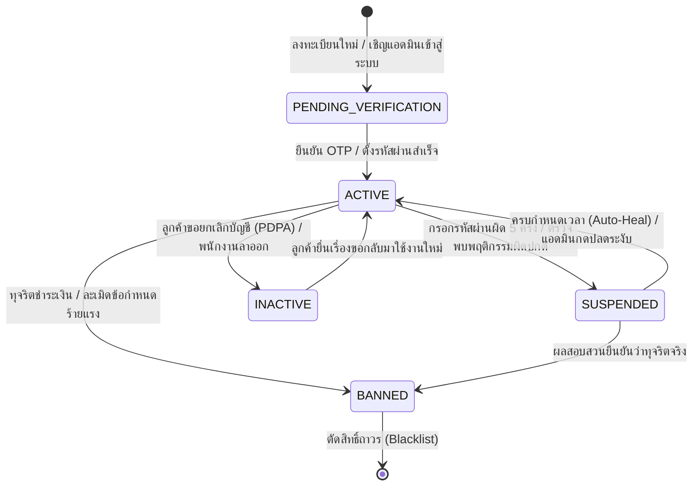
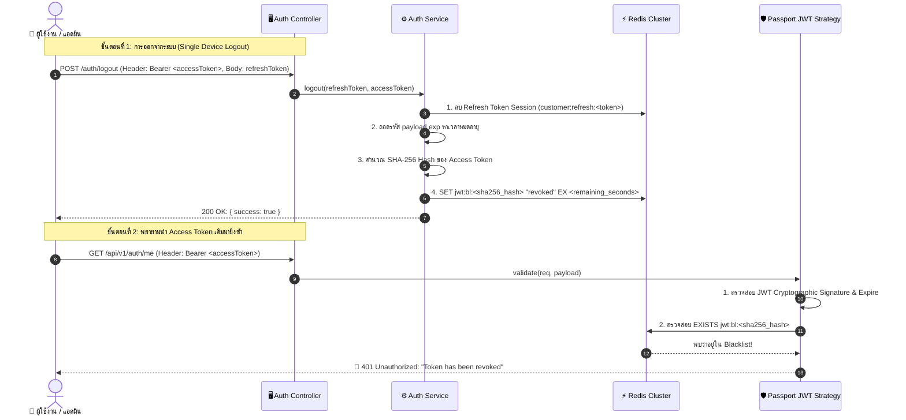
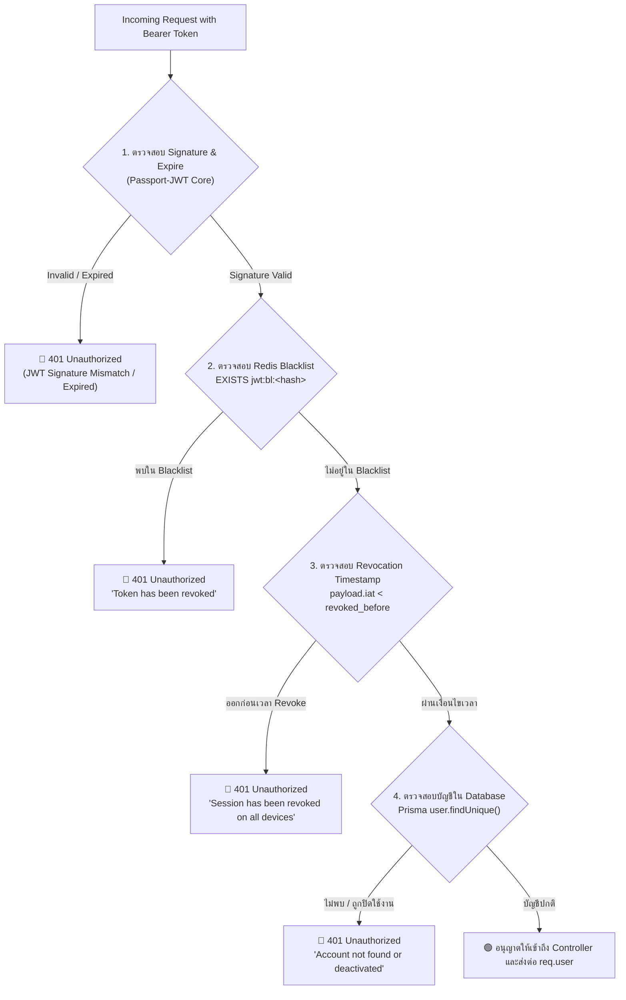

# Account & Authentication Specification (`account.md`)

เอกสารข้อกำหนดเชิงเทคนิคสำหรับวงจรชีวิตบัญชีผู้ใช้งาน (`AccountStatus`), การควบคุมสิทธิ์ผ่าน Guards, การล็อคบัญชีอัตโนมัติ (Auto-Lockout), และการเพิกถอนเซสชัน (Token Revocation) ของ Nida Platform

---

## 1. แผนภาพสถานะบัญชี (Account Lifecycle State Machine)



---

## 2. นิยามสถานะและสิทธิ์การเข้าถึง (`AccountStatus`)

| สถานะ (Enum)               |  สี Badge  | สิทธิ์การเรียก API                        | ผลกระทบต่อระบบเมื่อติดสถานะนี้                                           |
| :------------------------- | :--------: | :---------------------------------------- | :----------------------------------------------------------------------- |
| **`PENDING_VERIFICATION`** |  🔵 สีฟ้า  | เฉพาะ Endpoint ยืนยัน OTP / ตั้งรหัสผ่าน  | บล็อกการสั่งซื้อ, ตะกร้าสินค้า และการเข้าถึงระบบหลังบ้าน                 |
| **`ACTIVE`**               | 🟢 สีเขียว | ใช้งานได้เต็มสิทธิ์ตามบทบาท (Full Access) | อนุญาตให้ผ่านทุก Endpoint ตามสิทธิ์ปกติ                                  |
| **`SUSPENDED`**            |  🟡 สีส้ม  | ถูกตัดสิทธิ์ชั่วคราว                      | สกัดกั้นที่ `AccountStatusGuard` (HTTP 403 `ACCOUNT_SUSPENDED`)          |
| **`BANNED`**               |  🔴 สีแดง  | ถูกตัดสิทธิ์ถาวร                          | บล็อกทุกคำขอ (HTTP 403 `ACCOUNT_BANNED`) และขึ้นบัญชีดำ Token บน Redis   |
| **`INACTIVE`**             |  ⚪ สีเทา  | ปิดการใช้งานถาวร                          | ตัดสิทธิ์ล็อกอิน (HTTP 401 `ACCOUNT_DEACTIVATED`) คงประวัติคำสั่งซื้อไว้ |

---

## 3. สถาปัตยกรรมและการทำงานของ `AccountStatusGuard`

```mermaid
flowchart TD
    A["Request + Bearer JWT Token"] --> B["Passport Strategy (ตรวจสอบ Signature)"]
    B --> C{"AccountStatusGuard"}

    C -->|status == ACTIVE| D["🟢 ผ่านเข้าสู่ Controller"]

    C -->|status == SUSPENDED| E{"ตรวจเวลา suspendedUntil"}
    E -->|ยังไม่ถึงเวลา| F["🔴 403 Forbidden: ACCOUNT_SUSPENDED"]
    E -->|เลยเวลาแล้ว| G["✨ Auto-Heal: อัปเดต DB เป็น ACTIVE และอนุญาตให้ผ่าน"]

    C -->|status == BANNED| H["🔴 403 Forbidden: ACCOUNT_BANNED"]

    C -->|status == PENDING_VERIFICATION| I{"มี Decorator @AllowPendingVerification()?"}
    I -->|มี (เช่น ยืนยัน OTP)| D
    I -->|ไม่มี| J["🔴 403 Forbidden: ACCOUNT_UNVERIFIED"]

    C -->|status == INACTIVE| K["🔴 401 Unauthorized: ACCOUNT_DEACTIVATED"]
```

---

## 4. กลไกความปลอดภัยเบื้องหลัง (Security Mechanisms)

1. **Auto-Lockout Policy (Anti-Brute Force):**
   - หากผู้ใช้หรือแอดมินกรอกรหัสผ่านผิดติดต่อกันครบ 5 ครั้ง (5-Strike Rule) ระบบจะทำการ Lockout บัญชีทันที 15 นาทีผ่าน Redis key `login:lockout:<email>` พร้อมคืนค่า HTTP 429
2. **Auto-Healing on Expired Suspension:**
   - เมื่อผู้ใช้ที่ติดสถานะ `SUSPENDED` เรียกใช้งาน API อีกครั้งหลังจากเลยเวลา `suspendedUntil` แล้ว ตัว Guard จะทำการปลดล็อคสถานะกลับเป็น `ACTIVE` ใน Database ให้อัตโนมัติ โดยไม่ต้องรบกวนแอดมินมากดปลดล็อค
3. **Immediate Session Eviction (Redis Blacklist):**
   - เมื่อบัญชีถูกแบนหรือระงับ ระบบจะส่งคำสั่งลบ Refresh Token และบันทึก Token Hash ลง Redis Blacklist พร้อม TTL เท่ากับเวลาหมดอายุของ JWT เพื่อให้ผู้ใช้หลุดออกจากระบบทันที

---

## 5. สถาปัตยกรรมการจัดการ JWT แบบวงจรปิด (Closed-Loop JWT Lifecycle & Revocation Architecture)

### 5.1 ปัญหาของ Stateless JWT แบบดั้งเดิม (The Stateless JWT Vulnerability)

ตามมาตรฐาน JWT แบบดั้งเดิม Token จะมีความเป็น **Stateless (ไร้สถานะ)** เมื่อเซิร์ฟเวอร์เซ็นลายเซ็นดิจิทัล (Sign) ออกไปแล้ว Token นั้นจะใช้งานได้จนกว่าจะหมดอายุตามเวลา `exp`:

- **ช่องโหว่เดิม:** เมื่อผู้ใช้กด "ออกจากระบบ" (Logout) เซิร์ฟเวอร์มักลบได้เฉพาะ Refresh Token ในฐานข้อมูล/Redis แต่ **Access Token ที่มีอายุคงเหลือ (เช่น 15 นาที) ยังคงนำไปยิงเรียก API ได้อย่างสมบูรณ์** หากถูกดักจับหรือคัดลอกไว้
- **แนวทางแก้ไขของ Nida Platform:** ติดตั้งระบบ **Hybrid Stateless/Stateful Revocation** โดยนำ Redis เข้ามาทำ Blacklist และ Global Timestamp Check ที่มีความเร็วระดับ Microsecond (< 0.1ms) ทำให้ตัดสิทธิ์ Token ได้ทันทีในระดับ Real-Time

---

### 5.2 แผนภาพลำดับการทำงาน (Sequence Diagram: Logout & Blacklist Flow)



---

### 5.3 กลไกการเพิกถอน 2 รูปแบบ (Revocation Strategies)

#### รูปแบบที่ 1: การออกจากระบบเฉพาะเครื่อง (Single Token Blacklist)

ใช้เมื่อผู้ใช้กด Logout ธรรมดาบนเครื่องปัจจุบัน (`POST /auth/logout`):

1. **SHA-256 Token Hashing:** เซิร์ฟเวอร์จะนำ Bearer Token มาแฮชด้วย `crypto.createHash('sha256')` ก่อนนำไปเป็น Key บน Redis เพื่อประหยัดพื้นที่ RAM จาก Token ขนาดยาวหลายร้อยตัวอักษร เหลือเพียงสตริง Hex 64 ตัวอักษร
2. **Exact Remaining TTL (Zero Memory Leak):**
   ```typescript
   remainingSeconds = Math.max(1, payload.exp - Math.floor(Date.now() / 1000));
   await redis.set(`jwt:bl:${hash}`, 'revoked', 'EX', remainingSeconds);
   ```
   Redis จะทำลายคีย์นี้ทิ้งอัตโนมัติเมื่อครบเวลาหมดอายุจริงของ Token ทำให้ **ไม่มีปัญหา Memory Leak ใน Redis**

#### รูปแบบที่ 2: การออกจากระบบทุกอุปกรณ์พร้อมกัน (Global Device Revocation)

ใช้เมื่อผู้ใช้กด "ออกจากระบบทุกอุปกรณ์" (`POST /auth/logout-all`) หรือแอดมินสั่งแบนบัญชี:

1. **ปัญหาของการ Blacklist รายตัว:** เซิร์ฟเวอร์ไม่สามารถล่วงรู้ Access Token ทั้งหมดที่กระจัดกระจายอยู่ใน Browser หรืออุปกรณ์ต่างๆ ของผู้ใช้ได้
2. **การแก้ไขด้วย `revoked_before` Timestamp:**
   ```typescript
   now = Math.floor(Date.now() / 1000);
   await redis.set(
     `jwt:revoked_before:${userId}`,
     String(now),
     'EX',
     7 * 86400,
   ); // เก็บ 7 วัน
   ```
3. **การตรวจสอบใน Passport Strategy:**
   ```typescript
   const revokedBefore = await redis.getUserRevocationTimestamp(payload.sub);
   if (revokedBefore && payload.iat && payload.iat < revokedBefore) {
     throw new UnauthorizedException(
       'Session has been revoked on all devices. Please login again.',
     );
   }
   ```
   Token ใดก็ตามที่ออก (Issued At: `iat`) **ก่อนเวลาที่กด Logout-All** จะถูกปฏิเสธทันที 100% แม้จะยังไม่หมดอายุก็ตาม

---

### 5.4 ลำดับการตรวจสอบใน Passport JWT Strategy (Validation Pipeline)

ใน [`CustomerJwtStrategy`](file:///Users/wiiznu/project/Nida_Project/apps/api/src/modules/auth/strategies/customer-jwt.strategy.ts) และ [`JwtStrategy`](file:///Users/wiiznu/project/Nida_Project/apps/admin-api/src/modules/auth/strategies/jwt.strategy.ts) ได้เปิด `passReqToCallback: true` และมีลำดับการตรวจเช็ค 4 ชั้น:



---

### 5.5 สรุปข้อกำหนด Redis Key สำหรับระบบ JWT (Redis Key Naming Standard)

| วัตถุประสงค์ (Purpose)          | รูปแบบคีย์ (Key Pattern)          | ชนิดข้อมูล (Data Type) |      อายุคงอยู่ (TTL)       | ตัวอย่างค่า (Value Example)        |
| :------------------------------ | :-------------------------------- | :--------------------: | :-------------------------: | :--------------------------------- |
| **Access Token Blacklist**      | `jwt:bl:<sha256_hash>`            |         String         | เท่ากับเวลาหมดอายุของ Token | `"revoked"`                        |
| **Global Revocation Timestamp** | `jwt:revoked_before:<userId>`     |         String         |     7 วัน (`604,800s`)      | `"1730600000"` (UNIX timestamp)    |
| **Customer Refresh Session**    | `customer:refresh:<token>`        |     String (JSON)      |    30 วัน (`2,592,000s`)    | `{"userId":"usr-1","email":"..."}` |
| **Customer User Sessions Set**  | `customer:user_sessions:<userId>` |          Set           | ไม่ระบุ (อัปเดตตาม Session) | `["token-uuid-1", "token-uuid-2"]` |
| **Admin Refresh Session**       | `admin:session:<token>`           |     String (JSON)      |     7 วัน (`604,800s`)      | `{"adminId":"adm-1","role":"..."}` |
