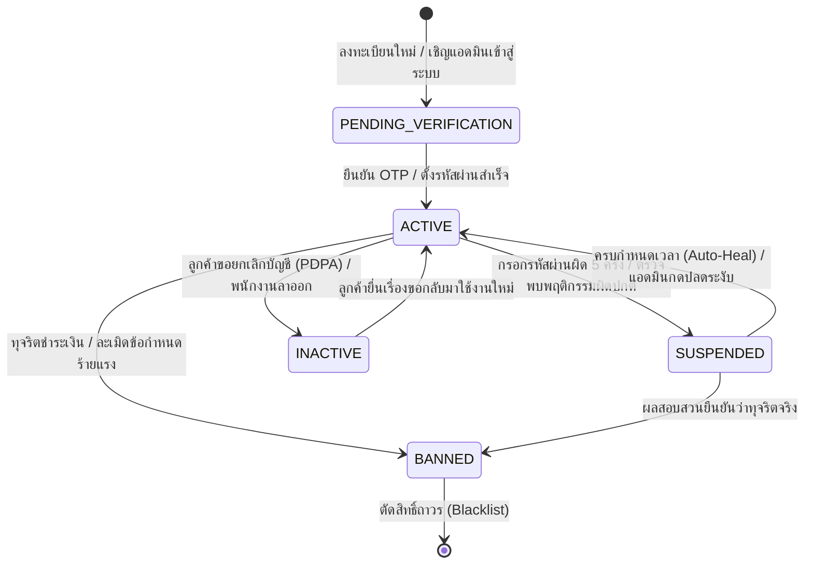

# Account & Authentication Specification (`account.md`)

เอกสารข้อกำหนดเชิงเทคนิคสำหรับวงจรชีวิตบัญชีผู้ใช้งาน (`AccountStatus`), การควบคุมสิทธิ์ผ่าน Guards, การล็อคบัญชีอัตโนมัติ (Auto-Lockout), และการเพิกถอนเซสชัน (Token Revocation) ของ Nida Platform

---

## 1. แผนภาพสถานะบัญชี (Account Lifecycle State Machine)



---

## 2. นิยามสถานะและสิทธิ์การเข้าถึง (`AccountStatus`)

| สถานะ (Enum) | สี Badge | สิทธิ์การเรียก API | ผลกระทบต่อระบบเมื่อติดสถานะนี้ |
| :--- | :---: | :--- | :--- |
| **`PENDING_VERIFICATION`** | 🔵 สีฟ้า | เฉพาะ Endpoint ยืนยัน OTP / ตั้งรหัสผ่าน | บล็อกการสั่งซื้อ, ตะกร้าสินค้า และการเข้าถึงระบบหลังบ้าน |
| **`ACTIVE`** | 🟢 สีเขียว | ใช้งานได้เต็มสิทธิ์ตามบทบาท (Full Access) | อนุญาตให้ผ่านทุก Endpoint ตามสิทธิ์ปกติ |
| **`SUSPENDED`** | 🟡 สีส้ม | ถูกตัดสิทธิ์ชั่วคราว | สกัดกั้นที่ `AccountStatusGuard` (HTTP 403 `ACCOUNT_SUSPENDED`) |
| **`BANNED`** | 🔴 สีแดง | ถูกตัดสิทธิ์ถาวร | บล็อกทุกคำขอ (HTTP 403 `ACCOUNT_BANNED`) และขึ้นบัญชีดำ Token บน Redis |
| **`INACTIVE`** | ⚪ สีเทา | ปิดการใช้งานถาวร | ตัดสิทธิ์ล็อกอิน (HTTP 401 `ACCOUNT_DEACTIVATED`) คงประวัติคำสั่งซื้อไว้ |

---

## 3. สถาปัตยกรรมและการทำงานของ `AccountStatusGuard`

```mermaid
flowchart TD
    A["Request + Bearer JWT Token"] --> B["Passport Strategy (ตรวจสอบ Signature)"]
    B --> C{"AccountStatusGuard"}
    
    C -->|status == ACTIVE| D["🟢 ผ่านเข้าสู่ Controller"]
    
    C -->|status == SUSPENDED| E{"ตรวจเวลา suspendedUntil"}
    E -->|ยังไม่ถึงเวลา| F["🔴 403 Forbidden: ACCOUNT_SUSPENDED"]
    E -->|เลยเวลาแล้ว| G["✨ Auto-Heal: อัปเดต DB เป็น ACTIVE และอนุญาตให้ผ่าน"]
    
    C -->|status == BANNED| H["🔴 403 Forbidden: ACCOUNT_BANNED"]
    
    C -->|status == PENDING_VERIFICATION| I{"มี Decorator @AllowPendingVerification()?"}
    I -->|มี (เช่น ยืนยัน OTP)| D
    I -->|ไม่มี| J["🔴 403 Forbidden: ACCOUNT_UNVERIFIED"]
    
    C -->|status == INACTIVE| K["🔴 401 Unauthorized: ACCOUNT_DEACTIVATED"]
```

---

## 4. กลไกความปลอดภัยเบื้องหลัง (Security Mechanisms)

1. **Auto-Lockout Policy (Anti-Brute Force):**
   - หากผู้ใช้หรือแอดมินกรอกรหัสผ่านผิดติดต่อกันครบ 5 ครั้ง ระบบจะปรับสถานะเป็น `SUSPENDED` ทันที และกำหนด `suspendedUntil = now() + 15 นาที`
2. **Auto-Healing on Expired Suspension:**
   - เมื่อผู้ใช้ที่ติดสถานะ `SUSPENDED` เรียกใช้งาน API อีกครั้งหลังจากเลยเวลา `suspendedUntil` แล้ว ตัว Guard จะทำการปลดล็อคสถานะกลับเป็น `ACTIVE` ใน Database ให้อัตโนมัติ โดยไม่ต้องรบกวนแอดมินมากดปลดล็อค
3. **Immediate Session Eviction (Redis Blacklist):**
   - เมื่อบัญชีถูกแบนหรือระงับ ระบบจะส่งคำสั่งลบ Refresh Token และบันทึก Token Hash ลง Redis Blacklist พร้อม TTL เท่ากับเวลาหมดอายุของ JWT เพื่อให้ผู้ใช้หลุดออกจากระบบทันที

