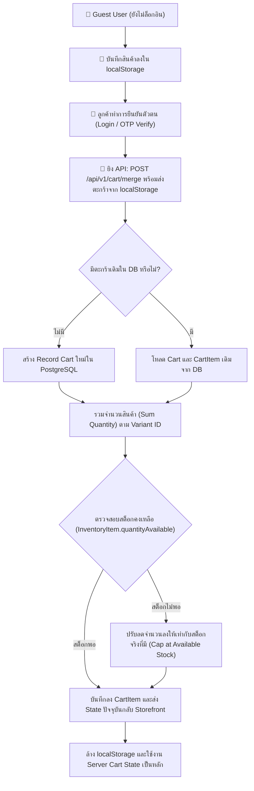

# Cart & Wishlist Specification (`cart.md`)

เอกสารข้อกำหนดเชิงเทคนิคสำหรับระบบตะกร้าสินค้า (`Cart`, `CartItem`) การรวมตะกร้าของ Guest (`Merge Cart`), การตรวจสอบสต็อกคงเหลือ และระบบรายการสินค้าโปรด (`Wishlist`) ในแพลตฟอร์ม Nida Platform

---

## 1. แผนภาพวงจรชีวิตตะกร้าสินค้า (Cart Lifecycle & Merging Flow)



---

## 2. ข้อมูลจำเพาะ API ตะกร้าสินค้า (`CustomerCartController`)

ทุก Endpoint ได้รับการปกป้องด้วย `CustomerJwtGuard` และ `AccountStatusGuard` (บัญชีสถานะ `SUSPENDED` หรือ `BANNED` จะถูกปฏิเสธทันที)

| Method   | Endpoint Path                | หน้าที่หลัก (Operation)                                                | สัญญาข้อมูล (Schema / DTO)           |
| :------- | :--------------------------- | :--------------------------------------------------------------------- | :----------------------------------- |
| `GET`    | `/api/v1/cart`               | ดึงข้อมูลตะกร้าสินค้าสด พร้อมรายละเอียดสินค้า รูปภาพ และสต็อกคงเหลือ   | `ServerCartResponse`                 |
| `POST`   | `/api/v1/cart/merge`         | รวมตะกร้าจาก `localStorage` เข้าสู่ DB ทันทีหลังยืนยัน OTP สำเร็จ      | `mergeCartSchema` (`MergeCartInput`) |
| `PUT`    | `/api/v1/cart/items`         | เพิ่มสินค้าใหม่ หรือปรับจำนวนชิ้นในตะกร้า (Auto create or update item) | `updateCartItemSchema`               |
| `DELETE` | `/api/v1/cart/items/:itemKey`| ลบสินค้าชิ้นนั้นออกจากตะกร้า (`variantId`)                             | `ServerCartResponse`                 |
| `DELETE` | `/api/v1/cart`               | ล้างสินค้าทั้งหมดในตะกร้า (เช่น หลัง Checkout สำเร็จ)                  | `ServerCartResponse` (Empty)         |

### กฎการตรวจสอบสต็อกคงเหลือ (Inventory Availability Guard):
1. เมื่อมีการเพิ่มหรือแก้ไขจำนวนในตะกร้า ระบบจะดึง `InventoryItem.quantityAvailable` ของ SKU นั้นๆ มาตรวจสอบเสมอ
2. หากลูกค้าพยายามสั่งซื้อเกินกว่าสต็อกที่มี ระบบจะแคปจำนวนสูงสุดเท่ากับสต็อกจริง และแจ้งเตือนไปยังหน้า UI
3. สินค้าที่ถูกปิดการขาย (`isActive: false` หรือ `Product.status !== PUBLISHED`) จะถูกลบออกจากผลลัพธ์ตะกร้าสินค้าอัตโนมัติ

---

## 3. ระบบรายการสินค้าที่สนใจ (Wishlist Specification)

โมเดลฐานข้อมูล `Wishlist` ถูกออกแบบมาเพื่อบันทึกสินค้าที่ลูกค้าต้องการเก็บไว้พิจารณาในภายหลัง โดยเชื่อมโยงกับบัญชีผู้ใช้ (`User`) และสินค้า (`Product`)

### 3.1 โครงสร้างระดับฐานข้อมูล (Database Schema)

```prisma
model Wishlist {
  id        String   @id @default(uuid()) @db.Uuid
  userId    String   @map("user_id") @db.Uuid
  productId String   @map("product_id") @db.Uuid
  addedAt   DateTime @default(now()) @map("added_at")

  user    User    @relation(fields: [userId], references: [id], onDelete: Cascade)
  product Product @relation(fields: [productId], references: [id], onDelete: Cascade)

  @@unique([userId, productId])
  @@index([userId])
  @@map("wishlists")
}
```

### 3.2 ข้อมูลจำเพาะ API รายการโปรด (`WishlistController`)

| Method   | Endpoint Path                | หน้าที่หลัก                                          | สิทธิ์การเข้าถึง                  |
| :------- | :--------------------------- | :--------------------------------------------------- | :-------------------------------- |
| `GET`    | `/api/v1/wishlist`           | ดึงรายการ `productIds` ทั้งหมดที่ลูกค้าคนนี้บันทึกไว้ | `CustomerJwtGuard` + `AccountStatusGuard` |
| `POST`   | `/api/v1/wishlist/:productId`| เพิ่มสินค้าเข้า Wishlist (ใช้คำสั่ง Upsert แบบ Idempotent) | `CustomerJwtGuard` + `AccountStatusGuard` |
| `DELETE` | `/api/v1/wishlist/:productId`| นำสินค้าออกจาก Wishlist                              | `CustomerJwtGuard` + `AccountStatusGuard` |

### 3.3 กลไกการทำงานฝั่งหน้าร้าน (Storefront Wishlist Behavior)
- **Optimistic UI Updates**: เมื่อผู้ใช้คลิกปุ่มไอคอนรูปหัวใจ หน้าร้านจะอัปเดต State ในหน่วยความจำทันทีเพื่อให้ผู้ใช้ได้รับประสบการณ์ที่ลื่นไหลไร้รอยต่อ และทำการซิงค์กับ Backend ในเบื้องหลัง
- **Automatic Rollback**: หากเกิดข้อผิดพลาดในการเชื่อมต่อเครือข่าย ระบบจะย้อนคืน State เดิม (Rollback) พร้อมแสดง Toast แจ้งเตือนข้อผิดพลาด
- **Fallback for Guest**: หากผู้ใช้ยังไม่ได้เข้าสู่ระบบ ระบบจะเก็บไว้ในหน่วยความจำหรือแนะนำให้ผู้ใช้เข้าสู่ระบบเพื่อบันทึกรายการโปรดถาวร

