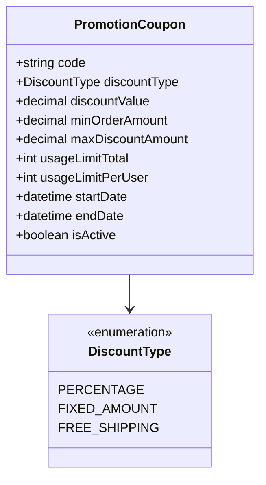
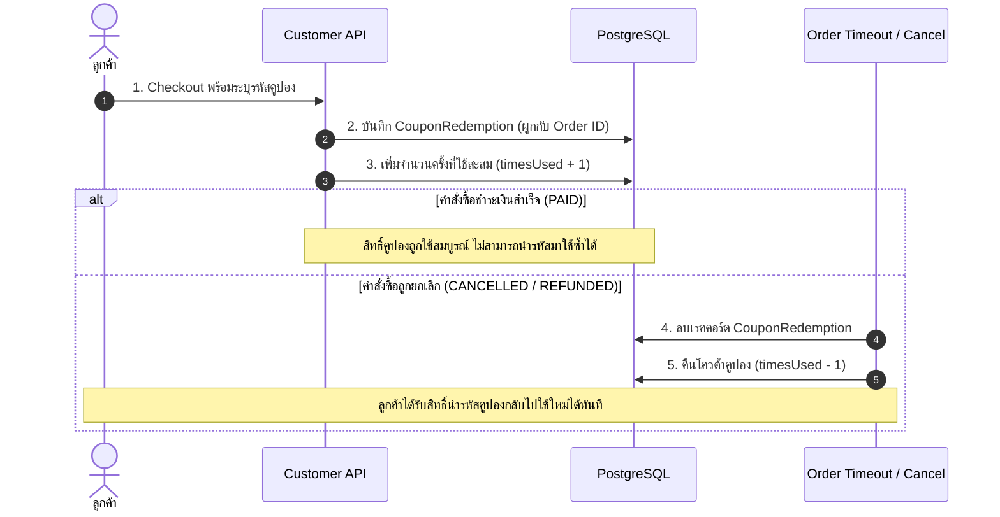

# Promotions & Coupons Specification (`coupon.md`)

เอกสารข้อกำหนดเชิงเทคนิคสำหรับระบบโปรโมชัน, เครื่องคำนวณส่วนลด (`PromotionCoupon`), และบัญชีประวัติการใช้สิทธิ์ (`CouponRedemption`) ของ Nida Platform

---

## 1. ประเภทส่วนลดที่รองรับ (`DiscountType`)

| ประเภทส่วนลด (Enum) | รูปแบบค่าส่วนลด (`discountValue`)            | ตัวอย่างการคำนวณ                       | ขีดจำกัดสูงสุด (`maxDiscountAmount`)                  |
| :------------------ | :------------------------------------------- | :------------------------------------- | :---------------------------------------------------- |
| **`PERCENTAGE`**    | เปอร์เซ็นต์ (เช่น `20` คือลด 20%)            | ซื้อ ฿2,000 ลด 20% = ลด ฿400           | หากมีเพดาน (เช่น สูงสุด ฿300) ยอดลดจะถูกตัดเหลือ ฿300 |
| **`FIXED_AMOUNT`**  | จำนวนเงินบาทคงที่ (เช่น `200.00`)            | ซื้อ ฿1,500 ลดทันที ฿200 = จ่าย ฿1,300 | ส่วนลดต้องไม่เกินยอดรวมสินค้าในตะกร้า                 |
| **`FREE_SHIPPING`** | ยกเว้นค่าจัดส่ง (เช่น `50.00` หรือเต็มจำนวน) | ค่าจัดส่ง ฿60 ➔ ลดค่าส่งเหลือ ฿0       | คืนส่วนลดเฉพาะค่าจัดส่ง ไม่แตะราคาสินค้า              |

---

## 2. กฎเกณฑ์การตรวจสอบสิทธิ์การใช้งาน (Validation Matrix)

คูปองจะสามารถใช้งานได้สำเร็จ ก็ต่อเมื่อผ่านเงื่อนไขครบทั้ง 6 ข้อนี้:

1. **สถานะเปิดใช้งาน (`isActive`):** ต้องเป็น `true` (แอดมินสามารถเปิด/ปิดได้ตลอดเวลา)
2. **กรอบเวลาที่ถูกต้อง (`Date Range`):** เวลาปัจจุบันต้องอยู่ระหว่าง `startDate` และ `endDate`
3. **ยอดสั่งซื้อขั้นต่ำ (`minOrderAmount`):** ยอดรวมของสินค้าในตะกร้าต้องเท่ากับหรือมากกว่ายอดขั้นต่ำที่กำหนด
4. **โควต้าการใช้งานรวมทั้งระบบ (`usageLimitTotal`):** จำนวนการใช้งานสะสม (`timesUsed`) ต้องไม่เกินโควต้าที่ตั้งไว้
5. **โควต้าต่อบุคคล (`usageLimitPerUser`):** ลูกค้ารายนั้นๆ ต้องไม่เคยใช้คูปองนี้เกินจำนวนครั้งที่อนุญาต (ตรวจสอบจากตาราง `CouponRedemption`)
6. **ไม่สามารถใช้ซ้อนคูปองอื่นได้:** คำสั่งซื้อ 1 รายการสามารถใส่รหัสคูปองโปรโมชันได้เพียง 1 รหัสเท่านั้น

---

## 3. วงจรการบันทึกสิทธิ์และการคืนสิทธิ์ (Redemption Lifecycle)

