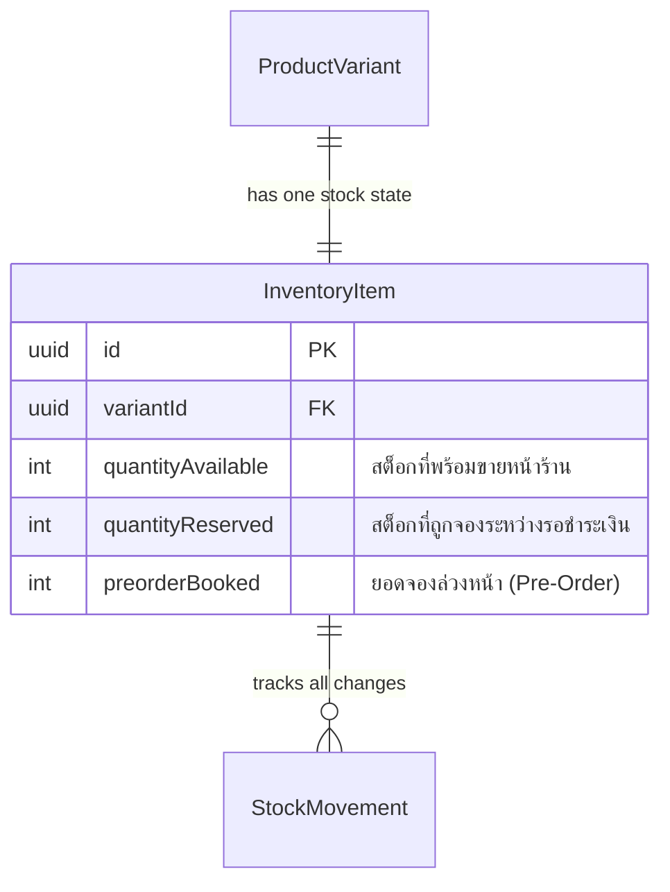
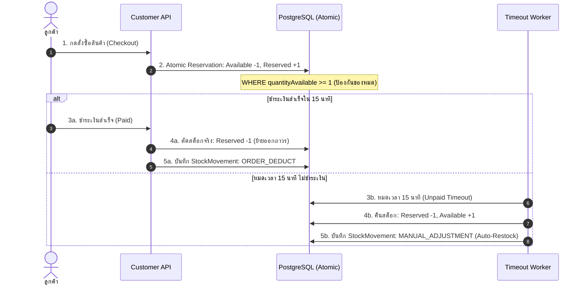

# Inventory & Stock Movement Specification (`inventory.md`)

เอกสารข้อกำหนดเชิงเทคนิคสำหรับระบบบริหารจัดการสต็อกสินค้า, การจองสต็อกชั่วคราว (Stock Reservation), และบัญชีแยกประเภทความเคลื่อนไหวสต็อก (Stock Movement Ledger) ของ Nida Platform

---

## 1. โครงสร้างข้อมูลสต็อกสินค้า (`InventoryItem`)

ทุกๆ SKU ของสินค้า (`ProductVariant`) จะมีเรคคอร์ดสต็อกเชื่อมโยงแบบ 1:1 เสมอ:



- **`quantityAvailable`**: จำนวนสินค้าจริงในคลังที่เปิดให้ลูกค้ากดใส่ตะกร้าและสั่งซื้อได้
- **`quantityReserved`**: จำนวนสินค้าที่ถูกล็อคไว้ขณะลูกค้ากดสั่งซื้อ อยู่ระหว่างรอชำระเงิน (อายุ 15 นาที) ป้องกันปัญหาสต็อกชนกัน
- **`preorderBooked`**: จำนวนคำสั่งซื้อที่จ่ายเงินแล้วสำหรับสินค้า Pre-Order ซึ่งรอการผลิต/นำเข้าเข้าคลัง

---

## 2. ประเภทความเคลื่อนไหวสต็อก (`StockChangeType`)

ทุกครั้งที่ตัวเลขสต็อกมีการเปลี่ยนแปลง ระบบจะบันทึก Audit Log ลงตาราง `StockMovement` เสมอ ห้ามแก้ตัวเลขลอยๆ:

| รหัสประเภท (Enum)       | ทิศทางสต็อก (Delta) | สาเหตุ / สถานการณ์                                         | ผู้กระทำ (Actor) |
| :---------------------- | :-----------------: | :--------------------------------------------------------- | :--------------- |
| **`RESTOCK`**           |    ➕ เพิ่มขึ้น     | การเติมสินค้าล็อตใหม่เข้าคลังสินค้า                        | Admin คลัง       |
| **`MANUAL_ADJUSTMENT`** |   ➕ / ➖ ปรับยอด   | การตรวจนับสต็อกประจำงวด (Stock Count Correction)           | Super Admin      |
| **`ORDER_DEDUCT`**      |       ➖ ลดลง       | คำสั่งซื้อชำระเงินสำเร็จ ตัดสินค้าออกจากคลังเพื่อส่ง       | ระบบอัตโนมัติ    |
| **`PREORDER_RECEIVE`**  |    ➖ ลดยอดค้าง     | สินค้า Pre-Order เดินทางมาถึงคลัง พร้อมแปลงเป็นของพร้อมส่ง | Admin คลัง       |
| **`DAMAGE`**            |       ➖ ลดลง       | สินค้าชำรุดเสียหาย ตรวจพบตำหนิ ต้องตัดจำหน่าย              | QC คลัง          |
| **`RETURNED`**          |    ➕ เพิ่มขึ้น     | สินค้าส่งคืนผ่านการตรวจรับ QC เรียบร้อย นำกลับเข้าชั้นวาง  | QC คลัง          |

---

## 3. วงจรการตัดสต็อกและความปลอดภัยต่อ Race Condition



### การป้องกัน Race Condition (Overselling Prevention):

การจองสต็อกจะกระทำผ่าน **Atomic Database Query** ระดับแถวเสมอ โดยไม่พึ่งพาค่าที่อ่านขึ้นมาใน Memory:

```ts
await prisma.inventoryItem.update({
  where: {
    variantId,
    quantityAvailable: { gte: quantityRequested }, // Guard Rail ป้องกันยอดติดลบ
  },
  data: {
    quantityAvailable: { decrement: quantityRequested },
    quantityReserved: { increment: quantityRequested },
  },
});
```
