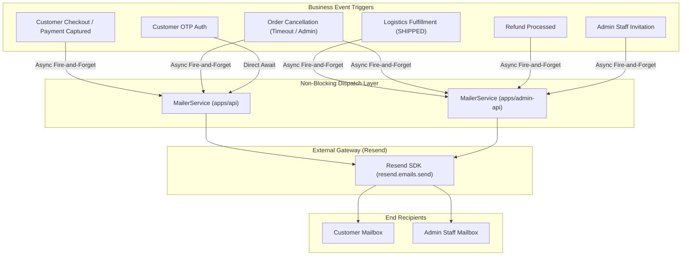

# Transactional Email & Customer Notifications Specification

ระบบส่งอีเมลแจ้งเตือนธุรกรรมอัตโนมัติ (Transactional Email) ของ Nida Platform ออกแบบด้วยแนวคิด **Editorial Luxury Aesthetic** (เรียบหรู คมชัด ปราศจากอีโมจิ) ขับเคลื่อนด้วยบริการ **Resend API** ทั้งในส่วนของลูกค้าหน้าร้าน (`apps/api`) และทีมงานหลังบ้าน (`apps/admin-api`)

---

## 1. สถาปัตยกรรมและการทำงาน (Architecture & Principles)



### กฎเหล็กของระบบอีเมล (Core Principles)
1. **Non-Blocking Fire-and-Forget**:
   การส่งอีเมลเป็น Side-effect ที่ทำงานแบบ Asynchronous ทุกจุดที่มีการส่งอีเมลธุรกรรมหลัก (การตัดเงิน, ตัดสต็อก, เปลี่ยนสถานะคำสั่งซื้อ, คืนเงิน) จะต้องไม่บล็อกหรือทำให้ Transaction ของ Database ล้มเหลว (`.catch(err => this.logger.error(...))`)
2. **Editorial Luxury Aesthetic (Anti-AI Slop)**:
   - **Zero Emojis**: ห้ามมีอีโมจิใน Subject line, Preheader หรือ Body text เด็ดขาด
   - **Color Palette**: ใช้สีหลัก `#2B1810` (Espresso Black), `#FAF7F2` (Warm Alabaster), `#EAE3D9` (Muted Warm Border), `#8C7A6B` (Refined Gold/Bronze)
   - **Bilingual Structure**: มีข้อความกำกับภาษาไทยและภาษาอังกฤษควบคู่กันอย่างประณีต
3. **Graceful Fallback Mode**:
   หากไม่มีการตั้งค่า `RESEND_API_KEY` (ในสภาพแวดล้อม Local Development / Unit Tests) ตัวบริการจะบันทึก Log เตือนและ Return `null` โดยไม่โยน Unhandled Exception ออกไปทำลายระบบ

---

## 2. แคตตาล็อกเทมเพลตอีเมล (Email Templates Catalog)

| เทมเพลต | ผู้รับ | Trigger Event | ข้อมูลสำคัญที่แสดงในอีเมล |
| :--- | :--- | :--- | :--- |
| **Customer OTP** | ลูกค้า | ขอรหัสยืนยันตัวตนสำหรับ Sign-in / Register | รหัส OTP 6 หลัก, อายุการใช้งาน 5 นาที, คำเตือนความปลอดภัย |
| **Order Confirmation** | ลูกค้า | ชำระเงินสำเร็จ / สร้างคำสั่งซื้อ | หมายเลขคำสั่งซื้อ, รายการสินค้า, ยอดรวมสุทธิ, ที่อยู่จัดส่ง |
| **Order Shipped** | ลูกค้า | แอดมินหรือคลังจัดส่งสินค้า (`SHIPPED`) | หมายเลขพัสดุ (Tracking Number), ผู้ให้บริการขนส่ง, ลิงก์ติดตามพัสดุ (Flash, Kerry, ThaiPost, DHL หรือ Nida Web View) |
| **E-Tax Invoice & Receipt** | ลูกค้า | การชำระเงินเสร็จสมบูรณ์ (`PAID`) | เลขที่ใบกำกับภาษี (`INV-YYYYMM-XXXXX`), เลขประจำตัวผู้เสียภาษี, ยอดก่อนภาษี, VAT 7%, ลิงก์ดูและพิมพ์ใบเสร็จ A4 |
| **Order Cancelled** | ลูกค้า | คำสั่งซื้อถูกยกเลิก (Timeout 15 นาที / แอดมินยกเลิก) | หมายเลขคำสั่งซื้อ, สาเหตุการยกเลิก, รายละเอียดการคืนเงิน (ถ้ามี) |
| **Refund Processed** | ลูกค้า | อนุมัติและดำเนินการคืนเงินผ่าน Omise สำเร็จ | หมายเลขคำสั่งซื้อ, ยอดเงินที่คืน, ช่องทางการคืนเงิน (PromptPay / Credit Card), ระยะเวลาดำเนินการ 7-14 วันทำการ |
| **Admin Staff Invitation** | พนักงาน | Super Admin ส่งคำเชิญเข้าใช้งาน Back-Office | ชื่อพนักงาน, ลิงก์ตั้งรหัสผ่านพร้อม Token อายุ 24 ชั่วโมง, Security Notice |
| **Password Reset** | พนักงาน/ลูกค้า | ส่งคำขอรีเซ็ตรหัสผ่าน | ลิงก์รีเซ็ตรหัสผ่านพร้อม Token อายุ 15 นาที |

---

## 3. การเชื่อมต่อลิงก์ระบบติดตามพัสดุ (Live Courier Tracking URLs)

ระบบกำหนด URL ติดตามสถานะพัสดุอัตโนมัติตามชื่อผู้ให้บริการขนส่ง:

- **Flash Express**: `https://www.flashexpress.co.th/tracking/?se={trackingNumber}`
- **Kerry Express**: `https://th.kerryexpress.com/th/track/?track={trackingNumber}`
- **Thailand Post**: `https://track.thailandpost.co.th/?trackNumber={trackingNumber}`
- **DHL Express**: `https://www.dhl.com/th-th/home/tracking.html?tracking-id={trackingNumber}`
- **Default Fallback**: `{STOREFRONT_URL}/orders/{orderNumber}`

---

## 4. มาตรการความปลอดภัยและ Rate Limiting

1. **Admin Invitation Rate Limiting**:
   - บัญชี Admin แต่ละคนสามารถส่งคำเชิญพนักงานใหม่ได้สูงสุด **5 ครั้งต่อนาที** (`@RateLimit({ limit: 5, windowSeconds: 60, keyPrefix: 'admin:invite' })`) เพื่อป้องกันการยิงสแปมอีเมล
2. **One-Time Token Lifespan**:
   - Invitation Token ใน Redis (`admin:invite:{token}`) มีอายุความปลอดภัยสูงสุด **24 ชั่วโมง (86,400 วินาที)**
   - เมื่อผู้ใช้ตั้งรหัสผ่านสำเร็จ Token จะถูกลบออกจาก Redis ทันที (`redis.deleteInviteToken(token)`)
3. **Password Reset Token Lifespan**:
   - Reset Token มีอายุความปลอดภัยสูงสุด **15 นาที (900 วินาที)**

---

## 5. คู่มือการตั้งค่าสำหรับ Production (Production Ops Guide)

### 5.1 Environment Variables ที่จำเป็น

```env
# Resend API Configuration
RESEND_API_KEY=re_xxxxxxxxxxxxxxxxxxxx
RESEND_FROM_EMAIL=NIDA Official <noreply@nida.co>
ADMIN_RESEND_FROM_EMAIL=NIDA Back-Office <system@nida.co>

# Domain Portals
STOREFRONT_URL=https://nida.co
ADMIN_PORTAL_URL=https://admin.nida.co
```

### 5.2 การยืนยันโดเมนบน Resend DNS (DNS Verification Checklist)

เพื่อให้ส่งอีเมลได้อย่างน่าเชื่อถือ ไม่ตกกล่อง Spam และปฏิบัติตามมาตรฐาน RFC / DMARC:

1. **SPF Record (TXT)**
   - **Host**: `@` หรือ `nida.co`
   - **Value**: `v=spf1 include:resend.com ~all`
2. **DKIM Record (CNAME / TXT)**
   - **Host**: `resend._domainkey.nida.co`
   - **Value**: ตามที่ Resend Dashboard กำหนด (e.g. `feedback-smtp.resend.com`)
3. **DMARC Record (TXT)**
   - **Host**: `_dmarc.nida.co`
   - **Value**: `v=DMARC1; p=quarantine; pct=100; rua=mailto:dmarc-reports@nida.co`
4. **MX Record (Fallback/Inbound)**
   - **Host**: `bounces.nida.co`
   - **Value**: `feedback-smtp.resend.com` (Priority 10)

