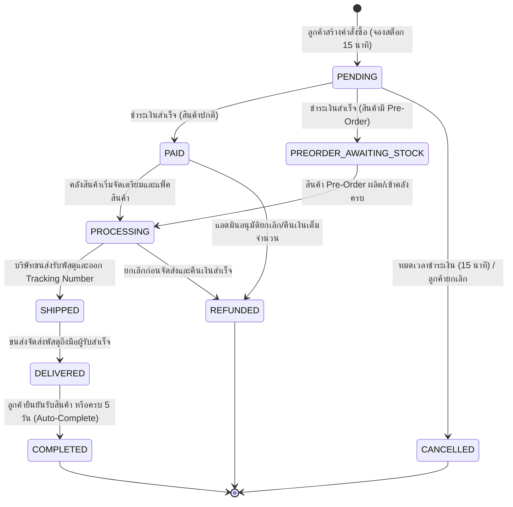
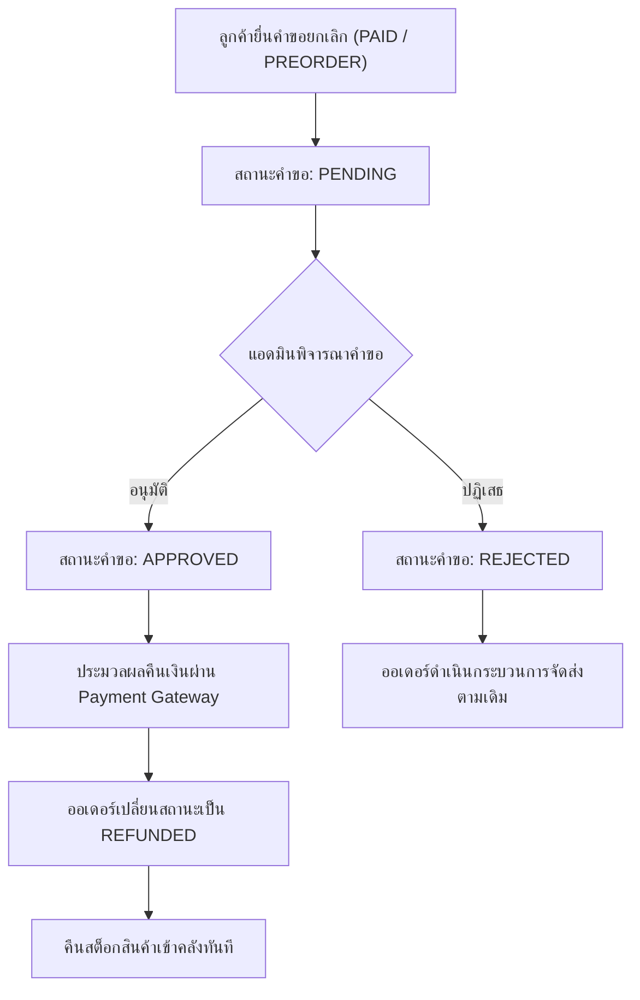

# Order & Cancellation Specification (`order.md`)

เอกสารข้อกำหนดเชิงเทคนิคสำหรับวงจรชีวิตคำสั่งซื้อ (`OrderStatus`) และการขอยกเลิกคำสั่งซื้อ (`CancellationRequestStatus`) ในระบบ Nida Platform

---

## 1. แผนภาพสถานะคำสั่งซื้อ (Order State Machine)

---

## 2. ตารางการเปลี่ยนผ่านสถานะ (Allowed Transitions Matrix)

| สถานะปัจจุบัน                 | สถานะถัดไปที่อนุญาต       | เงื่อนไข / ตัวกระตุ้น (Trigger)                        | Side Effects ที่ต้องเกิดขึ้นอัตโนมัติ                                                  |
| :---------------------------- | :------------------------ | :----------------------------------------------------- | :------------------------------------------------------------------------------------- |
| **`PENDING`**                 | `PAID`                    | ชำระเงินผ่าน Gateway (Omise/PromptPay) สำเร็จ          | • ย้ายสต็อก `reserved` ➔ `deducted` • ส่งอีเมล Order Confirmation                   |
| **`PENDING`**                 | `PREORDER_AWAITING_STOCK` | ชำระเงินสำเร็จ และในออเดอร์มีสินค้า Pre-Order          | • บันทึกสต็อก `preorderBooked` • ส่งอีเมลแจ้งกำหนดการจัดส่ง Pre-Order               |
| **`PENDING`**                 | `CANCELLED`               | ลูกค้ากดสละสิทธิ์ หรือหมดเวลา 15 นาที (Unpaid Timeout) | • ปลดล็อคสต็อกที่จองไว้คืนคลัง (`quantityReserved` ➔ 0) • คืนสิทธิ์คูปองและแต้มสะสม |
| **`PREORDER_AWAITING_STOCK`** | `PROCESSING`              | แอดมินยืนยันสินค้าเข้าคลัง (`RESTOCK_PREORDER`)        | • ย้ายสต็อกเข้าสู่กระบวนการแพ็คตามปกติ                                                 |
| **`PAID`**                    | `PROCESSING`              | แอดมินหรือระบบคลังกดรับออเดอร์เข้าสู่ไลน์แพ็ค          | • บันทึกเวลาเริ่มแพ็คสินค้า                                                            |
| **`PROCESSING`**              | `SHIPPED`                 | ปริ้นท์ใบปะหน้าพัสดุและขนส่งสแกนรับของ                 | • สร้างเรคคอร์ด `Shipment` • ส่งอีเมลแจ้ง Tracking Number                           |
| **`SHIPPED`**                 | `DELIVERED`               | ขนส่งแจ้งสถานะปลายทางผ่าน Webhook/Polling              | • เริ่มนับถอยหลัง Auto-Complete (5 วัน)                                                |
| **`DELIVERED`**               | `COMPLETED`               | ลูกค้ากดยืนยันรับสินค้า หรือครบกำหนด 5 วัน             | • คำนวณแจกแต้มสะสม (Loyalty Points) • ปิดวงจรคำสั่งซื้ออย่างสมบูรณ์                 |
| **`PAID` / `PROCESSING`**     | `REFUNDED`                | คำขอยกเลิกได้รับการอนุมัติและเงินคืนเข้าบัญชีสำเร็จ    | • คืนสต็อกสินค้ากลับเข้าคลัง • ดึงแต้ม/คูปองคืน                                     |

---

## 3. วงจรการขอยกเลิกคำสั่งซื้อ (Cancellation Flow)

ลูกค้าสามารถยื่นคำขอยกเลิกได้เฉพาะคำสั่งซื้อที่อยู่ในสถานะ `PAID` หรือ `PREORDER_AWAITING_STOCK` เท่านั้น (เมื่อเข้าสู่ `PROCESSING` หรือ `SHIPPED` แล้วจะไม่สามารถยกเลิกได้ ต้องใช้กระบวนการคืนสินค้าแทน)

### ฟิลด์ในโมเดล `OrderCancellationRequest`:

- `requestNumber`: รหัสคำขอยกเลิก (เช่น `CAN-20261102-001`)
- `status`: `PENDING` | `APPROVED` | `REJECTED`
- `reason`: เหตุผลที่ลูกค้าระบุ
- `reviewedByAdminId`: แอดมินผู้พิจารณา
- `rejectedReason`: เหตุผลที่แอดมินปฏิเสธ (กรณีไม่อนุมัติ)

---

## 4. ระบบงานเบื้องหลังอัตโนมัติ (Automated Background Workers)

1. **`OrderTimeoutWorker` (Unpaid Order Expiration):**
   - ตรวจสอบคำสั่งซื้อที่ค้างสถานะ `PENDING` เกิน 15 นาที
   - ปรับสถานะเป็น `CANCELLED` พร้อมทั้งคืนสต็อก `quantityReserved` กลับสู่ `quantityAvailable`
2. **`DeliveryCompleteWorker` (5-Day Auto-Completion):**
   - ตรวจสอบคำสั่งซื้อที่อยู่ในสถานะ `DELIVERED` ครบ 5 วัน (120 ชั่วโมง)
   - ปรับสถานะเป็น `COMPLETED` อัตโนมัติ และโอนแต้มสะสม Loyalty Points เข้ากระเป๋าของลูกค้า
