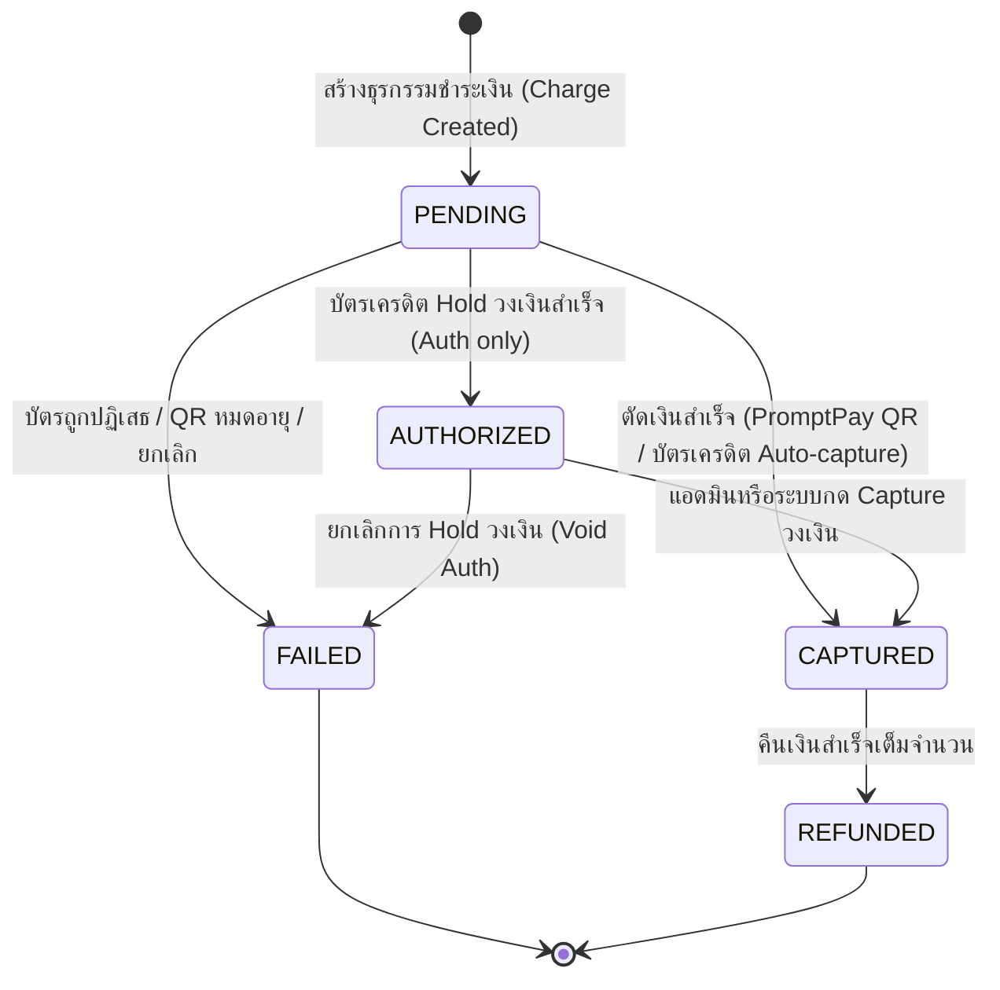

# Payment & Refund Specification (`payment.md`)

เอกสารข้อกำหนดเชิงเทคนิคสำหรับระบบการชำระเงิน (`PaymentStatus`), ช่องทางการจ่ายเงิน (`PaymentMethod`), และกระบวนการคืนเงิน (`RefundStatus`) ของ Nida Platform

---

## 1. แผนภาพสถานะการชำระเงินและการคืนเงิน (Payment Lifecycle)



---

## 2. ช่องทางการชำระเงินที่รองรับ (`PaymentMethod`)

| รหัสช่องทาง (Enum) | ผู้ให้บริการ (Gateway) | พฤติกรรมการประมวลผล (Processing Behavior) |
| :--- | :--- | :--- |
| **`CREDIT_CARD`** | Omise Payment Gateway | • ชำระผ่านบัตร Visa, Mastercard, JCB พร้อม 3-D Secure (OTP แบงก์)<br>• รองรับทั้ง Auto-Capture และ Two-step Authorization |
| **`PROMPTPAY`** | Omise QR PromptPay | • สร้าง Dynamic QR Code ที่ระบุยอดเงินตรงเป๊ะ (หมดอายุใน 15 นาที)<br>• ยืนยันสถานะแบบ Real-time ผ่าน Webhook จากธนาคาร |
| **`BANK_TRANSFER`** | Manual Bank Slip | • ลูกค้าโอนเงินเข้าบัญชีบริษัทและอัปโหลดสลิป<br>• แอดมินตรวจสอบยอดเงินในบัญชีจริงก่อนกดยืนยัน |
| **`COD`** | Cash on Delivery (เก็บเงินปลายทาง) | • ไม่ตัดเงินทันที สร้างสถานะ `PENDING`<br>• อัปเดตเป็น `CAPTURED` เมื่อบริษัทขนส่งเก็บเงินและโอนเข้าบัญชี |

---

## 3. สัญญาณ Webhook และความปลอดภัย (Idempotency & Webhook Verification)

1. **Webhook Signature Verification:**
   - ทุก Request ที่มาจาก Gateway จะต้องตรวจสอบ Signature หรือ Secret Key เพื่อป้องกันการปลอมแปลงยอดเงิน
2. **Idempotency Key Enforcement:**
   - ธุรกรรมการชำระเงินและการคืนเงินทุกรายการต้องมี `transactionId` หรือ `chargeId` ที่ไม่ซ้ำกัน
   - หาก Gateway ส่ง Webhook ซ้ำ (Event Duplication) ระบบจะตรวจเช็คสถานะเดิม หากเป็น `CAPTURED` อยู่แล้วจะตอบรับ HTTP 200 โดยไม่ทำซ้ำซ้อน
3. **Fail-Fast Policy:**
   - หาก Token บัตร (`omiseToken`) หายหรือไม่ถูกต้อง Backend จะปฏิเสธคำขอทันทีด้วย `BadRequestException` ห้ามจำลองการจ่ายเงินผ่าน (No Fake Fallbacks)

---

## 4. วงจรการคืนเงิน (`RefundStatus`)

เมื่อออเดอร์ถูกยกเลิก หรือมีการส่งคืนสินค้า ระบบจะประมวลผลการคืนเงินผ่านโมเดล `Refund`:

```mermaid
flowchart TD
    A["เริ่มกระบวนการคืนเงิน (Refund Requested)"] --> B["สถานะ Refund: PENDING"]
    B --> C["เรียก API Gateway เพื่อส่งยอดเงินคืน"]
    C -->|สำเร็จ| D["สถานะ Refund: SUCCEEDED"]
    D --> E["Payment เปลี่ยนสถานะเป็น REFUNDED"]
    D --> F["Order เปลี่ยนสถานะเป็น REFUNDED"]
    
    C -->|ล้มเหลว (บัตรหมดอายุ/ข้อผิดพลาดธนาคาร)| G["สถานะ Refund: FAILED"]
    G --> H["แจ้งเตือนแอดมินเพื่อโอนเงินคืนแบบ Manual"]
```

### ฟิลด์ในโมเดล `Refund`:
- `id`: UUID v7
- `paymentId`: อ้างอิงธุรกรรมเดิม
- `amount`: ยอดเงินที่คืนจริง
- `reason`: เหตุผลการคืนเงิน
- `status`: `PENDING` | `SUCCEEDED` | `FAILED`
- `gatewayRefundId`: รหัสอ้างอิงการคืนเงินจาก Omise
- `processedByAdminId`: แอดมินผู้ดำเนินการ

