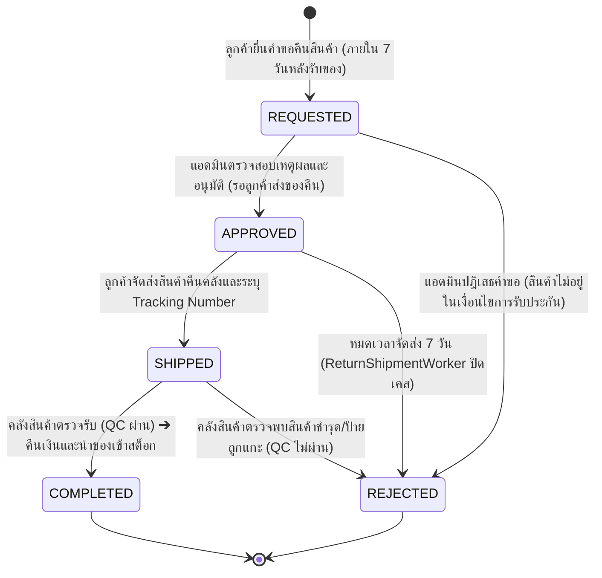

# Return & Exchange Specification (`return.md`)

เอกสารข้อกำหนดเชิงเทคนิคสำหรับกระบวนการคืนสินค้า (`ReturnStatus`), การตรวจรับของคลังสินค้า (QC Inspection), และเส้นตายการจัดส่งคืน (Return Deadline) ของ Nida Platform

---

## 1. แผนภาพวงจรการขอคืนสินค้า (Return Lifecycle)

---

## 2. ตารางการเปลี่ยนผ่านสถานะ (Allowed Transitions Matrix)

| สถานะปัจจุบัน   | สถานะถัดไป  | เงื่อนไข / ตัวกระตุ้น                                 | การจัดการสต็อกและการเงิน                                                                          |
| :-------------- | :---------- | :---------------------------------------------------- | :------------------------------------------------------------------------------------------------ |
| **`REQUESTED`** | `APPROVED`  | แอดมินพิจารณาแล้วเข้าเกณฑ์ (เช่น ผิดไซส์, มีตำหนิ)    | รอลูกค้าส่งสินค้าคืนภายใน 7 วัน                                                                   |
| **`REQUESTED`** | `REJECTED`  | แอดมินปฏิเสธคำขอ (เช่น ป้ายถูกตัด, เกิน 7 วัน)        | ไม่มีผลกระทบทางการเงิน                                                                            |
| **`APPROVED`**  | `SHIPPED`   | ลูกค้ากรอกรหัสพัสดุส่งคืนเข้ามาในระบบ                 | บันทึก Tracking ขากลับเข้าคลัง                                                                    |
| **`APPROVED`**  | `REJECTED`  | ลูกค้าไม่ส่งของภายใน 7 วันหลังได้รับอนุมัติ           | `ReturnShipmentWorker` ตัดสิทธิ์คำขอคืนอัตโนมัติ                                                  |
| **`SHIPPED`**   | `COMPLETED` | เจ้าหน้าที่คลังสแกนรับและตรวจสภาพสินค้าผ่าน (QC Pass) | • นำสินค้าเข้าสต็อก (`StockChangeType.RETURNED`) • ออกใบคืนเงิน (`Refund`) ส่งยอดเงินคืนลูกค้า |
| **`SHIPPED`**   | `REJECTED`  | เจ้าหน้าที่คลังตรวจพบการใช้งานแล้ว หรือของไม่ครบ      | ปฏิเสธการคืนเงินและส่งสินค้าชิ้นเดิมกลับให้ลูกค้า                                                 |

---

## 3. เงื่อนไขและกฎเกณฑ์การคืนสินค้า (Return Policy Guardrails)

1. **ระยะเวลาที่สามารถยื่นขอคืนได้ (Eligibility Window):**
   - คำสั่งซื้อต้องอยู่ในสถานะ `DELIVERED` หรือ `COMPLETED` และยื่นเรื่องภายใน **7 วันนับจากวันที่ได้รับสินค้า** (อิงตาม Timestamp ใน `ShipmentLog`)
2. **เส้นตายการส่งสินค้าคืน (7-Day Return Shipment Deadline):**
   - เมื่อคำขอเปลี่ยนเป็น `APPROVED` ลูกค้าต้องนำพัสดุไปส่งที่ขนส่งและกรอก Tracking ภายใน **7 วัน (168 ชั่วโมง)**
   - หากเกินกำหนด ตัวประมวลผลเบื้องหลัง `ReturnShipmentWorker` จะทำการปรับสถานะเป็น `REJECTED` (Void Expired Return) โดยอัตโนมัติ
3. **การคืนเงินตามมูลค่าจริง (Net Amount Refund):**
   - ยอดเงินที่จะคืนให้ลูกค้าจะคำนวณตามสัดส่วนจริงหลังหักส่วนลดคูปองเฉลี่ยรายชิ้น และหักคะแนนสะสมที่ได้รับจากสินค้านั้นๆ ออก
