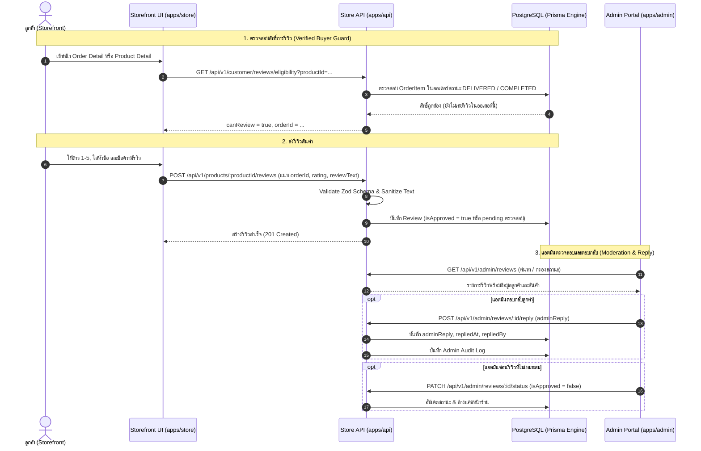

# Product Reviews & Ratings Specification (`reviews.md`)

เอกสารข้อกำหนดเชิงเทคนิคสำหรับระบบรีวิวและให้คะแนนสินค้า (Product Reviews & Ratings System) ของ Nida Platform ครอบคลุมการให้คะแนน 1–5 ดาว, การยืนยันสิทธิ์ผู้ซื้อจริง (Verified Buyer Enforcement), ระบบตรวจสอบและอนุมัติรีวิว (Admin Moderation), การคำนวณคะแนนเฉลี่ยแบบเรียลไทม์, และการแสดงผลตามมาตรฐาน Editorial Luxury

---

## 1. วัตถุประสงค์และกรอบการทำงาน (Business Goals & Standards)

1. **สร้างความน่าเชื่อถือด้วย Social Proof ที่แท้จริง (Zero Fake Reviews)**:
   - ป้องกันการปั๊มรีวิว (Review Bombing) หรือการใส่รีวิวปลอม โดยบังคับใช้กฎ **Verified Buyer**: เฉพาะลูกค้าที่สั่งซื้อสินค้านั้นจริง และออเดอร์มีสถานะ `DELIVERED` (ส่งมอบแล้ว) หรือ `COMPLETED` (สำเร็จแล้ว) เท่านั้นจึงจะมีสิทธิ์เขียนรีวิว
   - จำกัด 1 รีวิว ต่อ 1 บัญชีผู้ใช้ ต่อ 1 รายการสั่งซื้อของสินค้านั้น
2. **สิทธิ์ในการลบรีวิวตามกฎหมาย PDPA (Right to Erasure & Deletion Policy)**:
   - **ลูกค้า (Customer)**: มีสิทธิ์ลบความคิดเห็นของตนเองได้ตลอดเวลา (Delete Own Review) เพื่อความเป็นส่วนตัวตามมาตรฐาน PDPA
   - **แอดมิน (Admin)**: มีสิทธิ์ลบรีวิวที่เป็นสแปม คำหยาบคาย รุนแรง หลอกลวง หรือละเมิดข้อมูลผู้อื่น พร้อมเก็บบันทึกประวัติการลบลงใน Audit Log
   - **สถาปัตยกรรม Soft Delete**: ใช้ฟิลด์ `deletedAt` เพื่อเก็บประวัติข้อความเดิมไว้สำหรับตรวจสอบย้อนหลังทางกฎหมาย แต่ระบบจะถอนออกจากหน้าร้านและคำนวณคะแนนใหม่ทันที
3. **ระบบตรวจสอบและควบคุมคุณภาพ (Admin Moderation & Quality Control)**:
   - แอดมินสามารถตรวจสอบความถูกต้อง กรองคำไม่สุภาพ โฆษณาแฝง หรือเนื้อหาที่ไม่เหมาะสม ก่อนหรือหลังการเผยแพร่
   - รองรับการตอบกลับรีวิวอย่างเป็นทางการจากแบรนด์ NIDA (Brand Official Response)
4. **การปกป้องข้อมูลส่วนบุคคล (Privacy & PII Masking)**:
   - ไม่เปิดเผยชื่อ-นามสกุลจริง หรืออีเมลของผู้รีวิวบนหน้าร้าน แสดงผลเฉพาะชื่อย่อ เช่น `Kallaya W.` หรือ `Wissanuray P.` เพื่อรักษาความเป็นส่วนตัวตามมาตรฐาน PDPA
5. **Editorial Luxury Aesthetic**:
   - ไม่ใช้ไอคอนหรือสติ๊กเกอร์ Emoji ฉูดฉาด
   - ใช้วิดเจ็ตแสดงผลระดับพรีเมียม: สรุปคะแนนตัวเลขคมชัด, แถบสัดส่วนคะแนนดาว (Rating Breakdown Bar 1-5 ดาว), และ Badge `Verified Buyer` เรียบหรู

---

## 2. แผนผังวงจรชีวิตของรีวิว (Review State Machine & Sequence Flow)



---

## 3. สูตรการคำนวณคะแนนเฉลี่ยและสถิติ (Rating Analytics)

การคำนวณคะแนนเฉลี่ย (`rating`) และจำนวนรีวิว (`reviewsCount`) จะคำนวณจากเฉพาะรีวิวที่ **`isApproved = true` และ `deletedAt IS NULL`** เท่านั้น:

### 3.1 สูตรคะแนนเฉลี่ย (Average Rating):

$$\text{Average Rating} = \frac{\sum_{i=1}^{N} \text{rating}_i}{N}$$

- ปัดเศษทศนิยม 1 ตำแหน่ง (เช่น `4.8`, `4.5`)
- หากยังไม่มีรีวิว หรือรีวิวทั้งหมดถูกลบ ($N = 0$) ให้ส่งกลับ `rating = null` หรือ `0` และ `reviewsCount = 0` (ห้าม Mock ตัวเลขลอย เช่น 4.9 เด็ดขาด)
- เมื่อมีการลบรีวิว (ไม่ว่าจะโดยลูกค้าหรือแอดมิน) ระบบจะ Re-calculate คะแนนและจำนวนรีวิวใหม่ทันที พร้อมล้างแคช Redis ของ Product Detail

### 3.2 สัดส่วนดาว (Star Distribution Breakdown):

คำนวณจำนวนและร้อยละของแต่ละระดับดาว (1 ถึง 5 ดาว):

$$\text{Percentage}_k = \left( \frac{\text{Count}_k}{N} \right) \times 100 \quad (k \in \{1, 2, 3, 4, 5\})$$

---

## 4. โครงสร้างฐานข้อมูล (Database Schema)

ปรับปรุงโมเดล `Review` ใน `packages/database/prisma/schema.prisma`:

```prisma
model Review {
  id                 String    @id @default(uuid(7)) @db.Uuid
  productId          String    @map("product_id") @db.Uuid
  userId             String    @map("user_id") @db.Uuid
  orderId            String?   @map("order_id") @db.Uuid
  rating             Int       @db.SmallInt // 1 - 5
  title              String?   @db.VarChar(150)
  reviewText         String?   @map("review_text") @db.Text
  isVerifiedPurchase Boolean   @default(false) @map("is_verified_purchase")
  isApproved         Boolean   @default(true) @map("is_approved")
  adminReply         String?   @map("admin_reply") @db.Text
  repliedAt          DateTime? @map("replied_at")
  repliedBy          String?   @map("replied_by") @db.Uuid
  createdAt          DateTime  @default(now()) @map("created_at")
  updatedAt          DateTime  @updatedAt @map("updated_at")
  deletedAt          DateTime? @map("deleted_at")

  product            Product   @relation(fields: [productId], references: [id], onDelete: Cascade)
  user               User      @relation(fields: [userId], references: [id], onDelete: Cascade)
  order              Order?    @relation(fields: [orderId], references: [id], onDelete: SetNull)
  repliedByAdmin     AdminUser? @relation(fields: [repliedBy], references: [id], onDelete: SetNull)

  @@index([productId, isApproved, deletedAt, createdAt(sort: Desc)])
  @@index([userId, deletedAt])
  @@index([orderId])
  @@unique([productId, userId, orderId]) // 1 รีวิว ต่อ 1 สินค้า ต่อ 1 ออเดอร์
  @@map("reviews")
}
```

---

## 5. สัญญาข้อมูลและสเปก API (API Contracts & Endpoints)

### 5.1 Storefront Customer Endpoints (`apps/api`)

| Method   | Endpoint                            | Authentication | คำอธิบาย                                                             |
| :------- | :---------------------------------- | :------------: | :------------------------------------------------------------------- |
| `GET`    | `/api/v1/products/:id/reviews`      |     Public     | ดึงรายการรีวิวที่อนุมัติแล้วและยังไม่ถูกลบ + Rating Summary สถิติดาว |
| `GET`    | `/api/v1/customer/reviews/eligible` |  Customer JWT  | ดึงรายการสินค้าที่ลูกค้าซื้อแล้วแต่ยังไม่ได้รีวิว                    |
| `POST`   | `/api/v1/products/:id/reviews`      |  Customer JWT  | ส่งรีวิวสินค้า (ตรวจ Guard: Verified Buyer)                          |
| `DELETE` | `/api/v1/customer/reviews/:id`      |  Customer JWT  | ลูกค้าลบรีวิวของตนเอง (Soft Delete + คำนวณคะแนนใหม่)                 |

#### Request Payload: `POST /api/v1/products/:id/reviews`

```json
{
  "orderId": "0194c502-3904-7a1a-8c34-8e100c451234",
  "rating": 5,
  "title": "เนื้อผ้าดีมาก ทรงสวยถูกใจ",
  "reviewText": "สั่งซื้อมาใส่พอดีตัวมาก เนื้อผ้าคอตตอนพรีเมียม ระบายอากาศดีเยี่ยม การตัดเย็บประณีตสมราคา"
}
```

#### Response Structure: `GET /api/v1/products/:id/reviews`

```json
{
  "success": true,
  "data": {
    "summary": {
      "averageRating": 4.8,
      "totalReviews": 24,
      "breakdown": {
        "5": 20,
        "4": 3,
        "3": 1,
        "2": 0,
        "1": 0
      }
    },
    "reviews": [
      {
        "id": "rev-0194...",
        "authorName": "Kallaya W.",
        "rating": 5,
        "title": "เนื้อผ้าดีมาก ทรงสวยถูกใจ",
        "reviewText": "สั่งซื้อมาใส่พอดีตัวมาก...",
        "isVerifiedPurchase": true,
        "createdAt": "2026-11-04T10:00:00.000Z",
        "adminReply": {
          "comment": "ขอขอบพระคุณคุณลูกค้าที่ไว้วางใจ NIDA ครับ",
          "repliedAt": "2026-11-04T12:00:00.000Z"
        }
      }
    ],
    "pagination": {
      "page": 1,
      "limit": 10,
      "total": 24,
      "totalPages": 3
    }
  }
}
```

---

### 5.2 Admin Back-Office Endpoints (`apps/admin-api`)

| Method   | Endpoint                           |   Permission    | คำอธิบาย                                                    |
| :------- | :--------------------------------- | :-------------: | :---------------------------------------------------------- |
| `GET`    | `/api/v1/admin/reviews`            | `CATALOG_READ`  | รายการรีวิวทั้งหมด พร้อม Search, Status, Star Filters       |
| `PATCH`  | `/api/v1/admin/reviews/:id/status` | `CATALOG_WRITE` | อนุมัติ (`isApproved: true`) หรือซ่อน (`isApproved: false`) |
| `POST`   | `/api/v1/admin/reviews/:id/reply`  | `CATALOG_WRITE` | แอดมินตอบกลับรีวิวลูกค้า                                    |
| `DELETE` | `/api/v1/admin/reviews/:id`        | `CATALOG_WRITE` | ลบรีวิวสแปม/ผิดกฎ (Soft Delete) พร้อมบันทึก Audit Log       |

---

## 6. กฎความปลอดภัยและการตรวจสอบ (Security Guards & Invariants)

1. **Verified Buyer Guard**:
   ```ts
   // ลูกค้าต้องมี OrderItem ในคำสั่งซื้อที่ Delivered แล้ว
   const validOrder = await prisma.order.findFirst({
     where: {
       id: orderId,
       userId: authenticatedCustomerId,
       status: { in: [OrderStatus.DELIVERED, OrderStatus.COMPLETED] },
       items: { some: { variant: { productId } } },
     },
   });
   if (!validOrder)
     throw new ForbiddenException(
       'Only verified buyers can review delivered products',
     );
   ```
2. **Review Ownership Guard (Customer Delete)**:
   - ลูกค้าสามารถสั่งลบได้เฉพาะรีวิวที่ตนเองเป็นเจ้าของ (`userId === customerId`) เท่านั้น หากพยายามลบรีวิวของผู้อื่น ระบบจะปฏิเสธด้วย `NotFoundException` หรือ `ForbiddenException`
3. **Duplicate Review Prevention**:
   - ป้องกันการส่งรีวิวซ้ำสำหรับสินค้าเดิมในออเดอร์เดียวกันด้วย Unique Constraint และ Service Validation
4. **Audit Trail**:
   - ทุกการ Toggle Status, Reply, หรือ Delete ของแอดมิน ต้องบันทึกเข้าสู่ `admin_audit_logs` พร้อมเก็บ Snapshot ข้อความก่อนลบไว้ใน `oldValuesJson` เพื่อให้ตรวจสอบย้อนหลังได้ 100%
