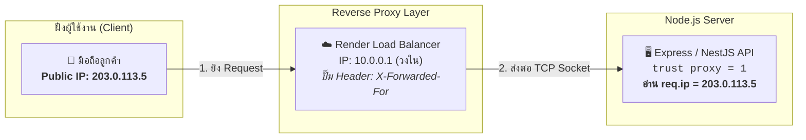
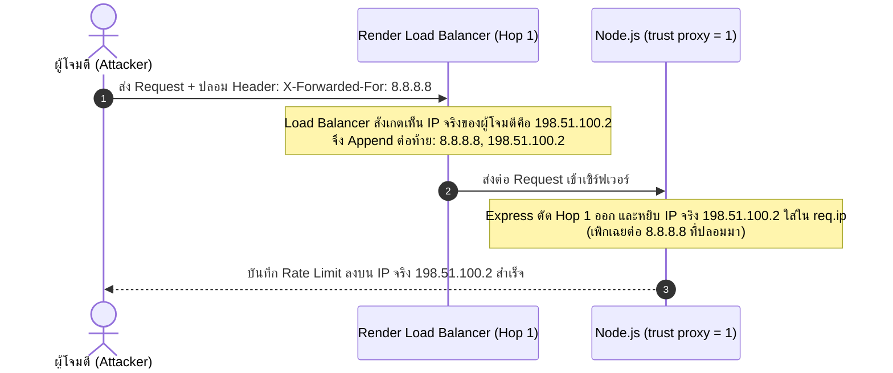

# Security & Network Specification (`security.md`)

เอกสารข้อกำหนดเชิงเทคนิคสำหรับสถาปัตยกรรมความปลอดภัยเครือข่าย, การระบุตัวตนและตรวจสอบ Client IP (`trust proxy`), การป้องกัน IP Spoofing, และระบบจำกัดอัตราคำขอ (5-Tier Rate Limiting) ของ Nida Platform

---

## 1. สถาปัตยกรรมการระบุตัวตน Client IP และ Reverse Proxy

เมื่อระบบรันบนสภาพแวดล้อมจริง (เช่น Render, Cloudflare, AWS) การเชื่อมต่อจากอุปกรณ์ของผู้ใช้จะผ่าน **Reverse Proxy / Load Balancer** เสมอ:



### 1.1 ความแตกต่างระหว่างประเภท IP

- **Public IP (IP สาธารณะ):** ออกให้โดย ISP (True, AIS, 3BB) หรือเครือข่ายมือถือ (4G/5G) เป็น IP เดียวที่โลกภายนอกมองเห็น หากในบ้าน/ออฟฟิศเดียวกันต่อ Wi-Fi เดียวกัน 10 เครื่อง เซิร์ฟเวอร์จะมองเห็นเป็น Public IP เดียวกันทั้งหมด (ผ่านกลไก NAT ของ Router)
- **Private IP (IP วงใน):** เช่น `192.168.1.X`, `10.0.0.X` ใช้เฉพาะในระบบเครือข่ายภายในบ้านหรือใน Cloud Datacenter ภายนอกไม่สามารถติดต่อเข้ามาตรงๆ ได้
- **Loopback IP (เครื่องตัวเอง):** `127.0.0.1` หรือ `::1` (`localhost`) ใช้เฉพาะตอนพัฒนาโปรแกรมบนเครื่อง Local Dev

### 1.2 กลไกการทำงานของ `trust proxy = 1`

- โดยค่าเริ่มต้น Express จะตั้งค่า `trust proxy = false` ส่งผลให้ `req.socket.remoteAddress` ชี้ไปที่ **IP วงในของ Load Balancer (`10.0.0.1`)** ทำให้ลูกค้าทุกคนแชร์ IP เดียวกันทั้งหมด และเกิดปัญหาบล็อกคนบริสุทธิ์
- เมื่อเปิดใช้งาน `app.set('trust proxy', 1)`:
  - ตัวเลข `1` หมายถึง: **"ให้เชื่อใจ Proxy ลำดับหน้าสุด 1 ชั้น (Hop 1 ซึ่งคือ Render Load Balancer ของเรา)"**
  - Express จะแกะ IP จาก Header `X-Forwarded-For` จากขวามาซ้าย โดยตัด IP ปลอมที่ Client ใส่เข้ามาเองออกไป
  - Express จะนำ Public IP ที่แท้จริงของลูกค้ามาบรรจุลงใน **`req.ip`** ให้อัตโนมัติอย่างถูกต้องและปลอดภัย

---

## 2. การป้องกัน IP Spoofing (Header Tampering Prevention)



> **กฎเหล็ก:** ห้ามเขียนฟังก์ชันอ่าน `req.headers['x-forwarded-for']` ดิบเองเด็ดขาด ให้เปิด `trust proxy = 1` และใช้ **`req.ip`** ของ Express เสมอ

---

## 3. ตารางสรุปการจำกัดอัตราคำขอแยกตามราย Route (Comprehensive Route-by-Route Rate Limit Matrix)

### 3.1 หลักการออกแบบและการจัดการ Redis Memory (Design & Memory Architecture)

1. **Global Fallback (120 req / 60s ต่อ 1 IP):**
   - ทุก Route ในระบบที่ไม่ได้ระบุ `@RateLimit` หรือ `@SkipRateLimit` จะถูกคุ้มกันอัตโนมัติด้วย Tier 1 Global Limit
   - **การประหยัดหน่วยความจำ Redis:** ทุก Route ทั่วไป (เช่น `users/addresses`, `cart`, `wishlist`) จะแชร์ Redis Key เดียวกันคือ **`global:<ip>`** ทำให้ผู้ใช้ 1 คนสร้าง Key ใน Redis เพียง 1 ตัว (~100 bytes พร้อม TTL 60 วินาที) แทนที่จะสร้างนับสิบคีย์
2. **Dedicated Decorator `@RateLimit(...)`:**
   - ใช้เฉพาะ Route ที่มี **ความเสี่ยงสูง (High-Risk)**, จุดตัดเงิน, สแปม OTP/อีเมล, หรือการสุ่มเดา (Enumeration) เพื่อแยก Key และตั้งค่าเวลาที่เข้มงวดเป็นพิเศษ
3. **Whitelist Decorator `@SkipRateLimit()`:**
   - ใช้กับ Route พิเศษที่ห้ามถูกบล็อกเด็ดขาด (เช่น Health Check Probes ของ Cloud และ Payment Webhook ของ Omise)

---

### 3.2 Storefront Customer API (`apps/api`)

| Method & Route Path                                                                                                                           |          Rate Limit          |    Key Prefix บน Redis    | วัตถุประสงค์และความเสี่ยงที่ป้องกัน                                                       |
| :-------------------------------------------------------------------------------------------------------------------------------------------- | :--------------------------: | :-----------------------: | :---------------------------------------------------------------------------------------- |
| **Authentication & Profile**                                                                                                                  |                              |                           |                                                                                           |
| `POST /api/v1/auth/login`                                                                                                                     |         5 req / 60s          |     `auth:login:<ip>`     | ป้องกัน Brute-force รหัสผ่าน (มีนโยบาย 5-Strike Lockout 15 นาที)                          |
| `POST /api/v1/auth/register`                                                                                                                  |         5 req / 60s          |   `auth:register:<ip>`    | ป้องกันการยิงสคริปต์สมัครสมาชิกขยะ                                                        |
| `POST /api/v1/auth/request-otp`                                                                                                               |         3 req / 60s          |    `auth:request:<ip>`    | ป้องกันการปั๊ม OTP (Email Pumping) และคุมค่าใช้จ่าย Resend                                |
| `POST /api/v1/auth/resend-otp`                                                                                                                |         3 req / 60s          |    `auth:resend:<ip>`     | ป้องกันการขอยิง OTP ซ้ำถี่เกินไป                                                          |
| `POST /api/v1/auth/forgot-password`                                                                                                           |         3 req / 60s          |    `auth:forgot:<ip>`     | ป้องกันการสแปมอีเมล Reset Password ไปรบกวนเหยื่อ                                          |
| `POST /api/v1/auth/reset-password`                                                                                                            |         5 req / 60s          |   `auth:reset-pw:<ip>`    | ป้องกันการสุ่มเดารหัส OTP ในขั้นตอนรีเซ็ตรหัสผ่าน                                         |
| `POST /api/v1/auth/change-password`                                                                                                           |         5 req / 60s          |   `auth:change-pw:<ip>`   | ป้องกันการสุ่มเดารหัสผ่านเดิม (Bcrypt verification)                                       |
| `POST /api/v1/auth/verify-otp`                                                                                                                |         10 req / 60s         |  `auth:verify-otp:<ip>`   | ป้องกันการยิงเดา OTP 6 หลัก                                                               |
| `POST /api/v1/auth/login/verify-otp`                                                                                                          |         10 req / 60s         |  `auth:verify-otp:<ip>`   | ป้องกันการยิงเดา OTP 6 หลักในขั้นตอน Login                                                |
| `POST /api/v1/auth/register/verify-otp`                                                                                                       |         10 req / 60s         |  `auth:verify-otp:<ip>`   | ป้องกันการยิงเดา OTP 6 หลักในขั้นตอน Register                                             |
| `GET /api/v1/auth/check-email`                                                                                                                |         10 req / 60s         |  `auth:check-email:<ip>`  | ป้องกัน User Enumeration (การเอาลิสต์อีเมลมาสแกนหารายชื่อผู้ใช้)                          |
| `POST /api/v1/auth/refresh`                                                                                                                   |         20 req / 60s         |    `auth:refresh:<ip>`    | ป้องกันการลูปยิงขอ Access Token ใหม่ถี่เกินไป                                             |
| **Orders & Checkout**                                                                                                                         |                              |                           |                                                                                           |
| `POST /api/v1/orders`                                                                                                                         |         10 req / 60s         |    `order:create:<ip>`    | ป้องกัน Fake Order Flood และการกักตุนสต็อกสินค้า (Inventory Hoarding)                     |
| `POST /api/v1/orders/:num/pay`                                                                                                                |         5 req / 60s          |     `order:pay:<ip>`      | ป้องกันการสุ่มตัดบัตรเครดิต (Card Testing) และลดภาระ Omise API                            |
| `GET /api/v1/orders/:num/omise-status`                                                                                                        |         20 req / 60s         | `order:omise-status:<ip>` | ป้องกัน Client ฝั่งหน้าร้าน Polling สถานะการจ่ายเงินถี่เกินไป                             |
| `GET /api/v1/orders/track/:num`                                                                                                               |         15 req / 60s         |    `order:track:<ip>`     | ป้องกันการสุ่มเดาเลขออเดอร์เพื่อขโมยข้อมูล PII ของลูกค้า                                  |
| `POST /api/v1/orders/track`                                                                                                                   |         15 req / 60s         |    `order:track:<ip>`     | ป้องกันการสุ่มเดาเลขออเดอร์ผ่าน Request Body                                              |
| `POST /api/v1/orders/:num/cancellation-request`                                                                                               |         5 req / 60s          |    `order:cancel:<ip>`    | ป้องกันการสแปมคำขอยกเลิกออเดอร์                                                           |
| `POST /api/v1/orders/:num/return-request`                                                                                                     |         5 req / 60s          |    `order:return:<ip>`    | ป้องกันการสแปมคำขอคืนสินค้า                                                               |
| `POST /api/v1/orders/webhook/omise`                                                                                                           |          **BYPASS**          |    `@SkipRateLimit()`     | Webhook ชำระเงินจาก Omise ห้ามบล็อกเด็ดขาดเพื่อไม่ให้ออเดอร์ตกหล่น                        |
| **Coupons & Promotions**                                                                                                                      |                              |                           |                                                                                           |
| `POST /api/v1/coupons/validate`                                                                                                               |         15 req / 60s         |     `coupon:val:<ip>`     | ป้องกัน Dictionary Attack สุ่มเดาโค้ดส่วนลด                                               |
| `POST /api/v1/coupons/calculate-checkout`                                                                                                     |         20 req / 60s         |    `coupon:calc:<ip>`     | ป้องกันการยิงคำนวณส่วนลดตะกร้าถี่เกินไป                                                   |
| **Catalog & Products**                                                                                                                        |                              |                           |                                                                                           |
| `GET /api/v1/catalog/products`                                                                                                                |         60 req / 60s         |  `catalog:products:<ip>`  | ป้องกัน Search & Filter Bombing ไม่ให้ PostgreSQL CPU Spike                               |
| `POST /api/v1/catalog/sync-cart`                                                                                                              |         30 req / 60s         | `catalog:sync-cart:<ip>`  | ป้องกันการยิงเช็คสต็อกและราคาตะกร้าสินค้าถี่เกินไป                                        |
| **Health Check**                                                                                                                              |                              |                           |                                                                                           |
| `GET /api/v1/health`                                                                                                                          |          **BYPASS**          |    `@SkipRateLimit()`     | ป้องกัน Liveness/Readiness Probe ของ Render และ Uptime Tools โดน 429                      |
| **Protected General CRUD (Addresses, Cart, Wishlist, Profile)**                                                                               |                              |                           |                                                                                           |
| • `GET, POST, PUT, DELETE /users/addresses`<br>• `GET, POST, DELETE /cart`<br>• `GET, POST, DELETE /wishlist`<br>• `GET, PATCH /auth/profile` | **120 req / 60s** _(Global)_ |       `global:<ip>`       | ผู้ใช้ต้องมี `CustomerJwtGuard` ล็อกอินก่อนเสมอ แชร์คีย์ `global:<ip>` เพื่อประหยัด Redis |

---

### 3.3 Admin Back-office API (`apps/admin-api`)

| Method & Route Path                                                                                      |          Rate Limit          |    Key Prefix บน Redis    | วัตถุประสงค์และความเสี่ยงที่ป้องกัน                                                |
| :------------------------------------------------------------------------------------------------------- | :--------------------------: | :-----------------------: | :--------------------------------------------------------------------------------- |
| **Admin Authentication & Staff Management**                                                              |                              |                           |                                                                                    |
| `POST /api/v1/auth/admin/login`                                                                          |         5 req / 60s          |    `admin:login:<ip>`     | ป้องกัน Brute-force รหัสผ่านหลังบ้าน (พร้อม 5-Strike Lockout 15 นาที)              |
| `POST /api/v1/auth/admin/forgot-password`                                                                |         3 req / 60s          |    `admin:forgot:<ip>`    | ป้องกันการสแปมอีเมลรีเซ็ตรหัสผ่านแอดมิน                                            |
| `POST /api/v1/auth/admin/setup-password`                                                                 |         5 req / 60s          |   `admin:setup-pw:<ip>`   | ป้องกันการสุ่มเดาโทเค็นเปิดใช้งานบัญชีพนักงานใหม่                                  |
| `POST /api/v1/auth/admin/reset-password`                                                                 |         5 req / 60s          |   `admin:reset-pw:<ip>`   | ป้องกันการสุ่มเดา Reset Token ของผู้ดูแลระบบ                                       |
| `GET /api/v1/auth/admin/verify-token`                                                                    |         10 req / 60s         | `admin:verify-token:<ip>` | ป้องกันการสุ่มทดสอบสถานะโทเค็น                                                     |
| `POST /api/v1/auth/admin/refresh`                                                                        |         20 req / 60s         |   `admin:refresh:<ip>`    | ป้องกันการลูปยิง Refresh Token ของแอดมิน                                           |
| `POST /api/v1/admin/users/invite`                                                                        |         5 req / 60s          |    `admin:invite:<ip>`    | ป้องกันการสแปมยิงอีเมลเทียบเชิญพนักงาน (Resend Quota Protection)                   |
| **File & Media Storage**                                                                                 |                              |                           |                                                                                    |
| `POST /api/v1/upload`                                                                                    |         20 req / 60s         |    `admin:upload:<ip>`    | ป้องกันการอัปโหลดไฟล์รัวๆ (สูงสุด 10MB/รูป) ไม่ให้ดิสก์เต็มและไม่เปลือง Cloudinary |
| **Admin Health Check**                                                                                   |                              |                           |                                                                                    |
| `GET /api/v1/health`                                                                                     |          **BYPASS**          |    `@SkipRateLimit()`     | Liveness/Readiness Probe สำหรับระบบหลังบ้าน                                        |
| **All Other Admin Management Modules**                                                                   |                              |                           |                                                                                    |
| • Products, Categories, CMS Content<br>• Orders, Shipments, Logistics<br>• Inventory & Audits, Analytics | **120 req / 60s** _(Global)_ |       `global:<ip>`       | ป้องกัน DoS ชั้นนอก, กั้นสิทธิ์ 2 ชั้นด้วย `JwtAuthGuard` + `PermissionsGuard`     |

---

## 4. มาตรการตอบสนองเมื่อเกินโควต้า (HTTP 429 Response Contract)

เมื่อ Request เกินกำหนด ระบบจะปฏิเสธด้วยสถานะ **HTTP 429 Too Many Requests** พร้อมแนบ Headers ตามมาตรฐาน RFC 6585:

### 4.1 Response Headers

```http
HTTP/1.1 429 Too Many Requests
Content-Type: application/json
X-RateLimit-Limit: 5
X-RateLimit-Remaining: 0
X-RateLimit-Reset: 1730590800
Retry-After: 45
```

### 4.2 Response JSON Body

```json
{
  "statusCode": 429,
  "errorCode": "TOO_MANY_REQUESTS",
  "message": "คำขอถี่เกินไป กรุณารอ 45 วินาทีก่อนลองใหม่อีกครั้ง (Rate limit exceeded. Please wait 45 seconds.)",
  "details": {
    "retryAfterSeconds": 45
  }
}
```

---

## 5. นโยบายการจำกัดขนาดข้อมูล (Payload Size Limits)

เพื่อป้องกันการโจมตีแบบ Memory Exhaustion (OOM Denial of Service):

1. **JSON Body ทั่วไป:** กำหนดเพดานสูงสุด `1mb` (`express.json({ limit: '1mb' })`)
2. **URL-Encoded Body:** กำหนดเพดานสูงสุด `1mb` (`express.urlencoded({ extended: true, limit: '1mb' })`)
3. **File Uploads (`/upload`):** อนุญาตเฉพาะ Multipart File Upload ขนาดสูงสุด **`10mb`** และตรวจสอบ Magic Bytes ของไฟล์รูปภาพ (`image/jpeg`, `image/png`, `image/webp`) เสมอ

---

## 6. มาตรการรักษาความปลอดภัยระดับ HTTP Headers (Helmet Security Specification)

เพื่อป้องกันการโจมตีระดับ Browser-based Attacks (MIME-sniffing, Clickjacking, Protocol Downgrade):

| Security Header                      | ค่าคอนฟิก (Configuration)                      | ภัยคุกคามที่ป้องกัน                                                            |
| :----------------------------------- | :--------------------------------------------- | :----------------------------------------------------------------------------- |
| **Strict-Transport-Security (HSTS)** | `max-age=31536000; includeSubDomains; preload` | ป้องกัน Man-in-the-Middle (MitM) และบังคับการเชื่อมต่อแบบ HTTPS 100% ตลอด 1 ปี |
| **X-Content-Type-Options**           | `nosniff`                                      | ป้องกันการโจมตีแบบ MIME-Confusion / Sniffing ไฟล์ปลอม                          |
| **X-Frame-Options**                  | `DENY` (`frameguard: { action: 'deny' }`)      | ป้องกัน Clickjacking โดยห้ามฝังเว็บไซต์ใน `<iframe>` ใดๆ                       |
| **Referrer-Policy**                  | `strict-origin-when-cross-origin`              | ป้องกันการรั่วไหลของ Sensitive Query Params ไปยังเว็บไซต์ภายนอก                |
| **Server Cloaking**                  | ลบ Header `X-Powered-By: Express`              | ซ่อนข้อมูลเทคโนโลยีและเวอร์ชันของเซิร์ฟเวอร์                                   |
| **Cross-Origin-Resource-Policy**     | `cross-origin`                                 | อนุญาตให้ไฟล์ภาพที่อัปโหลดโหลดข้ามโดเมนได้ถูกต้อง                              |

---

## 7. เอกสารอ้างอิงที่เกี่ยวข้อง (Related Specifications)

- **การจัดการวงจรชีวิตและการเพิกถอน JWT Token (Blacklist & Global Revocation):** ดูรายละเอียดทางสถาปัตยกรรมที่ [docs/specs/account.md#5-สถาปัตยกรรมการจัดการ-jwt-แบบวงจรปิด-closed-loop-jwt-lifecycle--revocation-architecture](file:///Users/wiiznu/project/Nida_Project/docs/specs/account.md#5-สถาปัตยกรรมการจัดการ-jwt-แบบวงจรปิด-closed-loop-jwt-lifecycle--revocation-architecture)
- **ระบบ PII & Sensitive Data Masking:** อธิบายใน [docs/specs/account.md](file:///Users/wiiznu/project/Nida_Project/docs/specs/account.md) และดูโค้ดจริงที่ [`sanitizeData()`](file:///Users/wiiznu/project/Nida_Project/apps/api/src/core/utils/sanitizer.ts)
