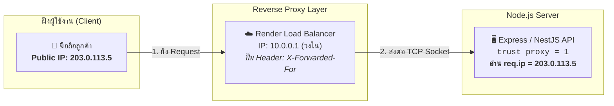
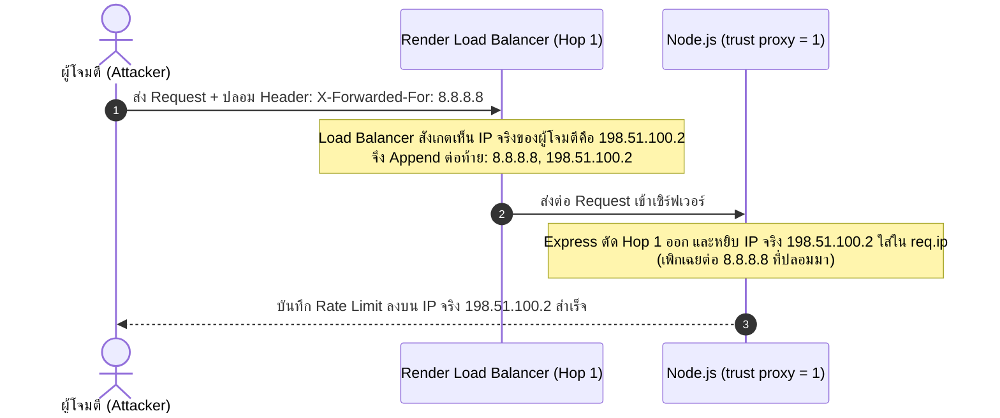

# Security & Network Specification (`security.md`)

เอกสารข้อกำหนดเชิงเทคนิคสำหรับสถาปัตยกรรมความปลอดภัยเครือข่าย, การระบุตัวตนและตรวจสอบ Client IP (`trust proxy`), การป้องกัน IP Spoofing, และระบบจำกัดอัตราคำขอ (5-Tier Rate Limiting) ของ Nida Platform

---

## 1. สถาปัตยกรรมการระบุตัวตน Client IP และ Reverse Proxy

เมื่อระบบรันบนสภาพแวดล้อมจริง (เช่น Render, Cloudflare, AWS) การเชื่อมต่อจากอุปกรณ์ของผู้ใช้จะผ่าน **Reverse Proxy / Load Balancer** เสมอ:



### 1.1 ความแตกต่างระหว่างประเภท IP
- **Public IP (IP สาธารณะ):** ออกให้โดย ISP (True, AIS, 3BB) หรือเครือข่ายมือถือ (4G/5G) เป็น IP เดียวที่โลกภายนอกมองเห็น หากในบ้าน/ออฟฟิศเดียวกันต่อ Wi-Fi เดียวกัน 10 เครื่อง เซิร์ฟเวอร์จะมองเห็นเป็น Public IP เดียวกันทั้งหมด (ผ่านกลไก NAT ของ Router)
- **Private IP (IP วงใน):** เช่น `192.168.1.X`, `10.0.0.X` ใช้เฉพาะในระบบเครือข่ายภายในบ้านหรือใน Cloud Datacenter ภายนอกไม่สามารถติดต่อเข้ามาตรงๆ ได้
- **Loopback IP (เครื่องตัวเอง):** `127.0.0.1` หรือ `::1` (`localhost`) ใช้เฉพาะตอนพัฒนาโปรแกรมบนเครื่อง Local Dev

### 1.2 กลไกการทำงานของ `trust proxy = 1`
- โดยค่าเริ่มต้น Express จะตั้งค่า `trust proxy = false` ส่งผลให้ `req.socket.remoteAddress` ชี้ไปที่ **IP วงในของ Load Balancer (`10.0.0.1`)** ทำให้ลูกค้าทุกคนแชร์ IP เดียวกันทั้งหมด และเกิดปัญหาบล็อกคนบริสุทธิ์
- เมื่อเปิดใช้งาน `app.set('trust proxy', 1)`:
  - ตัวเลข `1` หมายถึง: **"ให้เชื่อใจ Proxy ลำดับหน้าสุด 1 ชั้น (Hop 1 ซึ่งคือ Render Load Balancer ของเรา)"**
  - Express จะแกะ IP จาก Header `X-Forwarded-For` จากขวามาซ้าย โดยตัด IP ปลอมที่ Client ใส่เข้ามาเองออกไป
  - Express จะนำ Public IP ที่แท้จริงของลูกค้ามาบรรจุลงใน **`req.ip`** ให้อัตโนมัติอย่างถูกต้องและปลอดภัย

---

## 2. การป้องกัน IP Spoofing (Header Tampering Prevention)



> **กฎเหล็ก:** ห้ามเขียนฟังก์ชันอ่าน `req.headers['x-forwarded-for']` ดิบเองเด็ดขาด ให้เปิด `trust proxy = 1` และใช้ **`req.ip`** ของ Express เสมอ

---

## 3. ตารางแบ่งระดับการจำกัดอัตรา (5-Tier Rate Limiting Specification)

ระบบจะใช้ `req.ip` ร่วมกับ Identifier เฉพาะเพื่อป้องกันการโจมตีแบ่งตาม 5 ระดับ:

| ระดับ (Tier) | ขอบเขต Endpoints | อัตราสูงสุดที่อนุญาต | คีย์บน Redis | ภัยคุกคามที่ป้องกัน |
| :--- | :--- | :--- | :--- | :--- |
| **Tier 1: Global** | ทุก Endpoint ทั้งระบบ | 120 req / 60 วินาที | `rl:global:<ip>` | DoS / สแปมถล่มเซิร์ฟเวอร์ |
| **Tier 2: Auth** | • `/auth/login`<br>• `/auth/register`<br>• `/auth/reset-password` | 5 req / 60 วินาที | `rl:auth:<ip>:<identifier>` | Brute-force รหัสผ่าน & Credential Stuffing |
| **Tier 3: Email/OTP** | • `/auth/resend-otp`<br>• `/auth/request-otp`<br>• `/auth/forgot-password` | **ต่ออีเมล:** 1 req / 60 วินาที<br>**ต่อ IP:** 10 req / 15 นาที | `rl:email:<target_email>`<br>`rl:ip_email:<ip>` | Email Pumping Attack & ป้องกันโควต้า Resend หมด |
| **Tier 4: Business** | • `/coupons/validate`<br>• `/checkout/calculate` | 15 req / 60 วินาที | `rl:coupon:<ip>:<userId>` | Dictionary Attack สุ่มเดารหัสคูปองส่วนลด |
| **Tier 5: Heavy Search** | • `/catalog/products?search=...` | 30 req / 60 วินาที | `rl:search:<ip>` | Database CPU Spike จากคำค้นหาซับซ้อน |

---

## 4. มาตรการตอบสนองเมื่อเกินโควต้า (HTTP 429 Response Contract)

เมื่อ Request เกินกำหนด ระบบจะปฏิเสธด้วยสถานะ **HTTP 429 Too Many Requests** พร้อมแนบ Headers ตามมาตรฐาน RFC 6585:

### 4.1 Response Headers
```http
HTTP/1.1 429 Too Many Requests
Content-Type: application/json
X-RateLimit-Limit: 5
X-RateLimit-Remaining: 0
X-RateLimit-Reset: 1730590800
Retry-After: 45
```

### 4.2 Response JSON Body
```json
{
  "statusCode": 429,
  "errorCode": "TOO_MANY_REQUESTS",
  "message": "คำขอถี่เกินไป กรุณารอ 45 วินาทีก่อนลองใหม่อีกครั้ง (Rate limit exceeded. Please wait 45 seconds.)",
  "details": {
    "retryAfterSeconds": 45
  }
}
```

---

## 5. นโยบายการจำกัดขนาดข้อมูล (Payload Size Limits)

เพื่อป้องกันการโจมตีแบบ Memory Exhaustion (OOM Denial of Service):
1. **JSON Body ทั่วไป:** กำหนดเพดานสูงสุด `1mb` (`express.json({ limit: '1mb' })`)
2. **URL-Encoded Body:** กำหนดเพดานสูงสุด `1mb` (`express.urlencoded({ extended: true, limit: '1mb' })`)
3. **File Uploads (`/upload`):** อนุญาตเฉพาะ Multipart File Upload ขนาดสูงสุด **`10mb`** และตรวจสอบ Magic Bytes ของไฟล์รูปภาพ (`image/jpeg`, `image/png`, `image/webp`) เสมอ

