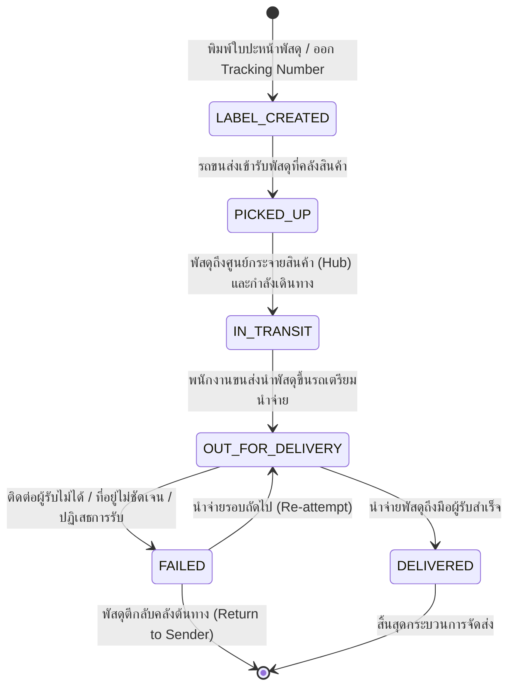

# Logistics & Delivery Specification (`shipment.md`)

เอกสารข้อกำหนดเชิงเทคนิคสำหรับระบบการจัดส่งพัสดุ (`ShipmentStatus`), ผู้ให้บริการขนส่ง (`CarrierCode`), และการติดตามสถานะการจัดส่ง (Tracking Timeline) ของ Nida Platform

---

## 1. แผนภาพสถานะการจัดส่งพัสดุ (Shipment Lifecycle)

---

## 2. ผู้ให้บริการขนส่งที่รองรับ (`CarrierCode`)

| รหัสขนส่ง (Enum) | ชื่อผู้ให้บริการ | รูปแบบ URL สำหรับติดตามพัสดุ (Tracking URL) |
| :--- | :--- | :--- |
| **`KERRY_EXPRESS`** | Kerry Express (KEX) | `https://th.kerryexpress.com/th/track/?track={trackingNumber}` |
| **`FLASH_EXPRESS`** | Flash Express | `https://www.flashexpress.co.th/tracking/?se={trackingNumber}` |
| **`THAILAND_POST_EMS`**| ไปรษณีย์ไทย (EMS) | `https://track.thailandpost.co.th/?trackNumber={trackingNumber}` |
| **`DHL_EXPRESS`** | DHL Express | `https://www.dhl.com/th-th/home/tracking/tracking-express.html?submit=1&tracking-id={trackingNumber}` |

---

## 3. โครงสร้างบันทึกไทม์ไลน์พัสดุ (`ShipmentLog`)

ทุกครั้งที่สถานะของพัสดุมีการเปลี่ยนแปลง จะต้องบันทึกประวัติลงตาราง `ShipmentLog` เพื่อแสดงเป็นไทม์ไลน์บนหน้าร้านและหลังบ้าน:

- `id`: UUID v7
- `shipmentId`: อ้างอิงพัสดุหลัก
- `status`: สถานะ ณ ขณะนั้น (`ShipmentStatus`)
- `location`: ตำแหน่งศูนย์กระจายสินค้า (เช่น `ศูนย์กระจายสินค้าวังน้อย`, `สาขาบางรัก`)
- `description`: คำอธิบาย (เช่น `พนักงานกำลังนำจ่ายพัสดุให้ท่าน`, `ผู้รับได้รับพัสดุเรียบร้อยแล้ว`)
- `logTimestamp`: วันและเวลาที่เกิดเหตุการณ์จริง

---

## 4. ผลกระทบต่อเนื่องต่อคำสั่งซื้อ (Order Sync & Auto-Completion)

1. **เมื่อ Shipment เปลี่ยนเป็น `LABEL_CREATED` หรือ `PICKED_UP`:**
   - สถานะคำสั่งซื้อ (`Order.status`) จะเปลี่ยนเป็น `SHIPPED`
   - ระบบส่งอีเมลแจ้งลูกค้าพร้อมปุ่มคลิกดู Tracking Number แบบ Real-time
2. **เมื่อ Shipment เปลี่ยนเป็น `DELIVERED`:**
   - สถานะคำสั่งซื้อ (`Order.status`) จะเปลี่ยนเป็น `DELIVERED`
   - ตัวจับเวลา **5-Day Auto-Complete** จะเริ่มทำงานทันที
   - หากลูกค้าไม่กดยืนยันรับของ หรือไม่มีการเปิดข้อพิพาทภายใน 120 ชั่วโมง ระบบจะตัดเป็น `COMPLETED` อัตโนมัติ

