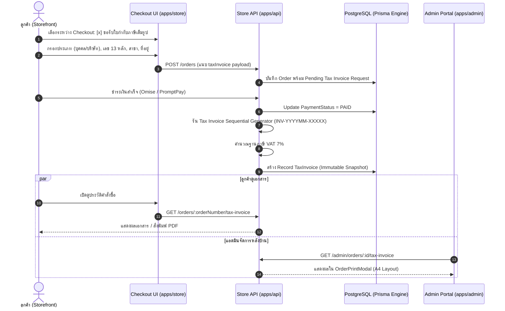

# Tax Invoicing & Receipts Specification (`tax-invoice.md`)

เอกสารข้อกำหนดเชิงเทคนิคสำหรับระบบออกใบเสร็จรับเงิน / ใบกำกับภาษีเต็มรูปแบบ (Full Tax Invoice & Receipt) ของ Nida Platform ให้ถูกต้องตามประมวลรัษฎากรแห่งกรมสรรพากร (มาตรา 86/4) สำหรับธุรกิจพาณิชย์อิเล็กทรอนิกส์ (E-Commerce) ในประเทศไทย

---

## 1. กรอบข้อกำหนดทางกฎหมาย (Legal & Regulatory Framework)

ตามประมวลรัษฎากร มาตรา 86/4 ใบกำกับภาษีแบบเต็มรูปจะต้องมีรายการอย่างน้อยดังต่อไปนี้:

1. คำว่า **"ใบกำกับภาษี/ใบเสร็จรับเงิน"** ในที่ที่เห็นได้เด่นชัด
2. **เลขที่ใบกำกับภาษี (Invoice Number)** และเล่มที่ (ถ้ามี) ที่รันตามลำดับอย่างต่อเนื่อง
3. **วัน เดือน ปี** ที่ออกใบกำกับภาษี
4. **ข้อมูลผู้ออกใบกำกับภาษี (ผู้ประกอบการจดทะเบียน VAT - NIDA)**:
   - ชื่อบริษัท / ชื่อผู้ประกอบการ
   - เลขประจำตัวผู้เสียภาษีอากร 13 หลัก
   - ที่ตั้งสำนักงานใหญ่ (Headquarters)
5. **ข้อมูลผู้ซื้อสินค้า**:
   - **กรณีบุคคลธรรมดา**: ชื่อ-นามสกุล, เลขประจำตัวประชาชน 13 หลัก (หรือ Passport), ที่อยู่ตามทะเบียนบ้าน/บัตรประชาชน
   - **กรณีนิติบุคคล (บริษัท/ห้างหุ้นส่วน)**: ชื่อบริษัท, เลขประจำตัวผู้เสียภาษีอากร 13 หลัก, ระบุ "สำนักงานใหญ่" หรือ "สาขาที่ ..." พร้อมรหัสสาขา 5 หลัก, ที่อยู่จดทะเบียน
6. **รายการสินค้า**: ชื่อสินค้า, จำนวน, ราคาต่อหน่วย, และจำนวนเงินรวม
7. **การแยกแสดงภาษีมูลค่าเพิ่ม (VAT 7%)**:
   - มูลค่าสินค้าก่อนภาษีมูลค่าเพิ่ม (Pre-VAT Amount)
   - ภาษีมูลค่าเพิ่ม 7% (VAT Amount)
   - จำนวนเงินรวมทั้งสิ้น (Total Net Amount)

---

## 2. แผนผังการทำงานของระบบ (Tax Invoicing State Machine & Architecture)



---

## 3. สูตรการคำนวณภาษีมูลค่าเพิ่ม 7% (VAT Calculation Logic)

สินค้าราคาขายปลีกของ NIDA เป็นราคารวมภาษีมูลค่าเพิ่มแล้ว (VAT-Inclusive Price) ดังนั้นเมื่อออกใบกำกับภาษี ระบบต้องคำนวณแยกฐานภาษีออกตามสูตรมาตรฐานของกรมสรรพากร:

$$\text{Pre-VAT Base} = \frac{\text{Total Net Amount}}{1.07}$$

$$\text{VAT Amount (7\%)} = \text{Total Net Amount} - \text{Pre-VAT Base}$$

### กฎการปัดเศษทศนิยม (Rounding Rules):
- ปัดเศษทศนิยม 2 ตำแหน่งตามหลักคณิตศาสตร์สากล (`Half-Up Rounding`)
- ตัวอย่าง: ยอดชำระสุทธิ `฿2,500.00`
  - มูลค่าสินค้าก่อนภาษี: `2500 / 1.07 = ฿2,336.45`
  - ภาษีมูลค่าเพิ่ม 7%: `2500 - 2336.45 = ฿163.55`
  - ยอดรวมทั้งสิ้น: `฿2,500.00`

---

## 4. โครงสร้างฐานข้อมูล (Database Schema Specification)

```prisma
enum TaxInvoicePayerType {
  PERSONAL    // บุคคลธรรมดา
  COMPANY     // นิติบุคคล / องค์กร / ห้างหุ้นส่วน
}

enum TaxInvoiceBranchType {
  HEADQUARTERS // สำนักงานใหญ่
  BRANCH       // สาขา
}

model TaxInvoice {
  id               String               @id @default(uuid(7)) @db.Uuid
  orderId          String               @unique @map("order_id") @db.Uuid
  invoiceNumber    String               @unique @map("invoice_number") @db.VarChar(50)
  
  payerType        TaxInvoicePayerType  @default(PERSONAL) @map("payer_type")
  taxId            String               @map("tax_id") @db.VarChar(20)
  name             String               @db.VarChar(255)
  
  branchType       TaxInvoiceBranchType @default(HEADQUARTERS) @map("branch_type")
  branchNumber     String?              @map("branch_number") @db.VarChar(10) // เช่น "00001"
  
  addressSnapshot  Json                 @map("address_snapshot")
  
  subtotal         Decimal              @db.Decimal(10, 2)
  discountTotal    Decimal              @default(0) @map("discount_total") @db.Decimal(10, 2)
  shippingFee      Decimal              @default(0) @map("shipping_fee") @db.Decimal(10, 2)
  preVatAmount     Decimal              @map("pre_vat_amount") @db.Decimal(10, 2)
  vatAmount        Decimal              @map("vat_amount") @db.Decimal(10, 2)
  totalAmount      Decimal              @map("total_amount") @db.Decimal(10, 2)
  
  issuedAt         DateTime             @default(now()) @map("issued_at")
  createdAt        DateTime             @default(now()) @map("created_at")
  updatedAt        DateTime             @updatedAt @map("updated_at")

  order            Order                @relation(fields: [orderId], references: [id], onDelete: Cascade)

  @@index([taxId])
  @@index([issuedAt])
  @@map("tax_invoices")
}
```

---

## 5. รูปแบบเลขที่ใบกำกับภาษี (Invoice Numbering Pattern)

- **Pattern**: `INV-YYYYMM-XXXXX`
  - `INV-`: Prefix คงที่สำหรับใบกำกับภาษี/ใบเสร็จรับเงิน
  - `YYYYMM`: ปีคริสตศักราชและเดือน เช่น `202611`
  - `XXXXX`: เลขลำดับ 5 หลัก รันอัตโนมัติแบบต่อเนื่องในแต่ละเดือน เช่น `00001`, `00002`
- **การแยก Sequence**: เลขที่ใบกำกับภาษีแยกขาดจากเลขที่คำสั่งซื้อ (`orderNumber`) เพื่อให้เป็นไปตามข้อกำหนดความต่อเนื่องของสมุดบัญชีภาษีขาย

---

## 6. ข้อกำหนดด้านความปลอดภัยและการคุ้มครองข้อมูล (Data Protection & PII)

1. **PII Protection**: ข้อมูล `taxId` และ `addressSnapshot` ในใบกำกับภาษี ถือเป็นข้อมูลส่วนบุคคลอ่อนไหว (Sensitive Personal Data) ภายใต้กฎหมาย PDPA
2. **Access Control**:
   - ลูกค้าสามารถดูและดาวน์โหลดได้เฉพาะใบกำกับภาษีของคำสั่งซื้อตนเองเท่านั้น
   - เจ้าหน้าที่แอดมินต้องมีสิทธิ์ `ORDERS_READ` ในการเข้าถึง และต้องบันทึกประวัติการเข้าถึงใน `admin_audit_logs` หากมีการเปิดเผยข้อมูลจริง
3. **Immutability**: เมื่อใบกำกับภาษีถูกสร้างและบันทึกแล้ว จะไม่อนุญาตให้แก้ไขข้อมูล (Immutable Record) เพื่อความโปร่งใสทางบัญชี หากมีการเปลี่ยนแปลงจะต้องออกใบลดหนี้ (Credit Note) หรือยกเลิกตามระเบียบกรมสรรพากร

