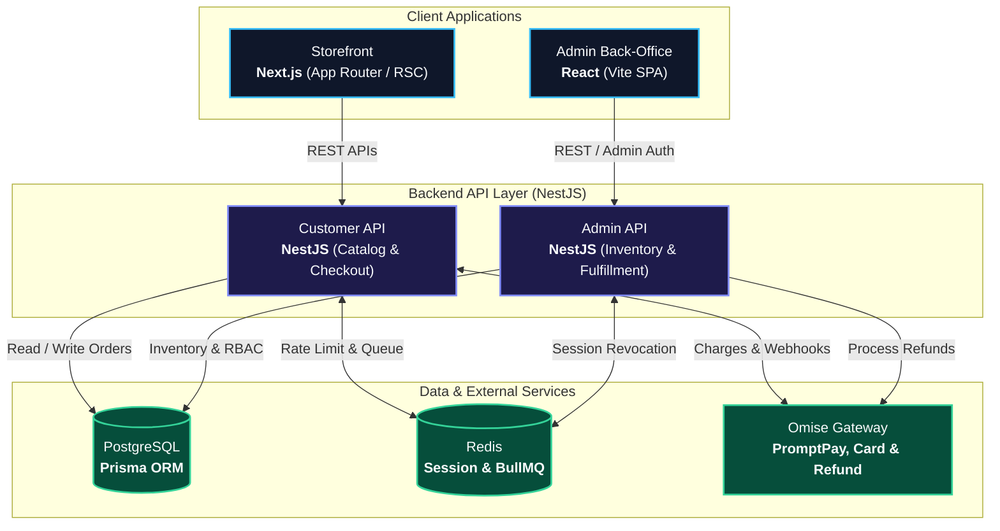

# สรุปนำเสนอโปรเจกต์ Nida — สไลด์ภาษาอังกฤษ (Slide: EN / Script: TH)
### (6 สไลด์กระชับ ~ 4 นาที | สไลด์เขียนอังกฤษทั้งหมด + สคริปต์พูดภาษาไทยเป็นธรรมชาติ)

เอกสารนี้จัดทำขึ้นสำหรับ:
1. **ข้อความบนสไลด์**: เขียนเป็น **ภาษาอังกฤษทั้งหมด (Professional & Concise)** ไม่มีคำโฆษณาเกินจริง
2. **บทพูดนำเสนอ (Speaker Notes)**: เป็น **ภาษาพูดภาษาไทยแบบธรรมชาติ ลื่นไหล สุภาพ และมั่นใจ**
3. **รูปภาพ**: ระบุชัดเจนว่าแต่ละหน้าต้องแปะไดอะแกรมหรือรูปแคปหน้าจออะไร

---

## 📋 Slide Overview (Summary Table)

| Slide | Topic (On Slide) | Visual on Slide (1 รูปต่อสไลด์ ยกเว้น 00) | Duration |
| :---: | :--- | :--- | :---: |
| **00** | **Project Overview** | Split Mockup (Storefront + Back-Office Admin) | ~35s |
| **01** | **System Architecture & Stack** | 1 Diagram: 3-Tier Architecture (Client $\rightarrow$ API $\rightarrow$ Data) | ~45s |
| **02** | **Frontend Engineering (Next.js)** | 1 Image: Product Detail Page with RSC (Green) vs Client (Blue) | ~40s |
| **03** | **Concurrency & Stock Locking** | 1 Image: Carbon Code Card (`updateMany` Atomic Update) | ~50s ⭐ |
| **04** | **Hybrid Auth (JWT + Redis)** | 1 Diagram: Dual-Token Flow (JWT Fast Path + Redis Revocation) | ~40s |
| **05** | **Testing & Code Quality** | 1 Image: Terminal Screenshot of Vitest 100% Pass | ~40s |

---

## 🖥️ Slide Content (Slide: English | Script: Thai)

---

### SLIDE 00: Project Overview

#### 🖼️ Image on Slide:
> **Split Mockup of Nida Application (Laptop + Mobile/Tablet)**:
> * **Left Side**: Laptop screen displaying the customer-facing **Storefront** (Clean fashion catalog, color/size chips, checkout).
> * **Right Side**: Tablet screen displaying the **Admin Dashboard** (SKU inventory table, order status tracking).
> * *(Header on Slide)*: `NIDA — Fashion E-Commerce Platform`

#### 📝 Slide Content (English):
* **Full-Stack Fashion Platform**: Unified commerce system connecting customer Storefront and Back-Office Admin
* **Integrated Storefront & Admin**: Next.js catalog with Omise payments (PromptPay/Card) paired with React SKU Matrix & Refunds
* **Backend & Automation (NestJS)**: High-concurrency stock protection and BullMQ worker for automated order lifecycle

#### 🗣️ คำอธิบายภาษาพูด (สคริปต์ซ้อมพูด ~ 35 วินาที):
> *"สวัสดีครับ วันนี้ผมขอแนะนำโปรเจกต์ **Nida** ครับ
> 
> ตัวนี้เป็นเว็บขายเสื้อผ้าแฟชั่นที่ผมพัฒนาขึ้นมา มีทั้งส่วนของหน้าร้านให้ลูกค้าเลือกซื้อของ และระบบแอดมินหลังบ้านสำหรับจัดการสต็อกกับคำสั่งซื้อครับ
> 
> * **ฝั่งหน้าร้าน**: ใช้ Next.js ลูกค้าสามารถเลือกดูสินค้า กรองตามสีกับไซส์ สลับภาษาไทย-อังกฤษ และจ่ายเงินผ่าน Omise ได้จริง ทั้งสแกน PromptPay QR Code หรือตัดบัตรเครดิต
> * **ฝั่งหลังบ้าน**: ใช้ React ทำระบบจัดการสต็อกตามตารางสีและไซส์ (SKU Matrix), ดูออเดอร์ และมีปุ่มกดทำเรื่อง Refund คืนเงินผ่าน Gateway ได้โดยตรง
> * **ฝั่งหลังบ้านและระบบอัตโนมัติ**: ใช้ NestJS มีการคุมสต็อกตอนสั่งซื้อเพื่อไม่ให้สต็อกติดลบ และมีคิวงานคอยยกเลิกออเดอร์ที่ลูกค้าไม่จ่ายเงินในเวลาที่กำหนด แล้วดึงสต็อกกลับมาคืนให้อัตโนมัติครับ
> 
> เดี๋ยวผมพาไปดูสถาปัตยกรรมและโค้ดในสไลด์ถัดไปเลยครับ"*

---

### SLIDE 01: System Architecture & Stack

#### 🖼️ Image on Slide:
> **Clean 3-Tier Architecture Diagram (Render via Mermaid)**:



*(Footer Note on Slide)*: Turborepo Monorepo sharing `@repo/types` (Interfaces) and `@repo/validators` (Zod) across all apps.

#### 📝 Slide Content (English):
* **Decoupled 3-Tier Architecture**: Separated Next.js storefront, React Vite admin, and dual NestJS backend APIs
* **Integrated Payments**: Omise gateway powering both customer checkout (PromptPay/Card) and direct admin refunds
* **Data & Queue Layer**: PostgreSQL with Prisma ORM for data integrity alongside Redis for sessions & BullMQ queues

#### 🗣️ คำอธิบายภาษาพูด (สคริปต์ซ้อมพูด ~ 45 วินาที):
> *"สไลด์แรกนี้เป็นภาพรวมสถาปัตยกรรมของ Nida ครับ
> 
> ถ้าดูตามแผนผัง เราจะแบ่งเป็น 3 ชั้นชัดเจนครับ:
> 1. **ชั้นหน้าบ้าน (Client)**: มี Storefront ของลูกค้าใช้ Next.js เน้นความเร็วและ SEO ส่วน Admin หลังบ้านเป็น React Vite SPA ที่คล่องตัวสูง
> 2. **ชั้นเซิร์ฟเวอร์ (API)**: เราใช้ NestJS 2 ตัวแยกกัน ตัวแรกดูแลลูกค้าและการสั่งซื้อ ส่วนตัวที่สองดูแลระบบหลังบ้าน สต็อกสินค้า และการอนุมัติคืนเงิน
> 3. **ชั้นข้อมูลและบริการภายนอก**: มี PostgreSQL สำหรับเก็บข้อมูลหลัก, Redis สำหรับแคชและคิวงาน และ **Omise Payment Gateway** ครับ โดยฝั่ง Customer API จะใช้ตัดเงินและรับ Webhook ส่วน Admin API ก็เชื่อมต่อกับ Omise เพื่อสั่งทำเรื่อง **Refund คืนเงิน** ให้ลูกค้าได้โดยตรงจากระบบหลังบ้านครับ"*

---

### SLIDE 02: Frontend Engineering (Next.js & Server Components)

#### 🖼️ Image on Slide (1 รูปเดียว):
> **Single Image: Product Detail Page Mockup (`/product/[id]`) with 2 Color Overlays**:
> * **Green Box Overlay (Page Structure & Content)**: Labeled `Server Component (0 KB Client JS)`
> * **Blue Box Overlay (Size/Color Chips & Add to Bag)**: Labeled `Client Component ('use client')`
> 
> *(ทางเลือก: หากไม่สะดวกแคปภาพเว็บจริง สามารถใช้ 1 Mermaid Diagram ด้านล่างนี้แทนได้)*:
> ```mermaid
> flowchart TD
>     subgraph PAGE["Product Detail Page (Server Component — Zero JS Bundle)"]
>         direction TB
>         subgraph TOP["Server-Rendered HTML"]
>             direction LR
>             IMG["Product Gallery<br/><code>next/image</code>"]
>             INFO["Product Meta<br/>Title, Price, Specs"]
>         end
>         subgraph INTERACTIVE["Interactive Area (Client Component)"]
>             direction LR
>             VARIANT["Color & Size Selector<br/><code>'use client'</code>"]
>             BTN["Add to Bag Button<br/><code>'use client'</code>"]
>         end
>         TOP --> INTERACTIVE
>     end
>     classDef serverStyle fill:#064e3b,stroke:#10b981,stroke-width:2px,color:#f8fafc
>     classDef clientStyle fill:#1e3a8a,stroke:#38bdf8,stroke-width:2px,color:#f8fafc
>     class PAGE,TOP,IMG,INFO serverStyle
>     class INTERACTIVE,VARIANT,BTN clientStyle
> ```

#### 📝 Slide Content (English):
* **Server-First Architecture**: Product pages rendered as Server Components with 0 KB client-side JavaScript for static content
* **Selective Hydration**: Client components (`'use client'`) isolated strictly to interactive controls (size/color chips, cart drawer)
* **Performance & SEO**: Dynamic OpenGraph tags with `generateMetadata` and automatic WebP optimization via `next/image`

#### 🗣️ คำอธิบายภาษาพูด (สคริปต์ซ้อมพูด ~ 40 วินาที):
> *"ถัดมาฝั่ง Frontend หน้าร้านครับ จุดที่ผมให้ความสำคัญมากคือ **ความเร็วและ SEO**
> 
> ผมออกแบบเป็น **Server-First บน Next.js App Router** ครับ ถ้าสังเกตจากในรูป ส่วนที่เป็นกรอบสีเขียวทั้งหมดจะทำงานเป็น Server Component บนเซิร์ฟเวอร์เลย ดึงข้อมูลสินค้าและสร้างหน้าเว็บออกมาเป็น HTML สำเร็จรูป โดยไม่ต้องส่งโค้ด JavaScript ที่ไม่จำเป็นไปให้บราวเซอร์ของผู้ใช้โหลด
> 
> เราจะแยกเฉพาะส่วนที่เป็นกรอบสีฟ้า เช่น ปุ่มเลือกสี ไซส์ และปุ่มใส่ตะกร้า ออกมาเป็น Client Component เท่านั้น นอกจากนี้รูปสินค้าเราก็รันผ่าน `next/image` ทั้งหมด แปลงเป็น WebP อัตโนมัติ ช่วยลดขนาดไฟล์ภาพลงกว่า 60% และจองพื้นที่หน้าจอไว้ล่วงหน้า ทำให้เวลาเปิดหน้าเว็บ รูปโหลดขึ้นมาแล้วหน้าจอจะไม่กระตุกเลยครับ"*

---

### SLIDE 03: Concurrency Control & Zero Overselling (⭐ Key Highlight)

#### 🖼️ Image on Slide (1 รูปเดียว):
> **Single Visual: Carbon Code Card — Atomic Conditional Update**:
> *(ภาพโค้ดที่ครอบด้วยกรอบสวยงาม Carbon / Ray.so หรือแคปภาพโค้ดจาก VS Code ชัดๆ 1 รูป เน้นบรรทัด `gte`)*
> 
> ```typescript
> // apps/api/src/modules/orders/orders.service.ts
> const result = await tx.inventoryItem.updateMany({
>   where: { 
>     id: variantId, 
>     quantityAvailable: { gte: quantity } // 1. Validate & Lock
>   },
>   data: { 
>     quantityAvailable: { decrement: quantity } // 2. Atomic Decrement
>   },
> });
> 
> if (result.count === 0) {
>   throw new BadRequestException('Insufficient stock'); // 3. Instant Rollback
> }
> ```

#### 📝 Slide Content (English):
* **The Concurrency Risk**: High-traffic simultaneous checkouts cause race conditions and negative inventory (overselling)
* **Atomic Conditional Update**: Single database query combining stock verification and decrement (`where: quantityAvailable >= quantity`)
* **Guaranteed Invariant**: Atomic row locking in PostgreSQL transaction ensures zero overselling with instant rollback on conflict

#### 🗣️ คำอธิบายภาษาพูด (สคริปต์ซ้อมพูด ~ 50 วินาที):
> *"สไลด์นี้เป็นจุดทางเทคนิคฝั่ง Backend ที่ท้าทายที่สุดของโปรเจกต์นี้ครับ คือการแก้ปัญหา **Race Condition ตอนตัดสต็อกสินค้า**
> 
> ปัญหาคลาสสิกของเว็บ E-Commerce คือ ถ้าเราเขียนโค้ดแบบอ่านยอดสต็อกขึ้นมาดูก่อนว่าเหลือไหม แล้วค่อยสั่งตัด ถ้ามีลูกค้า 2 คนกดซื้อพร้อมกัน ทั้งคู่จะเห็นว่ามีของ และระบบจะสั่งตัดสต็อกซ้ำจนยอดติดลบ
> 
> วิธีที่ผมใช้แก้คือ **Atomic Conditional Update** ตามโค้ดบนสไลด์นี้เลยครับ ผมสั่ง `updateMany` ภายใต้ Database Transaction โดยใส่เงื่อนไขไปในคำสั่งเดียวเลยว่า `quantityAvailable` ต้องมากกว่าหรือเท่ากับจำนวนที่ขอซื้อ ให้ตัว PostgreSQL Engine เป็นคนตัดสินใจทันที ถ้ามีใครตัดไปก่อนหน้าแล้ว คำสั่งที่สองจะอัปเดตโดน 0 แถว ระบบจะรู้ทันทีและสั่ง Rollback ธุรกรรมทั้งหมด ทำให้รับประกันได้ 100% ว่าสต็อกไม่มีทางติดลบแน่นอนครับ"*

---

### SLIDE 04: Hybrid Authentication & Session Revocation

#### 🖼️ Image on Slide (1 รูปเดียว):
> **Single Diagram: Dual-Token Flow (Render via Mermaid)**:
> 
> ```mermaid
> flowchart LR
>     CLIENT["Client App"]
> 
>     subgraph FAST["1. Fast Path (Stateless ~1ms)"]
>         direction TB
>         ACCESS["Access Token<br/><b>JWT (15 min)</b>"] -->|Verify Signature| GUARD["NestJS Guard<br/>(No DB Query)"]
>     end
> 
>     subgraph STATE["2. Stateful Session & Revocation"]
>         direction TB
>         REFRESH["Refresh Token<br/><b>7 Days</b>"] <-->|Validate & Rotate| REDIS[("Redis Session<br/>IP + UserAgent")]
>         REVOKE["Admin / Logout"] -.->|Delete Session Key| REDIS
>     end
> 
>     CLIENT --> FAST
>     CLIENT -.->|When Access Token Expires| STATE
> 
>     classDef clientStyle fill:#0f172a,stroke:#38bdf8,stroke-width:2px,color:#f8fafc
>     classDef fastStyle fill:#064e3b,stroke:#34d399,stroke-width:2px,color:#f8fafc
>     classDef stateStyle fill:#451a03,stroke:#fb923c,stroke-width:2px,color:#f8fafc
> 
>     class CLIENT clientStyle
>     class ACCESS,GUARD fastStyle
>     class REFRESH,REDIS,REVOKE stateStyle
> ```

#### 📝 Slide Content (English):
* **Dual-Token Architecture**: Balances stateless performance for API calls with stateful control for security
* **Stateless Access Token (JWT 15m)**: Verified instantly by NestJS Guards at microsecond speed without database overhead
* **Stateful Session & Revocation (Redis 7d)**: Stores active sessions with IP/User-Agent, enabling immediate session invalidation

#### 🗣️ คำอธิบายภาษาพูด (สคริปต์ซ้อมพูด ~ 40 วินาที):
> *"ถัดมาเป็นเรื่องระบบยืนยันตัวตน (Authentication) ครับ โจทย์คือทำยังไงให้ระบบตรวจสอบสิทธิ์ได้เร็ว แต่ถ้ามีเหตุฉุกเฉินต้องสั่งตัดสิทธิ์ผู้ใช้ได้ทันที
> 
> ผมเลยออกแบบเป็น **Hybrid Dual-Token** ตามในไดอะแกรมนี้ครับ
> ฝั่งการเรียกใช้งานปกติ เราใช้ **Access Token เป็น JWT อายุสั้น 15 นาที** ข้อดีคือ Guard ของ NestJS สามารถถอดรหัสตรวจสิทธิ์ได้ทันทีแบบ Stateless โดยไม่ต้องไปเสียเวลาคิวรีฐานข้อมูล
> 
> แต่สำหรับ **Refresh Token อายุ 7 วัน เราจะบันทึกไว้ใน Redis Session ครับ** ตรงนี้ช่วยปิดจุดอ่อนของ JWT เพราะถ้าวันไหนแอดมินถูกระงับสิทธิ์ หรือลูกค้าทำมือถือหาย เราแค่สั่งลบ Key ใน Redis ทิ้งไป พอ Access Token เดิมหมดอายุ ระบบจะตัดการเข้าถึงทันที ถือว่าได้ทั้งความเร็วและความปลอดภัยควบคู่กันครับ"*

---

### SLIDE 05: Code Quality & Testing Discipline

#### 🖼️ Image on Slide (1 รูปเดียว):
> **Single Image: Terminal Screenshot of Vitest Execution**:
> *(แคปภาพ Terminal ที่รันคำสั่ง `npm run test` แล้วขึ้นผลผ่านสีเขียวทั้งหมด 1 รูป ชัดเจน)*
> 
> ```bash
> ✓ test/orders/orders.service.spec.ts (14 tests) 182ms
> ✓ test/orders/order-lifecycle-status.spec.ts (8 tests) 94ms
> ✓ test/auth/auth.service.spec.ts (10 tests) 112ms
> 
> Test Files  3 passed (3)
> Tests       32 passed (32)
> Duration    1.84s
> ```

#### 📝 Slide Content (English):
* **Type Safety & Data Integrity**: Zero `any` policy with strict Zod validation schemas and mandatory SQL database migrations
* **Automated Unit Testing (Vitest)**: Fast test suite running in < 2s with isolated mocks for external gateways (Omise, Prisma)
* **Code Ownership**: AI tools leveraged for boilerplate velocity while core architectural logic is thoroughly verified and tested

#### 🗣️ คำอธิบายภาษาพูด (สคริปต์ซ้อมพูด ~ 40 วินาที):
> *"สไลด์สุดท้ายเป็นเรื่องคุณภาพของโค้ดและการทดสอบครับ
> 
> ในโปรเจกต์นี้เราตั้งกฎเหล็กไว้ชัดเจนครับ เช่น **Zero `any` Policy** ห้ามใช้ `any` เด็ดขาด ข้อมูลที่รับเข้ามาต้องผ่าน Zod Validation ทั้งหมด และถ้ามีการแก้โครงสร้างฐานข้อมูล จะต้องสร้างไฟล์ SQL Migration เสมอ
> 
> และตามภาพ Terminal บนสไลด์นี้ เราเขียนชุดทดสอบ Unit Test ด้วย **Vitest** ครอบคลุมทั้งกรณีปกติและกรณีที่เกิด Error โดยใช้การ Mock เซอร์วิสภายนอกอย่าง Omise Payment Gateway ทำให้เราจำลองเคสที่บัตรเครดิตถูกตัดไม่ผ่าน หรือของหมด ได้อย่างปลอดภัยโดยไม่ต้องจ่ายเงินจริง และรันเทสผ่านทั้งหมดในเวลาไม่ถึง 2 วินาที
> 
> โค้ดทั้งหมดในโปรเจกต์นี้ แม้จะมีบางส่วนที่ผมใช้ AI ช่วยร่าง Boilerplate เพื่อความรวดเร็ว แต่ผมเป็นคน Review ตรวจสอบตรรกะ และเขียน Unit Test กำกับเองทุกจุด ทำให้ผมเข้าใจและเป็นเจ้าของโค้ดทุกบรรทัดอย่างแท้จริงครับ"*

---

## 💡 Quick Tips for the Interview
* **Slide is in English, Speak in Thai**: สไลด์ภาษาอังกฤษจะดูเป็นมืออาชีพและได้มาตรฐานสากล ส่วนการพูดอธิบายเป็นภาษาไทยตามธรรมชาติจะช่วยให้สื่อสารได้อย่างมั่นใจ ไม่เกร็ง และตอบข้อซักถามได้อย่างลื่นไหล
* **Point to the Diagram**: ใช้เมาส์ชี้ไปที่จุดสำคัญบนสไลด์ เช่น *"In this code block..."* หรือ *"ในกล่องสีเขียวนี้..."* ช่วยดึงดูดสายตาผู้สัมภาษณ์ได้ดีมากครับ
