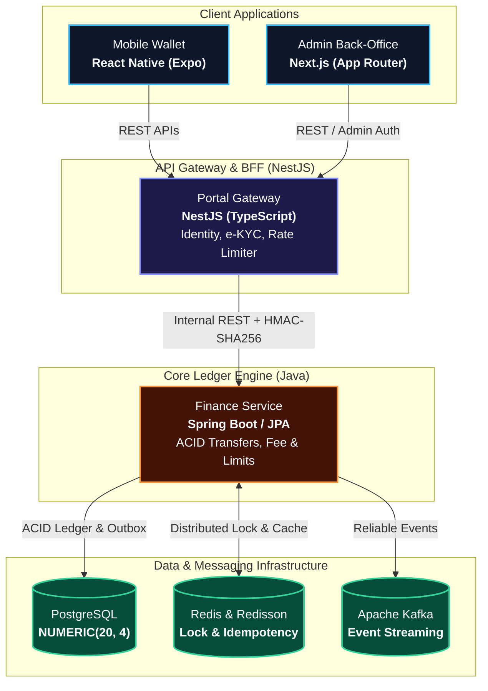
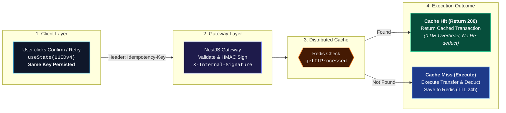
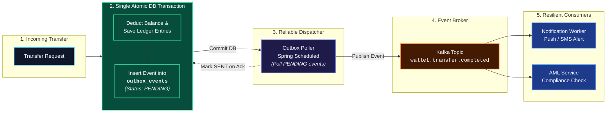

# สรุปนำเสนอโปรเจกต์ P-wallet (J-Ledger) — สไลด์ภาษาอังกฤษ (Slide: EN / Script: TH)
### (6 สไลด์กระชับ ~ 4 นาที | สไลด์เขียนอังกฤษ 3 Bullet Points + 1 รูปต่อสไลด์ ยกเว้น 00 + สคริปต์พูดภาษาไทยเป็นธรรมชาติ)

เอกสารนี้จัดทำขึ้นตามมาตรฐานเดียวกันกับโปรเจกต์ Nida:
1. **ข้อความบนสไลด์**: เขียนเป็น **ภาษาอังกฤษทั้งหมด (Professional & Concise)** จำกัดเพียง **3 Bullet Points ต่อหน้า**
2. **รูปภาพบนสไลด์**: กำหนด **1 รูป/ไดอะแกรมที่ชัดเจนต่อ 1 สไลด์** (ยกเว้น Slide 00 ที่เป็น Split Mockup สองจอ)
3. **บทพูดนำเสนอ (Speaker Notes)**: เป็น **ภาษาพูดภาษาไทยแบบธรรมชาติ ลื่นไหล สุภาพ มั่นใจ** ซ้อมพูดตามได้ทันที

---

## 📋 Slide Overview (Summary Table)

| Slide | Topic (On Slide) | Visual on Slide (1 รูปต่อสไลด์ ยกเว้น 00) | Duration |
| :---: | :--- | :--- | :---: |
| **00** | **Project Overview** | Split Mockup (Mobile Wallet App + Admin Portal) | ~35s |
| **01** | **System Architecture & Stack** | 1 Diagram: Polyglot Architecture (Client $\rightarrow$ Gateway $\rightarrow$ Core $\rightarrow$ Infra) | ~45s |
| **02** | **End-to-End Idempotency** | 1 Diagram: Idempotency Lifecycle (Client Key $\rightarrow$ Redis Cache Hit/Miss) | ~45s |
| **03** | **Distributed Lock & Deadlock** | 1 Image: Carbon Code Card (`compareTo` Alphabetical Lock Ordering) | ~50s ⭐ |
| **04** | **Financial Precision & Ledger** | 1 Table/Card: Double-Entry Ledger Entries ($\sum \text{Debit} = \sum \text{Credit}$) | ~40s |
| **05** | **Transactional Outbox & Kafka** | 1 Diagram: Reliable Event Dispatching (DB Outbox $\rightarrow$ Kafka $\rightarrow$ Workers) | ~45s |
| **06** | **Summary: What Each Project Brings** | 4-Card Grid with Center Mockup (Synergy of Nida + P-wallet) | ~40s |

---

## 🖥️ Slide Content (Slide: English | Script: Thai)

---

### SLIDE 00: Project Overview

#### 🖼️ Image on Slide:
> **Split Mockup of P-wallet Ecosystem (Mobile + Laptop/Tablet)**:
> * **Left Side**: Mobile Phone screen displaying **Wallet App (React Native)** (Transfer confirmation, Balance card, Recent transactions).
> * **Right Side**: Laptop screen displaying **Admin Back-Office (Next.js)** (Real-time Liquidity chart, Audit logs, Daily Reconciliation).
> * *(Header on Slide)*: `P-WALLET (J-LEDGER) — Mission-Critical Financial Ledger & Wallet`

#### 📝 Slide Content (English):
* **High-Consistency Financial Platform**: Production-ready wallet ecosystem combining customer mobile app and administrative oversight
* **Mission-Critical Core Invariant**: Designed with zero tolerance for financial inaccuracy, double-deductions, or unverified ledger state
* **Dual-Service Engine**: Java 21 Spring Boot core ledger for ACID guarantees paired with NestJS gateway for user workflows

#### 🗣️ คำอธิบายภาษาพูด (สคริปต์ซ้อมพูด ~ 35 วินาที):
> *"สำหรับโปรเจกต์ที่สองคือ **P-wallet** หรือในโค้ดคือระบบ **J-Ledger** ครับ
> 
> ตัวนี้เป็นระบบกระเป๋าเงินดิจิทัลและ Core Ledger ที่ผมพัฒนาขึ้นมา มีทั้งแอปบนมือถือสำหรับลูกค้าทั่วไปโอนเงิน และหน้าเว็บ Admin Portal สำหรับทีมการเงินตรวจสอบยอดเงินคงเหลือและกระทบยอดบัญชีครับ
> 
> โจทย์หลักข้อเดียวของโปรเจกต์นี้คือ **'เรื่องเงิน ต้องถูกต้อง 100% ห้ามมีข้อผิดพลาดแม้แต่สตางค์เดียว'**
> เราจึงแยกระบบออกเป็น 2 เซอร์วิสหลัก: ฝั่งตัดเงินใช้ **Java 21 Spring Boot** เพื่อควบคุมความถูกต้องของบัญชีแบบ ACID และฝั่งหน้าบ้านใช้ **NestJS** ในการจัดการผู้ใช้งานและการยืนยันตัวตน e-KYC ครับ
> 
> เดี๋ยวเราไปดูภาพรวมสถาปัตยกรรมในสไลด์ถัดไปกันครับ"*

---

### SLIDE 01: System Architecture & Stack

#### 🖼️ Image on Slide (1 รูปเดียว):
> **Clean Polyglot Architecture Diagram (Render via Mermaid)**:



*(Footer Note on Slide)*: Secure Service-to-Service communication verified via HMAC-SHA256 signatures (`X-Internal-Signature`).

#### 📝 Slide Content (English):
* **Polyglot Monolithic Architecture**: Clear boundary between user-facing gateway (NestJS) and core ledger engine (Java)
* **Single Source of Truth**: Java Spring Boot encapsulates all monetary state mutations with strict ACID isolation
* **Production Data Stack**: PostgreSQL schemas with `NUMERIC(20, 4)`, Redisson for distributed locks, and Kafka for async events

#### 🗣️ คำอธิบายภาษาพูด (สคริปต์ซ้อมพูด ~ 45 วินาที):
> *"สไลด์แรกนี้เป็นภาพรวมสถาปัตยกรรมของ P-wallet ครับ
> 
> ถ้าดูตามแผนผัง เราแบ่งความรับผิดชอบออกเป็นชั้นๆ อย่างชัดเจนครับ:
> 1. **ชั้นหน้าบ้าน (Client)**: มีแอปมือถือ React Native สำหรับลูกค้า และเว็บ Next.js สำหรับแอดมิน
> 2. **ชั้นเกตเวย์ (NestJS)**: ทำหน้าที่เป็น BFF รับคำขอ ตรวจสอบสิทธิ์ผู้ใช้ และจัดการข้อมูล e-KYC ก่อนจะส่งต่อคำขอไปยัง Backend
> 3. **ชั้น Core Ledger (Java)**: ตัวนี้เป็นหัวใจสำคัญครับ เป็นจุดเดียวในระบบที่มีสิทธิ์แก้ไขยอดเงินและบันทึกบัญชี โดยทั้งสองเซอร์วิสสื่อสารกันด้วย REST API ที่มีลายเซ็น **HMAC-SHA256** ป้องกันการปลอมแปลง
> 
> ข้อมูลทั้งหมดจะวิ่งลง **PostgreSQL** ควบคู่กับ **Redis** สำหรับการล็อก และ **Apache Kafka** สำหรับกระจายอีเวนต์ครับ"*

---

### SLIDE 02: End-to-End Idempotency (Zero Double-Deduction)

#### 🖼️ Image on Slide (1 รูปเดียว):
> **Single Diagram: Idempotency Lifecycle Flow (Render via Mermaid)**:



#### 📝 Slide Content (English):
* **The Business Risk**: Network timeouts and repeated user taps cause duplicate transfer requests and double-deductions
* **Client-Side Key Lifecycle**: `Idempotency-Key` generated once via React Native `useState` and preserved across retries
* **Fast-Path Redis Caching**: Redis returns original transaction on Cache Hit (0 ms DB load) or caches successful transfers with 24h TTL

#### 🗣️ คำอธิบายภาษาพูด (สคริปต์ซ้อมพูด ~ 45 วินาที):
> *"ปัญหาคลาสสิกที่สุดของระบบการเงินคือ **ผู้ใช้กดยืนยันแล้วเน็ตหลุด แล้วเผลอกดซ้ำจนเงินถูกตัดเบิ้ล** ครับ
> 
> ผมแก้ปัญหานี้ด้วย **End-to-End Idempotency System** ตามในไดอะแกรมนี้ครับ:
> เริ่มตั้งแต่หน้าจอมือถือ React Native เราสร้าง `Idempotency-Key` เป็น UUID ผูกไว้กับ `useState` ตั้งแต่ตอนเปิดหน้าจอ ทำให้เวลากด Retry ซ้ำ ตัวแอปจะส่งกุญแจเดิมขึ้นมาเสมอ ไม่มีการสุ่มใหม่เด็ดขาด
> 
> พอคำขอวิ่งผ่าน NestJS มาถึง Java Core ระบบจะนำกุญแจนี้ไปเช็กใน Redis ทันที
> ถ้าพบว่าเคยทำสำเร็จไปแล้ว (**Cache Hit**) ระบบจะดึงผลลัพธ์เดิมส่งกลับให้ผู้ใช้ทันทีในเวลาไม่กี่มิลลิวินาที โดยไม่มีการไปแตะฐานข้อมูลเพื่อตัดเงินซ้ำ แต่ถ้าเป็นรายการใหม่ (**Cache Miss**) ระบบจะตัดเงินจริงและบันทึกผลลง Redis ไว้ 24 ชั่วโมง การันตีว่าตัดเงินแค่ครั้งเดียวแน่นอนครับ"*

---

### SLIDE 03: Distributed Lock & Deadlock Prevention (⭐ Key Highlight)

#### 🖼️ Image on Slide (1 รูปเดียว):
> **Single Visual: Carbon Code Card — Alphabetical Lock Ordering**:
> *(ภาพโค้ดจริงจาก `TransferServiceImpl.java` ตีกรอบไฮไลต์บรรทัด `compareTo` และ `tryLock` 1 รูป ชัดเจน)*
> 
> ```java
> // TransferServiceImpl.java — Strict Alphabetical Lock Ordering
> String firstId = fromId.compareTo(toId) <= 0 ? fromId : toId;
> String secondId = fromId.compareTo(toId) <= 0 ? toId : fromId;
> 
> RLock firstLock = redissonClient.getLock("lock:account:" + firstId);
> RLock secondLock = redissonClient.getLock("lock:account:" + secondId);
> 
> if (firstLock.tryLock(3, 10, TimeUnit.SECONDS) && 
>     secondLock.tryLock(3, 10, TimeUnit.SECONDS)) {
>     try {
>         return walletService.transfer(fromId, toId, amount);
>     } finally {
>         if (secondLock.isHeldByCurrentThread()) secondLock.unlock();
>         if (firstLock.isHeldByCurrentThread()) firstLock.unlock();
>     }
> }
> ```

#### 📝 Slide Content (English):
* **The Concurrency Hazard**: Simultaneous bidirectional transfers (A $\rightarrow$ B and B $\rightarrow$ A) cause circular-wait deadlocks
* **Strict Alphabetical Ordering**: Enforces global lock order via `compareTo() <= 0`, guaranteeing all threads acquire locks in identical sequence
* **Deterministic Fail-Safe**: 3s acquisition timeout prevents thread pool starvation, with 10s auto-lease and guaranteed `finally` release

#### 🗣️ คำอธิบายภาษาพูด (สคริปต์ซ้อมพูด ~ 50 วินาที):
> *"สไลด์นี้เป็นจุดทางเทคนิคที่ท้าทายที่สุดของระบบ Core Ledger ครับ คือเรื่องการจัดการ Concurrency
> 
> ปัญหาโลกแตกของการโอนเงินคือ **'เคสสองคนโอนเงินสวนทางกันในเสี้ยววินาที'** เช่น นาย A โอนให้นาย B ขณะที่นาย B ก็โอนให้นาย A พร้อมกัน ถ้าเราเขียนโค้ดล็อกตามคนโอน เธรดแรกจะถือ A รอ B ส่วนเธรดที่สองจะถือ B รอ A เกิดปัญหา Deadlock ค้างทั้งสองฝั่งทันที
> 
> ผมแก้ปัญหานี้ด้วยเทคนิค **Strict Alphabetical Lock Ordering** ตามโค้ดบนสไลด์นี้ครับ
> ก่อนที่จะขอกุญแจจาก Redisson เราจะนำ Account ID มาเปรียบเทียบตามตัวอักษรด้วยคำสั่ง `.compareTo()` ทำให้ไม่ว่าใครจะเป็นคนโอน ทุกคำขอในระบบจะถูกบังคับให้วิ่งไปแย่งกุญแจตัวที่มาก่อน (เช่น นาย A) เสมอ
> 
> คำขอแรกที่ชนะจะได้กุญแจ A แล้วไปหยิบ B เพื่อตัดเงินจนเสร็จ ส่วนคำขอที่สองจะต้องยืนรอคิวหน้าประตู A พอคำขอแรกปลดล็อก คำขอที่สองถึงจะได้ทำต่อ ทำให้ธุรกรรมสำเร็จทั้งคู่โดยไม่มีการ Deadlock 100% ครับ"*

---

### SLIDE 04: Financial Precision & Double-Entry Ledger

#### 🖼️ Image on Slide (1 รูปเดียว):
> **Single Card: Double-Entry Ledger & Decimal Precision Balance**:

| Entry ID | Account Identifier | Entry Type | Amount (THB) | Currency |
| :---: | :--- | :---: | :---: | :---: |
| `#TX-101-LEG1` | `ACC-ALICE-WALLET` (Sender) | **DEBIT** | `100.0000` | THB |
| `#TX-101-LEG2` | `ACC-BOB-WALLET` (Receiver) | **CREDIT** | `100.0000` | THB |
| **VERIFICATION** | **Balanced Journal Entry Invariant** | **$\sum \text{Debit} - \sum \text{Credit}$** | **`0.0000`** | **MATCHED ✅** |

*(Footer Badge on Slide)*: `Rule: No Binary Floating-Point (float/double) — Enforced via BigDecimal & NUMERIC(20, 4)`

#### 📝 Slide Content (English):
* **Zero Floating-Point Policy**: Prohibits `float/double` to eliminate IEEE 754 precision drift ($0.1 + 0.2 = 0.30000000000000004$)
* **Arbitrary Precision Arithmetic**: `BigDecimal` with `UNNECESSARY` rounding for transfers and PostgreSQL `NUMERIC(20, 4)` for sub-cent math
* **Double-Entry Ledger Engine**: Atomic dual-leg journal entries ensuring $\sum \text{Debit} = \sum \text{Credit}$ with complete auditability

#### 🗣️ คำอธิบายภาษาพูด (สคริปต์ซ้อมพูด ~ 40 วินาที):
> *"ถัดมาเป็นเรื่องความถูกต้องของตัวเลขและหลักการบัญชีครับ
> 
> ในระบบการเงิน เรามีกฎเหล็กว่า **ห้ามใช้ primitive float หรือ double ในโค้ดเด็ดขาด** เพราะคอมพิวเตอร์เก็บเลขทศนิยมเป็นฐานสอง ทำให้เกิดปัญหา IEEE 754 เช่น $0.1 + 0.2$ จะได้ $0.30000000000000004$ ซึ่งในระบบเงิน เศษสตางค์จะงอกออกมาจากอากาศทันที เราจึงใช้ **`BigDecimal` บน Java ควบคู่กับ `NUMERIC(20, 4)` บน PostgreSQL** เพื่อรองรับการคำนวณที่แม่นยำระดับเสี้ยวสตางค์
> 
> และหัวใจสำคัญคือ **หลักการบัญชีคู่ (Double-Entry Bookkeeping)** ตามตารางนี้เลยครับ
> เงินทุกบาทที่มีการเคลื่อนไหว จะต้องมีบันทึก 2 ขาเสมอ คือ **Debit เงินออกจากคนโอน และ Credit เงินเข้าหาคนรับ** โดยผลรวมทั้งสองด้านต้องหักล้างกันเป็นศูนย์พอดีเป๊ะ ทำให้ระบบสามารถกระทบยอดบัญชี (Reconcile) ได้ตรงกัน 100% เสมอครับ"*

---

### SLIDE 05: Eventual Consistency & Transactional Outbox Pattern

#### 🖼️ Image on Slide (1 รูปเดียว):
> **Single Diagram: Transactional Outbox Flow (Render via Mermaid)**:



#### 📝 Slide Content (English):
* **Dual-Write Vulnerability**: Direct Kafka publishing after database commit risks losing notification and AML events on network failure
* **Transactional Outbox Solution**: Ledger balance mutation and event insertion committed together inside a single `@Transactional` boundary
* **Guaranteed Delivery**: Outbox poller dispatches pending events to Kafka with consumer `@RetryableTopic` and Dead Letter Topics (DLT)

#### 🗣️ คำอธิบายภาษาพูด (สคริปต์ซ้อมพูด ~ 45 วินาที):
> *"สไลด์สุดท้ายเป็นเรื่อง **การรักษาความสอดคล้องของข้อมูลข้ามระบบ (Data Consistency)** ครับ
> ในการโอนเงิน พอตัดเงินในฐานข้อมูลเสร็จ เราต้องส่ง Push Notification ไปบอกผู้ใช้ และส่งข้อมูลไปให้ระบบ AML ตรวจจับการฟอกเงิน
> 
> ถ้าเราใช้วิธีตัดเงินในฐานข้อมูลเสร็จแล้วสั่งยิง Kafka ทันที หากจังหวะนั้นเน็ตเวิร์กหลุด จะเกิดปัญหา **Dual-Write** คือเงินถูกตัดจริง แต่ข้อความแจ้งเตือนหายไป
> 
> ผมแก้ปัญหานี้ด้วย **Transactional Outbox Pattern** ตามในไดอะแกรมนี้ครับ 
> ตอนตัดเงิน เราจะเขียนบันทึกอีเวนต์ลงตาราง `outbox_events` ใน PostgreSQL ภายใต้ Database Transaction เดียวกัน ถ้าตัดเงินไม่ผ่าน อีเวนต์ก็จะไม่ถูกเขียน
> จากนั้นจะมี Outbox Poller คอยหยิบอีเวนต์ไปส่งเข้า Apache Kafka และมีระบบ Dead Letter Topic ป้องกันข้อมูลสูญหาย ทำให้การันตีได้ว่า ทุกธุรกรรมที่ตัดเงินสำเร็จ จะมีการส่งอีเวนต์ไปแจ้งเตือนผู้ใช้งานได้อย่างแน่นอน 100% ครับ"*

---

### SLIDE 06: Summary — What Each Project Brings

#### 🖼️ Image on Slide (Layout from Template):
> **4-Card Grid surrounding Center Image (Split Mockup / Engineering Laptop)**:
> * **Left Column (Title & Lead)**:
>   * `What Each Project Brings ↗`
>   * *"A complementary balance of high-performance modern web engineering and mission-critical financial backend systems. Together, they demonstrate end-to-end full-stack capabilities, concurrency control, and zero-compromise data integrity."*
> * **Center Image**: Split Mockup showing **Nida Storefront on Laptop** paired with **P-wallet on Mobile Device**.
> * **Top-Left Card**: `Full-Stack Velocity (Nida)` — Next.js RSC, Turborepo Monorepo & Omise Payments
> * **Top-Right Card**: `Financial Integrity (P-wallet)` — Double-Entry Ledger, BigDecimal & Strict Zero Inaccuracy
> * **Bottom-Left Card**: `High-Concurrency Mastery` — Redisson Distributed Lock & Atomic Stock Decrement
> * **Bottom-Right Card**: `Production Discipline` — Transactional Outbox, Kafka & 100% Type-Safe Architecture

#### 📝 Slide Content (English):
* **Complementary Technical Competencies**: Merging consumer-facing web performance (Nida) with mission-critical ledger consistency (P-wallet)
* **Multi-Layer Concurrency Control**: Proved capability in handling race conditions at both Database (Atomic Updates) and Redis (Distributed Lock) layers
* **Production-Grade Engineering**: Strict zero-compromise data contracts, transactional outbox messaging, and comprehensive automated test suites

#### 🗣️ คำอธิบายภาษาพูด (สคริปต์ซ้อมพูด ~ 40 วินาที):
> *"สไลด์สุดท้ายนี้เป็นบทสรุปภาพรวมทั้งหมดที่ผมนำเสนอในวันนี้ครับ
> 
> ถ้าดูจากการ์ดทั้ง 4 มุม จะเห็นว่าทั้ง 2 โปรเจกต์เสริมจุดแข็งซึ่งกันและกันอย่างสมบูรณ์แบบครับ:
> 
> 1. **ฝั่ง Nida (การ์ดบนซ้าย)**: สะท้อนทักษะฝั่ง **Modern Full-Stack Web** — ความเร็วและการทำ SEO ด้วย Next.js Server Components, การวาง Monorepo และการเชื่อมต่อ Payment Gateway จริง
> 2. **ฝั่ง P-wallet (การ์ดบนขวา)**: สะท้อนทักษะฝั่ง **Mission-Critical Financial Core** — การคำนวณเงินด้วย BigDecimal, ระบบบัญชีคู่ และการยึดหลัก Zero Inaccuracy เรื่องเงินห้ามผิดพลาดแม้แต่สตางค์เดียว
> 3. **เรื่อง Concurrency (การ์ดล่างซ้าย)**: ทั้งสองโปรเจกต์แสดงวิธีคุม Race Condition ต่างเลเยอร์กัน ทั้งการใช้ Redisson Distributed Lock เรียงลำดับตัวอักษรเพื่อกัน Deadlock และการใช้ Atomic Update ในฐานข้อมูล
> 4. **เรื่อง Production Discipline (การ์ดล่างขวา)**: มีการใช้ Transactional Outbox ร่วมกับ Kafka เพื่อการันตีว่าอีเวนต์ไม่สูญหาย และการวางระบบ Type-Safe อย่างเข้มงวด
> 
> ทั้งหมดนี้คือประสบการณ์จริงที่ผมตั้งใจออกแบบและลงมือทำ เพื่อพิสูจน์ว่าพร้อมที่จะเข้ามาสร้างระบบที่มีทั้งความเร็ว ความเสถียร และความปลอดภัยให้กับทีมครับ 
> 
> ขอบคุณมากครับ ยินดีตอบทุกคำถามครับ"*

---

## 🎯 สรุปคำพูดปิดท้ายเชื่อมโยง 2 โปรเจกต์ (Closing Bridge ~ 20 วินาที)

> *"สรุปภาพรวมทั้งหมดครับ เมื่อนำทั้ง 2 โปรเจกต์มาต่อภาพกัน:
> * โปรเจกต์ **Nida** จะสะท้อนทักษะฝั่ง **Modern Full-Stack E-commerce** การใช้ Next.js 15 Server Components, Web Performance และการออกแบบ Monorepo ที่ปลอดภัยเรื่อง Type
> * ส่วนโปรเจกต์ **P-wallet** จะสะท้อนทักษะฝั่ง **Financial Backend & Distributed Systems** ที่เน้นความถูกต้องของข้อมูล (Zero Inaccuracy), การแก้ปัญหา Concurrency ด้วย Distributed Lock และการออกแบบ Event-Driven ที่มีความทนทานสูงครับ
> 
> ขอบคุณมากครับ ยินดีตอบทุกคำถามเจาะลึกครับ"*
