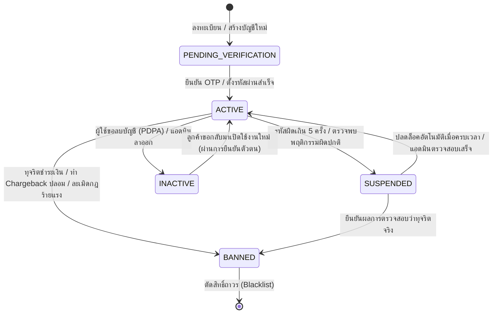

# Account Status Lifecycle Specification & Implementation Roadmap

เอกสารข้อกำหนดเชิงเทคนิค (System Specification) และรายการสิ่งที่ต้องทำ (Todo Checklist) สำหรับการจัดการวงจรชีวิตสถานะบัญชี (Account Status Lifecycle) ของแพลตฟอร์ม Nida Platform ครอบคลุมทั้งลูกค้าหน้าร้าน (`User`) และผู้ดูแลระบบหลังบ้าน (`AdminUser`) พร้อมแนวทางการต่อยอดสู่โมเดลสถานะอื่นๆ ในอนาคต

---

## 1. ปรัชญาการออกแบบและขอบเขต (Design Principles & Scope)



### หลักการสำคัญ (Core Rules):

1. **Fail-Closed Security**: บัญชีที่ไม่ใช่สถานะ `ACTIVE` จะต้อง**ถูกปฏิเสธการทำธุรกรรมหรือเรียกใช้ API หลักทันที** (ยกเว้น Endpoints สำหรับการยืนยันตัวตนหรือชำระส่วนที่ค้าง)
2. **Immediate Session Eviction**: เมื่อสถานะของบัญชีเปลี่ยนเป็น `SUSPENDED` หรือ `BANNED` ตัว Token ทั้งหมดใน Redis Session / Cache จะต้องถูก Revoke ทันทีภายในเสี้ยววินาที ไม่รอให้ JWT หมดอายุ
3. **Data Retention & PDPA Compliance**: การเปลี่ยนเป็น `INACTIVE` (ลบบัญชี) จะไม่ทำการ `DELETE` ข้อมูลออกจาก Database (Hard Delete) เพื่อรักษาประวัติคำสั่งซื้อและใบกำกับภาษีตามกฎหมาย แต่จะทำการ Anonymize ข้อมูลส่วนบุคคล (PII) แทน

---

## 2. นิยามสถานะบัญชี (AccountStatus Enum Specification)

| รหัสสถานะ (Enum Value)     | สี Badge (UI) | สิทธิ์การเข้าถึง (Privileges)             | เงื่อนไขการเกิดสถานะ (Trigger Condition)                                                          |
| :------------------------- | :-----------: | :---------------------------------------- | :------------------------------------------------------------------------------------------------ |
| **`PENDING_VERIFICATION`** |   สีฟ้า 🔵    | เข้าได้เฉพาะหน้ายืนยัน OTP / ตั้งรหัสผ่าน | • สมัครสมาชิกใหม่แต่ยังไม่ยืนยันอีเมล<br>• แอดมินถูกเชิญเข้าสู่ระบบรอบแรก                         |
| **`ACTIVE`**               |  สีเขียว 🟢   | ใช้งานได้เต็มสิทธิ์ตามบทบาท (Full Access) | • ยืนยัน OTP สำเร็จ<br>• แอดมินตั้งรหัสผ่านสมบูรณ์<br>• บัญชีได้รับการปลดล็อค                     |
| **`SUSPENDED`**            |   สีส้ม 🟡    | เข้าสู่ระบบไม่ได้ชั่วคราว                 | • กรอกรหัสผ่านผิดติดต่อกัน 5 ครั้ง (ล็อค 15 นาที)<br>• ฝ่ายตรวจสอบ Fraud สั่งพักการใช้งานชั่วคราว |
| **`BANNED`**               |   สีแดง 🔴    | บล็อกถาวร ตัดสิทธิ์ทุกบริการ              | • ทุจริตเงิน/บัตรเครดิต<br>• แกล้งสั่งซื้อเพื่อกั๊กสต็อก<br>• ละเมิดข้อกำหนดร้ายแรง               |
| **`INACTIVE`**             |   สีเทา ⚪    | ปิดการใช้งานถาวร แต่คงประวัติไว้          | • ลูกค้าขอยกเลิกบัญชีตามสิทธิ์ PDPA<br>• พนักงานลาออกจากบริษัท                                    |

---

## 3. การออกแบบ Schema ในระดับฐานข้อมูล (Prisma Schema Spec)

### 3.1 การประกาศ Enum

```prisma
enum AccountStatus {
  ACTIVE
  PENDING_VERIFICATION
  SUSPENDED
  BANNED
  INACTIVE
}
```

### 3.2 ฟิลด์ที่ต้องเพิ่มในตาราง `users` (ลูกค้าหน้าร้าน)

```prisma
model User {
  // ... fields เดิม ...
  status          AccountStatus   @default(PENDING_VERIFICATION)
  statusReason    String?         @map("status_reason") @db.VarChar(255)
  suspendedAt     DateTime?       @map("suspended_at")
  suspendedUntil  DateTime?       @map("suspended_until")

  // @@index([status]) เพื่อการค้นหาและกรองที่รวดเร็ว
  @@index([status])
  @@map("users")
}
```

### 3.3 ฟิลด์ที่ต้องปรับในตาราง `admin_users` (ทีมงานหลังบ้าน)

```prisma
model AdminUser {
  // ... fields เดิม ...
  // แปลงจาก isActive เดิมเป็น status เพื่อความสม่ำเสมอ
  status          AccountStatus   @default(PENDING_VERIFICATION)
  statusReason    String?         @map("status_reason") @db.VarChar(255)
  suspendedAt     DateTime?       @map("suspended_at")
  suspendedUntil  DateTime?       @map("suspended_until")

  @@index([status])
  @@map("admin_users")
}
```

---

## 4. มาตรฐานสัญญา API Response เมื่อถูก Guard ดัก (Error Contract)

เมื่อ Request ถูก `AccountStatusGuard` บล็อก ระบบจะตอบกลับด้วยรูปแบบมาตรฐาน (RFC 7807) เพื่อให้ฝั่ง Frontend (`apps/store` / `apps/admin`) นำ Error Code ไปแสดงผล Modal หรือ Redirect ได้อย่างถูกต้อง:

### 4.1 กรณีบัญชีถูกระงับชั่วคราว (HTTP 403 Forbidden)

```json
{
  "statusCode": 403,
  "errorCode": "ACCOUNT_SUSPENDED",
  "message": "บัญชีของคุณถูกระงับการใช้งานชั่วคราว",
  "details": {
    "reason": "กรอกรหัสผ่านผิดเกินกำหนด 5 ครั้ง",
    "suspendedUntil": "2026-11-02T23:15:00.000Z",
    "retryAfterSeconds": 900
  }
}
```

### 4.2 กรณีบัญชีถูกแบนถาวร (HTTP 403 Forbidden)

```json
{
  "statusCode": 403,
  "errorCode": "ACCOUNT_BANNED",
  "message": "บัญชีของคุณถูกระงับการให้บริการถาวรเนื่องจากละเมิดเงื่อนไขการใช้งาน",
  "details": {
    "supportEmail": "support@nida-apparel.com"
  }
}
```

### 4.3 กรณีบัญชีรอยืนยัน OTP (HTTP 403 Forbidden)

```json
{
  "statusCode": 403,
  "errorCode": "ACCOUNT_UNVERIFIED",
  "message": "กรุณายืนยันรหัส OTP เพื่อเปิดใช้งานบัญชีของคุณก่อนทำรายการ",
  "details": {
    "verifyUrl": "/verify-otp"
  }
}
```

---

## 5. แผนงานและรายการสิ่งที่ต้องทำ (Implementation Checklist)

### 📌 เฟส 1: Database & Migration Architecture

- [x] **1.1 เพิ่ม Enum และฟิลด์ใหม่ใน `packages/database/prisma/schema.prisma`**
  - เพิ่ม `enum AccountStatus` (`ACTIVE`, `PENDING_VERIFICATION`, `SUSPENDED`, `BANNED`, `INACTIVE`)
  - เพิ่มฟิลด์ `status`, `statusReason`, `suspendedAt`, `suspendedUntil` ในโมเดล `User` และ `AdminUser` พร้อม Index `@@index([status])`
- [x] **1.2 เขียน Migration File พร้อม Data Backfill Strategy และ Clean Dropping Redundant Columns**
  - สร้าง migration `20261103201500_add_account_status_lifecycle` และ Deploy ขึ้นฐานข้อมูลจริงสำเร็จ
  - แมปข้อมูลเดิมของ `admin_users`:
    - `isActive = true` ➔ `status = 'ACTIVE'`
    - `isActive = false` ➔ `status = 'INACTIVE'`
  - แมปข้อมูลเดิมของ `users`:
    - `isVerified = true` ➔ `status = 'ACTIVE'`
    - `isVerified = false` ➔ `status = 'PENDING_VERIFICATION'`
  - สร้าง migration `20261103205000_remove_is_verified_and_is_active` และลบฟิลด์ซ้ำซ้อน `users.is_verified` และ `admin_users.is_active` ออกจาก DB, Schema, Types และ Codebase ทั้งหมด 100% ป้องกัน Split-Brain State เรียบร้อย
- [x] **1.3 อัปเดต `@repo/types` และ `@repo/validators`**
  - ส่งออก `AccountStatus` และสัญญา `AccountStatusErrorResponse` ใน `@repo/types`
  - สร้าง Zod Schema `updateAccountStatusSchema` และ DTO `UpdateAccountStatusInput` ใน `@repo/validators` พร้อมบังคับระบุ `statusReason`
  - ปรับปรุง Test Cases และ Types ในทุกโมดูล รองรับ 100% Unit Test Pass & Build ผ่านทุก Workspace

---

### 📌 เฟส 2: Backend Guards & Security Interceptors (การสร้าง Guard ป้องกัน API)

> **เป้าหมาย:** สกัดกั้น Request ที่มาจากบัญชีที่ไม่ใช่ `ACTIVE` ไม่ให้เข้าถึง Business Logic ใดๆ พร้อมส่ง Error Code ที่ชัดเจน

- [x] **2.1 สร้าง `AccountStatusGuard` กลาง และ Decorators สำหรับควบคุม Endpoint**
  - **สร้าง Decorator:** `@RequireAccountStatus(...statuses: AccountStatus[])` และ `@AllowPendingVerification()`
  - **สร้าง Guard:** `AccountStatusGuard` (Implement `CanActivate`) สำหรับตรวจสอบสถานะบัญชีหลังผ่าน Passport JWT:
    - **กรณี `ACTIVE`:** อนุญาตให้ผ่าน (`return true`)
    - **กรณี `SUSPENDED`:**
      - ตรวจสอบ `suspendedUntil`:
        - หาก `new Date() < user.suspendedUntil`: โยน `ForbiddenException` (HTTP 403) รหัส `ACCOUNT_SUSPENDED` พร้อมระบุเวลาปลดล็อคและเหตุผล
        - หาก `new Date() >= user.suspendedUntil`: ทำ **Auto-Heal / Auto-Reactivate** อัปเดตสถานะกลับเป็น `ACTIVE` ใน DB ทันที และอนุญาตให้ Request ดำเนินการต่อได้อย่างไร้รอยต่อ
    - **กรณี `BANNED`:** โยน `ForbiddenException` (HTTP 403) รหัส `ACCOUNT_BANNED` (`This account has been permanently banned`)
    - **กรณี `PENDING_VERIFICATION`:**
      - ถ้า Endpoint มี `@AllowPendingVerification()` (เช่น Route สำหรับยืนยัน OTP `/auth/otp/verify` หรือขอ OTP ซ้ำ) ➔ อนุญาตให้ผ่าน
      - ถ้าเป็น Endpoint อื่นๆ (เช่น กดสั่งซื้อ `/orders`, ดู Wishlist `/wishlist`, เพิ่มสินค้าลงตะกร้า) ➔ โยน `ForbiddenException` (HTTP 403) รหัส `ACCOUNT_UNVERIFIED`
    - **กรณี `INACTIVE`:** โยน `UnauthorizedException` (HTTP 401) รหัส `ACCOUNT_DEACTIVATED`
- [x] **2.2 ยกระดับ `CustomerJwtStrategy` (`apps/api`)**
  - ดึงฟิลด์ `status`, `statusReason`, `suspendedUntil` จาก Prisma ในขั้นตอน Validate Token
  - แนบข้อมูลสถานะเข้าไปใน `req.user` ให้ Guard นำไปตรวจสอบต่อได้โดยไม่ต้อง Query ซ้ำ
- [x] **2.3 ยกระดับ `JwtAuthGuard` & Strategy (`apps/admin-api`)**
  - แทนที่การเช็ค `admin.isActive: boolean` เดิม ด้วยการตรวจสอบ `admin.status === AccountStatus.ACTIVE`
  - อนุญาตให้บัญชีสถานะ `PENDING_VERIFICATION` เข้าถึงได้เฉพาะ Route `/auth/setup-password` เท่านั้น และบล็อกการเข้าถึง Route อื่นๆ ทั้งหมด (เช่น `/orders`, `/products`, `/analytics`)
- [x] **2.4 ระบบ Force Logout & Session Revocation ทันทีเมื่อสถานะเปลี่ยน**
  - เมื่อแอดมินกดเปลี่ยนสถานะผู้ใช้คนใดเป็น `SUSPENDED` หรือ `BANNED`:
    - สั่งลบ Redis Session / Refresh Token ของผู้ใช้นั้นทันที
    - ขึ้นบัญชีดำ Token เดิมใน Redis Blacklist ผ่าน `revokeAllUserSessions` และ Token revocation
- [x] **2.5 Auto-Lockout Integration (Brute-force Guard)**
  - ผูกระบบ Rate Limiter เข้ากับฟิลด์ `status`:
    - หากรหัสผ่านผิดเกิน 5 ครั้ง ให้เปลี่ยนสถานะเป็น `SUSPENDED` พร้อมตั้ง `suspendedUntil = now() + 15 นาที` บันทึกเหตุผล `Failed login attempts exceeded limit` ลงฐานข้อมูลจริง และบังคับ Logout ทุกอุปกรณ์ทันที

---

### 📌 เฟส 3: Back-Office Admin Controls (ระบบจัดการผู้ใช้และลูกค้าฝั่งหลังบ้าน)

#### 🔹 3.1 โมดูลจัดการลูกค้าฝั่ง Store สำหรับระบบหลังบ้าน (Store Customer Management Module)

> **เป้าหมาย:** ให้เจ้าหน้าที่แอดมินสามารถสืบค้น ดูข้อมูล ตรวจสอบประวัติ และควบคุมสถานะบัญชีของลูกค้าหน้าร้าน (`users` table) ได้อย่างปลอดภัยและมีประสิทธิภาพ

- [x] **3.1.1 Backend API Customer Module (`apps/admin-api/src/modules/customers/`)**
  - สร้าง `CustomersModule`, `CustomersService`, และ `CustomersController`
  - **`GET /admin/customers`**:
    - รองรับ Pagination (`page`, `limit`), Sorting (`createdAt`, `totalSpent`, `points`)
    - รองรับการค้นหา (Keyword Search: ชื่อ-นามสกุล, อีเมล, เบอร์โทรศัพท์)
    - รองรับการกรองตามสถานะ (`status`: `ACTIVE`, `PENDING_VERIFICATION`, `SUSPENDED`, `BANNED`, `INACTIVE`) และระดับสมาชิก (`tier`)
    - กฎ PDPA Masking: ซ่อนข้อมูลอ่อนไหว (PII) หากแอดมินไม่มีสิทธิ์ `CUSTOMERS_PII_READ` หรือไม่ใช่ `SUPER_ADMIN`
  - **`GET /admin/customers/:id`**:
    - ดึงข้อมูลเจาะลึกของลูกค้า: ข้อมูลโปรไฟล์, รายการที่อยู่จัดส่ง, ประวัติสถานะบัญชี, แต้มสะสม และสถิติคำสั่งซื้อ (จำนวนออเดอร์, ยอดสั่งซื้อรวม, วันที่สั่งซื้อล่าสุด)
  - **`PATCH /admin/customers/:id/status`**:
    - อัปเดตสถานะบัญชีลูกค้าผ่าน Zod schema `updateAccountStatusSchema`
    - กรณี `SUSPENDED`: รองรับการระบุ `durationMinutes` เพื่อคำนวณ `suspendedUntil` พร้อมบังคับกรอก `statusReason`
    - กรณี `BANNED`: บล็อกถาวร พร้อมระบุเหตุผล
    - กรณี `ACTIVE`: ปลดล็อคและล้าง `suspendedUntil` / `statusReason`
    - **Session Eviction:** สั่งเตะ Session ใน Redis ทันทีเมื่อเปลี่ยนสถานะ (`redis.revokeAllCustomerSessions(customerId)`) บังคับให้ลูกค้ารายนั้นหลุดออกจากระบบในทุกอุปกรณ์ทันที
    - **Audit Trail:** บันทึกประวัติการเปลี่ยนสถานะลง `admin_audit_logs` อัตโนมัติ (`targetTable = 'users'`)
  - **Unit Testing:** เขียนชุดทดสอบ `apps/admin-api/test/customers/customers.service.spec.ts` ครอบคลุม Happy Path, Input Validation, Role Guards, Session Eviction, และ Audit Log Recording (100% Pass)

- [x] **3.1.2 Frontend Admin Customer Page & UI Controls (`apps/admin`)**
  - **Navigation:** เพิ่มเมนู "Customers" (ลูกค้า) ในแถบเมนูหลัก [`AdminSidebar.tsx`](file:///Users/wiiznu/project/Nida_Project/apps/admin/src/components/layout/AdminSidebar.tsx) พร้อมไอคอน Lucide `Users` และกำหนดสิทธิ์การมองเห็น
  - **API Requester:** สร้าง `apps/admin/src/api/requester/customerRequester.ts` สำหรับเรียกใช้ API ฝั่งหลังบ้าน
  - **Page Component:** สร้าง [`AdminCustomers.tsx`](file:///Users/wiiznu/project/Nida_Project/apps/admin/src/pages/AdminCustomers.tsx) รองรับเส้นทาง `/admin/customers`:
    - ตารางแสดงรายการลูกค้า: Avatar ตัวอักษร, ชื่อ-นามสกุล, อีเมล, ระดับสมาชิก (Tier Pill), ยอดสั่งซื้อสะสม, สถานะบัญชีด้วย `<StatusBadge />`, และวันที่สมัคร
    - กล่องค้นหาและแถบตัวกรองสถานะบัญชีตามหลัก Editorial Luxury Design
    - Drawer หรือ Slide-over ดูโปรไฟล์ลูกค้าและประวัติคำสั่งซื้อ
  - **Action Modals:**
    - `CustomerSuspendModal`: เลือกจำนวนวันระงับบัญชี (1 วัน, 7 วัน, 30 วัน, หรือกำหนดเอง) พร้อมช่องกรอกเหตุผลที่จำเป็น
    - `CustomerBanModal`: กล่องยืนยันการแบนถาวรและบันทึกเหตุผล
    - `CustomerReactivateModal`: กล่องยืนยันการปลดล็อคบัญชีกลับมาใช้งาน
  - **i18n Localization:** จัดทำ Key แปลภาษาใน `th.json` และ `en.json` ครบถ้วน 100% สอดคล้องตามกฎ Zero Emojis

---

#### 🔹 3.2 ปรับปรุงหน้าจัดการเจ้าหน้าที่หลังบ้าน (Admin Staff Management UI)

- [x] **3.2.1 ปรับปรุงหน้า [`AdminUsers.tsx`](file:///Users/wiiznu/project/Nida_Project/apps/admin/src/pages/AdminUsers.tsx)**
  - แทนที่สวิตช์ Toggle เปิด/ปิดเดิม ด้วย `<StatusBadge />` สีมาตรฐาน (เขียว/ส้ม/แดง/เทา)
  - เพิ่มเมนู Action Dropdown และ Modal สำหรับจัดการสถานะของเจ้าหน้าที่:
    - **"Suspend Account"**: ระบุระยะเวลาและเหตุผล
    - **"Ban Account"**: ยืนยันการแบนถาวร
    - **"Reactivate Account"**: ปลดล็อคกลับมาใช้งาน
  - เชื่อมโยงเข้ากับ Endpoint `PATCH /admin/users/:id/status` ที่สร้างไว้แล้ว
- [x] **3.2.2 ความสอดคล้องด้านภาษาและ UI Guidelines**
  - จัดทำข้อความภาษาไทยและอังกฤษใน `locales/th.json` และ `locales/en.json` หมวด `adminUsers.*` แบบสมมาตร

---

### 📌 เฟส 4: Customer Storefront Handling (การจัดการข้อความแจ้งเตือนและสถานะบัญชีฝั่งหน้าร้านค้า)

- [x] **4.1 แสดงข้อความแจ้งเตือนและนาฬิกานับถอยหลังสดบนหน้าต่าง Auth และ Login ([AuthDrawer.tsx](file:///apps/store/src/components/layout/AuthDrawer.tsx))**
  - พัฒนาคอมโพเนนต์ `<AccountStatusAlert />` แสดงผลตามสถานะบัญชีจริงแบบ Editorial Luxury:
    - บัญชีติด `SUSPENDED`: แสดงนาฬิกานับถอยหลังสด (Live Countdown Timer `mm:ss`) อิงจาก `retryAfterSeconds` / `suspendedUntil` และแสดงเหตุผลการระงับ เมื่อครบเวลาจะขึ้นข้อความแจ้งให้สามารถลองเข้าสู่ระบบได้ทันที
    - บัญชีติด `BANNED`: แสดงกล่องแจ้งเตือนสีแดงสุภาพพร้อมเหตุผล และปุ่มติดต่อฝ่ายบริการลูกค้า (`mailto:support@nida-apparel.com`)
    - บัญชีติด `PENDING_VERIFICATION`: แสดงคำแนะนำให้ยืนยันตัวตนพร้อมปุ่มสลับไปกรอกรหัส OTP หรือขอส่งรหัสใหม่ทันที
    - บัญชีติด `INACTIVE`: แสดงคำแนะนำกรณีบัญชีถูกปิดการใช้งาน
- [x] **4.2 Global Mid-Session Interception ([AccountRestrictedModal.tsx](file:///apps/store/src/components/auth/AccountRestrictedModal.tsx) & [StoreLayout.tsx](file:///apps/store/src/components/layout/StoreLayout.tsx))**
  - ดักจับสัญญาณ HTTP 403 / 401 ใน `api/client.ts` เมื่อมี `code: 'ACCOUNT_SUSPENDED' | 'ACCOUNT_BANNED' | 'ACCOUNT_DEACTIVATED'`
  - ล้าง Token ออกจาก `localStorage` ทันที และส่ง Custom Event `nida:auth:account_restricted`
  - ให้ `AuthContext.tsx` รับ Event และเปิดโมดอล `<AccountRestrictedModal />` แจ้งเตือนลูกค้าอย่างชัดเจนและตัดกลับสู่ Guest Mode อย่างปลอดภัย
- [x] **4.3 ระบบแปลภาษา 2 ภาษา (i18n Localization)**
  - เพิ่ม Key แปลภาษาใน `locales/th.json` และ `locales/en.json` หมวด `auth.restricted.*` แบบสมมาตร 100% ปราศจาก Emoji

---

## 5. มาตรฐานสำหรับนำไปต่อยอดกับสถานะของระบบอื่นๆ (Pattern for Future Statuses)

เมื่อต้องการออกแบบวงจรชีวิตสถานะใหม่ในอนาคต (เช่น `VendorStatus`, `SubscriptionStatus`, `ReturnStatus`) ให้ปฏิบัติตามมาตรฐาน 4 ข้อนี้เสมอ:

1. **Explicit Enums Only**: ห้ามใช้ Boolean Flag คลุมเครือ (เช่น `isApproved`, `isDeleted`) แต่ให้ใช้ Finite State Enum เสมอ
2. **Transition Matrix**: ต้องมี Guard ตรวจสอบว่าสถานะ A สามารถเปลี่ยนไปเป็นสถานะ B ได้หรือไม่ (ห้ามกระโดดข้ามวงจรชีวิต เช่น จาก `BANNED` จะไม่สามารถเปลี่ยนเป็น `PENDING_VERIFICATION` ได้)
3. **Reason Tracking**: ทุกสถานะที่เป็น Negative Transition (เช่น `SUSPENDED`, `REJECTED`, `CANCELLED`) ต้องมีฟิลด์ `reason` เสมอ
4. **Audit Trail**: ทุกการเปลี่ยนสถานะของ Entity สำคัญต้องมี Event ถูกบันทึกลง Audit Log หรือประวัติไทม์ไลน์
