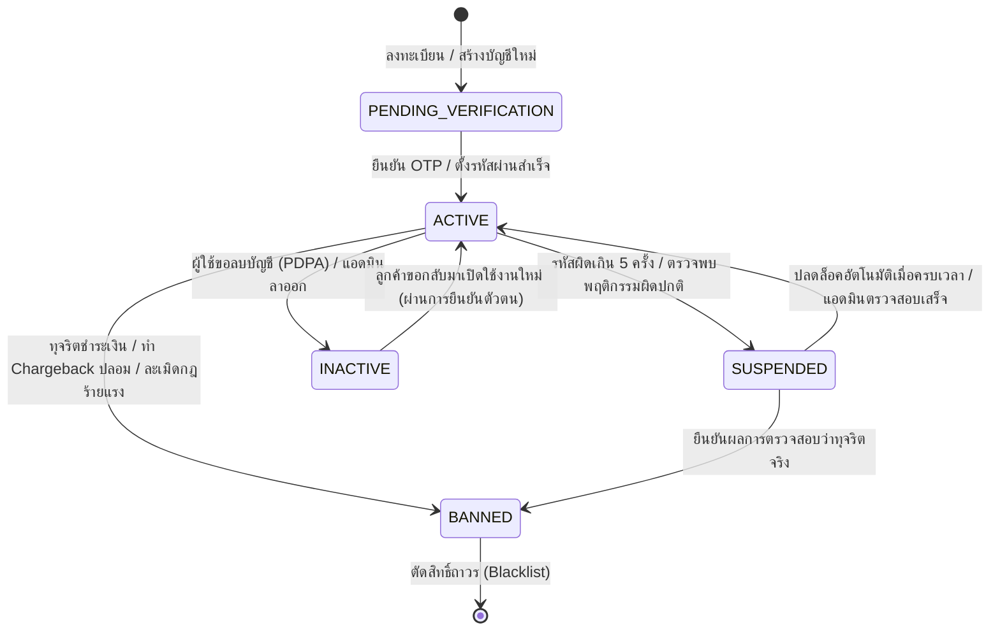

# Account Status Lifecycle Specification & Implementation Roadmap

เอกสารข้อกำหนดเชิงเทคนิค (System Specification) และรายการสิ่งที่ต้องทำ (Todo Checklist) สำหรับการจัดการวงจรชีวิตสถานะบัญชี (Account Status Lifecycle) ของแพลตฟอร์ม Nida Platform ครอบคลุมทั้งลูกค้าหน้าร้าน (`User`) และผู้ดูแลระบบหลังบ้าน (`AdminUser`) พร้อมแนวทางการต่อยอดสู่โมเดลสถานะอื่นๆ ในอนาคต

---

## 1. ปรัชญาการออกแบบและขอบเขต (Design Principles & Scope)



### หลักการสำคัญ (Core Rules):
1. **Fail-Closed Security**: บัญชีที่ไม่ใช่สถานะ `ACTIVE` จะต้อง**ถูกปฏิเสธการทำธุรกรรมหรือเรียกใช้ API หลักทันที** (ยกเว้น Endpoints สำหรับการยืนยันตัวตนหรือชำระส่วนที่ค้าง)
2. **Immediate Session Eviction**: เมื่อสถานะของบัญชีเปลี่ยนเป็น `SUSPENDED` หรือ `BANNED` ตัว Token ทั้งหมดใน Redis Session / Cache จะต้องถูก Revoke ทันทีภายในเสี้ยววินาที ไม่รอให้ JWT หมดอายุ
3. **Data Retention & PDPA Compliance**: การเปลี่ยนเป็น `INACTIVE` (ลบบัญชี) จะไม่ทำการ `DELETE` ข้อมูลออกจาก Database (Hard Delete) เพื่อรักษาประวัติคำสั่งซื้อและใบกำกับภาษีตามกฎหมาย แต่จะทำการ Anonymize ข้อมูลส่วนบุคคล (PII) แทน

---

## 2. นิยามสถานะบัญชี (AccountStatus Enum Specification)

| รหัสสถานะ (Enum Value) | สี Badge (UI) | สิทธิ์การเข้าถึง (Privileges) | เงื่อนไขการเกิดสถานะ (Trigger Condition) |
| :--- | :---: | :--- | :--- |
| **`PENDING_VERIFICATION`** | สีฟ้า 🔵 | เข้าได้เฉพาะหน้ายืนยัน OTP / ตั้งรหัสผ่าน | • สมัครสมาชิกใหม่แต่ยังไม่ยืนยันอีเมล<br>• แอดมินถูกเชิญเข้าสู่ระบบรอบแรก |
| **`ACTIVE`** | สีเขียว 🟢 | ใช้งานได้เต็มสิทธิ์ตามบทบาท (Full Access) | • ยืนยัน OTP สำเร็จ<br>• แอดมินตั้งรหัสผ่านสมบูรณ์<br>• บัญชีได้รับการปลดล็อค |
| **`SUSPENDED`** | สีส้ม 🟡 | เข้าสู่ระบบไม่ได้ชั่วคราว | • กรอกรหัสผ่านผิดติดต่อกัน 5 ครั้ง (ล็อค 15 นาที)<br>• ฝ่ายตรวจสอบ Fraud สั่งพักการใช้งานชั่วคราว |
| **`BANNED`** | สีแดง 🔴 | บล็อกถาวร ตัดสิทธิ์ทุกบริการ | • ทุจริตเงิน/บัตรเครดิต<br>• แกล้งสั่งซื้อเพื่อกั๊กสต็อก<br>• ละเมิดข้อกำหนดร้ายแรง |
| **`INACTIVE`** | สีเทา ⚪ | ปิดการใช้งานถาวร แต่คงประวัติไว้ | • ลูกค้าขอยกเลิกบัญชีตามสิทธิ์ PDPA<br>• พนักงานลาออกจากบริษัท |

---

## 3. การออกแบบ Schema ในระดับฐานข้อมูล (Prisma Schema Spec)

### 3.1 การประกาศ Enum
```prisma
enum AccountStatus {
  ACTIVE
  PENDING_VERIFICATION
  SUSPENDED
  BANNED
  INACTIVE
}
```

### 3.2 ฟิลด์ที่ต้องเพิ่มในตาราง `users` (ลูกค้าหน้าร้าน)
```prisma
model User {
  // ... fields เดิม ...
  status          AccountStatus   @default(PENDING_VERIFICATION)
  statusReason    String?         @map("status_reason") @db.VarChar(255)
  suspendedAt     DateTime?       @map("suspended_at")
  suspendedUntil  DateTime?       @map("suspended_until")
  
  // @@index([status]) เพื่อการค้นหาและกรองที่รวดเร็ว
  @@index([status])
  @@map("users")
}
```

### 3.3 ฟิลด์ที่ต้องปรับในตาราง `admin_users` (ทีมงานหลังบ้าน)
```prisma
model AdminUser {
  // ... fields เดิม ...
  // แปลงจาก isActive เดิมเป็น status เพื่อความสม่ำเสมอ
  status          AccountStatus   @default(PENDING_VERIFICATION)
  statusReason    String?         @map("status_reason") @db.VarChar(255)
  suspendedAt     DateTime?       @map("suspended_at")
  suspendedUntil  DateTime?       @map("suspended_until")

  @@index([status])
  @@map("admin_users")
}
```

---

## 4. มาตรฐานสัญญา API Response เมื่อถูก Guard ดัก (Error Contract)

เมื่อ Request ถูก `AccountStatusGuard` บล็อก ระบบจะตอบกลับด้วยรูปแบบมาตรฐาน (RFC 7807) เพื่อให้ฝั่ง Frontend (`apps/store` / `apps/admin`) นำ Error Code ไปแสดงผล Modal หรือ Redirect ได้อย่างถูกต้อง:

### 4.1 กรณีบัญชีถูกระงับชั่วคราว (HTTP 403 Forbidden)
```json
{
  "statusCode": 403,
  "errorCode": "ACCOUNT_SUSPENDED",
  "message": "บัญชีของคุณถูกระงับการใช้งานชั่วคราว",
  "details": {
    "reason": "กรอกรหัสผ่านผิดเกินกำหนด 5 ครั้ง",
    "suspendedUntil": "2026-11-02T23:15:00.000Z",
    "retryAfterSeconds": 900
  }
}
```

### 4.2 กรณีบัญชีถูกแบนถาวร (HTTP 403 Forbidden)
```json
{
  "statusCode": 403,
  "errorCode": "ACCOUNT_BANNED",
  "message": "บัญชีของคุณถูกระงับการให้บริการถาวรเนื่องจากละเมิดเงื่อนไขการใช้งาน",
  "details": {
    "supportEmail": "support@nida-apparel.com"
  }
}
```

### 4.3 กรณีบัญชีรอยืนยัน OTP (HTTP 403 Forbidden)
```json
{
  "statusCode": 403,
  "errorCode": "ACCOUNT_UNVERIFIED",
  "message": "กรุณายืนยันรหัส OTP เพื่อเปิดใช้งานบัญชีของคุณก่อนทำรายการ",
  "details": {
    "verifyUrl": "/verify-otp"
  }
}
```

---

## 5. แผนงานและรายการสิ่งที่ต้องทำ (Implementation Checklist)

### 📌 เฟส 1: Database & Migration Architecture
- [ ] **1.1 เพิ่ม Enum และฟิลด์ใหม่ใน `packages/database/prisma/schema.prisma`**
  - เพิ่ม `enum AccountStatus`
  - เพิ่มฟิลด์ `status`, `statusReason`, `suspendedAt`, `suspendedUntil` ในโมเดล `User` และ `AdminUser`
- [ ] **1.2 เขียน Migration File พร้อม Data Backfill Strategy**
  - แมปข้อมูลเดิมของ `admin_users`: 
    - `isActive = true` ➔ `status = 'ACTIVE'`
    - `isActive = false` ➔ `status = 'PENDING_VERIFICATION'` (กรณีเพิ่งเชิญ) หรือ `'INACTIVE'`
  - แมปข้อมูลเดิมของ `users`:
    - `isVerified = true` ➔ `status = 'ACTIVE'`
    - `isVerified = false` ➔ `status = 'PENDING_VERIFICATION'`
- [ ] **1.3 อัปเดต `@repo/types` และ `@repo/validators`**
  - ส่งออก `AccountStatus` ใน `@repo/types`
  - สร้าง Zod Schema สำหรับการเปลี่ยนสถานะผู้ใช้ (เช่น `updateUserStatusSchema`) พร้อมบังคับระบุ `statusReason`

---

### 📌 เฟส 2: Backend Guards & Security Interceptors (การสร้าง Guard ป้องกัน API)
> **เป้าหมาย:** สกัดกั้น Request ที่มาจากบัญชีที่ไม่ใช่ `ACTIVE` ไม่ให้เข้าถึง Business Logic ใดๆ พร้อมส่ง Error Code ที่ชัดเจน

- [ ] **2.1 สร้าง `AccountStatusGuard` กลาง และ Decorators สำหรับควบคุม Endpoint**
  - **สร้าง Decorator:** `@RequireAccountStatus(...statuses: AccountStatus[])` และ `@AllowPendingVerification()`
  - **สร้าง Guard:** `AccountStatusGuard` (Implement `CanActivate`) สำหรับตรวจสอบสถานะบัญชีหลังผ่าน Passport JWT:
    - **กรณี `ACTIVE`:** อนุญาตให้ผ่าน (`return true`)
    - **กรณี `SUSPENDED`:**
      - ตรวจสอบ `suspendedUntil`:
        - หาก `new Date() < user.suspendedUntil`: โยน `ForbiddenException` (HTTP 403) รหัส `ACCOUNT_SUSPENDED` พร้อมระบุเวลาปลดล็อคและเหตุผล
        - หาก `new Date() >= user.suspendedUntil`: ทำ **Auto-Heal / Auto-Reactivate** อัปเดตสถานะกลับเป็น `ACTIVE` ใน DB ทันที และอนุญาตให้ Request ดำเนินการต่อได้อย่างไร้รอยต่อ
    - **กรณี `BANNED`:** โยน `ForbiddenException` (HTTP 403) รหัส `ACCOUNT_BANNED` (`This account has been permanently banned`)
    - **กรณี `PENDING_VERIFICATION`:**
      - ถ้า Endpoint มี `@AllowPendingVerification()` (เช่น Route สำหรับยืนยัน OTP `/auth/otp/verify` หรือขอ OTP ซ้ำ) ➔ อนุญาตให้ผ่าน
      - ถ้าเป็น Endpoint อื่นๆ (เช่น กดสั่งซื้อ `/orders`, ดู Wishlist `/wishlist`, เพิ่มสินค้าลงตะกร้า) ➔ โยน `ForbiddenException` (HTTP 403) รหัส `ACCOUNT_UNVERIFIED`
    - **กรณี `INACTIVE`:** โยน `UnauthorizedException` (HTTP 401) รหัส `ACCOUNT_DEACTIVATED`
- [ ] **2.2 ยกระดับ `CustomerJwtStrategy` (`apps/api`)**
  - ดึงฟิลด์ `status`, `statusReason`, `suspendedUntil` จาก Prisma ในขั้นตอน Validate Token
  - แนบข้อมูลสถานะเข้าไปใน `req.user` ให้ Guard นำไปตรวจสอบต่อได้โดยไม่ต้อง Query ซ้ำ
- [ ] **2.3 ยกระดับ `JwtAuthGuard` & Strategy (`apps/admin-api`)**
  - แทนที่การเช็ค `admin.isActive: boolean` เดิม ด้วยการตรวจสอบ `admin.status === AccountStatus.ACTIVE`
  - อนุญาตให้บัญชีสถานะ `PENDING_VERIFICATION` เข้าถึงได้เฉพาะ Route `/auth/setup-password` เท่านั้น และบล็อกการเข้าถึง Route อื่นๆ ทั้งหมด (เช่น `/orders`, `/products`, `/analytics`)
- [ ] **2.4 ระบบ Force Logout & Session Revocation ทันทีเมื่อสถานะเปลี่ยน**
  - เมื่อแอดมินกดเปลี่ยนสถานะผู้ใช้คนใดเป็น `SUSPENDED` หรือ `BANNED`:
    - สั่งลบ Redis Session / Refresh Token ของผู้ใช้นั้นทันที
    - ขึ้นบัญชีดำ Token เดิมใน Redis Blacklist (`redis.setex('bl:token:<jti>', remainingTtl, 'revoked')`)
- [ ] **2.5 Auto-Lockout Integration (Brute-force Guard)**
  - ผูกระบบ Rate Limiter เข้ากับฟิลด์ `status`:
    - หากรหัสผ่านผิดเกิน 5 ครั้ง ให้เปลี่ยนสถานะเป็น `SUSPENDED` พร้อมตั้ง `suspendedUntil = now() + 15 นาที` บันทึกเหตุผล `Failed login attempts exceeded limit`

---

### 📌 เฟส 3: Back-Office Admin UI Controls
- [ ] **3.1 ปรับปรุงหน้าจัดการสมาชิก ([apps/admin/src/pages/AdminUsers.tsx](file:///Users/wiiznu/project/Nida_Project/apps/admin/src/pages/AdminUsers.tsx))**
  - แสดงสถานะด้วย Component `<StatusBadge />` สีมาตรฐาน (เขียว/ส้ม/แดง/เทา)
  - เพิ่มปุ่ม Action:
    - **"Suspend Account"**: เปิด Modal ให้ระบุระยะเวลาและเหตุผล
    - **"Ban Account"**: ยืนยันการแบนถาวร
    - **"Reactivate Account"**: ปลดล็อคกลับมาใช้งาน
- [ ] **3.2 บันทึก Audit Trail**
  - ทุกการเปลี่ยนแปลงสถานะบัญชีต้องบันทึกลง `AdminAuditLog` โดยระบุ `adminId`, `targetUserId`, `previousStatus`, `newStatus`, และ `statusReason`

---

### 📌 เฟส 4: Customer Storefront Handling
- [ ] **4.1 แสดงข้อความแจ้งเตือนที่เข้าใจง่ายบนหน้า Login หน้าร้าน**
  - บัญชีติด `PENDING_VERIFICATION`: *"กรุณายืนยันรหัส OTP เพื่อเปิดใช้งานบัญชี"* พร้อมปุ่มส่งรหัสใหม่
  - บัญชีติด `SUSPENDED`: *"บัญชีของคุณถูกระงับชั่วคราวเนื่องจากความปลอดภัย สามารถลองใหม่ได้ในอีก X นาที"*
  - บัญชีติด `BANNED`: *"บัญชีนี้ถูกระงับการให้บริการถาวร กรุณาติดต่อฝ่ายบริการลูกค้าที่ support@nida-apparel.com"*

---

## 5. มาตรฐานสำหรับนำไปต่อยอดกับสถานะของระบบอื่นๆ (Pattern for Future Statuses)

เมื่อต้องการออกแบบวงจรชีวิตสถานะใหม่ในอนาคต (เช่น `VendorStatus`, `SubscriptionStatus`, `ReturnStatus`) ให้ปฏิบัติตามมาตรฐาน 4 ข้อนี้เสมอ:

1. **Explicit Enums Only**: ห้ามใช้ Boolean Flag คลุมเครือ (เช่น `isApproved`, `isDeleted`) แต่ให้ใช้ Finite State Enum เสมอ
2. **Transition Matrix**: ต้องมี Guard ตรวจสอบว่าสถานะ A สามารถเปลี่ยนไปเป็นสถานะ B ได้หรือไม่ (ห้ามกระโดดข้ามวงจรชีวิต เช่น จาก `BANNED` จะไม่สามารถเปลี่ยนเป็น `PENDING_VERIFICATION` ได้)
3. **Reason Tracking**: ทุกสถานะที่เป็น Negative Transition (เช่น `SUSPENDED`, `REJECTED`, `CANCELLED`) ต้องมีฟิลด์ `reason` เสมอ
4. **Audit Trail**: ทุกการเปลี่ยนสถานะของ Entity สำคัญต้องมี Event ถูกบันทึกลง Audit Log หรือประวัติไทม์ไลน์

