# แผนงานเตรียมความพร้อมสู่การใช้งานจริง (Production Go-Live Readiness Roadmap & Checklist)

เอกสารรวบรวมแผนงานการพัฒนา ขอบเขตความต้องการเชิงปฏิบัติการ และรายการตรวจสอบอย่างละเอียด (Actionable Production Checklist) สำหรับการนำ **Nida Platform (Luxury E-Commerce Monorepo)** ก้าวสู่สถานะ **Production-Ready 100% พร้อมเปิดรับคำสั่งซื้อจากลูกค้าจริง** อย่างมีเสถียรภาพ ปลอดภัย และไร้รอยต่อ

---

## 📊 ตารางสถานะความพร้อมสู่ Production (Go-Live Readiness Matrix)

| เสาหลักความพร้อม (Pillar) | สถานะความพร้อม | รายละเอียดสิ่งที่ต้องดำเนินการ |
| :--- | :---: | :--- |
| **1. Transactional Email & Notifications** | ⏳ รอดำเนินการ | เชื่อมต่อเทมเพลตอีเมลแจ้งสถานะจัดส่งพัสดุ (Tracking), ใบเสร็จ/ใบกำกับภาษี PDF, และการคืนเงินผ่าน Resend |
| **2. Production Deployment & CI/CD** | ⏳ รอดำเนินการ | Multi-stage Dockerfile ทั้ง 4 แอป, Docker Compose Production, Nginx Reverse Proxy + SSL, และ Environment Checklist |
| **3. Storefront Live CMS Integration** | ⏳ รอดำเนินการ | เชื่อมต่อ Hero Billboard, Promo Bar, และ Collection Tiles หน้าร้าน ให้ดึงแบนเนอร์จริงจาก DB 100% |
| **4. E2E Production Smoke Test** | ⏳ รอดำเนินการ | ซิมูเลชันการสั่งซื้อและ Fulfillment ครบวงจร (Customer Checkout ➔ Omise ➔ Tax Invoice ➔ Courier ➔ Review) |

---

## 🎯 แผนภาพการปฏิบัติการสู่การเปิดตัว (Go-Live Operational Architecture)

```mermaid
graph TD
    subgraph "1. Customer Notifications"
        A[ออเดอร์ชำระเงินสำเร็จ] -->|แนบ Tax Invoice PDF| B[อีเมลยืนยันคำสั่งซื้อและใบเสร็จรับเงิน]
        C[แอดมินจัดส่งสินค้าและกรอกเลขพัสดุ] -->|แนบ Tracking Link| D[อีเมลแจ้งเตือนพัสดุจัดส่ง Order Shipped]
        E[อนุมัติการคืนสินค้าสำเร็จ] -->|สรุปยอดคืนเงิน Omise| F[อีเมลยืนยันการคืนเงิน Refund Notice]
    end

    subgraph "2. Live CMS Synchronization"
        G[แอดมินจัดการแบนเนอร์ใน Admin CMS] -->|บันทึก CmsBanner / StoreSettings| H[Redis Cache Invalidation]
        H -->|ดึงข้อมูลสด| I[หน้าร้าน: Hero Billboard, Promo Bar, Discovery Tiles]
    end

    subgraph "3. Production Infrastructure"
        J[Git Release Tag / Branch] --> K[CI/CD Pipeline: Test & TypeCheck]
        K --> L[Multi-Stage Docker Build]
        L --> M[Prisma Migrate Deploy]
        M --> N[Zero-Downtime Deployment: Nginx + SSL Let's Encrypt]
    end

    subgraph "4. E2E Smoke Verification"
        O[ทดสอบสั่งซื้อจริง Omise Sandbox] --> P[Fulfillment & พิมพ์ใบปะหน้าจริง]
        P --> Q[ลูกค้ากดยืนยันรับของ & รีวิวสินค้า 5 ดาว]
    end
```



---

## 📋 แผนงานสิ่งที่ต้องทำตามลำดับขั้นตอนอย่างละเอียด (Detailed Actionable Checklist)

---

### เสาหลักที่ 1: ระบบแจ้งเตือนทางอีเมลอัตโนมัติครบวงจร (Transactional Email & Customer Notifications)

> **เป้าหมาย**: ลูกค้าและแอดมินได้รับการสื่อสารอย่างเป็นมืออาชีพในทุกขั้นตอนสำคัญของการทำธุรกรรม ด้วยเทมเพลตอีเมลที่ออกแบบตามสไตล์ **Editorial Luxury Aesthetic** (ไม่มี Emoji, ดีไซน์โทนสี `#2B1810` และ `#FAF7F2`) ผ่าน Resend API

#### 1.1 อีเมลแจ้งเตือนเมื่อสินค้าถูกจัดส่ง (Order Shipped & Live Tracking Notification)
- [x] **Email Template**:
  - [x] สร้างเทมเพลตอีเมล `formatOrderShippedEmail` ใน `apps/api/src/core/mailer/email-templates.ts` และ `apps/admin-api/src/core/mailer/email-templates.ts`
  - [x] แสดงเลขออเดอร์, รายการสินค้าที่จัดส่ง, ผู้ให้บริการขนส่ง (Courier), และเลขพัสดุ (Tracking Number)
  - [x] เพิ่มปุ่ม Call-to-Action ขนาดใหญ่ "ติดตามพัสดุของคุณ (TRACK SHIPMENT)" สไตล์ Editorial Luxury (Zero Emojis)
- [x] **Trigger Integration**:
  - [x] เชื่อมต่อใน `apps/admin-api/src/modules/orders/orders.service.ts` ในฟังก์ชัน `fulfillWithCarrier()` และ `updateOrderStatus()`
  - [x] ส่งคำขอผ่าน `MailerService.sendOrderShippedEmail(order, shipment)` แบบ Non-blocking ทันทีเมื่อสถานะเปลี่ยนเป็น `SHIPPED`
  - [x] รองรับ Deep Link ติดตามพัสดุทั้งลิงก์ตรงของผู้ให้บริการขนส่ง (Flash, Kerry, Thailand Post, DHL) และหน้าร้าน NIDA
  - [x] Unit Test ครอบคลุมการส่งอีเมลแจ้งจัดส่งใน `orders.service.spec.ts` (32/32 tests pass)

#### 1.2 อีเมลส่งมอบใบเสร็จรับเงิน / ใบกำกับภาษีอิเล็กทรอนิกส์ (E-Tax Invoice & Receipt Delivery)
- [x] **Email Template**:
  - [x] สร้างเทมเพลตอีเมล `formatTaxInvoiceReceiptEmail` ใน `apps/api/src/core/mailer/email-templates.ts`
  - [x] สรุปข้อมูลผู้เสียภาษี (บุคคลธรรมดา/นิติบุคคล, เลข 13 หลัก, ที่อยู่), ฐานภาษี Pre-VAT, ยอด VAT 7%, และยอดสุทธิ พร้อมปุ่ม View Tax Invoice
- [x] **Trigger Integration**:
  - [x] เชื่อมต่อใน `apps/api/src/modules/orders/orders.service.ts` ในทุกจุดที่ได้รับยืนยันการชำระเงินสำเร็จ (`PaymentStatus.CAPTURED` ทั้ง `processOrderPayment`, `syncPromptPayStatus`, `simulateOmisePay`, และ `handleOmiseWebhook`)
  - [x] ออกเลขที่เอกสาร `INV-YYYYMM-XXXXX` ผ่าน `taxInvoiceService.issueTaxInvoiceForOrder()` และส่งอีเมลแจ้งลูกค้าอัตโนมัติ
  - [x] ทำงานแบบ Asynchronous Non-blocking และมี Unit Test รองรับใน `orders.service.spec.ts` (22/22 tests pass)

#### 1.3 อีเมลยืนยันการคืนเงินและการยกเลิกคำสั่งซื้อ (Cancellation & Refund Confirmation)
- [x] **Email Template**:
  - [x] สร้างเทมเพลตอีเมล `formatOrderCancelledEmail` และ `formatRefundProcessedEmail` ในทั้งสองบริการ API
  - [x] ระบุเหตุผลการยกเลิก/คืนเงิน, ยอดเงินที่ทำการ Refund, ช่องทางรับเงินคืน และระยะเวลาการปรับปรุงยอด (SLA)
- [x] **Trigger Integration**:
  - [x] เชื่อมต่อใน `apps/admin-api/src/modules/orders/orders.service.ts` เมื่อแอดมินอนุมัติคำขอยกเลิกหรือดำเนินการคืนเงินผ่าน Omise สำเร็จ (`processRefund`, `updateOrderStatus(CANCELLED)`, `reviewCancellationRequest(REJECT)`)
  - [x] เชื่อมต่อใน Auto-Cancel Worker (`order-timeout.worker.ts`) สำหรับออเดอร์ที่หมดเวลาชำระเงิน 15 นาที พร้อมส่งอีเมลแจ้งลูกค้าอัตโนมัติ
  - [x] Unit Test ครอบคลุมการส่งอีเมลใน `order-timeout.worker.spec.ts` (5/5 tests pass) และ `orders.service.spec.ts` (34/34 tests pass)

#### 1.4 อีเมลคำเชิญและตั้งรหัสผ่านสำหรับทีมงานแอดมิน (Admin Staff Invitation Email)
- [x] **Email Template**:
  - [x] ปรับปรุงเทมเพลตอีเมล `formatAdminInvitationEmail` ใน `apps/admin-api/src/core/mailer/email-templates.ts`
  - [x] แนบลิงก์สำหรับตั้งรหัสผ่านครั้งแรก พร้อมข้อความระบุอายุความปลอดภัย 24 ชั่วโมง
- [x] **Trigger Integration**:
  - [x] ส่งอีเมลทันทีเมื่อ Super Admin สั่งเชิญพนักงานใหม่ผ่าน `POST /admin/admin-users/invite`
  - [x] เก็บ Token ใน Redis (`admin:invite:{token}`) กำหนดอายุ 24 ชั่วโมง (86,400 วินาที) สอดคล้องกับข้อความในอีเมล
  - [x] ป้องกัน Spam ด้วย Rate Limiting สูงสุด 5 คำเชิญต่อนาทีต่อแอดมิน (`@RateLimit({ limit: 5, windowSeconds: 60, keyPrefix: 'admin:invite' })`)
  - [x] Unit Test ครอบคลุมการส่งอีเมลคำเชิญใน `admin-users.service.spec.ts` (8/8 tests pass)

#### 1.5 การยืนยันโดเมนส่งอีเมลในระดับ Production (Resend Domain Verification)
- [x] จัดทำข้อกำหนดและ Checklist ใน `docs/specs/mailer.md`:
  - [x] `TXT` record สำหรับ SPF (`v=spf1 include:resend.com ~all`)
  - [x] `CNAME` records สำหรับ DKIM Key rotation
  - [x] `TXT` record สำหรับ DMARC policy (`v=DMARC1; p=quarantine; pct=100; rua=mailto:dmarc-reports@nida.co`)
  - [x] สลับอีเมลผู้ส่งจาก `onboarding@resend.dev` เป็นโดเมนทางการผ่าน Environment Variables (`RESEND_FROM_EMAIL`, `ADMIN_RESEND_FROM_EMAIL`) พร้อม Non-blocking Fallback Mode เมื่อไม่มี API Key ใน Local/Test

---

### เสาหลักที่ 2: การจัดเตรียมโครงสร้างพื้นฐานและการนำขึ้นระบบจริง (Production Deployment & CI/CD Readiness)

> **เป้าหมาย**: สร้างสภาพแวดล้อม Production ที่สามารถรันได้อย่างเสถียร รองรับการสเกล และปลอดภัยตามมาตรฐานสากล ด้วย Docker Containerization และ Reverse Proxy

#### 2.1 Multi-Stage Production Dockerfiles
- [ ] **Backend APIs Dockerfiles**:
  - [ ] สร้าง `apps/api/Dockerfile.prod` (Node.js Alpine, Standalone bundle, non-root user `node`)
  - [ ] สร้าง `apps/admin-api/Dockerfile.prod`
  - [ ] ติดตั้งเฉพาะ `production` dependencies และ compile ด้วย Nest CLI ใน Stage builder
- [ ] **Frontend Applications Dockerfiles**:
  - [ ] สร้าง `apps/store/Dockerfile.prod` (Next.js Standalone Output Mode `output: 'standalone'` ใน `next.config.ts`, ปรับขนาดอิมเมจเหลือ < 150MB)
  - [ ] สร้าง `apps/admin/Dockerfile.prod` (Vite production build ➔ Nginx Alpine static serving)

#### 2.2 Orchestration & Reverse Proxy Configuration
- [ ] สร้าง `docker-compose.prod.yml`:
  - [ ] Services: `api` (port 4000), `admin-api` (port 4001), `admin-ui` (port 8080), `store-ui` (port 3000), `redis` (persistent volume)
  - [ ] Network Isolation: Internal network สำหรับ APIs และ Redis, External network สำหรับ Web Traffic
  - [ ] Healthcheck configuration สำหรับทุก Service
  - [ ] Resource Limits: กำหนด Memory Limit และ CPU Shares ป้องกัน Container OOM
- [ ] Reverse Proxy (Nginx / Caddy):
  - [ ] กำหนด SSL/TLS 1.3 Encryption อัตโนมัติด้วย Let's Encrypt Certbot
  - [ ] กำหนด Subdomain Mapping:
    - `nida.co` และ `www.nida.co` ➔ `store-ui` (Next.js)
    - `admin.nida.co` ➔ `admin-ui` (Vite SPA)
    - `api.nida.co` ➔ `api` (Storefront Customer API)
    - `admin-api.nida.co` ➔ `admin-api` (Back-Office API)
  - [ ] เปิดใช้งาน Gzip/Brotli compression และ WebSocket Proxy สำหรับ Next.js / Vite HMR (ถ้ามี)
  - [ ] กำหนดความปลอดภัย: `client_max_body_size 10M;`, ซ่อน Nginx Server Version Header

#### 2.3 Production Environment Variables & Secrets Checklist
- [ ] จัดทำเอกสาร `.env.production.example` ที่ระบุตัวแปรที่จำเป็นครบถ้วน:
  - [ ] **Database**: `DATABASE_URL` และ `DIRECT_URL` (พร้อม Connection Pooler เช่น PgBouncer / Supabase Pooler port 6543)
  - [ ] **Redis**: `REDIS_URL` หรือ `REDIS_HOST`, `REDIS_PORT`, `REDIS_PASSWORD` (รองรับ TLS `rediss://`)
  - [ ] **JWT Secrets**: สร้าง Random 64-byte Hex Strings ที่ปลอดภัยสูง:
    - `JWT_CUSTOMER_SECRET`
    - `JWT_ADMIN_SECRET`
  - [ ] **Payment Gateway (Omise)**:
    - สลับจาก `skey_test_...` และ `pkey_test_...` เป็น **Live Keys** (`skey_live_...`, `pkey_live_...`)
  - [ ] **Email (Resend)**:
    - `RESEND_API_KEY` (Production Key)
    - `EMAIL_FROM=NIDA Official <noreply@nida.co>`
  - [ ] **Media & Storage (Cloudinary)**:
    - `CLOUDINARY_CLOUD_NAME`, `CLOUDINARY_API_KEY`, `CLOUDINARY_API_SECRET`
  - [ ] **Bot Protection (Cloudflare Turnstile)**:
    - สลับเป็น Production Site Key & Secret Key ของโดเมนจริง
  - [ ] **CORS Origins**:
    - กำหนดเฉพาะโดเมนทางการ เช่น `https://nida.co,https://admin.nida.co` (ห้ามใช้ `*` ใน Production)

#### 2.4 กลยุทธ์การอัปเดต Database อัตโนมัติ (Database Migration Pipeline)
- [ ] กำหนดคำสั่งรัน Migration ก่อนเริ่ม Container:
  ```bash
  npx prisma migrate deploy --schema=packages/database/prisma/schema.prisma
  ```
- [ ] ห้ามรัน `prisma db push` ในสภาพแวดล้อม Production เด็ดขาด เพื่อป้องกัน Data Loss
- [ ] ตรวจสอบว่า Migration Files ทั้งหมดใน `packages/database/prisma/migrations/` ทำงานต่อเนื่องและเป็นลำดับที่ถูกต้อง

---

### เสาหลักที่ 3: ปรับปรุง Storefront CMS ให้ควบคุมหน้าแรกได้แบบ 100% (CMS Live Synchronization)

> **เป้าหมาย**: หน้าร้านค้าสะท้อนข้อมูลแคมเปญ แบนเนอร์ภาพสไลด์ และแถบประกาศโปรโมชันจากฐานข้อมูลจริง 100% โดยที่ฝ่ายการตลาดสามารถอัปเดตผ่าน Admin Back-Office ได้ตลอดเวลาโดยไม่ต้องแก้โค้ด

#### 3.1 Live Hero Billboard Carousel (`apps/store`)
- [ ] ปรับปรุง [`HeroBillboard.tsx`](file:///apps/store/src/components/home/HeroBillboard.tsx):
  - [ ] ดึงข้อมูลแบนเนอร์สดจาก API `GET /api/v1/content/home` หรือ `contentRequester.getHomeContent()`
  - [ ] กรองเฉพาะแบนเนอร์ที่ `isActive: true` และอยู่ในช่วงวันที่แคมเปญ (`startDate <= now <= endDate`)
  - [ ] จัดเรียงสไลด์ตามลำดับ `sortOrder`
  - [ ] รองรับรูปภาพ Responsive ทั้ง Desktop (`imageUrl`) และ Mobile (`mobileImageUrl`)
  - [ ] เชื่อมต่อปุ่ม Action Link (CTA Button) ให้กดแล้วพาไปยัง URL หรือคอลเลกชันเป้าหมายจริง

#### 3.2 Dynamic Promo Ribbon & Announcement Bar
- [ ] ปรับปรุง [`PromoRibbon.tsx`](file:///apps/store/src/components/home/PromoRibbon.tsx) และแถบประกาศด้านบน Header:
  - [ ] ดึงข้อความประกาศโปรโมชันจาก `StoreSettings` ในฐานข้อมูล
  - [ ] รองรับการแสดงผล 2 ภาษา (TH / EN) ตามที่ผู้ดูแลระบบตั้งค่าไว้ในหลังบ้าน
  - [ ] ซ่อนแถบประกาศอัตโนมัติหากแอดมินปิดการใช้งาน (`promoBarActive: false`)

#### 3.3 Dynamic Category Discovery Tiles
- [ ] ปรับปรุง [`CategoryDiscoveryTiles.tsx`](file:///apps/store/src/components/home/CategoryDiscoveryTiles.tsx):
  - [ ] เชื่อมต่อภาพแบนเนอร์และชื่อหมวดหมู่กับโมเดล `Category` ในฐานข้อมูลจริง
  - [ ] กดแล้วนำทางไปยังหน้ารวมสินค้าตามแผนกและหมวดหมู่นั้นๆ ทันที

---

### เสาหลักที่ 4: การทดสอบความสมบูรณ์และจำลองสถานการณ์จริง (End-to-End Smoke Test & Security Audit)

> **เป้าหมาย**: ตรวจสอบการทำงานของทุกระบบร่วมกันตั้งแต่ต้นน้ำจนถึงปลายน้ำ ด้วยข้อมูลธุรกรรมจริงในโหมด Sandbox / Production Staging ก่อนเปิดตัวสู่สาธารณะ

#### 4.1 จำลองกระบวนการสั่งซื้อและชำระเงินของลูกค้า (Customer Checkout E2E)
- [ ] **Flow 1: สมาชิกสั่งซื้อผ่านบัตรเครดิต**:
  - [ ] สมัครสมาชิกใหม่ ➔ รับ OTP ทางอีเมล ➔ ยืนยันตัวตนสำเร็จ
  - [ ] เลือกสินค้า (ระบุ สี และ ไซส์) ➔ ตรวจสอบสต็อก ➔ เพิ่มลงตะกร้า
  - [ ] ใช้คูปองส่วนลด ➔ ยืนยันยอดลดราคาถูกต้องตามเงื่อนไข
  - [ ] ขอใบกำกับภาษีเต็มรูป (เลือกนิติบุคคล: กรอกเลขประจำตัวผู้เสียภาษี 13 หลัก, สาขา, ที่อยู่)
  - [ ] ชำระเงินด้วยบัตรเครดิตผ่าน Omise ➔ ระบบเปลี่ยนสถานะเป็น `PAID` ทันที
  - [ ] สต็อกสินค้าถูกตัดลดจำนวนลงทันที และเกิดเลขใบกำกับภาษี `INV-YYYYMM-XXXXX`

- [ ] **Flow 2: สั่งซื้อผ่าน PromptPay QR Code**:
  - [ ] สร้างออเดอร์ ➔ หน้าจอแสดง QR Code พร้อมยอดชำระที่ถูกต้อง
  - [ ] ทดสอบปล่อยให้ออเดอร์หมดเวลา 15 นาที ➔ BullMQ Worker ทำการยกเลิกออเดอร์อัตโนมัติ (`CANCELLED`) และคืนสต็อกกลับเข้าคลัง

#### 4.2 จำลองกระบวนการจัดการคำสั่งซื้อและจัดส่งของแอดมิน (Admin Fulfillment E2E)
- [ ] แอดมินล็อกอินเข้าสู่ระบบ Back-Office (`apps/admin`)
- [ ] ตรวจสอบรายการคำสั่งซื้อใหม่ในหน้า Admin Orders
- [ ] พิมพ์เอกสารสำหรับจัดเตรียมสินค้า:
  - [ ] พิมพ์ใบ Packing Slip ขนาด A4 แสดงรายการสินค้าและ SKU ถูกต้อง
  - [ ] พิมพ์ใบกำกับภาษีเต็มรูปแบบ A4 แสดงข้อมูลครบถ้วนตาม ม.86/4
- [ ] ทำการจัดส่งสินค้า:
  - [ ] เลือกผู้ให้บริการขนส่ง (Flash Express) และกรอกเลขพัสดุ (Tracking Number)
  - [ ] ระบบเปลี่ยนสถานะออเดอร์เป็น `SHIPPED`
  - [ ] ระบบส่งอีเมลแจ้งลูกค้าพร้อมลิงก์ติดตามพัสดุโดยอัตโนมัติ

#### 4.3 จำลองกระบวนการรับสินค้าและเขียนรีวิว (Post-Purchase & Reviews E2E)
- [ ] จำลองสินค้าส่งถึงปลายทาง (สถานะ `DELIVERED`)
- [ ] ลูกค้าล็อกอินเข้าสู่หน้า Order Detail บน Storefront
- [ ] กดยืนยันการรับสินค้า ➔ ระบบเปลี่ยนสถานะเป็น `COMPLETED`
- [ ] ลูกค้ากดปุ่ม "รีวิวสินค้า":
  - [ ] ให้คะแนน 5 ดาว และเขียนข้อความรีวิว
  - [ ] หน้าร้านแสดงรีวิวพร้อม Badge "Verified Buyer"
  - [ ] คะแนนเฉลี่ยของสินค้าอัปเดตตามจริง
- [ ] แอดมินเข้าหน้า Admin Reviews:
  - [ ] ตรวจสอบรีวิวของลูกค้า
  - [ ] พิมพ์ข้อความตอบกลับอย่างเป็นทางการในนามแบรนด์ NIDA
  - [ ] คำตอบของแอดมินปรากฏในหน้าร้านทันที

#### 4.4 การตรวจสอบความปลอดภัยขั้นสุดท้าย (Security & Compliance Checklist)
- [ ] ตรวจสอบว่าไม่มี API Key หรือ Secret หลุดเข้าไปใน Git Commit History
- [ ] ทดสอบ Rate Limiting (ลองยิงรหัสผ่านผิด 5 ครั้ง ➔ บัญชีถูกล็อค 15 นาที)
- [ ] ทดสอบ PII Masking (เบอร์โทร, อีเมล, เลขบัตรประชาชน ไม่แสดงเต็มในหน้าจอและ Log)
- [ ] ตรวจสอบ HTTP Security Headers บนเบราว์เซอร์จริง (Strict-Transport-Security, Content-Security-Policy, X-Content-Type-Options)

---

## 📅 ตารางลำดับการปฏิบัติงาน (Suggested Execution Timeline)

```
สัปดาห์ที่ 1: เสาหลักที่ 1 (ระบบอีเมลแจ้งเตือนลูกค้า Shipped, E-Tax Invoice & Refunds)
สัปดาห์ที่ 2: เสาหลักที่ 3 (เชื่อมต่อ Live CMS แบนเนอร์หน้าแรกและแถบประกาศ)
สัปดาห์ที่ 3: เสาหลักที่ 2 (จัดเตรียม Dockerfile, Nginx Reverse Proxy, และ Production Config)
สัปดาห์ที่ 4: เสาหลักที่ 4 (รัน E2E Smoke Test จำลองสถานการณ์จริง และเปิดตัวสู่ Production)
```

