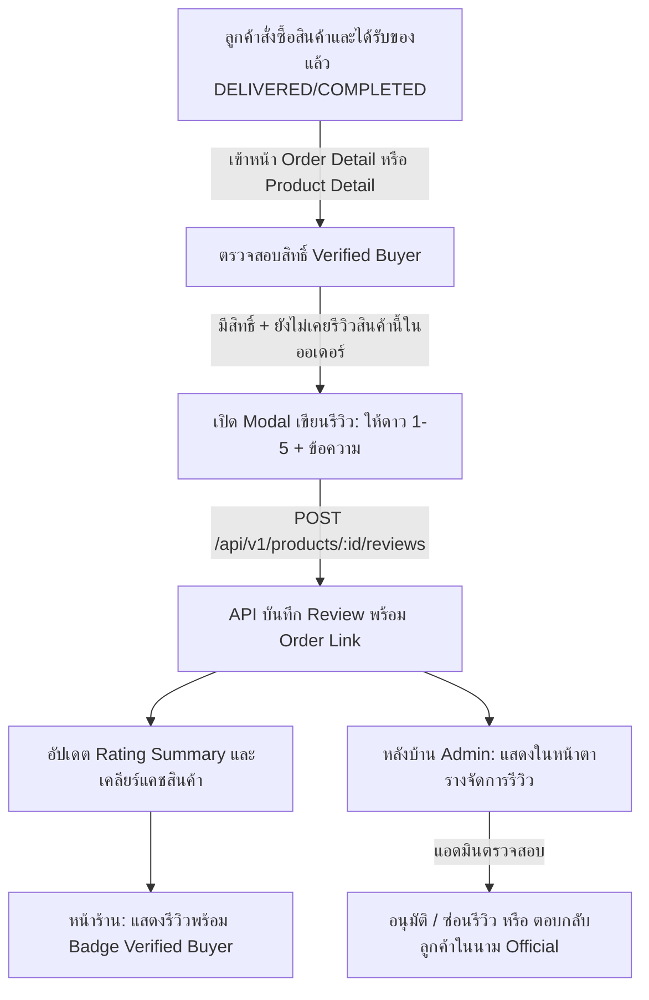

# ระบบรีวิวและให้คะแนนสินค้า (Product Reviews & Ratings) — Roadmap & TODO

เอกสารรวบรวมแผนงานการพัฒนา ขอบเขตความต้องการ และรายการสิ่งที่ต้องทำ (Actionable Checklist) สำหรับ **ระบบรีวิวและให้คะแนนสินค้า (Product Reviews & Ratings System)** ของ Nida Platform ครอบคลุมการแสดงผลรีวิวหน้าร้าน การให้คะแนน 1–5 ดาว การยืนยันสิทธิ์ผู้ซื้อจริง (Verified Buyer) และระบบตรวจสอบและตอบกลับของแอดมิน (Admin Moderation)

---

## 📊 สถานะภาพรวมของระบบ (System Status)

| ส่วนประกอบ / โมดูล | สถานะการพัฒนา | รายละเอียดความพร้อม |
| :--- | :---: | :--- |
| **Technical Specification** | ✅ พร้อม 100% | อ้างอิงเอกสาร [docs/specs/reviews.md](file:///Users/wiiznu/project/Nida_Project/docs/specs/reviews.md) |
| **Database Schema & Migration** | ✅ เสร็จสมบูรณ์ | ปรับปรุง Model `Review` เพิ่ม `orderId`, `title`, `adminReply`, `deletedAt`, `isVerifiedPurchase` พร้อมสร้าง Migration SQL เรียบร้อย |
| **Shared Contracts & Validators** | ⏳ รอดำเนินการ | ประกาศ DTO ใน `@repo/types` และ Zod Schema ตรวจสอบคะแนน 1–5 ดาวใน `@repo/validators` |
| **Storefront Backend Engine** | ⏳ รอดำเนินการ | โมดูล `reviews` ใน `apps/api`: คำนวณ Average Rating, สัดส่วนดาว, และ Guard `Verified Buyer` |
| **Admin Back-Office Backend** | ⏳ รอดำเนินการ | โมดูล `reviews` ใน `apps/admin-api`: ค้นหา, สลับสถานะ Approved/Hidden, ตอบกลับรีวิว, และ Audit Logging |
| **Storefront UI & Modal** | ⏳ รอดำเนินการ | ส่วนแสดงรีวิวในหน้าสินค้า (`apps/store`), แถบสัดส่วนดาว, และ Modal เขียนรีวิว (`WriteReviewModal`) |
| **Admin Back-Office UI** | ⏳ รอดำเนินการ | เมนูและหน้าจัดการรีวิว (`apps/admin/src/pages/AdminReviews.tsx`) และ Modal ตอบกลับลูกค้า |
| **Unit Tests & Integrity Verification** | ⏳ รอดำเนินการ | ทดสอบการคำนวณคะแนนเฉลี่ย, ป้องกันการรีวิวซ้ำ, Verified Buyer Guard, และ Admin Moderation 100% |

---

## 🎯 แผนภาพการทำงานของระบบ (System Flow)

---

## 📋 แผนงานสิ่งที่ต้องทำตามลำดับขั้นตอน (Actionable Roadmap)

### เฟส 1: โครงสร้างฐานข้อมูลและการย้ายข้อมูล (Database Schema & Migration)
> **เป้าหมาย**: ปรับปรุงโมเดล `Review` ใน `packages/database/prisma/schema.prisma` ให้รองรับ Verified Buyer และการตอบกลับของแอดมิน พร้อมสร้างไฟล์ SQL Migration

- [x] **Prisma Model `Review` Enhancement**:
  - [x] เพิ่ม `orderId`: เชื่อมกับ `Order?` (`@map("order_id") @db.Uuid`)
  - [x] เพิ่ม `title`: หัวข้อรีวิว (`@db.VarChar(150)?`)
  - [x] เพิ่ม `isVerifiedPurchase`: ยืนยันผู้ซื้อจริง (`@default(false) @map("is_verified_purchase")`)
  - [x] เพิ่ม `adminReply`: ข้อความตอบกลับของแอดมิน (`@map("admin_reply") @db.Text?`)
  - [x] เพิ่ม `repliedAt`: วันที่ตอบกลับ (`@map("replied_at")`)
  - [x] เพิ่ม `repliedBy`: แอดมินผู้ตอบกลับ (`@map("replied_by") @db.Uuid?`)
  - [x] เพิ่ม `deletedAt`: รองรับ Soft Delete สำหรับ PDPA และ Admin Moderation (`@map("deleted_at")`)
  - [x] ปรับปรุง Index: `@@index([productId, isApproved, deletedAt, createdAt(sort: Desc)])`
  - [x] เพิ่ม Index: `@@index([userId, deletedAt])`
  - [x] เพิ่ม Unique Constraint: `@@unique([productId, userId, orderId])` ป้องกันลูกค้ารีวิวซ้ำในออเดอร์เดียวกัน
- [x] **Migration & Client Generation**:
  - [x] สร้างไฟล์ Migration SQL: `packages/database/prisma/migrations/20261104034000_enhance_review_model/migration.sql`
  - [x] รัน `npm --prefix packages/database run db:generate`

---

### เฟส 2: กำหนด Contract และ Zod Validators ส่วนกลาง (`@repo/types`, `@repo/validators`)
> **เป้าหมาย**: สร้าง Single Source of Truth สำหรับ Review Entities, API Payloads, และการตรวจสอบความถูกต้องของข้อมูล

- [ ] **`packages/types`**:
  - [ ] สร้าง `packages/types/src/common/review.types.ts`:
    - `ApiReview`: ข้อมูลรีวิว, ผู้รีวิว (`authorName`), คะแนนดาว, ข้อความ, สถานะ Verified Buyer, และคำตอบกลับแอดมิน
    - `ApiRatingSummary`: คะแนนเฉลี่ย (`averageRating`), จำนวนรีวิวรวม (`totalReviews`), สัดส่วนดาว (`breakdown: Record<1|2|3|4|5, number>`)
    - `CreateReviewDto`: Payload สำหรับการส่งรีวิว (`orderId`, `rating`, `title`, `reviewText`)
    - `AdminReviewFilterDto` & `AdminReplyReviewDto`
  - [ ] Export ผ่าน `packages/types/src/common/index.ts` และรัน `npm --prefix packages/types run build`
- [ ] **`packages/validators`**:
  - [ ] สร้าง `packages/validators/src/customer/review.ts`:
    - `createReviewSchema`:
      - `orderId`: UUID format
      - `rating`: ตัวเลขจำนวนเต็ม 1 ถึง 5 (`z.number().int().min(1).max(5)`)
      - `title`: ตัวอักษรความยาว 2 ถึง 150 ตัวอักษร (Optional)
      - `reviewText`: ตัวอักษรความยาว 10 ถึง 1,000 ตัวอักษร
    - `adminReplyReviewSchema`: ตัวอักษรความยาว 2 ถึง 1,000 ตัวอักษร
  - [ ] Export ผ่าน `packages/validators/src/customer/index.ts` และรัน `npm --prefix packages/validators run build`

---

### เฟส 3: เครื่องยนต์รีวิวและคำนวณคะแนนฝั่งหน้าร้าน (`apps/api`)
> **เป้าหมาย**: API สำหรับดึงรีวิวสินค้า คำนวณสถิติดาว และ Guard ตรวจสอบสิทธิ์ผู้ซื้อจริง

- [ ] **โมดูล `apps/api/src/modules/reviews/`**:
  - [ ] สร้าง `reviews.service.ts`:
    - `getProductReviews(productId, page, limit, starFilter)`: ดึงรีวิวที่ `isApproved = true` พร้อมคำนวณ `ApiRatingSummary`
    - `createReview(userId, productId, dto)`:
      - **Verified Buyer Guard**: ตรวจสอบว่า `orderId` เป็นของลูกค้าจริง ออเดอร์มีสถานะ `DELIVERED` หรือ `COMPLETED` และมีสินค้าดังกล่าวอยู่ในออเดอร์
      - ตรวจสอบไม่ให้ส่งรีวิวซ้ำสำหรับสินค้าเดิมในออเดอร์เดียวกัน
      - ล้างแคช Redis ของ Product Detail เมื่อมีรีวิวใหม่
    - `getEligibleItemsForReview(userId)`: ค้นหาสินค้าจากออเดอร์ที่จัดส่งสำเร็จแล้วและยังไม่เคยรีวิว
  - [ ] สร้าง `reviews.controller.ts`:
    - `GET /api/v1/products/:id/reviews` (Public)
    - `GET /api/v1/customer/reviews/eligible` (Customer JWT Guard)
    - `POST /api/v1/products/:id/reviews` (Customer JWT Guard + Zod Validation)
    - `DELETE /api/v1/customer/reviews/:id` (Customer JWT Guard: สิทธิ์ลบรีวิวของตนเอง + คำนวณคะแนนใหม่)
  - [ ] ลงทะเบียนโมดูลใน `app.module.ts`
- [ ] **ปรับปรุง `catalog.service.ts`**:
  - [ ] คำนวณค่า `rating` เฉลี่ยจริง และนับ `reviewsCount` จากเฉพาะรีวิวที่ `isApproved = true` และ `deletedAt IS NULL`
  - [ ] ลบตัวเลขหลอก/สมมติทั้งหมด

---

### เฟส 4: ระบบจัดการและตรวจสอบรีวิวฝั่งหลังบ้าน (`apps/admin-api`)
> **เป้าหมาย**: API สำหรับแอดมินในการค้นหา อนุมัติ ซ่อน ตอบกลับ และลบรีวิวลูกค้า พร้อมเก็บบันทึก Audit Trail

- [ ] **โมดูล `apps/admin-api/src/modules/reviews/`**:
  - [ ] สร้าง `admin-reviews.service.ts`:
    - `getReviews(query)`: Pagination, Search (ชื่อลูกค้า, สินค้า, ข้อความ), Filter ตามดาว และสถานะ
    - `toggleReviewStatus(id, isApproved, adminId)`: สลับสถานะเปิด/ปิดการแสดงผลรีวิว พร้อมบันทึก `admin_audit_logs`
    - `replyToReview(id, replyText, adminId)`: บันทึกคำตอบกลับในนามแบรนด์ NIDA พร้อมบันทึก `admin_audit_logs`
    - `deleteReview(id, adminId)`: ลบรีวิวที่เป็นสแปม/ผิดกฎ พร้อมบันทึก `admin_audit_logs` และคำนวณคะแนนสินค้าใหม่
  - [ ] สร้าง `admin-reviews.controller.ts`:
    - `GET /api/v1/admin/reviews` (สิทธิ์ `CATALOG_READ`)
    - `PATCH /api/v1/admin/reviews/:id/status` (สิทธิ์ `CATALOG_WRITE`)
    - `POST /api/v1/admin/reviews/:id/reply` (สิทธิ์ `CATALOG_WRITE`)
    - `DELETE /api/v1/admin/reviews/:id` (สิทธิ์ `CATALOG_WRITE`)
  - [ ] ลงทะเบียนโมดูลใน `apps/admin-api/src/app.module.ts`

---

### เฟส 5: พัฒนาหน้าจอผู้ใช้ทั้งหน้าร้านและหลังบ้าน (`apps/store` & `apps/admin`)
> **เป้าหมาย**: สร้าง UI ประณีตมาตรฐาน Editorial Luxury โดยไม่มี Emoji ใน UI

- [ ] **หน้าร้าน (`apps/store`)**:
  - [ ] แก้ไข `ProductInfo.tsx`: ลบ Fallback `|| 4.9` และ `|| 128` ออก แสดงคะแนนจริงหรือข้อความ "ยังไม่มีรีวิว"
  - [ ] สร้างคอมโพเนนต์ย่อยใน `apps/store/src/components/product/reviews/`:
    - `ProductReviewsSection.tsx`: วางใต้รายละเอียดสินค้า
    - `RatingSummaryCard.tsx`: สรุปตัวเลขคะแนนใหญ่ (เช่น `4.8 / 5.0`), ดาว Lucide, และ Bar สัดส่วนดาว 1-5
    - `ReviewList.tsx` & `ReviewItemCard.tsx`: แสดงรายการรีวิว, ชื่อแบบ Masked (`Kallaya W.`), Badge `Verified Buyer`, ข้อความรีวิว, คำตอบกลับแบรนด์, และปุ่มลบรีวิวของตนเอง
    - `WriteReviewModal.tsx`: ฟอร์มให้ดาว 1-5 และกรอกข้อความ
  - [ ] หน้าประวัติคำสั่งซื้อ (`/profile/orders/[orderNumber]`):
    - เพิ่มปุ่ม "เขียนรีวิวสินค้า" ข้างรายการสินค้าที่สถานะเป็น `DELIVERED`/`COMPLETED`
  - [ ] รองรับ i18n 2 ภาษา (`th.json`, `en.json`) ใต้คีย์ `product.reviews.*`
- [ ] **หลังบ้าน (`apps/admin`)**:
  - [ ] เพิ่มเมนู **Product Reviews** ใน `AdminSidebar.tsx` (ใต้หมวด `nav.catalogInventory`)
  - [ ] สร้างหน้า `apps/admin/src/pages/AdminReviews.tsx`:
    - ตารางรีวิว: สินค้า, ผู้รีวิว, ดาว, ข้อความ, สถานะ Approved/Hidden
    - ฟิลเตอร์ค้นหาและกรองตามคะแนนดาว
    - Modal ตอบกลับลูกค้า (`AdminReviewReplyModal.tsx`)
    - สลับสถานะเปิด/ปิดรีวิวได้ทันที และปุ่มลบรีวิวพร้อม Modal ยืนยัน
  - [ ] รองรับ i18n 2 ภาษาใน `apps/admin/src/locales/`

---

### เฟส 6: การทดสอบและความสมบูรณ์ของระบบ (Testing & Verification)
> **เป้าหมาย**: ครอบคลุม 100% ตาม Mandatory Feature Unit Testing Policy

- [ ] **Unit Tests (`apps/api/test/reviews/reviews.service.spec.ts`)**:
  - [ ] ทดสอบการคำนวณ Average Rating และ Star Breakdown สัดส่วนดาว 1–5
  - [ ] ทดสอบ Verified Buyer Guard (ปฏิเสธหากไม่มี Order หรือ Order ยังไม่ Delivered)
  - [ ] ทดสอบการป้องกันส่งรีวิวซ้ำในออเดอร์เดิม
  - [ ] ทดสอบการลบรีวิวของลูกค้า (Customer Delete Own Review Guard: ปฏิเสธหากไม่ใช่เจ้าของ)
  - [ ] ทดสอบการ Re-calculate คะแนนดาวเมื่อรีวิวถูกลบ
  - [ ] ทดสอบการ Masking ชื่อผู้รีวิว (PDPA Compliance)
- [ ] **Unit Tests (`apps/admin-api/test/reviews/admin-reviews.service.spec.ts`)**:
  - [ ] ทดสอบการดึงรายการและการกรองสถานะ
  - [ ] ทดสอบการ Toggle Status และบันทึก Audit Log
  - [ ] ทดสอบการตอบกลับรีวิว (Admin Reply)
  - [ ] ทดสอบการลบรีวิวโดยแอดมิน และการบันทึก Audit Log พร้อม Snapshot ข้อความเดิม
- [ ] **Monorepo Build Verification**:
  - [ ] คอมไพล์ผ่านทุกแพ็กเกจ: `@repo/types`, `@repo/validators`, `apps/api`, `apps/admin-api`, `apps/admin`, `apps/store`
  - [ ] รัน Unit Tests ทุกชุดผ่าน 100%

