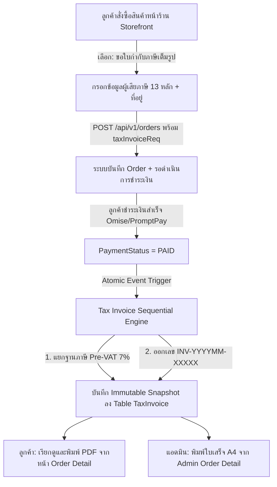

# ระบบออกใบเสร็จรับเงิน / ใบกำกับภาษีเต็มรูปแบบ (Tax Invoicing & Receipts) — Roadmap & TODO

เอกสารรวบรวมแผนงานการพัฒนา ขอบเขตความต้องการ และรายการสิ่งที่ต้องทำ (Actionable Checklist) สำหรับ **ระบบออกใบเสร็จรับเงิน / ใบกำกับภาษีเต็มรูปแบบ (Full Tax Invoice & Receipt)** ของ Nida Platform ให้ถูกต้องตามประมวลรัษฎากรแห่งกรมสรรพากร (มาตรา 86/4) ครอบคลุมทั้งฝั่งหน้าร้าน (Storefront), ระบบประมวลผลคำนวณภาษีหลังบ้าน (Backend API), และระบบจัดการเอกสารพิมพ์ A4 ฝั่งแอดมิน (Admin Back-Office)

---

## 📊 สถานะภาพรวมของระบบ (System Status)

| ส่วนประกอบ / โมดูล | สถานะการพัฒนา | รายละเอียดความพร้อม |
| :--- | :---: | :--- |
| **Technical Specification** | ✅ พร้อม 100% | อ้างอิงเอกสาร [docs/specs/tax-invoice.md](file:///Users/wiiznu/project/Nida_Project/docs/specs/tax-invoice.md) |
| **Database Schema & Migration** | ✅ เสร็จสมบูรณ์ | เพิ่ม `TaxInvoice` Model, Enums และเชื่อม Relation 1-to-1 กับ `Order` พร้อม Migration SQL |
| **Shared Contracts & Validators** | ✅ เสร็จสมบูรณ์ | กำหนด DTO ใน `@repo/types` และ Zod Schema ตรวจสอบเลข 13 หลัก Mod 11 ใน `@repo/validators` |
| **Storefront Checkout Integration** | ✅ เสร็จสมบูรณ์ | แบบฟอร์มขอใบกำกับภาษีในขั้นตอนชำระเงิน (`TaxInvoiceFormSection.tsx`) พร้อมสลับ บุคคล/นิติบุคคล |
| **Backend Sequential Engine** | ✅ เสร็จสมบูรณ์ | รันเลขเอกสาร `INV-YYYYMM-XXXXX` อัตโนมัติเมื่อออเดอร์ชำระเงินสำเร็จ (`PAID`) ทั้ง Customer และ Admin |
| **Storefront Document Download** | ✅ เสร็จสมบูรณ์ | หน้าประวัติออเดอร์ให้ลูกค้าเรียกดูและสั่งพิมพ์ A4 PDF ได้ด้วยตนเอง (`CustomerTaxInvoiceModal.tsx`) |
| **Admin Document Printing** | ✅ เสร็จสมบูรณ์ | แท็บพิมพ์ใบเสร็จ/ใบกำกับภาษี A4 ในหน้า Admin Order Detail (`OrderTaxInvoice.tsx`) พร้อมบันทึก Audit Log |
| **Unit Tests & Integrity Verification** | ✅ เสร็จสมบูรณ์ | ผ่านการทดสอบ Unit Test 100% (23/23 ใน Store API, 6/6 ใน Admin API) ครอบคลุมคำนวณฐานภาษี VAT 7% |

---

## 🎯 แผนภาพสถาปัตยกรรมและการไหลของข้อมูล (System Architecture & Flow)

---

## 📋 แผนงานสิ่งที่ต้องทำตามลำดับขั้นตอน (Actionable Roadmap)

### เฟส 1: โครงสร้างฐานข้อมูลและการย้ายข้อมูล (Database Schema & Migration)
> **เป้าหมาย**: สร้างตาราง `TaxInvoice` พร้อม Enum และ Foreign Key ใน `packages/database/prisma/schema.prisma` พร้อมไฟล์ Migration แท้จริง

- [x] **Prisma Enums**:
  - [x] `TaxInvoicePayerType`: `PERSONAL` (บุคคลธรรมดา), `COMPANY` (นิติบุคคล)
  - [x] `TaxInvoiceBranchType`: `HEADQUARTERS` (สำนักงานใหญ่), `BRANCH` (สาขา)
- [x] **Prisma Model `TaxInvoice`**:
  - [x] `id`: UUIDv7 (`@id @default(uuid(7)) @db.Uuid`)
  - [x] `orderId`: UUIDv7 เชื่อม 1-to-1 กับ `Order` (`@unique @map("order_id")`)
  - [x] `invoiceNumber`: รหัสใบกำกับภาษี (`@unique @map("invoice_number") @db.VarChar(50)`)
  - [x] `payerType`: `TaxInvoicePayerType`
  - [x] `taxId`: เลขประจำตัวผู้เสียภาษีอากร 13 หลัก (`@map("tax_id") @db.VarChar(20)`)
  - [x] `name`: ชื่อบุคคลธรรมดา หรือ ชื่อบริษัท/นิติบุคคล (`@db.VarChar(255)`)
  - [x] `branchType`: `TaxInvoiceBranchType?`
  - [x] `branchCode`: รหัสสาขา 5 หลัก เช่น `00000` (`@map("branch_code") @db.VarChar(10)?`)
  - [x] `address`: ที่อยู่จดทะเบียน / ที่อยู่ตามบัตรประชาชน (`@db.Text`)
  - [x] `subtotal`: ยอดรวมสินค้าก่อนหักส่วนลด (`@db.Decimal(12, 2)`)
  - [x] `discount`: ส่วนลดคูปอง/โปรโมชัน (`@default(0) @db.Decimal(12, 2)`)
  - [x] `shippingFee`: ค่าจัดส่ง (`@default(0) @db.Decimal(12, 2)`)
  - [x] `totalAmount`: ยอดชำระสุทธิรวม VAT (`@map("total_amount") @db.Decimal(12, 2)`)
  - [x] `preVatAmount`: มูลค่าก่อนภาษีมูลค่าเพิ่ม (`@map("pre_vat_amount") @db.Decimal(12, 2)`)
  - [x] `vatAmount`: ภาษีมูลค่าเพิ่ม 7% (`@map("vat_amount") @db.Decimal(12, 2)`)
  - [x] `itemsSnapshot`: JSON Snapshot รายการสินค้า ณ เวลาออกใบกำกับภาษี (`@map("items_snapshot") @db.JsonB`)
  - [x] `issuedAt`: วันที่ออกเอกสาร (`@default(now()) @map("issued_at")`)
- [x] **Migration & Client Generation**:
  - [x] สร้างไฟล์ Migration SQL: `packages/database/prisma/migrations/<timestamp>_add_tax_invoice_model/migration.sql`
  - [x] รัน `npm --prefix packages/database run db:generate`
  - [x] อัปเดต Prisma Mock ใน Test Suite ของทั้งสอง API

---

### เฟส 2: กำหนด Contract และ Zod Validators ส่วนกลาง (`@repo/types`, `@repo/validators`)
> **เป้าหมาย**: รักษาความปลอดภัยของข้อมูลตามกฎ Single Source of Truth โดยเขียน Zod Schema ตรวจสอบความถูกต้องของเลขประจำตัวผู้เสียภาษีและข้อมูลสาขา

- [x] **`packages/types`**:
  - [x] ประกาศ Interface `TaxInvoice`, `TaxInvoicePayerType`, `TaxInvoiceBranchType`
  - [x] ประกาศ Request Payload `CreateTaxInvoiceRequestDto`
  - [x] ประกาศ Response Contract `TaxInvoiceResponseDto`
  - [x] Export ผ่าน `packages/types/src/index.ts` และรัน `npm --prefix packages/types run build`
- [x] **`packages/validators`**:
  - [x] ฟังก์ชันคำนวณ Checksum เลขประจำตัวผู้เสียภาษี 13 หลัก (Mod 11 Algorithm)
  - [x] Zod Schema `taxInvoiceRequestSchema`:
    - ตรวจสอบ `payerType`: `PERSONAL` vs `COMPANY`
    - ตรวจสอบ `taxId`: 13 หลัก ตัวเลขล้วน และผ่าน Checksum Algorithm
    - กรณี `COMPANY`: บังคับระบุ `branchType` และถ้าเป็น `BRANCH` ต้องมี `branchCode` 5 หลัก
    - ตรวจสอบ `address`: ความยาวขั้นต่ำ 10 ตัวอักษร
  - [x] รวม `taxInvoice` เข้ากับ `checkoutOrderSchema` (Optional field)
  - [x] Export ผ่าน `packages/validators/src/index.ts` และรัน `npm --prefix packages/validators run build`

---

### เฟส 3: หน้าร้านค้า — เช็คเอาต์และแบบฟอร์มขอใบกำกับภาษี (`apps/store`)
> **เป้าหมาย**: ให้ลูกค้าหน้าร้านสามารถเลือกขอรับใบกำกับภาษีเต็มรูปได้สะดวกรวดเร็วตามมาตรฐาน Editorial Luxury

- [x] **Component สถาปัตยกรรมย่อยใน `apps/store/src/components/checkout/`**:
  - [x] สร้าง `TaxInvoiceFormSection.tsx`:
    - Switch / Checkbox: "ขอรับใบเสร็จรับเงิน/ใบกำกับภาษีเต็มรูปแบบ (Full Tax Invoice)"
    - Radio Selector: "บุคคลธรรมดา (Personal)" vs "นิติบุคคล (Corporate / Company)"
    - ช่องกรอก:
      - บุคคล: ชื่อ-นามสกุล, เลขบัตรประชาชน 13 หลัก, ที่อยู่ตามทะเบียนบ้าน
      - นิติบุคคล: ชื่อบริษัท/ห้างหุ้นส่วน, เลขประจำตัวผู้เสียภาษี 13 หลัก, สำนักงานใหญ่ / สาขา, รหัสสาขา 5 หลัก, ที่อยู่จดทะเบียน
    - Checkbox: "ใช้ที่อยู่เดียวกันกับที่อยู่จัดส่ง" (Auto-fill sync)
- [x] **Internationalization (i18n)**:
  - [x] เพิ่มคำแปลครบถ้วนใน `apps/store/src/locales/th.json` และ `en.json` (Zero Emojis, Editorial Tone)
- [x] **Checkout Submission**:
  - [x] แนบ Payload `taxInvoice` ส่งต่อไปยัง API `POST /api/v1/orders`

---

### เฟส 4: เครื่องยนต์คำนวณภาษีและออกเลขเอกสารอัตโนมัติ (`apps/api`)
> **เป้าหมาย**: ออกเลขเอกสารตามลำดับ (Sequential) ที่ไม่ซ้ำซ้อน และคำนวณฐานภาษี VAT 7% ตามประมวลรัษฎากร ม.86/4

- [x] **Sequential Numbering Generator (`TaxInvoiceService`)**:
  - [x] ฟอร์แมต: `INV-YYYYMM-XXXXX` (เช่น `INV-202611-00001`)
  - [x] รับประกันความต่อเนื่องและป้องกัน Race Condition ด้วย Atomic Counter (Redis / Postgres Transaction)
- [x] **VAT Calculation Engine**:
  - [x] สูตรแยกฐานภาษี:
    $$\text{Pre-VAT Base} = \text{Total} / 1.07$$
    $$\text{VAT Amount} = \text{Total} - \text{Pre-VAT Base}$$
  - [x] ปัดเศษ 2 ตำแหน่งสากล (`Half-Up Rounding`)
- [x] **Trigger Lifecycle**:
  - [x] เมื่อ Order ถูกเปลี่ยนสถานะเป็น `PAID` (หลังชำระผ่าน Omise / Credit Card / PromptPay สำเร็จ) ➔ หากมีคำขอใบกำกับภาษี ให้ทำการ Generate และบันทึก `TaxInvoice` ทันที
- [x] **API Endpoints สำหรับหน้าร้าน**:
  - [x] `GET /api/v1/orders/:orderNumber/tax-invoice`: ดึงข้อมูลใบกำกับภาษีเฉพาะออเดอร์ของตนเอง (Customer Auth Guard)

---

### เฟส 5: แสดงผลและพิมพ์เอกสารทั้งหน้าร้านและหลังบ้าน (`apps/store` & `apps/admin`)
> **เป้าหมาย**: เอกสารพิมพ์ A4 ที่จัดเลย์เอาต์ประณีตตามแบบฟอร์มสรรพากร ถูกต้องตามมาตรฐาน Editorial Luxury

- [x] **Storefront Customer Portal (`apps/store`)**:
  - [x] เพิ่มปุ่ม "ดาวน์โหลด / พิมพ์ใบกำกับภาษี" ในหน้าประวัติออเดอร์ (`/profile/orders/[orderNumber]`)
  - [x] สร้าง Modal / Printable View (`CustomerTaxInvoiceModal.tsx`) รองรับ `@media print` สำหรับกระดาษ A4
- [x] **Admin Back-Office Portal (`apps/admin`)**:
  - [x] เพิ่มปุ่ม "พิมพ์ใบกำกับภาษี (Tax Invoice)" ในหน้า Admin Order Detail (`/admin/orders/[id]`)
  - [x] สร้าง `OrderTaxInvoice.tsx` ใน `apps/admin/src/components/order/print/`
  - [x] รองรับการแสดงผล:
    - ตราสัญลักษณ์และข้อมูลบริษัท NIDA
    - เลขประจำตัวผู้เสียภาษี 13 หลักของบริษัท
    - ข้อมูลผู้ซื้อ (บุคคลธรรมดา หรือ นิติบุคคล + สำนักงานใหญ่/สาขา)
    - รายการสินค้า, ราคาต่อหน่วย, ส่วนลด, ค่าส่ง
    - สรุปยอด: มูลค่าสินค้าก่อน VAT, ภาษีมูลค่าเพิ่ม 7%, และยอดสุทธิ
  - [x] รองรับคำสั่งพิมพ์ของเบราว์เซอร์ (`window.print()`) จัดหน้ากระดาษ A4 สวยงาม ขอบกระดาษพอดี
- [x] **Admin Security & Audit Trail**:
  - [x] ผูก Guard สิทธิ์ `ORDERS_READ`
  - [x] บันทึก `admin_audit_logs` ทุกครั้งที่มีการสั่งพิมพ์หรือเปิดดูใบกำกับภาษีของลูกค้า

---

### เฟส 6: การทดสอบและความสมบูรณ์ของระบบ (Testing & Verification)
> **เป้าหมาย**: ครอบคลุม 100% ตามข้อกำหนด Mandatory Feature Unit Testing Policy

- [x] **Unit Tests (`apps/api/test/orders/tax-invoice.spec.ts`)**:
  - [x] ทดสอบสูตรคำนวณ VAT 7% ยอดต่างๆ (ยอดลงตัว, ยอดมีเศษสตางค์, ยอดมีส่วนลดคูปอง)
  - [x] ทดสอบการตรวจสอบเลข 13 หลัก (Mod 11 Checksum: Valid, Invalid, Bad Length)
  - [x] ทดสอบการออกเลข `INV-YYYYMM-XXXXX` อัตโนมัติและไม่ซ้ำกัน
  - [x] ทดสอบ Security Guard: ลูกค้าคนอื่นไม่สามารถดึงใบกำกับภาษีของผู้อื่นได้
- [x] **Unit Tests (`apps/admin-api/test/orders/admin-tax-invoice.spec.ts`)**:
  - [x] ทดสอบ Admin Endpoint และการบันทึก Audit Log
- [x] **Monorepo Build Verification**:
  - [x] `npm --prefix packages/types run build`
  - [x] `npm --prefix packages/validators run build`
  - [x] `npm --prefix apps/api run build`
  - [x] `npm --prefix apps/admin-api run build`
  - [x] `npm --prefix apps/admin run build`
  - [x] `npm --prefix apps/store run build`
  - [x] รันการทดสอบ Unit Tests ทั้งหมดต้องผ่าน 100%

